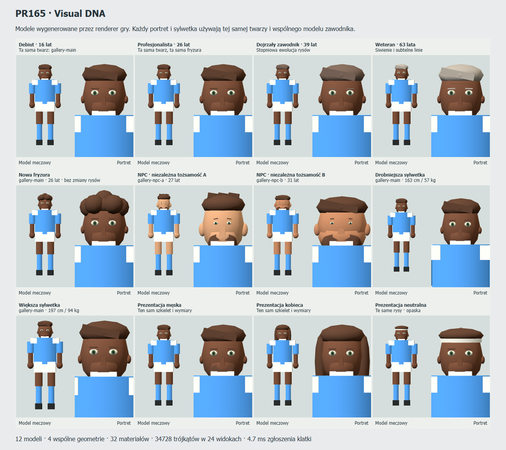

# PR165 — Visual DNA & Character Creator

Base: merged PR164, main `4f08a37b83067c5bd8e59fb297ab6156ef0fe86e`.
One versioned identity now drives the protagonist, NPCs, pitch bodies, portraits,
creator and career profile. Appearance ages from the calendar and stores compact
cosmetics independently of canonical football. Targeted wall preparation and
post-goal logistics repairs accompany bounded tactical experiments.

## Work stages and acceptance

1. Read current identity, world, aging, persistence, career contracts, rig/replay and
   restart/AI architecture; preserve existing IDs, lazy loading and roadmap.
2. Reproduce late free-kick preparation using packed deterministic geometry at the
   reported spot, prove the failure against clean main, repair its owning geometry.
3. Split goalkeeper retrieval from outfield transport using a continuous stoppage
   handover; verify both goals, urgency, statistics, kickoff and back-net movement.
4. Run matched passing and isolated hybrid-marking diagnostics. Ship no broad tactical policy.
5. Add v1 Visual DNA, calendar aging, compact persistence/presentation context,
   shared procedural rig/portraits, creator and career cosmetic editor.
6. Compare actual production transfer and 22-model rendering against rebuilt main;
   inspect actual Edge output, run complete verification and publish one PR165.

## Match integrity — questions 1–7

1. **Cause:** the equivalent fixture proves a geometry/collision deadlock, separate
   from PR164's released-shot ownership bug. `spreadCluster` displaced law-critical
   wall slots toward nearby marking bodies. Repeated separation sustained wall
   movement above the 0.5 m/s readiness limit even after ball placement.
2. **Reconstruction:** the historical `lab-mv47opno-benchmark-sesji.json` was absent.
   This is an equivalent fixture, not an exact exported-state replay. It uses the
   reported clubs, seed and `(78.775, 23.418)` spot at 58:49, with reproducible
   packed positions from `pr165-packed-7` and regenerated native XI. This does
   not claim the exported formations, lineup or controlled player's exact position.
   Human ownership cases nominate the actual taker. The historical cause remains unconfirmed.
3. **Failed condition:** `wall_developing`; retrieval had reached `placed`.
   Before/after snapshots include wall position, assigned/planned target, speed
   and nearest-body clearance. No earlier debug window was treated as onset evidence.
4. **Legal completion:** clean main stalls all four mirrored human/CPU cases for
   the full 60 s observation window; PR165 releases all four after 8.575–8.600 s.
   Fixed wall slots survive target separation, other intentions move around them,
   and existing movement/ball/law/referee checks remain authoritative. Human input
   freezes the clock before explicit selection; actual flight must move afterward.
5. **Keeper excursion:** nearest-teammate retrieval implicitly also owned the full
   journey. In ordinary goal fixtures the keeper reached 53.49/53.52 m own depth.
   The keeper can still fetch the real ball, while a suitable nearby outfielder
   receives a short modeled transfer and owns midfield transport.
6. **Transfer/accounting:** `approach → transport → handoff → transfer → transport
   → placed` uses the one real ball. A nearby handover or short rolling path advances
   every 25 ms at up to 4 m/s; it is explicitly stoppage logistics, not a competitive
   pass. No touch, pass, shot, interception duel, attacking possession or football
   RNG is generated. Only the nominated taker's legal kickoff adds one pass attempt.
7. **Keeper responsibility:** ordinary fixtures now peak at 5.43 m own depth and
   restart in their normal goal area, completing after 29.05/30.55 s versus
   42.025/42.400 s. Urgent retrieval still completes in 23.325/24.100 s. Back-net
   tests caught a separate 1.28 m body snap at handoff: an already outside keeper
   now returns through locomotion instead of being clamped to the line. Both sides
   assert per-tick body/ball continuity and a successful legal kickoff.

The 1 Hz liveness observer retains 12 successful phase/retrieval transitions and
32 diagnostics, recording selected target/source, exact blockers, legal/tactical
readiness, assigned and legal targets, remaining distance and nearest-body clearance.
It only observes; it never overrides a law, human choice or canonical outcome.
Scored-ball incident coordinates use the existing finite physical-point schema;
the legal kickoff spot remains pitch bounded.

[Before/after integrity receipt](performance/PR165-integrity.json).
Regression suites: `pr165RestartIntegrity.test.ts` and `pr165GoalLogistics.test.ts`.

## Visual identity — questions 15–25

15. **Every footballer:** unedited profiles resolve v1 from `footballer:<id>`.
    Protagonist, old/new NPC, future intake, substitutes and retired profiles reuse
    their existing footballer ID. No duplicate Person database is created.
16. **Existing types:** the shared resolver reuses all 17 FaceGenome fields and
    accepts existing Person.faceSeed/faceGenome. Optional FootballerProfile.visualIdentity
    stores version, seed, deliberate initial face and cosmetic overrides.
17. **Creator:** identity → football profile → appearance → archetype. Presets,
    palette/style choices, optional advanced facial controls, portrait/full preview
    and deterministic reset preserve existing football creation and navigation.
18. **Career editing:** player profile → “Zmień wygląd” edits hair, colour, facial
    hair, accessories and presentation. Explicit save uses the existing career
    commit/storage path; the face is retained. Edge verified edit → save → reload.
19. **Aging:** canonical DOB/date drives restrained maturation, lines and greying.
    Head/chin changes are small; the stable face seed and jaw/eye/nose/mouth identity
    survive. Gallery shows the same person at 16, 26, 39 and 63.
20. **Annual development:** stored choices survive actual season rollover and
    serialization; age appearance is derived, never randomly rerolled each year.
21. **NPC consistency:** the same stable profile ID/date resolves identically
    across loads, careers and fixtures. Different IDs produce varied faces.
    Names, nationality and match seed do not choose cosmetic presentation.
22. **Shared model:** one `buildParametricHead` extends the existing articulated
    PlayerModel. Pitch and portrait use the same face, kit and body dimensions;
    only camera/detail context differs. Structural anatomy comparisons cover this.
23. **Cosmetic presentation:** masculine/feminine/neutral styling shares the rig.
    Canonical profiles omit appearance; a custom face/hair/feminine edit produces
    byte-identical final canonical states after 1200 real ticks. Attributes, RNG,
    match colliders/contact, development and opportunity rules are unchanged.
24. **Older saves:** save version remains 7 with an optional validated field.
    Existing v3–v7 migration tests preserve ID, derive the same fallback look and
    add no NPC visual records. Existing persistence/replay regressions remain binding.
25. **Future contexts:** the same resolver/model family can serve news, awards,
    cinematics and national rosters by reusing the profile ID. No national-team
    engine or ceremony was added; reuse of a national-role reference is structural.

`SingleMatchSession.presentation` contains date and only manually edited identities.
PR164's optional `presentation.visualContext` stays outside canonical hashes/data;
XI, bench and replay participants reconstruct from IDs and recorded DOB/age.
Match-result application does not overwrite identity. The profile change summary
keeps eight style fingerprints and counts distinct changes at most once per seven
career days; this is bounded future achievement data, not an achievement engine.

## Performance — questions 26–32

Actual Edge 153.0.4234.32, Radeon 780M/ANGLE D3D11. Production transfer uses
loopback HTTP with Brotli quality 11 and CDP encoded response bytes, including
response overhead. Hosting headers/latency are not inferred from this local policy.
Creator/world loading can overlap after navigation. “First playable match” below
is incremental after creating the career and opening its portrait in this sequence.

| Measurement | Rebuilt main | PR165 |
| --- | ---: | ---: |
| Cold start response bytes | 117,260 | 115,864 |
| First creator response bytes | 44,936 | 46,598 |
| First portrait incremental bytes | 0 (feature absent) | 172,083 |
| First playable match incremental bytes | 257,949 | 97,976 |
| 22-model generation CPU ms | 3.4 | 6.2 |
| 22-model warmed render submission median / p95 ms | 1.2 / 2.2 | 1.9 / 2.9 |
| Draw calls / triangles for 22 bodies | 459 / 14,104 | 835 / 37,248 |
| Shared geometry buffer bytes / geometry count | 6,616 / 4 | 6,616 / 4 |

26. **Initial download:** -1,396 bytes in this same-policy comparison;
    no eager Three.js/model resource request on the start screen. This is a small
    bundling/transfer difference, not a promised network-speed improvement.
27. **First preview:** 172,083 incremental bytes for lazy renderer code;
    the first actual 12-model/24-view gallery submission took 30.8 ms.
    Simple preview reports shared geometry/draw counts. Timings that include
    network-idle waits are not labeled as pure UI render time.
28. **22 distinct bodies:** see the matched standalone camera/lighting/viewport table.
    Both share four geometries and zero textures; PR165 uses 27 materials/two
    programs. The measured 6,616 geometry bytes exclude framebuffer/driver/VRAM
    allocations. CPU submissions and RAF cadence are measured, not GPU duration
    or whole-match FPS; stadium, overlays and physics are absent from this harness.
29. **Second match:** zero additional JS/model/world asset bytes in both versions.
    The recorded 344 current bytes are a favicon request; they are not
    redundant model download. Gallery code loaded on demand adds 3176 bytes later.
30. **Save impact:** starter career 3819 UTF-8 bytes; cosmetic edit
    4159 (+340); deliberate custom face
    4525 (+706). 0 ordinary NPC profiles store a visualIdentity
    field. This measures a new compact career, not a long rich-result archive.
31. **Bounds:** presentation cache 64 identities, material cache 128 entries per
    renderer, shared procedural primitives and no raster portrait cache. Preview
    instances release owned renderer/geometry/material/context resources on unmount;
    requesting the same NPC resolves its parameters without generating new hair.
    4,400 identity derivations take 13.6 ms local Node;
    22-player projection 1.48 ms cold and 0.06 ms cached per frame.
32. **Headless independence:** cosmetic/no-cosmetic 1200-tick final states are byte
    identical. Three warmed paired Node medians are 877.77 vs
    862.32 ms, normal timing noise rather than a speedup claim.
    Rendering is outside the canonical engine; full-fixture contract tests check
    complete match determinism separately.

[Browser transfer/preview receipt](performance/PR165-browser.json),
[matched model render receipt](performance/PR165-model-render.json),
[identity/save/headless receipt](performance/PR165-visual-identity.json).

## Actual visual acceptance

The small gallery is rendered by the implemented Three.js models, not concept art.
It includes the same player at four ages, a haircut, unrelated NPCs, varied body
dimensions, three cosmetic presentations, and each pitch model beside its portrait.
Open `?devtools=1&visualGallery=1` for the live implementation. Native Edge creator
and profile screenshots were also inspected; edit/save/reload completed with no
page errors. No commercial footballer likeness or external image/model asset exists.

## Verification and remaining scope

**Final npm run verify: PASS. 1631 tests across 4 serial suites; ESLint, TypeScript and production build pass.**
Receipt: [PR165-verification.json](performance/PR165-verification.json).
Targeted restart checks pass 40 tests including PR159 continuity, PR164 release/
human choice, new late free kick, keeper logistics and both deep-back-net regressions.
The existing test timeouts were retained; an earlier sandbox-focused whole-half
test timed out during concurrent work, and the ordinary native full pipeline passed
that same integration suite. No test was weakened or skipped from `verify`.

The deferred renderer bundle still exceeds the existing 500 kB warning threshold;
Vite also reports the existing static/dynamic careerStorage overlap. Driver VRAM,
full-stadium GPU timings and whole-match FPS are not claimed by the model harness.
The historical free-kick checkpoint remains unavailable. Tactical population
calibration, sparse shots and logical-ID asymmetry are still open.

PR166 integration/playstyles, PR167 NPC diversity, PR168 coaches, PR169 narratives
and PR170 atmosphere retain their planned numbers. A dedicated later tactical
scope should cover dynamic interception forecasting, reception retention/next action,
second-ball value, persistent threat handoffs, DM/fullback cover replacement and
line integrity, after those planned identity/career milestones.

## Tactical diagnostics — questions 8–14

## Scope and reproducibility

`npm run benchmark:pr165-tactics` produces `docs/performance/PR165-tactics.json`;
`-- --smoke` runs one seed/two passing conditions and all marking scenarios. Full
receipt: 16 conditions × five simultaneous outlets × three paired seeds = 240 rows;
237 offered and physically released, three unoffered, zero censored pass resolutions.
Seven marking scenarios × two policies × three seeds = 42 runs. Native ball probes
use the canonical 25 ms engine; no production tactics, balance coefficients, quotas,
forced direct-play timers or production pass/outcome observers were changed by the tactical lab.

The final receipt records stable canonical source SHA-256
`9fe5db8da870189a6cbc1e5416077cbcdebcbeabe9be0bcc7d7a2c61ee01f0bb`
and runner SHA-256
`d48755c49719aa66146ab16ca1cd6811dd41adf5bd5425b25bceb2d0b9d0230f`.
Fingerprint inputs include tracked **and new untracked** core/schema/type sources.
Git base is `4f08a37b83067c5bd8e59fb297ab6156ef0fe86e`; the source hash describes
the actual uncommitted PR165 implementation, not a claim that this was pristine main.
The receipt is 476,621 bytes, with at most six one-second flight samples per probe,
four marking snapshots per run and rounded numerical observations. No full match
trace, world-profile archive or rendered binary is included.

Passing conditions vary passer skill, central recipient skill, length, ground/lofted
delivery, lane coverage, recipient movement, pressure, coach preference and second-ball
support. `blocked_build_up` is a combined adaptation example, deliberately separate
from the one-factor conditions. Geometries are synthetic, not reconstructed historical
playtests. Counterfactual selections execute offered actions independently, whether
or not the AI ranked them first. The receipt preserves actual action intent and
classification: a long forward `progressive` pass is not silently renamed
`direct_attack`, and no new clearance action family was invented.

`expectedCompletion` models the intended recipient reaching the forecast/error
envelope. The comparable numerator is **actual intended-recipient contact**;
canonical completion to any teammate is recorded separately. Neither metric promises
controlled possession or a successful next action. The observer records physical
flight, actual contact/receiver, interception, subsequent action and retention two
seconds after canonical completion. Expected future progression is explicitly
`predictedCompletion × intended signed depth gain`, a bounded proxy rather than a
full future attack forecast. Unavailable/null outcomes are not counted as failures.

## Passing results (three seeds per row)

| Condition and outlet | Mean rank | Predicted intended completion | Actual intended contacts | Retained after 2 s |
| --- | ---: | ---: | ---: | ---: |
| Baseline short central midfielder | 2.33 | 96.0% | 3/3 | 3/3 |
| Baseline lateral lofted switch | 25.00 | 71.7% | 3/3 | 3/3 |
| Baseline behind-defence lofted ball | 21.00 | 73.0% | 3/3 | 3/3 |
| Baseline shielding striker lofted ball | 21.67 | 85.2% | 3/3 | 3/3 |
| Baseline fast winger lofted ball | 14.67 | 93.8% | 3/3 | 3/3 |
| Covered central short lane | 15.33 | 74.1% | 0/3 | 0/3 |
| Pressure: behind-defence lofted ball | 19.00 | 54.9% | 0/3 | 0/3 |
| Pressure: shielding striker lofted ball | 21.00 | 62.6% | 0/3 | 0/3 |
| Blocked build-up: short central | 21.33 | 51.6% | 0/3 | 0/3 |
| Blocked build-up: fast winger lofted ball | 1.00 | 88.7% | 2/3 | 2/3 |

The unoffered rows are deliberately requested lofted delivery to the 13.4 m short
central outlet: production enumeration adds the ordinary lofted option only at
22 m or longer. This is an availability rule, distinct from ranking or execution.
The available ground short option is never missing in these fixtures. “Offered but
not first” is recorded neutrally; low ranking alone does not prove undervaluation.

8. **Why prefer long balls over elite central midfielders?** The controlled baseline
does not reproduce a universal preference: central ranks 2.33 versus switch 25 and
completes 3/3. The overall first option is usually a central space pass, so a
receiver-position label can omit useful central progress. Raising central reception
skill from 40 to 91 improves ordinary central rank 7.33 → 2.33; 91 → 97 leaves it
2.33. Code inspection shows that own passer technique, depth gain, pressure escape,
lane risk, offside, reception retention and coach context drive utility. A recipient's
elite **passing** attribute is not an explicit forecast of that player's next pass.
The missing historical checkpoint prevents a causal claim about the original
Błękitni match, and no midfield quota was added.

9. **Are long forecasts miscalibrated?** There are context-dependent discrepancies:
under pressure behind-defence and striker forecasts of 54.9%/62.6% yield 0/3 contacts;
unpressed switches forecast 71.7% and yield 3/3. Even the covered *short* pass is
optimistic (74.1%, 0/3). Three seeds per geometry cannot establish population
calibration or a universal distance penalty. The supplied 90.8%/68.2% and
82.6%/64.1% selected-match figures were not reused as calibration targets. Actual
intended contact, canonical any-teammate completion and later retention are kept
distinct before comparison.

10. **Availability, ranking or physics?** All three have observable examples:
the short loft is not offered; ordinary short central ground passes are offered
and near the top; covered/pressed options still release but are actually intercepted.
The micro-lab distinguishes these stages without relabelling every non-first option
as a ranking bug or granting reception to make a selected action succeed.

11. **Can direct play beat blocked build-up?** Yes in the AI ranking: the long loft
to the fast winger rises from baseline mean rank 14.67 to first in all three blocked
fixtures, while the central short option falls to 21.33 and is intercepted 3/3.
The winger probe completes 2/3, not a guaranteed escape. This option retains its
existing `progressive` intent and long-forward classification. Removing nearby
second-ball support changes the striker's support count 2 → 1 but leaves its raw
score 17.180867 and initial forecast unchanged; full second-ball expected value
therefore remains a future diagnostic/design task. No unsafe-strategy timer was added.

## Experimental marking results

At time zero the snapshots describe static starting geometry. Later samples at
2/4/6 s and the 8 s final measure dynamic movement. Threat routes are prescribed
to create controlled switches, drops, shared corridors, runs behind a fullback,
overlaps, an advancing fullback requiring DM cover, and handoffs. Experimental
responsibilities consider travel, nominal/current zone, line abandonment, passing
lane, one-to-one existing coverage and assignment hysteresis. There is no added
Brownian motion. Baseline retains existing canonical tactical targets (including
the engine's existing bounded positioning error).

The **motion harness is isolated**, not the canonical full-match movement integrator.
It shares movement capability, facing and actual-work fitness functions and applies
fixture acceleration/braking/separation. Thus its distance/fatigue measurements
describe this controlled harness, not validated whole-match energy expenditure.
Final geometries launch genuine canonical eight-second pass/contact probes that
immediately resume production tactics. Their interception/foul counts are actual
probe events, not fictitious events attached to marking distance.

| Scenario | Nearest threat distance baseline → experimental (m) | Defensive line spread baseline → experimental (m) | Experimental handoffs (3 seeds) |
| --- | ---: | ---: | ---: |
| Wingers switch sides | 3.90 → 1.97 | 7.33 → 8.56 | 12 |
| Striker drops | 2.02 → 1.75 | 6.86 → 10.97 | 0 |
| Two forwards in one corridor | 2.24 → 1.77 | 13.69 → 14.69 | 0 |
| Wide forward behind fullback | 10.25 → 1.79 | 6.81 → 21.49 | 0 |
| Fullback overlaps | 5.85 → 1.80 | 6.86 → 19.67 | 6 |
| DM covers exposed flank | 11.96 → 1.79 | 21.05 → 21.80 | 0 |
| Marked attacker handed between defenders | 3.03 → 1.82 | 6.63 → 12.26 | 3 |

All distances/spreads are paired-seed means at 8 s. Width, available space behind
the average line, lane accessibility, >5 m missed threats, central gaps, total/excess
movement, capacity/burst spending and actual post-geometry interceptions/fouls are
in the JSON. They are explicitly geometric proxies, not pass probabilities. For
example, behind-fullback width changes 28.74 → 40.01 m; winger-switch movement
changes 178.79 → 203.72 aggregate defender metres; corresponding aggregate capacity
spent changes 0.010406 → 0.010051 because work intensity/turns differ, so distance
alone must not be used as fatigue. Canonical probe totals are 20 → 22 interceptions
and 1 → 0 fouls over 21 probes per policy; this small sample does not establish
reliable interception improvement or foul safety.

12. **Excessive formation anchoring?** The biggest controlled symptoms are the run
behind a fullback and the overlap: the experimental responsibility substantially
reduces threat distance. It also increases line spread sharply (6.81 → 21.49 m
behind the fullback), revealing a tradeoff instead of proving the entire experiment
should ship. Baseline already deals reasonably with the dropping striker/shared
corridor in these fixtures. A complete live persistent marking policy is untested.

13. **Can the DM cover without exposing the centre?** The fixture makes the DM
actually cover the flank: representative final position `(87.73, 12.02)`, versus
baseline `(61.91, 35.02)`. Missed threats fall 2 → 0, but the central defender
count drops 3 → 2 across all three seeds and the measured central gap increases
mean 4.15 → 5.66 m. Coverage is physically demonstrable; centre preservation is
not established. The experiment needs explicit replacement/central-lane ownership
before production use.

14. **Later dedicated tactical work:** prediction conditioning on dynamic lane
interception/pressure and intended-contact versus retained-possession outcomes;
recipient next-action capability and real aerial/second-ball expected value;
persistent threat ownership/handoffs; explicit DM/fullback cover swaps with central
lane replacement; line-integrity costs; then canonical full-match paired benchmarks.
These findings do not renumber PR166–PR170 or justify a global long-pass nerf.

## Validation completed for this subtask

- Tactical tests: **4/4 pass**, including deterministic replay, immutable ranking,
  offered versus absent delivery, physical flight/contact, dynamic fatigue/handoffs
  and actual DM flank responsibility.
- Targeted ESLint and strict standalone TypeScript checks: **pass**.
- Existing formation geometry benchmark: **10/10** mirrored native-XI windows,
  all five formations, equal attributes, 240 native ticks/6 s each. This is a
  bounded fixed-window smoke, not ten full matches. Existing runner's canonical
  statistics invariants pass. Compact receipt:
  `docs/performance/PR165-formation-smoke.json`; full intermediate remains local.
- `npm run verify` is the root integration gate; this subtask does not claim it
  passed until the root finishes the complete suite.
