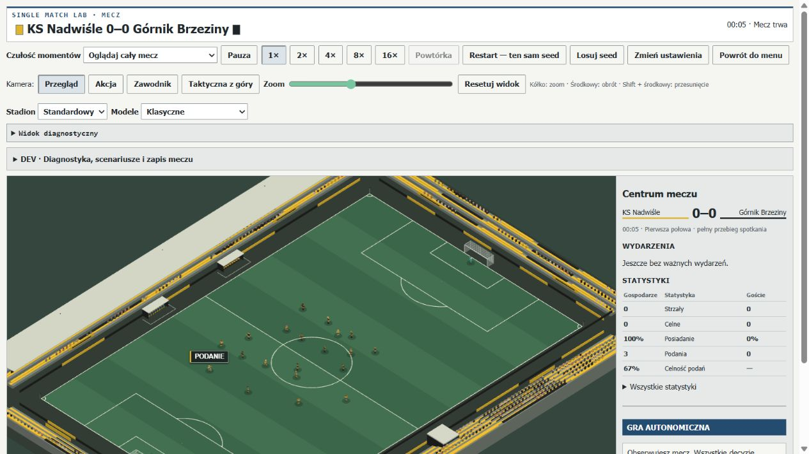
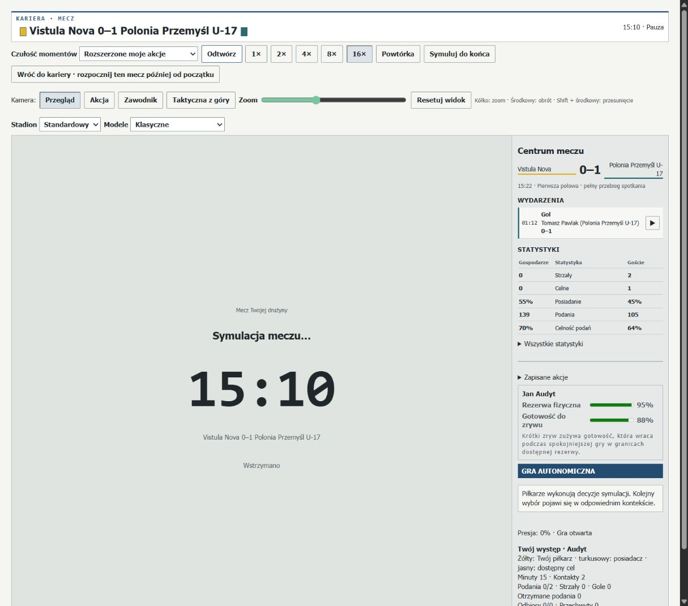
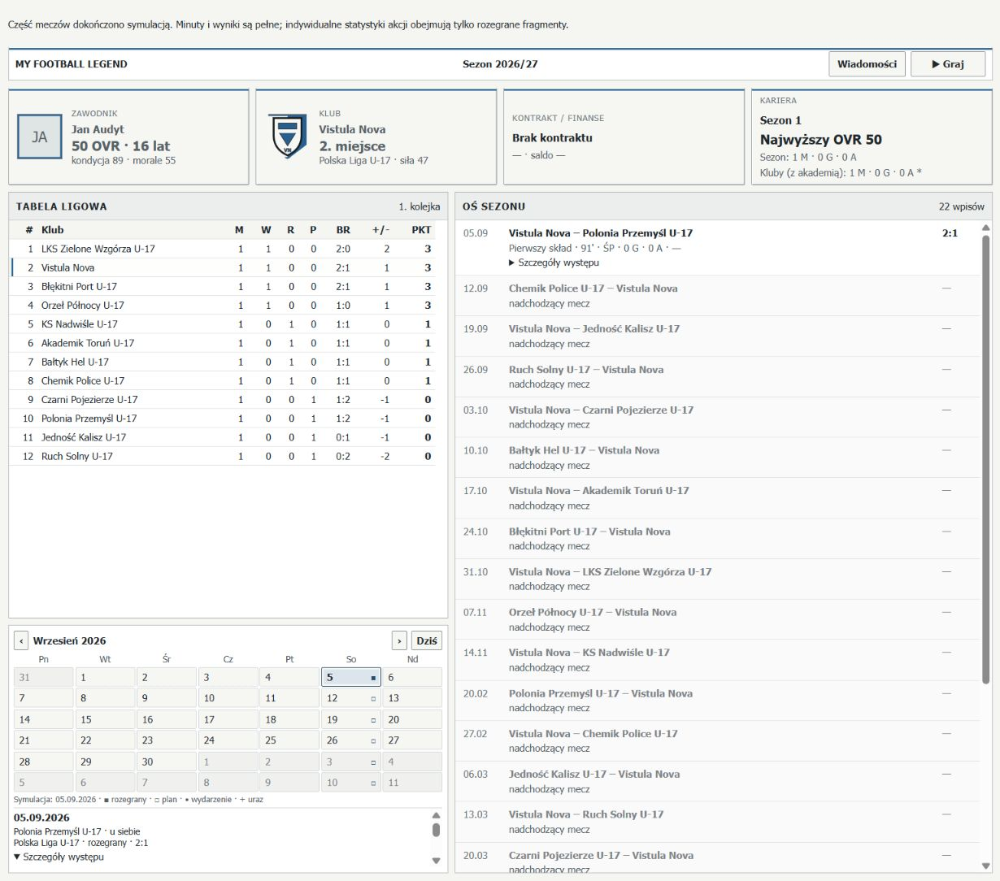

# PR171 — Match Reality Diagnostic Audit

Baza: scalony PR170, `1b7e2e0be1c36fe0fb8ddf730440b8ba2126842c`. Audyt i badania, bez zmian rankingu, fizyki, prawdopodobieństw ani zapisów kariery.

## Wynik i zakres

12 pełnych meczów kanonicznych z rzeczywistymi wygenerowanymi profilami; 2 przebiegi main-cohort osiągnęły limit 7200 s bez full_time. Dwie orientacje silny–słaby zakończyły się odtwarzalnym błędem geometrii po zmianie bramkarza. Próby cenzorowane i awarie nie są normalizowane do pełnych meczów. Dodatkowe seedy senior_balanced/wide_direct uzupełniają próbę; dobór nie zależy od wyniku.

Podania są rzeczywiście gęste, a wejścia do niebezpiecznych stref i strzały rzadkie. Mechanizm saves działa. Potwierdzono ograniczenie kierunku defleksji i zgubienie orientacji w callerze strzału, lukę gotowości powrotu keeperów i awarię keeper handover. Udział CM jest niski, ale nie przypisujemy całej różnicy jednemu współczynnikowi.

## Audyt początkowy i plan wykonania

Przejrzano PROJECT_STATE/ROADMAP, MATCH_BEHAVIOUR_CALIBRATION, PR152/156/157/162/163/168/170 oraz aktualnych właścicieli passDecision, shotOpportunity/options/resolver, goalkeeperIntervention, carryPursuit i restartLifecycle/laws/geometry. Błędna nazwa PR162_COMBINED z briefu nie istnieje; właściwy aktualny dokument to PR162_INTEGRATED_MATCH_REALISM_AUDIT.

1. Ustalić definicje i właścicieli, zamrozić bazę.
2. Stage A: cztery 30-sekundowe smoke i diagnostyczne regresje.
3. Stage B: sześć rodzin × obie orientacje, deterministyczne seedy.
4. Stage C: cztery uzupełniające mecze po wykryciu cenzorowania; osobne odtworzenie dwóch crashy i dwóch stanów liveness.
5. Zamrożone kontrfaktyczne stany, 22 wybory AI, 72 osobne kontakty strzeleckie, 9 carry, 5 restart i 8 crossing.
6. Referencja StatsBomb, observer parity/koszt, produkcyjna przeglądarka, pełne verify i plan PR172.

| Istniejący właściciel | Pomiar / pozostała luka |
|---|---|
| playerMatchStats + matchCentreStatistics | Oficjalne próby/ukończenia/odbiorcy, epizody kontroli, minuty, sieć, posiadanie, wznowienia. Crosses mają odrębną księgę. |
| matchFlowTelemetry/calibration | Tempo, podania/kierunki, strzały, obrony, possession spells. Krótki osobny test uzgadnia flow/public/nowy lejek. |
| PR162 AttackingFunnelTracker | Controlled/progression/final/box/shot, przyczyny końca i przestrzeń. Rozszerzono opt-in o okresy, zegary, histogramy i CM sampling; bez drugiego silnika. |
| PassingConnectivityTracker | Sieci i reciprocity, odległości, forecast CM przy release. Próbka do jednego ticka przed akcją nie jest dokładnym zapisem wewnętrznego rankingu. |
| PR163 OffensiveContinuationTracker | Fizyczny release, wynik/przyjęcie, follow-up, cross/cutback, pięć sekund kontynuacji. |
| PR168 tactical evaluator / agency / carryPursuit | Heurystyka i intencja są oddzielone od fizycznego wyniku; pierwotny debug użytkownika pozostaje niedostępny. |

Nieobserwowalne w pełnej próbie: każdy wewnętrzny ranking tuż przed wyborem, wszystkie odrzucone opcje przed generowaniem, niezależna gotowość taktyczna każdego receivera, pełne anulowane selekcje shot ID oraz oryginalna projekcja penalty. Fizyczne mikrokontakty per zawodnik nie są zebrane w pełnej kohorcie; publiczne control episodes są. Kohorta jest spectator: brak okazji decyzji ludzkiej wynika z konfiguracji, a jeden rozstrzygnięty wybór jest sprawdzony osobno w przeglądarce. Te braki nie są uzupełniane wymyślonymi danymi.

## Słownik i zgodność definicji

| Metryka | MFL / referencja / porównywalność |
|---|---|
| Próba podania | Jeden PassDiagnostic.passId fizycznego release; includes throws i GK distribution. StatsBomb Pass bez flagi cross; obie strony includes throws. Strukturalnie porównywalne, końcowa jakość reception różni się. |
| Ukończenie / przyjęcie | MFL rzeczywisty teammate control/contact; StatsBomb brak pass.outcome. Deflection/recipient nie dowodzą tej samej kontroli. Częściowo zgodne. |
| Długość | MFL <18 / 18–30 / ≥30 m; direction >5 m forward, <−2 m backward, reszta lateral. Lokalna definicja, bez narzucania provider progressive. |
| Cross / cutback | Kanoniczne oddzielne cross sourceAction/intent; nie dorabiać klasyfikacji z samego położenia. |
| Touches | Publiczne touches to epizody kontroli PR152. Fizyczne mikrokontakty contactControlTelemetry są odrębne. Nie porównywać 1:1 z provider Ball Receipt. |
| Posiadanie | MFL czas ostatniego ustalonego live-possession, także lot; setup/postGoal poza mianownikiem. Provider possession IDs opisują inne sekwencje. Procentów i duration nie traktować jako zgodnych. |
| Sekwencja lejka | Początek przy kontrolowanym owner; lot/loose nie rozpoczyna nowej. Zmiana team/stoppage zamyka. Starts in final/box nie są automatycznie wejściem. |
| Shot / on target | Jeden released shot ID, wynik aktualizuje go raz; final goal/save = on target. Block/frame poza nim. StatsBomb Goal/Saved/Saved to Post, bez Saved Off Target; frame rozróżniony. Zbliżone, nie identyczne. |
| Corner / goal kick / free kick | MFL award, a StatsBomb Pass typu Corner to wykonanie. Jeden niewykonany końcowy award może różnić totals. |
| Live / elapsed | MFL live excludes setup/postGoal; per90Elapsed używa final seconds wraz z doliczeniem. Referencja elapsed sumuje Half End okresów 1–2. Nie ma zgodnego live-clock. |
| Dostępny CM / viable shot | Próbkowane forecast/ranking w cooldown≤0, najwyżej raz na 2 s. Nie są pełnym licznikiem faktycznych decyzji; goal visibility/xG to heurystyka. |
| Zakończenie ataku | Canonical loss cause + restart; backward/hold to działania wewnątrz sekwencji, nie automatyczna strata. Nie utożsamiać end claim z dowiedzioną przyczyną błędu technicznego. |

## Dane rzeczywiste

Data: **StatsBomb Open Data** ([repozytorium](https://github.com/statsbomb/open-data), [opis eventów](https://github.com/statsbomb/open-data/tree/master/doc), [Media Pack / logo](https://statsbomb.com/media-pack/)). Rewizja `4b73468fc5b0f1950f9f66fada70ad3a4f9327cb`, 12 pierwszych chronologicznych spotkań grupowych MŚ 2022, 24 zespołowe obserwacje; match IDs, daty, immutable URLs i SHA256 plików są w reference-comparison.json. Nie kopiujemy eventów do gry. Logo poniżej jest niezmodyfikowaną kopią zasobu media-pack; dokładny mirror zapisano w images/pr171/README.md. Jest to seniorski turniej elitarny; nie stanowi celu celności/tempa dla akademii. Brak adekwatnej referencji U-17 jest jawnym ograniczeniem.

| Metryka / zespół / mecz | MFL średnia / mediana / P10–P90 | StatsBomb średnia / mediana / P10–P90 |
| --- | --- | --- |
| Próby podań bez crosses | 1087.54 / 1015.50 / 694.20–1655.20 | 519.79 / 471.50 / 283.40–786.30 |
| Strzały | 0.58 / 0.00 / 0.00–2.00 | 10.63 / 9.50 / 4.30–20.50 |
| Celne (definicje poniżej) | 0.54 / 0.00 / 0.00–2.00 | 3.38 / 3.00 / 1.00–6.70 |
| Gole | 0.33 / 0.00 / 0.00–1.00 | 1.38 / 1.00 / 0.00–3.40 |
| Rożne | 0.13 / 0.00 / 0.00–0.00 | 4.75 / 5.00 / 0.30–8.70 |

MFL completion: średnia 86.13%, mediana 90.52%, zakres 57.17–93.68%. Referencyjna liczba podań ma rozrzut 238–1077, strzałów 0–26; zero-shot realnego zespołu jest zachowane. Nie ma dokładnego celu ani kwoty.

## Kohorta i niepewność

| Rodzina / odwrócona | Formacje | Wynik | Podania | Strzały | Czas kanoniczny s |
| --- | --- | --- | --- | --- | --- |
| central_possession / false | 3-5-2 / 4-3-3 | 0:0 | 2468 | 0 | 5520.275 |
| press_low / true | 4-3-3 / 3-4-2-1 | 1:0 | 2419 | 2 | 5580.800 |
| senior_balanced:extra-a / false | 4-3-3 / 4-3-3 | 0:1 | 2167 | 3 | 5581.975 |
| senior_balanced:extra-a / true | 4-3-3 / 4-3-3 | 0:0 | 2173 | 0 | 5581.475 |
| senior_balanced / false | 4-3-3 / 4-3-3 | 1:0 | 2141 | 2 | 5581.975 |
| senior_balanced / true | 4-3-3 / 4-3-3 | 0:0 | 2233 | 0 | 5582.450 |
| wide_direct:extra-a / false | 4-2-3-1 / 4-4-2 | 0:0 | 2420 | 0 | 5539.150 |
| wide_direct:extra-a / true | 4-4-2 / 4-2-3-1 | 0:1 | 2381 | 3 | 5520.550 |
| wide_direct / false | 4-2-3-1 / 4-4-2 | 0:0 | 2428 | 0 | 5521.225 |
| wide_direct / true | 4-4-2 / 4-2-3-1 | 0:0 | 2380 | 0 | 5652.025 |
| youth_native / false | 4-3-3 / 4-3-3 | 0:1 | 1441 | 1 | 5462.225 |
| youth_native / true | 4-3-3 / 4-3-3 | 2:1 | 1450 | 3 | 5580.025 |

Raw raporty pozostają w work/pr171-full poza Git; publiczne kompaktowe pliki zachowują manifesty, SHA256, kompletne publiczne statystyki, per-period ledger, sieci i bounded traces. Łączny czas ścienny pełnych runów: 37.58 min; część była równoległa i konkuruje z verify, więc nie jest to benchmark wydajności. Wszystkie mają dt=0.025 s. Zwykłe CI nie uruchamia kohorty.

Mean/median/P10/P90/min/max/SD i liczby obserwacji są w baseline.json; CI średniej liczy bloki projektu z zależnymi mirrorami, a nie 2×team×match jako niezależne próby. Jest eksploracyjny dla wybranych fixture, nie reprezentatywny dla ligi. Wyników z 7200 s bez końca nie przelicza się na 90. U-17 ma tylko jedną parę seedów; formacja/style/atrybuty nie tworzą pełnego factorial.

## Lejek ataku i udział CM

3041 kontrolowanych sekwencji → 561 z final-entry → 34 z box-entry → 19 z próbkowaną wiarygodną pozycją → 14 fizycznych strzałów. Stages są zbiorami epizodów, events są częstotliwościami; long-range shot nie musi przejść przez box, więc nie mnożyć tych stopni jako obowiązkowego liniowego łańcucha. Final-continuation trwa ≥2 s. Atak może zacząć się już wysoko.

Passes/controlled sequence: średnia 8.96, mediana 7.43; passes/live minute zespołu: 12.39, P10–P90 7.84–18.75. Histogramy mają domknięte górne koszyki ≥64 podań/≥600 s; nie są dokładnymi surowymi percentylami duration. Domknięte sekwencje nie obejmują otwartej sekwencji cenzorowanego meczu.

CM: 3316 rzeczywistych przyjęć (14.41% team completions łącznie), 4285 prób podań. Rozkład per zawodnik obejmuje faktyczne minuty, share of attempts i share of completions; te mianowniki nie są wymienne. Sampling CM: 8849/8849 wygenerowanych, 5667 credible forecast, 171 najwyżej w rankingu. Próbki nie oznaczają wszystkich rzeczywistych ofert/wyborów ani dowodu, że dany cel został pominięty w konkretnym release.

Kontrolowany CM pod presją: score badanego odbiorcy 53.772→7.684, expected retention około 0.960→0.449. Otwarty gifted90 vs ordinary50 zmienia score 53.548→53.996, w obu wygrywa inne krótkie wsparcie (także CM). Nie dowodzi to automatycznie preferencji skrzydeł. W pełnych meczach sieci i spatial moments pokazują udział, ale do korekty pozycji/utility trzeba utrwalić zróżnicowane rzeczywiste zamrożone stany.

## Strzały, obrony i rożne

| Kontrolowany stan | Kategorie okazji | Opcje strzału / wykonalne | Pierwszy wybór AI |
| --- | --- | --- | --- |
| unmarked_striker | high_value | 3 / 3 | shot |
| edge_midfielder | high_value | 3 / 3 | shot |
| winger_box | credible | 3 / 3 | carry |
| cutback | high_value | 2 / 2 | shot |
| two_v_one | high_value | 3 / 3 | pass |
| four_v_line | high_value | 3 / 3 | shot |
| counter | high_value | 3 / 3 | shot |
| closed_block | credible | 3 / 3 | carry |
| long_range | non_viable | 2 / 2 | carry |
| first_time | high_value | 2 / 2 | shot |
| pushed_ball | high_value | 3 / 3 | shot |

Tabela pokazuje pierwszy naturalny wybór AI po ocenie wspólnej polityki, bez wymuszania shot. W eight-second follow-up mogą paść późniejsze strzały innego zawodnika; nie są wykonaniem pierwotnie odrzuconej opcji. Pierwsza piłka jest dostawą innego aktora, nie własnym touch; pushed-ball świadomie bada rozbieżność nominalnego owner i fizycznego gap.

Naturalne outcomes: {"save":5,"goal":8,"miss":1}. Osobne przepisane 72 strzały: {"save":35,"goal":3,"block":22,"miss":12}. Są osiągalne catch/parry, block i miss; nie jest to empiryczne save% ligi. Keeper weakness/pozycja i blocker mają swoje komórki.

`deterministicRebound` narzuca znak X zależny od orientacji zamiast normalnej kontaktu; `handleShotContact` podaje `shooter.team`, tracąc endsSwitched. Osiem zamrożonych par wejść wykazuje różnicę po przerwie. `parry` i `parry_away` nie sterują tym fizycznym kierunkiem. To niezależne ograniczenie obok niskiego wolumenu. Osiem supplied last-touch/outgoing crossing daje poprawne corner/goal-kick w obu kierunkach, także po zmianie ostatniego dotknięcia. Nie jest to dowód poprawnego wygenerowania każdego block→behind-goal/parry→behind-goal; właśnie tych fizycznych wariantów brakuje i PR172 powinien je zbudować bez fabrykowania award.

## Ciągłość, wznowienia i awarie

9 carry probes zachowuje initial pursuit/agency, pierwszy prompt z ownsBall/ballGap/destinationGap, odzyskanie, realny ground contact i wynik. W straight prompt jest przed końcem odległego celu; behind-ball/sharp-turn pokazują zachowanie części naprawy PR168. Nie twierdzimy, że wszystkie takie prompty powodują stratę. Wrogi owner w intercepted ma fizyczną pozycję przy piłce; out/unreachable nie zyskuje magnetycznego odzyskania.

Live indirect free kick: decyzja i legal readiness po 10.675 s. DEV setup: menu od razu mimo taker_not_ready. Live penalty: 11.3 s, keeper center 0.0695 m od linii, DEV 0 m. Brak oryginalnego obrazu i modelu stopy nie pozwala orzec, że zgłoszony kadr był fizycznie błędny. [IFAB Law 14](https://theifab.com/laws/latest/the-penalty-kick/) dotyczy części stopy przy kopnięciu.

Halftime: directions/targets zmieniają się, bodies relokują fizycznie. Przy pierwszej zgodzie po 22.75 s jeden keeper ma depth≈48.10 m. [Law 8](https://theifab.com/laws/latest/the-start-and-restart-of-play/) wymaga własnej połowy, więc to luka taktycznej kompletności, nie automatycznie naruszenie przepisów. Szatnia pozostaje ceremonią.

Silny–słaby crash: false: 4615.600 s; true: 4769.125 s. Każdy pre-crash snapshot odtwarza błąd jednym tickiem. Podczas wejścia GK nadal istnieje emergency goalkeeperRole na zawodniku pola; geometry wyklucza dwóch keeperów z outfield, lecz umieszcza jednego, a spreadCluster dereferencjonuje brakujący punkt. Kontrfaktyczne usunięcie jedynie tego przejściowego flag daje 22 cele. Zachowano pełne seedy i mały reproducer; produkcja pozostaje niezmieniona.

Dwa main-cohort limity 7200 s mają osobne replays bez observerów i kontekst restart/timekeeping. Central possession reversed stoi od 489.225 s w free_kick_wide z wall_developing; stracony czas i requiredEndAt rosną wraz z oczekiwaniem. To błąd liveness, nie normalny rozkład doliczenia. Press-low w drugiej połowie także pozostaje w free_kick_wide/preparing z wall_developing; wymagany koniec wynosi 7380.025 s przy limicie 7200 s. Pełny kontekst obu stanów i identyczne hasze replay bez observerów zapisano w censored-replays.json.

## Observer, pamięć i walidacja

Read-only observer nie jest importowany przez normalny runtime meczu, nie zapisuje save i nie steruje rankingiem. LRU identities≤512, pending origins≤64, ślady 32/24, audit samples≤64, shot records≤128; agregaty liczą dalej. Mapy mają klucze z ograniczonego rosteru, dwóch teamów/okresów i skończonych eventów; brak historii klatek. Stare eventy prezentacji są filtrowane przez canonical release timestamp/ID. Regresja obejmuje powtórzenie i ponowną emisję po wyparciu z cache.

Pełne U-17 w obu orientacjach (oba hasze ON/OFF, ticks i manifesty zachowane w observer-equivalence.json): identyczny SHA256 całego kanonicznego stanu przy observer ON/OFF (wynik, statystyki, decyzje, ledgery). Krótka seria: wszystkie 9 hasze identyczne. Flow/public pass totals uzgodnione. Ranking noise jest niezależnie seed-derived; żaden współdzielony stan RNG nie jest zmieniany. Nie deklarujemy identycznej liczby wszystkich wywołań niezależnych generatorów diagnostycznych.

Po rozgrzaniu każdego trybu, seryjne 3×60 s: plain 1645.10 ms; existing 2040.07 ms; extended 2026.23 ms. Przyrost nowego audit -0.68%; całości research 23.17%. Ujemna różnica median nie dowodzi przyspieszenia: w tej małej próbie zmienność maskuje dodatkowy koszt audytu. Po 60 s serialized retained payload wynosi 126005 B dla istniejących observerów i 136045 B z audit (+10040 B); surowe czasy są w observer-equivalence.json; nie są izolowanym V8 heap ani FPS. Normalna kariera nie włącza tych śladów, save delta=0 przez brak integracji serializacji.

Pełne `npm run verify`: **PASS**. 1801 testów: 1740 main, 52 integration, 4 canonical contract, 5 full-career; lint, TypeScript i produkcyjny build PASS. Timeouty/workery/asercje bez zmian. Końcowe research scripts mają osobny strict TypeScript i ponowiony lint. Końcowe sprawdzenia CLI są zapisane w verification.json. Bez osłabiania testów, workerów lub timeoutów.

Browser: production build, nowa kariera pr171-browser, CM Rozgrywający → Play3D → rzeczywiste „Podaj do nogi” → Simulate Remainder → wynik 2:1 i jeden rozstrzygnięty wybór → reload i jedno appearance. Nie opisujemy tej hybrydy jako pełnego browser-played 90-min meczu. Żaden audit panel nie został dodany do gameplay. Produkcja z jawnym DEV query otwiera Lab: rzeczywiste modele/stadion WebGL, pauza i pobrany benchmark sesji (SHA w browser.json). CLI diagnostic/export pozostaje poza zwykłą karierą. Szary ekran na zrzucie podania to tryb ukrytego przewijania; osobny zrzut Lab potwierdza rendering.

## PR172 — kolejność wdrożenia

| Priorytet / przyczyna | Moduły i wąska korekta | Efekt pomiarowy / ryzyko / regresja |
|---|---|---|
| P0 keeper handover | substitutions, matchGoalkeeper, restartGeometry: uzgodnić keeper appointment po wejściu, przed geometry; jawnie zagwarantować target każdemu uczestnikowi. | Obie strong_weak kończą bez exception; powtórzyć ten sam jeden tick i zmianę GK w obu kierunkach. Nie ukrywać nielegalnego składu samym fallbackiem. |
| P0 restart liveness | restartLifecycle/Geometry/Laws, stoppageLedger/timekeeping: zidentyfikować wall_developing i nieosiągalne cele; rozdzielić przyczynę czekania od pętli added-time. | Oba censored replays dochodzą do legalnego release/full_time bez timeout/teleport. Chronić mur i human ownership. |
| P1 defleksja/orientacja | matchSimulation handleShotContact, ballFlight: zachować pełny orientation; dopiero osobno projektować normalną kontaktu i energię/rozróżnienie parry. | Symetryczne fizyczne wejścia po przerwie; block behind/in-play, parry behind/to-attacker, rapid last touch i niezmienny shot ID. Ryzyko wzrostu rebound goals. |
| P1 kreacja i CM | tacticalPositioning/support, passDecision, matchActions: najpierw rzeczywiste frozen states od generation po wykonanie; zmieniać jeden wykazany człon. | Raportować udział CM, retained progression, final→box i jakość strat; bez minimalnych liczników. Ryzyko odsłonięcia środka lub masowych strat. |
| P2 shot choice/contact | shootingOpportunity/options, onBallPreparation, resolver: kontrolować wiarygodne odrzucone opcje i kontakt pushed-ball, nie podnosić globalnie shot utility. | Ten sam open striker/winger/block/first-time/counter działa i może chybić; sprawdzić selected→release/cancel po stabilnym ID. |
| P2 human intent | playerDecision, possessionAgency, carryPursuit/Execution: domknięcie carry i ważność celu osobno od pilnej nowej sytuacji. | Straight/reached/behind/turn, rzeczywista presja, przechwyt i out; brak magnesu, target completion guarantee i blokady ważnych decyzji. |
| P2 halftime | restart readiness/targets: określić i sprawdzić taktyczną gotowość bramkarza przed drugą połową. | Właściwy własny koniec i release bez teleportacji/ceremonialnego obowiązku szatni. |
| UX po mechanikach | TacticalMatchSandbox, renderer/model/goalCoordinates: goal → click horizontal+height → technika → execute; keyboard, sliders jako alternatywa. | Goal point roundtrip w obu orientacjach, anulowanie/fokus/replay, fizyka i shot type pozostają wspólne. Istniejący world-goal picker już daje punkt; zmienia się kolejność interakcji. |

Wyższe priorytety to mechanicznie odtworzone poprawki. Pozycja/ranking i tempo mają proponowane eksperymenty, nie dowiedziony uniwersalny współczynnik naprawczy. Pełny rejestr observation/prediction/counterprediction/measurement/confidence/risk: hypothesis-results.json.

## Zachowana roadmapa

PR172 mechaniki zgodne z dowodami → PR173 generacje/siła świata → PR174 summary/PlayStyles. W PR174: spójne start/sub/entry/exit/partner i wyłącznie modelowany powód zmiany (nie wnioskować poor performance z oceny). Po PR174 UX: zwarty pojedynczy wiersz fixture, zbiorczy wiersz archiwum sezonu, bez duplikatów historii; kalendarz podąża za career.currentDate, pokazuje prawdziwe terminy, trening/życie/urazy i rzeczywisty okres niedostępności. Nie tworzyć treningów dla pustych komórek. Udowodniony blokujący błąd daty może mieć oddzielny wcześniejszy maintenance PR.

## Odpowiedzi na 30 pytań odbioru

1. Rozkłady: 12 pełnych meczów, 24 obserwacji zespołu; tabela powyżej i baseline.json.
2. Porównywalne strukturalnie: release podań po wyłączeniu crosses, shots/outcomes, gole, rożne. Kontrola przyjęcia, possession i live time nie są bezpośrednio zgodne.
3. MFL passes zawierają throw-ins i dystrybucję GK, wyłączają crosses; touches oznaczają epizody kontroli, nie pojedyncze dotknięcia stopy.
4. 26101 uzgodnionych release; nadmiar nie wynika w tej próbce z dublowania oficjalnej księgi. Stary presentation event może się powtórzyć.
5. 8.96 podań na controlled sequence i 12.39 na live minutę zespołu; rozkłady i jawne mianowniki w JSON.
6. 12015 wstecz / 6638 boczne / 7448 forward; 1748 kolejnych powrotów. To nie są identyczne definicje długiej pętli.
7. 3316/23010 ukończeń do CM (14.41%); indywidualne minuty/formacje i oba udziały w midfield-connectivity.json.
8. W 8849 próbkach CM: 8849 generated, 5667 credible, 171 ranked first. To oceny stanów, nie wszystkie rzeczywiste decyzje.
9. Opcje mogą istnieć i przegrywać z innym wsparciem; presja obniża forecast. Nie udowodniono jednej uniwersalnej przyczyny udziału CM ani konieczności bonusu pozycyjnego.
10. 3041 controlled → 561 final-entry → 34 box-entry. Główna utrata występuje przed regularnym dostępem do wykończenia.
11. 1488 próbkowanych stanów z wykonalną opcją; wiarygodność 19 sekwencji. Sam wygenerowany daleki shot nie jest dobrą okazją.
12. 746 próbek shot-below-pass / 1488 próbek z shot. Oddzielone od rzeczywistej selekcji.
13. 14 zaobserwowanych zmian latestAction na shot; 14 release publicznych. Kontrolowane naturalne wybory oraz późniejsze strzały są rozdzielone w probes JSON; brak pełnego identyfikatora anulowanej selekcji.
14. Pełne mecze: {"save":5,"goal":8,"miss":1}. Osobne 72 przepisane kontakty: {"save":35,"goal":3,"block":22,"miss":12}.
15. Mechanizm obrony działa w kontrolowanych stanach. Niski naturalny wolumen i jakość okazji nie pozwalają oszacować populacyjnej skuteczności bramkarzy.
16. 3 rożnych; niskie strzały/crosses oraz ograniczenie kierunku odbić. Udział każdego czynnika w lidze nie jest oszacowany.
17. 8/8 testów zadanej trajektorii i ostatniego dotknięcia daje właściwe corner/goal-kick w obu orientacjach. To nie dowodzi realizmu generowania defleksji.
18. W straight fixture prompt pojawia się w trakcie niedokończonego carry. Presja ma osobny przypadek; nie wyłączono reakcji na nową sytuację.
19. Behind/turn potrafią odzyskać piłkę; nie odtworzono uniwersalnego porzucania. Wszystkie 9 przypadków zachowuje kontakt, gap, odzyskanie i wynik.
20. Live indirect: menu po 10.675 s i legal ready; DEV od razu mimo taker_not_ready. Oryginalny mecz pozostaje nieodtworzony.
21. Zmiana kierunku/celów działa bez teleportacji. Przy gotowym kickoff jeden keeper wciąż 48.10 m od własnego końca; luka taktyczna, nie automatycznie złamanie Law 8.
22. Live penalty: około 0.0695 m środka ciała od linii. Nie odtworzono wady oryginalnego obrazu; położenie stóp i projekcja wymagają jego snapshotu.
23. Tak: goal target → click punkt (w tym wysokość) → technika → potwierdzenie, ze współdzielonym goalIntentToPitch i alternatywą klawiatury.
24. Wsparte: recykling/niedobór wejść, ograniczenie odbić/orientacji, niedokończona relokacja, keeper-handover crash, live/DEV różnica i problemy liveness.
25. Odrzucone w badanym zakresie: oficjalne pass micro-contact inflation, całkowicie niedziałające saves, uniwersalny live indirect prompt przed gotowością.
26. Niepewne: populacyjna trudność pressing/keeper, dokładny udział pozycji i utility w CM, wpływ carry prompts na naturalne straty oraz oryginalny screenshot.
27. Koszt: nowy audit wobec istniejących observerów -0.68%; cały research wobec plain 23.17%. Małe seryjne próby, nie FPS ani dowód przyspieszenia.
28. Dwa pełne U-17 potwierdzone hashem całego stanu z wyłączonymi observerami; 9 krótkich przebiegów również identycznych. Cenzorowane replay sprawdzono osobno.
29. Najpierw keeper handover/restart liveness i wiarygodna księga; potem orientacja/defleksje, kreacja/CM/shot rejection oraz human intent lifecycle.
30. Rzeczywiste frozen decisions w końcowej tercji, izolowane duty/pressure i keeper normalne kontaktu, wpływ interakcji nowego celu, poprawny live-clock reference. Bez kwot.

## Mapa dowodów

| Artefakt | Zawartość |
|---|---|
| [PR171-baseline.json](performance/PR171-baseline.json) | Manifesty, seedy, role, per-period ledger, publiczne statystyki i rozkłady |
| [PR171-attacking-funnel.json](performance/PR171-attacking-funnel.json) | Lejek, straty, histogramy i bounded traces |
| [PR171-midfield-connectivity.json](performance/PR171-midfield-connectivity.json) | Przyjęcia CM, ekspozycja/rankingi i sieci |
| [PR171-reference-comparison.json](performance/PR171-reference-comparison.json) | Definicje, immutable źródła StatsBomb, SHA256 i rozkłady |
| [PR171-controlled-probes.json](performance/PR171-controlled-probes.json) | Naturalne decyzje AI, CM i carry |
| [PR171-shot-resolution.json](performance/PR171-shot-resolution.json) | 72 osobne przepisane kontakty strzałów |
| [PR171-restart-continuity.json](performance/PR171-restart-continuity.json) | Live/DEV restart, przerwa i ostatnie dotknięcie |
| [PR171-mechanical-counterfactuals.json](performance/PR171-mechanical-counterfactuals.json) | Kierunek odbicia i przejściowe role keeperów |
| [PR171-engine-failures.json](performance/PR171-engine-failures.json) | Seedy i one-tick replay awarii silny–słaby |
| [PR171-censored-replays.json](performance/PR171-censored-replays.json) | Bezobserverowe replay i kontekst restart/timekeeping |
| [PR171-observer-equivalence.json](performance/PR171-observer-equivalence.json) | Pełne hasze ON/OFF, koszt i retained payload |
| [PR171-hypothesis-results.json](performance/PR171-hypothesis-results.json) | Obserwacja, przewidywanie, kontrprzewidywanie, wynik, niepewność i ryzyko |
| [PR171-verification.json](performance/PR171-verification.json) | Bramka verify i końcowe kontrole skryptów |
| [PR171-browser.json](performance/PR171-browser.json) | Smoke produkcji, commit/reload i eksport DEV |

## Odtworzenie

`npm ci`, potem `npm run generate:world-db`. Research jest jawnie opt-in:

`npm run benchmark:reality-audit -- --families=youth_native,senior_balanced,central_possession,wide_direct,press_low`

`npm run benchmark:reality-audit -- --families=senior_balanced,wide_direct --replicate=extra-a`

`node --experimental-transform-types --import ./scripts/registerTypescriptLoader.mjs scripts/benchmarkPr171Failure.ts`

`node --experimental-transform-types --import ./scripts/registerTypescriptLoader.mjs scripts/diagnosePr171Censored.ts`

`npm run benchmark:reality-audit -- --mode=confirm --families=youth_native`

`npm run benchmark:reality-probes`

`node --experimental-transform-types --import ./scripts/registerTypescriptLoader.mjs scripts/benchmarkPr171Mechanics.ts`

`npm run benchmark:reality-reference -- --download` (jawny download tylko do research cache). Offline używa utrwalonego cache/revision; immutable commit/URL w JSON pozwala odtworzyć dokładną referencję.

Po zatrzymaniu innych obciążeń: `node --experimental-transform-types --import ./scripts/registerTypescriptLoader.mjs scripts/benchmarkPr171Performance.ts`, następnie `node scripts/summarizePr171.mjs` i `node scripts/reportPr171.mjs`. Zmiana optional replicate dodała tryb w harnessie bez zmiany domyślnych fixture; hash każdej użytej wersji harnessu jest jawny w receiptach, ten sam frozen core sourceHash. Nie łączyć danych z folderu pr171-superseded.

Wymagana bramka: `npm run verify`. Ograniczenia i niepowodzenia są częścią dowodu, nie pominiętymi próbkami.
