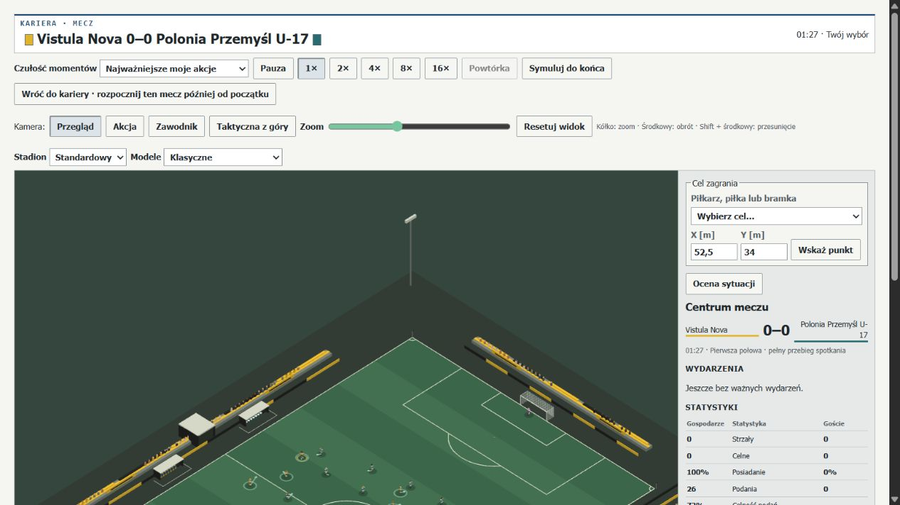
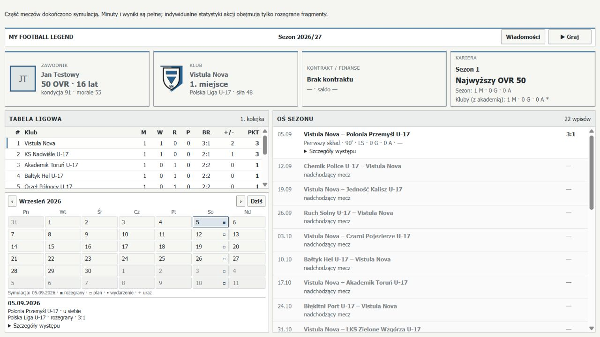

# PR173 — Dynamic Football Actions & First-Touch Intelligence

Status: propozycja do przeglądu. Baza: scalony PR172, `7465773cc1621687bfd3bbb9b174a8bc6e9b4360`.
PR173 naprawia konkretną nieciągłość fizycznej piłki przy kierunkowym przyjęciu,
dodaje ograniczoną prognozę względnego ruchu i wąską rewalidację istniejącego planu.
Nie dowodzi rozwiązania nadmiernego recyklingu ani pełnej realizacji ambitnego celu
„AI rozumie przewagę dynamiczną”. Szerszą zmianę polityki dryblingu odrzucono na
podstawie rzeczywistych stanów. Ten zakres i pozostałe luki są celowe i jawne.

## 1. Wykorzystana implementacja

Audyt objął PROJECT_STATE, ROADMAP, MATCH_BEHAVIOUR_CALIBRATION, raporty
PR163/168/171/172, historyczne receipts oraz moduły locomotion, playerOrientation,
playerArrival, ballContactGeometry, passReception, receptionPreparation,
receptionContinuation, onBallPreparation, firstTimeActions, carryExecution,
offBallMovement, passDecision, tacticalDecision, defensiveTransitions i matchFitness.

Już istniały: running reception i readiness, kierunkowy kontakt zależny od techniki,
zachowanie części prędkości przy przyjęciu, finite control impulses dla planned carry,
first-time pass, inside/outside carry, sprint push, osłanianie piłki, krótkie intencje
ruchowe, pursuit/recovery/cover, fizyczne pojedynki i sędziowanie kontaktu.
PR173 korzysta z tych prymitywów. Nie dodaje nowej równoległej fizyki ani zależności.

## 2. Zweryfikowane problemy przed zmianą

Kierunkowy kontakt bez `onBallPreparation.plannedCarry` ustawiał piłkę od razu w
`reception.resultingPoint`. Ten sam rodzaj przyjęcia z planem używał impulsu.
Była to zależność fizyki od istnienia planu, choć pozycja kontaktu powinna pozostać
autorytatywna. Test bez autonomicznego planu odtwarza różnicę w obu orientacjach.
Propozycja kontynuacji mogła też wyprzedzać jawnie wybrany kierunek człowieka.

Nie potwierdzono ogólnego resetowania prędkości ciała przez przyjęcie. Dwa kontakty
moving→stopped w macierzy 1a pozostają dwa. Hamowanie techniczne, trudny kontakt,
wybrana asekuracja i późniejszy wybór AI nie są automatycznie błędem przejścia stanu.
Dotychczasowy stały próg wolnej przestrzeni mógł natomiast kasować istniejący plan,
ignorując to, że bliski obrońca biegnie w przeciwną stronę.

## 3. Dokładne scenariusze 1a, 1b i 2a

`pr173Fixtures.ts` tworzy pełne 22-osobowe stany na bazie PR163. Nie nadaje wyniku
kontaktu ani zwycięstwa. W orientacji podstawowej skrzydłowy jest w (68,10),
biegnie (4,0) m/s; pierwszy obrońca w (70,12.5), crossing velocity (-3.6,-4.8).
Wsparcie znajduje się za akcją. Opcjonalna asekuracja w (74,17) biegnie (-1,-2).

| Scenariusz | Rzeczywisty bodziec / przepisane otwarcie                                                                       |
| ---------- | --------------------------------------------------------------------------------------------------------------- |
| 1a         | Niski pass już w locie: piłka (66.5,10), 8 m/s, origin (61,10), bez właściciela; zwykły odbiór i dalsze decyzje |
| 1b         | Fizycznie kontrolowana piłka, carry do (79,21) lub (79,5), tryb dribble                                         |
| 2a         | Kontrolowana piłka, wypchnięcie carry w sprint; kierunek straight/inside/outside                                |

Po 19 zależnych wariantów na scenariusz: crossing/aligned/stationary/recovering,
prędkość podejścia, facing, technika, zwinność, gotowość, prędkość odbiorcy/podania,
kierunek, asekuracja, obrót całego boiska i druga połowa. To zestaw jednoczynnikowy,
nie pełny iloczyn kombinacji ani niezależna próba populacyjna. Każda para ma
identyczny hash wejściowego stanu i ten sam seed. Po otwarciu biegnie 5 s zwykłego
silnika z dt=25 ms. Próbki: 0.5/1/2/5 s; zapisujemy też kontakt, decyzje, faktyczne
interwencje, faule/kartki, posiadanie, kontrolowaną progresję i dostępne następne opcje.

## 4. Prognoza interwencji i pędu

`dynamicIntervention.ts` przewiduje dojście do dwóch punktów krótkiej trasy przez
maksymalnie 2.5 s. Korzysta z widocznej pozycji, velocity, facing, canonical
`integrateFacing`, movement-mode speed factors oraz właściwych zawodnikowi
przyspieszenia, hamowania, turning i fitness. Integruje wektor prędkości co 25 ms.
Nie czyta przyszłych decyzji ani RNG. Zerowy reaction delay jest optymistycznym
założeniem; wynik to **bounded kinematic estimate**, nie gwarantowana dolna granica
czasu ani prawdopodobieństwo sukcesu. Dotychczasowy promień arrival 0.8 m pozostaje.

Stopa będąca już w zasięgu oznacza zagrożenie teraz, nawet przy złym pędzie ciała.
Uwzględniana jest cała fizycznie dostępna asekuracja, z bezpiecznym odrzuceniem
ciał zbyt odległych nawet przy maksymalnej prędkości. Sent-off/niedostępni nie grają.
Margin to różnica szacowanych czasów obrońca–atakujący, a nie „szansa dryblingu”.

24 osobne próby porównują prognozę z faktycznym ruchem kanonicznego obrońcy:
4 kierunki × 3 gotowości × 2 zwinności. Przy 17 osiągniętych celach średni błąd
forecast−actual wynosi według grup: crossing +0.050 s, aligned +0.050 s,
stationary +0.079 s, recovering +0.188 s. Pozostałe 7 jest cenzorowane na 2.5 s.
Faktyczne interwencje przy poruszającej się piłce liczymy osobno od dojścia do
stałego celu. Ta walidacja wyklucza nazywanie prognozy ścisłym fizycznym bound.
[Dane](performance/PR173-intervention-validation.json),
[porównania względnego ruchu](performance/PR173-relative-motion-pressure.json).

## 5. Ciągłość pierwszego kontaktu

Wydzielono identyczną dotychczasową matematykę finite control impulse do wspólnego
`deriveGroundControlImpulse`. Kierunkowe przyjęcie bez planned carry zostawia
piłkę w punkcie kontaktu i rozpoczyna prawdziwy impuls. Docelowy offset, tempo,
zdolności i trudność wpływają na późniejszy ruch; nie ma natychmiastowego przeskoku.
Przyjęcie z planned carry również używa wspólnej kontroli zamiast dawnego prostego
`1.2 + speed * 0.7`; zmiana trajektorii obejmuje oba rodzaje przygotowania.
Zachowano modelowany spin. Prędkość ciała nadal przechodzi przez dotychczasową
skalę jakości kontaktu, bez teleportacji zwrotu. Jawny human carry target poprzedza
propozycję AI. Trudne kontakty nadal mogą dać heavy touch/failed control.

Rewalidacja może zachować tylko **już zaobserwowaną** kontynuację, zanim minie jej
czas, bez zmiany epizodu lotu. Wymaga m.in. ruchu >0.7 m/s, techniki ≥0.6,
komfortowego arrival speed, clearance >1.2 m, zgodności kierunku >0.8 i dodatniego
konserwatywnego margin zależnego od awareness. Bada najwyżej 3 m starej trasy.
Nie tworzy nowego kierunku ani nie zmienia rankingu kandydatów.

## 6. Repertuar działań dynamicznych

Wykorzystano istniejące kierunkowe przyjęcie, cięcie do środka/na zewnątrz,
sprint push i first-time layoff. Nowe zachowanie to spójny impuls przyjęcia i
warunkowe utrzymanie wcześniejszego planu przy niekorzystnym pędzie pressera.
Nie dodano gwarantowanego nutmeg, animacyjnego zwodu ani bonusu do odbioru/foulu.
Nie wprowadzono pełnego nowego autonomicznego repertuaru uników. Wszystkie akcje
przechodzą przez te same ruch, kontakt, piłkę i obronę co decyzje człowieka.

## 7. Obrona i asekuracja

Pursuit, tackle commitment, contact geometry, recovery, collision i referee
pozostają dotychczasowe. Dalszy obrońca biegnący zgodnie z trasą może być bardziej
groźny od bliższego overshooting pressera. Stopę można wykorzystać natychmiast;
nie istnieje okres ochronny po minięciu. Test rewalidacji z efektywną stopą cover
odrzuca zachowanie planu. W 1b/2a obrona może odzyskać piłkę lub zamknąć dalszą grę.
Moment commitment jest w danych oddzielony od faktycznej interwencji. Faule i kartki
są nowymi zdarzeniami danego odcinka, bez powtórnego liczenia wcześniejszego meczu.

## 8. Audyt burst readiness

Nie zmieniono współczynników staminy, kosztu ani regeneracji. Przy starcie 1%
gotowości po 60 s: stanie około 64%, chód 1.5 m/s około 41%, trucht 3 m/s około
17%; 4.5/7.5 m/s zużywa bieżącą regenerację i utrzymuje zero. Sama intencja press
bez obciążenia ruchowego nie spala energii. Osobno zachowano osiem istniejących
finite-acceleration fitness drills, każde przy 1%/100%, oraz próbę przerwy.

Przy pięciu gotowościach 100/60/30/10/1% dostępnych jest 13 podań, a nieruchome
krótkie podanie ma zawsze score 45.187487644. Liczba carry zmniejsza się 7/6/4/4/4:
gotowość ogranicza fizyczne zrywy, nie usuwa sensownego lekkiego podania. Nie
udowodniono pułapki uniwersalnie niskiej regeneracji. To audyt obciążeń i opcji,
nie dowód realistycznego rozkładu zmęczenia całych naturalnych meczów.
[Dane](performance/PR173-burst-readiness.json).

## 9. Parowane wyniki kontrolowane

| Miara (po 19 prób)                      | 1a PR172→PR173 | 1b PR172→PR173 | 2a PR172→PR173 |
| --------------------------------------- | -------------: | -------------: | -------------: |
| Posiadanie zespołu po 2 s               |          17→17 |          14→14 |          19→19 |
| Posiadanie zespołu po 5 s               |          14→16 |          14→14 |          16→16 |
| Średnia maks. kontrolowana progresja, m |  12.551→11.935 |    2.293→2.293 |    8.793→8.788 |
| Fizyczne impulsy ground control         |        179→128 |        236→244 |          59→69 |
| Faktyczne faule w odcinku               |            0→4 |            3→3 |            1→1 |

1a: 15 directional, 1 clean, 2 heavy, 1 failed po obu stronach; średnia prędkość
ciała przed/po ticku kontaktu 3.689/3.001 m/s, bez poprawy względem PR172. Dwa
moving→stopped pozostają dwa; średni czas do następnej akcji 1.153 s nie zmienia się.
Lepsze utrzymanie nie usprawiedliwia twierdzenia o większej progresji ani mniejszej
liczbie fauli. Gate B (sam forecast bez integracji) zachowuje całe 57 stanów.
Gate C i final dają te same 57 wyników: wąski guard nie zmienia tej głównej macierzy.
Dedykowany test i rozszerzenie revalidation pokrywają jego rzeczywiste użycie.
[1a](performance/PR173-scenario-1a.json), [1b](performance/PR173-scenario-1b.json),
[2a](performance/PR173-scenario-2a.json), [ciągłość](performance/PR173-first-touch-continuity.json).

16 dodatkowych otwarć 1a obejmuje layoff, layoff+run, overlap i revalidation,
każde z/bez cover i w lustrze. Podania first-time rzeczywiście opuszczają stopę
po 0.125 s, przy prędkości ciała 3.027 m/s. Przy jawnie wybranym istniejącym
movement intent layoff+run ruch trwa: po 0.5 s 5.455 m/s i 1.994 m do przodu;
po 1 s 8.974 m/s i 5.144 m; po 2 s około 10.8 m progresji. Bez cover po 5 s
około 20.6 m, z cover około 4.5 m. Te możliwości istniały już wcześniej; partner
nie ma wymuszonego return pass. Nie jest to implementacja zbiorowego one-two.
[Pierwsze tempo i dalszy bieg](performance/PR173-first-time-continuations.json).

## 10. Rzeczywiste zamrożone stany

Użyto wszystkich 40 zachowanych decyzji z PR172 central_possession, wide_direct
i youth_native. Archiwa PR172 są bajtowo identyczne. Każdy stan i ranking wejściowy
jest taki sam w before/after/rejected. Wybrane 40 akcji oraz po trzy carry
kontrfaktyczne na stan dają 160 pięciosekundowych odcinków na wersję silnika.
Odtworzenie nie usuwa trudnej presji ani nie dodaje partnera. To stany użyte do
oceny/odrzucania zmian, więc nie są niezależną walidacją PR175.

## 11. Naturalne krótkie kontynuacje

Wybrane akcje: posiadanie 2 s 35→35/40, 5 s 30→30; średnia maksymalna kontrolowana
progresja 1.818→2.062 m. Faule 6→4, kartki 3→1. Carry kontrfaktyczne: 5 s 91→90/120,
progresja 3.564→3.481 m, faule 9→10, kartki 2→3. Nie ma spójnej poprawy wszystkich
metryk. Rejestrowane lanes/visible goal area/next action opisują późniejszy stan,
ale same metry nie dowodzą wykorzystanej okazji. Brak poprawy rankingu początkowego:
40/40 pozostaje identyczne. [Wyniki](performance/PR173-short-continuations.json).

## 12. Pełne mecze i PR172

Wyniki pełnej kohorty, źródła i tabela porównawcza są w
[PR173-full-match-comparison.json](performance/PR173-full-match-comparison.json).
Wymagane są te same 12 oryginalnie pełnych meczów oraz wszystkie 16 fixtures
PR172, w tym pary silny–słaby, press_low i dodatkowe seedy. Każde wejście musi
mieć ten sam hash, bez poprawiania historycznych receipts i bez ukrywania censored.
Wynik: **16/16 full_time, 0 cenzorowanych, 0 awarii**. Dwa pełne U-17 mają identyczny
cały stan observer ON/OFF. Pary są zależnymi obrotami geometrii; nie jest to 32
niezależnych obserwacji drużyn. Czasy równolegle wykonywanej kohorty nie służą do
deklarowania poprawy CPU. Całe 18 surowych receipts (16 observed + 2 confirm)
zachowano bezstratnie w archiwum źródłowej zgodności.

| Te same 12 pełnych meczów                           |           PR172 |           PR173 |
| --------------------------------------------------- | --------------: | --------------: |
| Podania / ukończone                                 | 25 853 / 22 767 | 25 177 / 21 987 |
| First-time pass, event observer                     |            1024 |            1153 |
| Directional reception, pass-result observer         |            9950 |            9915 |
| Podania na kontrolowaną sekwencję, średnia zespołów |           9.021 |           7.574 |
| Strzały / celne / gole                              |    21 / 19 / 13 |    21 / 16 / 12 |
| Bloki / obrony / rożne                              |       1 / 6 / 3 |       2 / 4 / 4 |
| CM receptions / udział ukończeń                     |  3356 / 14.741% |  3532 / 16.064% |
| Wejścia final third / box                           |        567 / 39 |        608 / 62 |
| Utraty posiadania                                   |            2798 |            3190 |
| Faule / żółte / czerwone                            |    196 / 44 / 2 |    219 / 51 / 5 |

Mniej podań na sekwencję współwystępuje z większą liczbą strat. Nie jest dowodem
lepszego tempa ani taktyki. Strzałów nie przybyło. Zmiany wynikają z fizycznej
kontynuacji wrażliwego deterministycznego meczu, bez nowych wag pozycyjnych lub
kwot; nie przypisujemy im populacyjnego efektu przyczynowego.
Wejść final/box przybyło, lecz strzałów po wejściu final ubyło 12→4, po box 14→7
w definicji kontrolowanej sekwencji. Ścieżki typu restart/luźna piłka nie zawsze
przynależą do tej sekwencji, dlatego licznik `shot` funnel nie musi równać się
oficjalnym strzałom. Widać lukę między dojściem a wykorzystaniem, bez premii do shoot.

## 13. Ranking zmieniony i zachowany

Nie zmieniono wag podań, dryblingu, strzałów, central-midfielder bias, pass limits,
support positioning ani celów statystycznych. Forecast służy wyłącznie lokalnej
feasibility starej kontynuacji po istniejących conservative guards. Nie szuka nowych
sekwencji przez rollout w każdym ticku. Zmiana piłki może zmienić późniejszą sytuację
i decyzję przez rzeczywiste konsekwencje. Bez magicznego „dynamic action bonus”.

## 14. Odrzucone hipotezy i poprawki

Pierwsza próba użycia prostego starego planned impulse w każdym odbiorze zostawiała
piłkę za biegnącym graczem. Zastąpiono ją wspólną istniejącą matematyką kontroli.
Szersze tworzenie nowych reception routes lub zbyt luźne ich utrzymanie również
nie przeszło porównań. Zachowano tylko wąskie utrzymanie starego planu.

Kandydat zastępujący wybór strony omijania obrońcy oceną dynamic-route poprawiał
wybrane cięcia syntetyczne. Powtórzony na finalnej fizyce pogarsza jednak naturalne
wybrane odcinki: 5 s posiadania 30→28/40, progresja 2.062→1.592 m; carry 90→80/120,
3.481→3.255 m. Niższe faule nie rekompensują strat. **Nie ma go w produkcji**.
Dokładny odrzucony kod i pełne A/B/C/F/R traces zachowano w
[archiwum](performance/PR173-evidence-index.json). Wcześniejsze robocze pomiary z
niedokończonym opisem lotu nie są publikowane jako porównanie finalnych fixtures.

## 15. Determinizm i wydajność

Brak nowego RNG lub danych z przyszłości. Szczegółowy observer pierwszego kontaktu
jest opt-in, trzyma najwyżej 32 rekordy i nie zapisuje się do kariery. Duplikaty
obserwacji nie zwiększają liczników. Trzy całe pięciosekundowe stany są identyczne
observer ON/OFF; dwie pełne symulacje U-17 są ponawiane bez observera.
[Krótkie porównanie](performance/PR173-F-observer-equivalence.json).

Spokojny pomiar CPU jest osobnym procesem po kohorcie i testach: 60 s / 2400 ticków,
jedna rozgrzewka i 3 pomiary na silnik/tryb, naprzemienna kolejność silników,
plain / dotychczasowe / rozszerzone diagnostics. Profilowane kategorie kroku są
oddzielone od nieinstrumentowanego czasu. Raportuje też heap snapshots i rozmiar
utrzymanych diagnostics; snapshot heap nie jest pomiarem peak ani dowodem braku leak.
[Pomiary](performance/PR173-performance.json). Startup CPU używa jednego świata,
profilu i seeda, 7 pomiarów po rozgrzewce: parse/validation, creation, save, load;
nie obejmuje cold import, sieci ani renderowania przeglądarki.
[Startup](performance/PR173-career-startup.json).

Końcowe mediany 60 s CPU, ms (stock Node 24, bez równoległych testów):

| Tryb                      |   PR172 |   PR173 | Zmiana |
| ------------------------- | ------: | ------: | -----: |
| Plain canonical stepping  | 1296.21 | 1389.04 | +7.16% |
| Dotychczasowe diagnostics | 1632.62 | 1737.08 | +6.40% |
| Rozszerzone diagnostics   | 1668.95 | 1749.86 | +4.85% |

Nie deklarujemy przyspieszenia. 65 próbkowanych ticków z 2400 w każdej wersji
obejmuje 10 kategorii inclusive spans; profiler daje identyczny pełny stan.
Rzadkie kosztowne decyzje mogą zdominować tak małą próbkę kategorii. Ich estymat
nie sumujemy jako udziałów ani nie zastępujemy nimi nieinstrumentowanych median.
Utrzymane payloady diagnostics: PR173 existing 132881 B, extended 155705 B
(PR172 126270/142273 B). Największe snapshoty heap w tych próbach: około 272 MB
PR172 i 271 MB PR173; to nie są peak ani porównanie izolowanej pamięci silnika.
Career-only world parse/validation 35.652→36.788 ms, construction 0.018→0.020 ms,
save 0.413→0.428 ms, load/validation 0.229→0.270 ms. Wszystkie 14 zapisów ma ten
sam hash i 3792 B. Nie zmieniano kodu startup; różnice są kosztami tego lokalnego pomiaru.

Kohorta mierzy hash źródeł `8edb827c…`; finalny kod ma `72bd46ea…`. Jedyna zmiana
po kohorcie to trafniejsza nazwa pola diagnostycznego `estimateKind` i komentarz
wyjaśniający, że forecast nie jest gwarantowaną granicą czasu. Odwrócenie dokładnie
tych dwóch podstawień odtwarza hash **całego** mierzonego core. Żadna liczba, warunek,
RNG ani zapis stanu nie zmienia się. Finalne 57 prób są ponowione i porównane pełnym
hashem stanu. [Dowód źródłowy i wszystkie receipts](performance/PR173-source-equivalence.json).

## 16. Zgodność zapisu

Nie zmieniono wersji ani schematu career save. Forecast jest wynikiem obliczenia;
ślad pierwszego kontaktu należy do zewnętrznego observera. W 24 punktach
(3 geometrie × lustro × 4 momenty) pełny schema-validated stan przechodzi JSON
save/reload i daje identyczny następny krok. Porównanie stosuje semantykę JSON
(-0/+0 i pominięte undefined), bez tolerancji pól kontraktu.
[Receipt](performance/PR173-save-reload.json). Career construction/save/load
z PR172 i PR173 musi dać identyczny payload, a przeglądarka zachowuje wynik kariery.

## 17. Testy i przeglądarka

18 nowych testów obejmuje pęd i orientation, current-foot access, cover,
agility/readiness, lustra/połowy, finite receiving bez planned carry, human direction,
ryzykowny kontakt, rewalidację, first-time human choice, skończone zwroty,
lekki pass przy 1% oraz prawdziwy layoff+run i read-only observer. Istniejące testy
PR163 także przechodzą. Pełny `npm run verify` w dotychczasowym CI: **PASS —
1858 testów**, lint, TypeScript i produkcyjny build, bez zmiany timeoutów/workerów.
Node 24.21.0 / Ubuntu, testowany commit `ba2b6d3`, źródła core `72bd46ea…`.
[Uruchomienie CI](https://github.com/adamfron/my_football_legend/actions/runs/39063889407),
[receipt i kompletny log](performance/PR173-verification.json).

Lokalny pełny `npm run verify` obecnie **FAIL**: 1796 passed / 1 failed w głównym
zestawie. Jedyna porażka to niezmieniony limit 5000 ms testu `pr149Statistics`
(headless kontra projected), 5894 ms w pełnym uruchomieniu. Osobna parowana kontrola
pristine PR172 w Vitest przechodzi 24/24; finalna wersja w tym samym zestawie
pozostaje przy 23/24. Seryjny Node dla dokładnego seeda daje mediany 2797.8→2878.7 ms
(+2.89%) i identyczne całe stany headless/watched. Nie zastępuje to PASS w Vitest.
Próba większej młodej generacji heap nie rozwiązała limitu i nie jest wdrożoną
konfiguracją. Nie wydłużono czasu, nie zmniejszono kroków ani liczby workerów.
CI przeszło całą ścieżkę: main 1797, integracja 52, kontrakt kariery 4 i pełna
kariera 5 testów. Lokalnie dodatkowo przeszły izolowane 8/8 statystyk, 52/52
integracji i 4/4 kontraktu, w tym trzy całe mecze z zapisem/odtworzeniem.
Osobny lokalny test pełnej kariery także przechodzi 5/5.
Lokalnego zbiorczego błędu czasu nie przedstawiamy jako sukcesu. PR pozostaje
draftem z powodu mieszanych wyników gry i szerszych nieosiągniętych celów AI.
Końcowa aktualizacja wyłącznie raportu i receipts nie zmienia przetestowanego core.
[Kontrola CPU](performance/PR173-statistics-test-cpu.json).

Referencje pełnej telemetrii zmieniły się wskutek celowej zmiany toru piłki.
Odtworzono dwa stare hashe dokładnie na pristine PR172, następnie dwa nowe;
każdy seed/silnik dwukrotnie w świeżym procesie. Zachowano wszystkie eksportowane
pola, schema, identity ledgers i asercję hasha całego payloadu. Zmieniono wyłącznie
oczekiwane hashe testu. W starszym teście directional contact zastąpiono oczekiwanie
natychmiastowego przesunięcia piłki asercją położenia w contact point i dodatniego
impulsu; wszystkie dalsze sprawdzenia faktycznej progresji pozostają.
[Pełne stare/nowe payloady](performance/PR173-telemetry-reference.json).

Przeglądarka IAB, produkcyjny build localhost: utworzono fikcyjną karierę, rozegrano
początek meczu 3D z ludzkim wyborem podania i prowadzenia, sprawdzono anulowanie
oraz zatwierdzenie reszty symulacji, wynik 3:1 i 1 występ/90 minut. Po reload→Continue
cały widoczny DOM był identyczny; bez podwójnego rozliczenia. Zwykły autoplay kariery
doszedł do zdarzenia życiowego 7 października, z pięcioma występami (pozostałe summary).
Nie jest to pięć sprawdzonych meczów 3D. Panel kalendarza pokazywał 4 października:
istniejącą niespójność zapisano do PR178. Bez bezpośredniej podmiany browser state.
[Receipt](performance/PR173-browser.json).




## 18. Pozostałe ograniczenia

Przewaga lokalna nie oznacza jakości całego meczu. Nie usunięto dwóch zatrzymań,
nie zwiększono jednoznacznie progresji, nie dodano pełnego repertoire policy ani
zbiorowego rozumienia kombinacji. Tuning set nie jest niezależną walidacją.
Forecast ma błędy, horizon i optimistic reaction assumption; nie gwarantuje
bezpieczeństwa. 1a ma więcej fauli, carry counterfactuals tracą jedno posiadanie.
Wysoka liczba podań i mało okazji wymagają dalszej pracy. Nie wolno opisywać tego PR
jako pełnego spełnienia każdego aspiracyjnego punktu briefu lub skalibrowanego realizmu.

## 19. Konkretne zalecenia dla PR174

Zbudować pass-and-go/one-two/third-man jako krótkie intencje kilku partnerów,
warunkowane faktycznym kontaktem, wolnym pasmem i zachowaniem obrony. Bez wymuszonego
return pass. Rozpoznać overlap/underlap i pressing escape; oceniać realną następną
akcję zamiast samych metrów. Dodać kontekstowe rozpoznawanie mocnych stron partnera,
słabości rywala i nieskutecznego recyklingu, w tym uzasadniony strzał z dystansu.
Zachować safe pass przy realnej asekuracji. Walidować nową politykę na osobnych
stanach i seedach, a PR175 przeznaczyć na niezależne rozkłady meczowe.
Pełna kolejność PR174–PR179+ jest na początku [ROADMAP](ROADMAP.md).

## Odpowiedzi na 34 pytania akceptacyjne

1. Istniały readiness, directional reception, zachowanie części prędkości,
   planned finite carry impulse i first-time actions (sekcja 1).
2. Nie znaleziono ogólnego resetu ciała. Potwierdzono skok piłki bez planu oraz
   zbyt geometryczne kasowanie planu; dwa zatrzymania w macierzy pozostają (2, 9).
3. Tak w fizycznie dopuszczalnym zakresie: impuls ma skończony czas, a ciało
   zachowuje dotychczasową jakość kontroli. Nie wykazano globalnie mniej stopów (5).
4. Tak: heavy/failed pozostają; prędkość i niski skill nadal zwiększają trudność.
5. Lokalna integracja do 2.5 s z canonical capabilities, dwa punkty starej trasy (4).
6. Tak, velocity vector i facing, także hamowanie i turning; bez przyszłej decyzji.
7. Tak; identyczne pozycje i inne velocity dają inne czasy. Stopa teraz nadal grozi.
8. Ruch kanoniczny już od nich zależał. Testy i 24 wykonane próby odróżniają
   konfiguracje; nie deklarujemy populacyjnego efektu na wygrane pojedynki.
9. Rozróżnia forecast i guard, ale główna macierz nie wykazała poprawy liczby stopów.
10. Tak, rzeczywisty first-time layoff oraz istniejący wybrany run zachowują bieg;
    automatyczna zbiorowa kombinacja pozostaje PR174 (9).
11. Tak, pełna lokalna asekuracja skraca margin, może odrzucić plan i odzyskać piłkę.
12. Wykonalne existing inside/outside są testowane. Nowa ogólna polityka wyboru
    została odrzucona; wyniki 1b nie poprawiają się (6, 14).
13. Tak, recovery/contact nie zostały osłabione; dalsze 5 s mogą zniwelować przewagę.
14. Fizyczny sprint push istnieje i działa przez finite impulse; 2a nie ma bonusu
    sukcesu ani wykazanej zbiorczej poprawy progresji.
15. Tak, wyłącznie rzeczywisty kontakt i istniejący referee, z osobnym commitment.
16. Tak, owner label nie daje zdalnego kontaktu; canonical ball pozostaje źródłem.
17. Spójny ground impulse przy directional receive bez planu i wąskie utrzymanie
    poprzedniej kontynuacji. Bez nowego systemu zwodów (5, 6).
18. Jakość kontaktu/ruchu zależy od techniki, firstTouch, agility i fitness; guard
    wymaga zdolności i awareness. Nie przypisano bonusu przez nazwę akcji.
19. Tak, 57+16 przygotowanych i 160 naturalnych odcinków per silnik. Metry same
    w sobie nie dowodzą wykorzystanej przewagi (9–11).
20. Tylko lokalne zachowanie poprzedniego planu; 40 rankingów pozostaje takich
    samych. Szersza inteligencja i recykling są nadal nierozwiązane (13, 18).
21. Tak, nie obniżono safe pass ani sztucznie nie wzmocniono dryblingu.
22. Audyt obciążenia pokazuje poprawną regenerację przy lekkim wysiłku; realna
    kalibracja zmęczenia całego meczu wymaga dalszych badań (8).
23. W kontrolowanej próbie nie: wszystkie 13 opcji i score krótkiego pass zostają.
24. Nie zmieniono. Dane nie uzasadniły korekty współczynników.
25. Kontakt directional ma zawsze impuls; first-time release bazowo bez zmian.
    Globalne liczniki są w pełnym porównaniu (12).
26. Udział CM jest porównany w tej samej kohorcie, bez bonusu pozycyjnego (12).
27. Final-third/box i strzały rozliczamy w kohorcie; lokalne metry nie zastępują tego
    wyniku i nie uzasadniają ogólnego twierdzenia o lepszej kreacji (12).
28. Nie. Nie zmieniono tackle, pursuit, collision, reaction ani referee policy.
29. Tak, 1a faule 0→4, carry natural 9→10 i 91→90 utrzymań. Pełne liczby są jawne
    w kohorcie; nie dobierano kwoty fauli ani nie ukryto negatywnych prób.
30. CPU i completion podaje osobny pomiar oraz wszystkie 16 receipts (12, 15).
31. Kod kluczowych napraw PR172 pozostaje; pełna regresja i kohorta to weryfikują.
32. Trzy krótkie pełne stany i dwa pełne U-17 porównywane ON/OFF, bez nowego RNG (15).
33. Odrzucono szeroki dynamic side chooser, tworzenie nowych reception routes,
    zbyt prosty impuls oraz tezę o ogólnej pułapce readiness. AI i realistyczne
    rozkłady meczowe pozostają niepewne (14, 18).
34. Warunkowe wspólne intencje, partner feedback, rzeczywiste lanes i ocena kolejnej
    akcji z autonomiczną obroną, bez gwarantowanego powrotu piłki (19).

## Odtwarzanie

Node z TypeScript loaderem repo, zwykłe zależności z lockfile. Przykładowe polecenia:

```sh
node --experimental-transform-types --import ./scripts/registerTypescriptLoader.mjs scripts/benchmarkPr173.ts --mode=scenarios --stage=A --engine-root=../baseline-pr172
node --experimental-transform-types --import ./scripts/registerTypescriptLoader.mjs scripts/benchmarkPr173.ts --mode=scenarios --stage=F
node --experimental-transform-types --import ./scripts/registerTypescriptLoader.mjs scripts/benchmarkPr173.ts --mode=natural --stage=F
node --experimental-transform-types --import ./scripts/registerTypescriptLoader.mjs scripts/benchmarkPr173.ts --mode=extensions --stage=F
node --experimental-transform-types --import ./scripts/registerTypescriptLoader.mjs scripts/benchmarkPr173.ts --mode=fitness --stage=F
node --experimental-transform-types --import ./scripts/registerTypescriptLoader.mjs scripts/benchmarkPr173.ts --mode=intervention
node --experimental-transform-types --import ./scripts/registerTypescriptLoader.mjs scripts/benchmarkPr173.ts --mode=persistence
node --experimental-transform-types --import ./scripts/registerTypescriptLoader.mjs scripts/benchmarkPr173.ts --mode=parity --stage=F
node --experimental-transform-types --import ./scripts/registerTypescriptLoader.mjs scripts/benchmarkPr171.ts --output-dir=../pr173-full --mode=cohort
node scripts/summarizePr171.mjs --input-dir=../pr173-full --receipt-prefix=PR173-after --minimum-matches=16
node scripts/reportPr173.mjs
node scripts/verifyPr173Evidence.mjs
npm run verify
node --experimental-transform-types --import ./scripts/registerTypescriptLoader.mjs scripts/benchmarkPr173Performance.ts --baseline-root=../baseline-pr172
node --experimental-transform-types --import ./scripts/registerTypescriptLoader.mjs scripts/benchmarkPr173Startup.ts --baseline-root=../baseline-pr172
node scripts/benchmarkPr173Telemetry.mjs --baseline-root=../baseline-pr172
node --experimental-transform-types --import ./scripts/registerTypescriptLoader.mjs scripts/benchmarkPr173Statistics.mjs --baseline-root=../baseline-pr172
```

Przy odtwarzaniu pełnej kohorty trzeba także uruchomić `--families=senior_balanced,wide_direct
--replicate=extra-a` w osobnym katalogu i połączyć cztery dodatkowe receipts, oraz
`--mode=confirm --families=youth_native` z istniejącymi observed receipts.
Gate B jest samą diagnostyką bez zmiany fizyki; Gate C to finite first touch przed
wąskim guard. Zarchiwizowane receipts zachowują faktycznie mierzone źródła,
manifesty i pełne hashe. Historyczne PR171/172 pozostają niezmienione.
