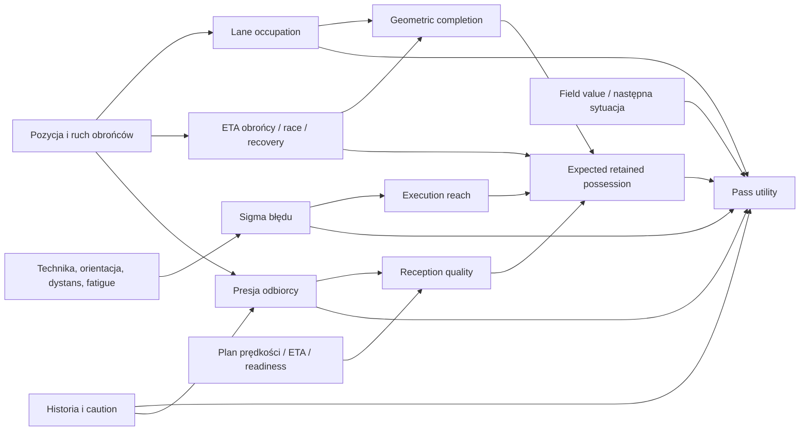
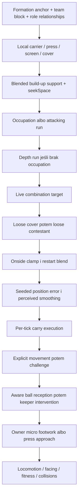

# PR176 — Match Engine Mathematical Audit

**Rekomendacja: PR177 powinien wdrożyć pakiet B — wspólną ocenę następnego stanu, jeden rachunek ryzyka, niezależne propozycje biegu i przerywalne zamiary.** Pakiet A jest porównaniem i fallbackiem; pakiet C pozostaje większym eksperymentem. Nie czekać na dowód, że pojedynczy współczynnik sam naprawi cały mecz.

PR176 nie zmienia produkcji. Baza: scalony PR175 `52748e299115cd4952d176e18d2609f4b358e797`; znormalizowany SHA 256 produkcyjnego matchSimulation `9f6123b5e9861d07b945253c0f1a98934326fb66da8246ca85fd96735c761d21`, identyczny z PR175 po review PR174. Dokładne bloby Git, hashe plików, źródła badań i historyczne receipts: [manifest](performance/PR176-source-manifest.json). Numery linii poniżej dotyczą tej bazy, nie historycznych wersji.

## 1. Decyzja i pięć najważniejszych problemów

| Priorytet | Problem / status dowodu                                                                                                                                                                            | Skutek i proponowane działanie                                                                                                                                                                                                                                   |
| --------- | -------------------------------------------------------------------------------------------------------------------------------------------------------------------------------------------------- | ---------------------------------------------------------------------------------------------------------------------------------------------------------------------------------------------------------------------------------------------------------------- |
| P1        | Niejednorodne skale utility i wiele skorelowanych rachunków ryzyka. **Potwierdzone w źródle i liczbach**, wpływ każdej ścieżki na cały mecz nieizolowany.                                          | Podanie płaci za możliwą stratę na wielu poziomach; carry otrzymuje wartość odległego celu bez tej samej wartości następnego stanu. Zastąpić wspólną oceną sukcesu/porażki; ablation jako kontrola.                                                              |
| P1        | Planner i wykonawca dalekiego zwykłego lofted pass mogą mieć różne prędkości. **Potwierdzone źródłowo i prescribed release probes**.                                                               | `derivePassLaunchPlan` dopuszcza aerial >30 m/s, zwykły release ogranicza sampledSpeed do 30. Forecast retention/interception/ETA może opisywać niewykonaną trajektorię. Ujednolicić wykonalny plan, nie zwiększać limitu w ciemno.                              |
| P1        | Sprzężone bramki lead→through i nieciągłości ruchu. **Potwierdzone**, częstość użytecznych brakujących podań nadal hipotezą.                                                                       | Najpierw odrzucone semantycznie lead może ukryć potencjalny through. Osobne `space_pass` już istnieje, lecz wybiera tylko trzech najbliższych runnerów i ma własne filtry. Generować ograniczoną liczbę przyszłych korytarzy niezależnie od bieżącego waypointu. |
| P1        | Ruch wsparcia jest mieszany, nadpisywany i nie wycenia kolejnego kontaktu. **Potwierdzona kolejność przypisań; związek z ubogą ofensywą silnie wsparty PR175, bez pełnego rozdzielenia przyczyn**. | Jawny arbiter celu i skoordynowany zamiar maksymalnie dwóch akcji. Zachować realną asekurację i możliwość odmowy partnera.                                                                                                                                       |
| P2        | Globalny cooldown i oddzielna gotowość decyzyjna blokują rutynowy wybór. **Potwierdzona blokada; szkoda ilościowa nieustalona**.                                                                   | Hold=1.6 s, carry=1.3 s nie są dowodem trwającego kontaktu. Hybrid perception/readiness pozwoli ponownie ocenić nową sytuację bez natychmiastowego kopnięcia. Cztery 3-sekundowe próby nie wykazały zniknięcia nowej okazji podczas blokady.                     |

Uzupełniające problemy: paradoks gameReading, skrajnie stłumiona wartość dalszego strzału i wzmacniające bezpieczny outlet człony pamięci. [Rejestr z modułami, reprodukcją, ryzykiem i rozwiązaniem](performance/PR176-issue-solution-registry.json).

## 2. Zakres, evidence i ograniczenia

Przeczytano PROJECT_STATE, ROADMAP, MATCH_BEHAVIOUR_CALIBRATION i raporty PR171–175 oraz ich dostępne receipts/provenance. PR171 ujawnił awarie i problemy restartów; PR172 naprawił konkretne mechaniki, lecz nie ranking; PR173 zachował fizyczną ciągłość pierwszego kontaktu; PR174 dodał krótkie kombinacje, z późniejszą poprawką dostępnej asekuracji. **Frozen K nie jest aktualną bazą**. PR175 ponownie zmierzył scalony kod i nie wykazał realizmu. Oryginalny dokument Gemini nie został dostarczony; wszystkie jego hipotezy z briefu oceniono na aktualnym kodzie, bez wymagania prywatnego Drive.

PR175: 12 nowych wówczas projektów, 21 306 podań, 14 strzałów, 9 goli, 6 rożnych; 87.03 min live / 92.03 elapsed. CM: 2112/16722 przyjęć (12.63%); 77 zakończonych kombinacji, zero powiązanej credible kolejnej decyzji runnera według ścisłej definicji. Są to deskryptywne, heterogeniczne projekty, nie populacja ligi. Bundesliga reference z tego samego raportu: 1166.17 podań i 25.50 strzału/mecz, z różnicami definicji cross/reception/corner i bez zgodnego realnego live-clock. [Metody PR175](PR175_MATCH_REALITY_VALIDATION.md#4-real-football-reference-i-definicje) pozostają obowiązujące; nie pobierano nowych event dumps i nie traktowano seniorów jako celu U17.

Nowe badania PR176:

- 19 kompletnych, rzeczywistych **historycznych development** frozen states PR175, wszystkie wygenerowane akcje i podpisane oryginalne składniki. Nie są świeżą walidacją.
- 190 teammate projections z tych stanów; 121 jednoczynnikowych sweeps i 78 osobnych boundary probes; 70 planów lotu 5/10/15/25/35/45/60 m i 28 rzeczywistych releases prosto/po przekątnej.
- Cztery zwykłe 3-sekundowe kontynuacje z shadow rankingiem co 0.1 s. Cały ranking i pełne końcowe stany są identyczne z/bez instrumentacji.
- AST census porównań, stałych i wyrażeń. Census nie utożsamia każdej liczby z timerem; interpretacja jest w [inventory](PR176_TIMING_AND_THRESHOLD_INVENTORY.md).

Loader owija **oryginalne operandy**, ocenia każdy raz i zachowuje drzewo arytmetyczne. Nie przepisuje scorera i nie dodaje RNG. Suma operantów zgadza się z canonicalScore do 1e-8; niezależny proces bez loadera porównuje pełne rankingi i whole-state continuations. [Integrity](performance/PR176-research-integrity.json). Pełne tabele: [appendix](PR176_NUMERICAL_APPENDIX.md), [JSON scores](performance/PR176-frozen-scores.json), [source expressions](performance/PR176-scoring-expressions.json).

## 3. Rzeczywista ścieżka od stanu do akcji

`stepTacticalMatchInternal` w [matchSimulation.ts](../src/core/matchSimulation/matchSimulation.ts#L2572) sprawdza koniec okresu, cooldown≤0, owner i restart. Human agency może wstrzymać wybór. `chooseNpcRoutineAction` dodaje `npcPossessionDecisionDelay`; dopiero potem `chooseNpcAction → rankAvailableActionsForAI → enumerateAvailableActions → scoreActionForAI`. Ranker jest czystą projekcją: sam nie stosuje globalnego cooldownu. Noise to osobny generator z `seed:decision:decisionIndex:actorId`, jedna wartość [-4,4] na kandydata w kolejności generacji. Dodanie kandydata może zmienić noise następnych opcji mimo niezmienionego RNG wykonania.

`resolveMatchAction → resolveMatchActionCanonical` ponownie sprawdza aktywnych uczestników, właściciela/first-time contact, throw restriction, shot eligibility i uprawnienia człowieka. Następnie wykonuje zwykły kontakt, seeded execution, release, offside snapshot i canonical stats. Zmiany trajektorii wpływają na dalszy mecz; forecast nie gwarantuje sukcesu.

| Rodzina                    | Eligibility / generacja                                                                                | Forecast i ranking                                                                                                          | Przygotowanie, wykonanie, wynik                                                                                                                                                      |
| -------------------------- | ------------------------------------------------------------------------------------------------------ | --------------------------------------------------------------------------------------------------------------------------- | ------------------------------------------------------------------------------------------------------------------------------------------------------------------------------------ |
| Hold                       | Owner; zawsze początkowa opcja w `enumerateAvailableActions` L283                                      | `scoreActionForAI` L449: patience, scan, pressure, age; floor pod dużą presją                                               | Nie przemieszcza futbolowo do celu. Micro footwork pozostaje. Resolver L1165 ustawia 1.6 s cooldown.                                                                                 |
| Carry / controlled dribble | `enumerateCarryChoices` L124: cztery kierunki 6/10/5/-3 m; aktywny cel może być dodany ponownie        | `projectCarryOpportunity`, contact window, local pressure, skill, endpoint value; szczegóły niżej                           | `deriveCarryExecution`: controlled/evade/tight/shield/burst, fizyczny pursuit/impuls. Dribble jest trybem wykonania/wyboru, nie autonomiczną rodziną z osobnym równoległym scorerem. |
| Sprint carry               | Burst≥0.35; trzy korytarze; freeDistance≥12 m, forward>8 m                                             | Six-waypoint race forecast, clipped free endpoint, burstCost; fitness skaluje realne capabilities                           | Cooldown carry 1.3 s; skończone przyspieszanie i kontakty, bez gwarancji minięcia.                                                                                                   |
| Ordinary/support           | Teammate <68 m; progression w **metrach X**≤8                                                          | Krótka projekcja ruchu, canonical launch/reception, pełne pass utility                                                      | `interpretPassExecution`, sampled target i speed; actual contact może być błąd/strata.                                                                                               |
| Progressive/direct         | Progress>8 m; direct gdy długość>42 m                                                                  | Ten sam scorer; inny intent deadline, style classification; progression utility jest ΔfieldValue                            | Zwykła piłka, nie szybka wersja „AI only”.                                                                                                                                           |
| Lead                       | `projectPassReception → deriveLeadPass` L197; wszystkie bramki w sekcji 6                              | Race/lane gates przed rankingiem, bonus do 12×Pcompletion po rankingu                                                       | Zachowany receiver-relative offset; receiver locomotion i przyjęcie.                                                                                                                 |
| Through                    | Lead musi istnieć; receiver ahead>8, duty≠defend, runSpace≥6, dedup target≥1.6                         | Dodatkowe -10 albo -38 oraz clipped runSpace [-35,25], runner bonus tylko Pcompletion>.62                                   | Release-time offside i normalna interwencja obrońcy.                                                                                                                                 |
| Lofted                     | Ordinary length≥22 i progress>5 lub lateral>20; osobna lofted-through bramka                           | Aerial planner; lane width 1 m, difficulty+.25. Uwaga na prędkość forecast/release                                          | Rzeczywisty 3D lot, contact height/headers/loose/rebounds.                                                                                                                           |
| Space pass                 | `enumerateNpcSpacePasses`; trzy najbliższe legalne propozycje                                          | `deriveSpacePassPlan`; recursive ordinary pass utility +clamp(3×advantage,0,6)                                              | Rewalidacja planu i zwykły pass release do wybranej przestrzeni. Może ocenić nieruchomego receivera.                                                                                 |
| Cross                      | fieldValue>54, width≥12, goal-depth distance≤44; final occupations                                     | Osobna heurystyka targets/density/delivery/length/pressure; nie używa expectedRetention podań                               | Driven/floated/cutback plan, kontakt i canonical flight. Cross nie ma normalnego PassDiagnostic denominator.                                                                         |
| Shot                       | `enumerateCanonicalShootingOptions` L263; settled feet/height/owner albo incoming contact; range≤60/29 | `shotUtility + canonicalShotStyleUtility - preparationPenalty`; wszystkie warianty konkurują z pass/carry                   | `canExecuteCanonicalShot` ponownie; `resolveCanonicalShot` i actual CCD/GK/laws. Zwykły shot jest transakcją, nie długą asynchroniczną wind-up queue.                                |
| First-time pass            | `incomingBallContact(...,'pass')`, height≤.65, target≥4 m; zwykłe projected pass options               | Pass utility, firstTime difficulty i dodatkowy próg względem fresh control                                                  | Przy kontakcie ponowna ocena; pending incoming intent, bez settled preparation penalty.                                                                                              |
| First-time shot/header     | Incoming forecast≤1.4 s, finite contact/range/height/orientation                                       | Shot style/difficulty; shotUtility bazuje na bieżącym actorze, style na forecast contact — sprawdzić spójność przy migracji | Kontakt i rewalidacja przy piłce; żaden forecast nie tworzy zdalnego strzału.                                                                                                        |
| Combination continuation   | `enumerateCombinationPasses` L299; live intent, runStarted, partner, legal/available runner            | Zwykły pass scorer bez darmowego bonusu; narrow moving return exemption                                                     | Partner może wybrać inną akcję; dwa reale pass IDs i run/contact milestones.                                                                                                         |

Źródła pomocnicze: [firstTimePassing](../src/core/matchSimulation/firstTimePassing.ts), [carryOpportunity](../src/core/matchSimulation/carryOpportunity.ts), [carryExecution](../src/core/matchSimulation/carryExecution.ts), [shootingOptions](../src/core/matchSimulation/shootingOptions.ts), [combinationPlay](../src/core/matchSimulation/combinationPlay.ts).

## 4. Matematyka i skale

Wszystkie `U` są umownymi punktami. `clamp` ogranicza do [0,1], `L` to liczba obrońców w ocenionym korytarzu, `r` to gameReading/composure mean w [0,1]. Nie wolno interpretować utility jako xG. Nawet pola expectedCompletion/retention są **heurystycznymi prognozami**, nie skalibrowanymi prawdopodobieństwami.

### 4.1 Podanie: fizyka, błąd, retention

[evaluatePassDecision](../src/core/matchSimulation/passDecision.ts#L73):

```text
Pgeom = clamp(.96 - .21L - .4 race - .45 timing - .22 boundary
              - .14 passerPressure(1-passerAbility/100))
race = clamp((receiverETA-defenderETA+.35)/1.1)
late = max(0,receiverETA-ballETA-.12); timing=clamp(late/.7)
window=max(0,min(ballETA-receiverETA,defenderETA-receiverETA))
radius=.9+min(3,1.5window)
Preach=1-exp(-radius²/(2sigma²)); Pcompletion=Pgeom*Preach
Qretention=clamp((receptionQuality-.25)/.5)
recovery=.35*clamp((ballETA-defenderETA+.3)/2)
R=Pcompletion*Qretention*(1-recovery)
adjustmentCost=sigma*(1+receivingPressure)
A=clamp(.35+lateTrailing(.15)+transition(.18)-caution*.2*clamp((passerPressure-.4)/.6))
Uforecast=-(1-(out?0:R))*(38+38r)*(1-.3A)
          -adjustmentCost*(.7+r)-(out?65+25r:0)
          +(runner && Pcompletion>.62 ? 22*(Pcompletion-.62):0)
```

`receiverETA` dodaje .04 s przy speed>.7, inaczej awareness z planu. Lane occupation sprawdza projekcję 7–94% odcinka i realny arrival obrońcy do punktu przed `ballETA*fraction+.18`. Ground corridor=2.1 m, lofted=1 m. `targetPredictedOutOfPlay` bada late receiver, czas do granicy i rolling runout, nie tylko punkt poza boiskiem.

[derivePassDifficulty](../src/core/matchSimulation/passExecution.ts#L51):

```text
ability=(passing/100)^.65*(technique/100)^.25*((reading+composure)/200)^.1
rangeDemand=.18+.03distance+.55(distance/18)^2
sigma=.12+rangeDemand*(.09+(1-ability)^2/(.08+ability))*difficulty
difficulty=1+|dy|/50+loft(.25)+runner(.2+receiverSpeed/24)
           +.75(facing/pi)^2+.7pressure+weakFoot+incoming+.75physicalDemandCost
```

Distribution zwraca sigma w metrach; release losuje Gaussian lateral sigma i depth .65 sigma przez seed przypisany do release. `Preach` używa izotropowego koła i tej samej sigma w obu osiach, więc nie jest dokładną całką rzeczywistego anizotropowego błędu. Forecast of reception ustawia sztucznie receiver w target i przewiduje facing. Live control zna faktyczny kontakt, prędkość i położenie. To przybliżenie do walidacji, nie dowód błędnego każdego prognozowanego przyjęcia.

[resolveReceptionOutcome](../src/core/matchSimulation/passReception.ts#L289) oblicza technical mean (firstTouch ma wagę 2), -.2 pressure, karę za speed ponad comfortable speed, body speed>6.5, facing behind body, height>.18 i weak foot; dodaje .14 oraz preparation bonus do .14. Quality≥.75 nasyca `Qretention=1`; utility nie odróżnia wtedy jeszcze lepszego kontrolera tym kanałem. Quality≥.64 w ruchu oznacza directional, ≥.55 clean, ≥.34 heavy, niżej failed. To nie ten sam podział co `.25/.75` w forecast retention.

### 4.2 Pełne utility podania

[scoreActionForAI](../src/core/matchSimulation/matchActions.ts#L631), dokładne operandy L759:

```text
Upass=28+Uforecast+24*possessionUrgency*Pcompletion-solutionPenalty
      +adaptation-attackVariation*min(3,channelFailures)*(1-R)*6
      +deltaFieldValue*(transition?1.5:1.05)-.3length-17receiverPressure-10L
      +.7markerSeparation+.35positiveWidthGain*switchOpportunity
      +switchValue+recycleValue-staleReturn+technical+style+throughContext
      -threatLoss-offsidePenalty-preparationPenalty+leadBonus+runSpace
```

`technical=(passing+technique+reading+composure)/20`, 0–20. Marker separation cap 15 daje do 10.5. `switchOpportunity=max(spaceReleased,passerPressure-receiverPressure,0)`; switchValue cap 12 × opportunity. Recycle wymaga support, ΔfieldValue>-9 i marker≥5: `3+14positivePressureEscape+.5switchValue`. Style direct/through: `36(verticality-.4)`, inne `14(patience-.5)`. ThroughContext zawsze ujemny: -10 przy ETA advantage≥.2, inaczej -38. Lead bonus max 12×Pcompletion. RunSpace to max z prognoz .5–2.5 s: `1.4forwardMetres+12(ETAdef-ETAatt)-8staticLaneRisk+min(5,boundary)`, na końcu [-35,25].

`fieldValue=70depth+centrality*(5+15finalThird)+10finalThird`, gdzie finalThird=max(0,3(depth−2/3)). **ΔfieldValue nie jest liczbą metrów**. W centrum ostatniej tercji przyrost na metr wynosi do około 1.38 punktu przed mnożnikiem; głębiej około .667. Model zna centralność, lecz nie zna pełnej wartości następnego przyjęcia i możliwości strzału partnera.

Stale return: resolved pass do current actor i powrót do passer <12 s; kara `30max(.35,1-age/12)`, chyba że escape>.2 przy pressure>.62, ΔfieldValue>9, switchValue>6, obecny receiverMoved>4 albo żywa moving combination z clear lane/Pcompletion>.62/ETA margin>.12. `receiverMoved` to przesunięcie obecnego posiadacza względem miejsca odbiorcy przy poprzednim release; PR174 dodał osobne rzeczywiste przesunięcie oryginalnego passera dla kombinacji. Nie usuwać tego wyjątku przy reformie.

`threatLoss=max(0, terminalOpportunityValue(actor)−.32fieldValue(target))`, terminal=`62effectiveShotExpectation+.7max(0,22−goalDistance)`. To różnica niejednakowych proxy, a nie oczekiwane goal difference po podaniu. Offside penalty=80, lecz finalny przepis pozostaje w execution. Preparation penalty cap 65, 55 punktów na sekundę ujemnego action-specific margin.

### 4.3 Hold, carry, cross, shot

| Rodzina / źródło                         | Wszystkie główne dodatnie i ujemne składniki                                                                                                                                                                                                                                                                                                             | Skala / interpretacja / problem                                                                                                                                                                                                                                                                                |
| ---------------------------------------- | -------------------------------------------------------------------------------------------------------------------------------------------------------------------------------------------------------------------------------------------------------------------------------------------------------------------------------------------------------- | -------------------------------------------------------------------------------------------------------------------------------------------------------------------------------------------------------------------------------------------------------------------------------------------------------------- |
| Hold, matchActions L449                  | `35+40(patience-.5)+scan(8+(read+comp)/20)−pressure*(scan?30:18)−completedScan−14buildUpSafety*pressure`; completedScan=18..46 po max(physical,decisionDelay). Przy pressure≥.65 floor `14+8shieldSkill−4pressure`, potem −35 urgency−memory.                                                                                                            | Przed końcem skanowania może sięgać ok.73; potem mocno spada. Lokalny age penalty nie zeruje cooldownu. Low-pressure hold może być racjonalny; nie wymaga quota podań.                                                                                                                                         |
| Carry, L500–600                          | `18+1.3ΔfieldValue+crossingAccess*min(10,3support)+continuity(5)+committedContinuity(5)−burstCost+(dribbling+agility+pace+composure)/16−30max(currentPressure,targetPressure)−18buildUpSafety*pressure−localBlockers*(12+12urgency)*(1-dribbling/160)+2pressure*escapeDistance−solution−2economicalCost−contactDifficulty*(8+10pressure)−30contactRisk`. | Skill do 25, dwa continuity bonuses mogą współistnieć. Sprint koszt 5+18(1-readiness)+5 turnCost i clipped endpoint. Zwykły carry używa requested endpoint nawet jeśli freeDistance mniejsze — świadoma ochrona przed podwójną karą starcia, lecz porównanie z ostro zdyskontowanym pass nie jest wspólnym EV. |
| Cross, L611                              | `24+(passing+technique+reading+composure)/20+9targets−6defenders−.35length−22pressure+cutback(8)+direct(7)`                                                                                                                                                                                                                                              | Targets w 15 m, opponents w 12 m od target. Liczba partnerów nie oznacza osiągalnego kontaktu; brak wspólnego Psuccess/Pfailure z pass.                                                                                                                                                                        |
| Shot, L146                               | `4+150effectiveExpectation^1.18−12pressure−4blockingDefenders+direct(3)−12(max(0,d−22)/8)^1.55+distanceContext`; potem shotStyle i preparation.                                                                                                                                                                                                          | Dla effective .02/.075/.24 samo `4+150e^1.18`≈5.48/11.06/31.83. Carry ma samą bazę+skill ok.30–43 przed progresją. Nie jest to dowód, że każde odrzucenie strzału błędne.                                                                                                                                      |
| Shot style, shootingOptions L483         | executionPenalty=9 firstTimeDifficulty+5 orientation+5 weakFoot; placed finishing/30+3 angle−7 pressure−penalty; driven .22 max(0,20−d)+3 pressure−penalty; chip min(22,3 keeperDepth)−8−penalty; header −8−penalty+heading/20                                                                                                                           | Pressure i blockers wpływają wcześniej na effective expectation, ponownie na utility/style; również skorelowane, nie tylko pass. Header shot pomija settled preparation penalty.                                                                                                                               |
| First-time vs control, matchActions L902 | Fresh control ma age=0. Pass musi pobić control o `18+18(1-pressure)+incomingHorizontalSpeed/5+6turnRadians`; shot nie ma tego dodatkowego pass premium.                                                                                                                                                                                                 | To osobna bramka porównania, nie zwykły mnożnik jakości. Nie mylić z fizycznym czasem kontaktu.                                                                                                                                                                                                                |

Distance context shot działa tylko przy 20–31 m, angle>.5, releaseQuality>.6, pressure<.65; wartość `16context*releaseQuality*exp(−blockingDemand)*min(1,reboundSupport/2+.5(1-keeperCoverage))`. Brak uniwersalnej premii „strzelaj z daleka”.

Fatigue: [matchFitness](../src/core/matchSimulation/matchFitness.ts#L191) skaluje speed/acceleration/turn/control; `difficultActionPhysicalCost` tylko dla realnego demand, a nie stała kara passing. Lekki nieruchomy pass nie traci jakości tylko dlatego, że burst jest niski. `projectPassReception` korzysta częściowo z własnego `3.2+.055agility` i `6.2+.033pace`, podczas gdy arrival uses canonical capability z fitness. Ta niejednakowa projekcja jest dodatkową niepewnością feasibility, do ujednolicenia w PR177.

## 5. Graf zależności i double-counting



Ostatnia krawędź historii do presji oznacza zmianę taktyki/ruchu w dalszym meczu, nie natychmiastową modyfikację geometrycznej presji w jednym frozen rankingu. [Machine graph](performance/PR176-scoring-dependency-graph.json) rozpisuje wszystkie wymagane czynniki, w tym timing, awareness i controllability.

**Ile razy ta sama sytuacja może być ukarana? Nie istnieje jedna uniwersalna liczba.** Bez pamięci jedna lane occupation obniża Pgeom i osobno odejmuje 10 punktów; przy aktywnym buildUpSafety dochodzi −7B na lane; through dodaje skorelowany static lane term w runSpace i może nie powstać z powodu pre-ranking gate. Zatem **2 podstawowe ścieżki, 3 z build-up, do 4 w through**, nie cztery identyczne mnożenia prawdopodobieństwa.

Presja/marker może wejść przez: race do target, recovery, reception quality, adjustment cost, bezpośrednie −17p, adaptację −19Bp, remembered receiver i attack-history factor; separation/escape/recycle dodatkowo nagradzają odwrotną stronę tej samej geometrii. Liczenie tych nazw jako ośmiu niezależnych prawdopodobieństw byłoby błędem. Obecny receiverPressure jest skill-aware `evaluatePressure` w **bieżącej** pozycji, a forecast receivingPressure używa nearest/14 w **przyszłym** target: informacja jest częściowo różna, silnie skorelowana.

Effective receiverPressure direct penalty wynosi `-(17+19B)p` plus pamięć odbiorcy; B to buildUpSafety aktywowany głębią i relief weight, nie stale 1. `adaptationValue` może jednocześnie dodać do 21B za safe outlet i odjąć ryzyko: nie jest zawsze ujemne. Znane historyczne straty mogą zawierać dodatkową informację o powtarzalnej pułapce; źródło nie dowodzi, że całą pamięć należy usunąć.

Przy pełnej jakości r=1, bazowej appetite=.35 spadek R o .21 daje około 14.28 punktu kary forecast (gdy pozostałe składniki retention=1), plus 10 lane i ewentualnie 7B. To **ilustracja marginalna**, nie symulacja tego, że jeden obrońca zawsze zmienia R dokładnie o.21. Attacking reward rzędu kilku punktów nie równoważy takiej zmiany. Duże ΔfieldValue/runSpace czasem może; tablice zawierają również wygrywające progresywne akcje.

Ranking jest arytmetycznie zdefiniowany i deterministyczny, ale **nie ma spójnej probabilistycznej interpretacji między rodzinami**. Nie udowodniono, że korelacja sama czyni wszystkie dodatkowe kary błędnymi; potwierdzono brak jednego rachunku kosztu straty i wymaganą wrażliwość na te składniki. Eksperyment powinien porównać kanały osobno i w pakiecie.

### Atrybuty: potwierdzony lokalny paradoks

Przy zamrożonych R/A/cost: `dUforecast/dr=−38(1−R)(1−.3A)−adjustmentCost`. Wyższe reading/composure zwiększają cenę ryzyka. Inne ścieżki poprawiają recognition, sigma, preparation, tactical preferences i technical score, więc wynik netto nie musi spadać.

Jednak w realnej geometrii CB z 39 s, prescribed progressive do tego samego CM: gameReading 20→99 poprawia R .424956→.426251, a canonical score **4.076880→.111423**. Zysk execution nie równoważy silniejszej awersji. [Sweep](performance/PR176-sensitivity.json). To potwierdza możliwy paradoks **oceny tego podania**, nie tezę, że lepszy zawodnik zawsze gra gorzej. Oddzielić jakość osądu od jawnej skłonności taktycznej do ryzyka.

## 6. Generowanie i wygaszanie okazji

[projectPassReception](../src/core/matchSimulation/passReception.ts#L143) wybiera velocity przy speed≥.35, inaczej tactical target dopiero od 1.6 m. Bez motion albo przy checking-back dot>.45 distance zamienia lead/through na support. Z postoju uwzględnia awareness, acceleration i docelową prędkość, **ale travel nie przekracza istniejącego waypointu**. Nie wymyśla nowego korytarza z samego tempa. Trzy iteracje meeting, max 2.5 s; trzy corrections ×.75 horizon; movementProjection<1.6 lub arrival>ballETA+.2 ponownie zamienia na support.

`deriveLeadPass` potem wymaga motionLength≥1.2 (velocity dopiero speed>.7, inaczej desired vector), leadDistance≥1.6, nie-check-back, reachable, defenderETA≥receiverETA+.12 i static lane defenders<2 przy 2.5 m. Ten sam player przy speed.349 może mieć lead, przy.350 go stracić: w sweep projected distance 2.59→3.86 m, eligibility true→false. To wypadkowa przełączenia modelu ruchu i kolejnej bramki, nie prawidło „szybszy receiver nie może biec”.

Through w ordinary path wymaga dodatkowo progress>8, duty≠defend, `evaluateRunSpace.utility≥6` i release target oddalony od ordinary target≥1.6. **Pcompletion>.62 nie jest ogólną bramką through**: to kink runner reward i warunek moving wall exemption; `.2s` w throughContext daje skok 28 punktów. `space_pass` używa advantage≥.2 jako osobnej bramki. Nie łączyć tych trzech różnych warunków w fikcyjne jedno kryterium.

Alternatywna [spacePassing](../src/core/matchSimulation/spacePassing.ts#L164) ścieżka omija lead: runner≠GK/duty defend, within 42 m, ahead>2 m, onside; wybiera trzech najbliższych, target+8 m central/+10 wide. Receiver wybrany planem musi być tym runnerem; advantage≥.2, receiverETA≤ballETA+.3, boundary≥2. `deriveSpacePassPlan` dopuszcza target 1.5–75 m, arrival≤6 s; stationary forward poza linią docelową może dostać through, inaczej progressive/direct. Dlatego twierdzenie „through zawsze wymaga już trwającego biegu” jest **fałszywe dla całego silnika**.

190 wybranych teammate pairs:136 lead requests reclassified support,16 accepted lead,1 ordinary through pair,6 pairs ze space actions. To nie mianownik „190 wykonalnych through balls”; missing viability i częstość w pełnym meczu nie są znane. Instrumentować wszystkie bramki z reason codes i shadow feasible-run envelope **na momentach rzeczywistych decyzji**, nie per tick. Zachować liczbę nominowanych, odrzuconych, wykonalnych i wybranych osobno.

## 7. Prędkość i ETA podań

[derivePassLaunchPlan](../src/core/matchSimulation/passLaunchPlan.ts#L32) ground:

```text
Tdesired=min(intentCap, max(intentFloor, earliestUsefulContact+buffer,distance/nominalRate))
cap=2.20 support /1.80 progressive /1.45 direct,lead,through
floor=.72 support /.48 inne; buffer=.28/.08; nominalRate=9/13/17 m/s
v0=min(30,max(3.2,d/Tdesired+.5*a*Tdesired)), a=3.2m/s²
```

Forecast próbuje 8 s co.025 i wybiera pierwszą próbkę w.55 m od target albo najbliższą. Stąd ETA nie jest dokładnym center crossing ani maksymalnym czasem rzeczywistego lotu. Dla ground bez kontaktu `Tcentre=(v0−sqrt(v0²−2ad))/a`; gdy dyskryminant<0 target nieosiągalny. Dla testowanych ground distances target jest fizycznie osiągalny. Dla 60 m support Tdesired 2.2, direct 1.45, ale oba v 0=30 i forecast≈2.275 s. Limit jest **żądanym ETA**, nie clampem rzeczywistego czasu.

W prescribed stationary receiver przykładzie 35 m: support v 0=19.429, arrival 12.469 m/s; direct 26.458/21.898. Forecast q .545→.204 i retained .163→0. To wspiera mechanizm szybszy intent→trudniejsza kontrola→niższe utility, nie potwierdza real-world błędnej prędkości wszystkich 35 m podań. Technika w tym przykładzie pochodzi z konkretnego youth CB, a opponents pozostają z oryginalnej geometrii. Pełne readiness/sigma/interception/q w [tabelach](performance/PR176-pass-flight.json).

Lofted używa `deriveAerialLaunchPlan`, osobnej apex/drag/gravity trajektorii, nie ground deadline. **Potwierdzona niezgodność**: przy 60 m nominalny ordinary lofted plan może mieć 35.456 m/s (pass) lub 33.769 (long/direct), a [release](../src/core/matchSimulation/matchActions.ts#L1477) zwykłego pass `sampledSpeed=min(30,...)`. GK long distribution i throw są osobnymi wyjątkami. [Rzeczywiste release probes](performance/PR176-released-flight.json) zachowują sampled target i actual vectors; różnica czasu/miss zawiera też błąd wykonania oraz start height 0 vs forecast.11, więc nie przypisuje się każdej różnicy samemu ceiling.

Interception forecast może być optymistyczny przy za szybkim nominalnym locie, albo pessimistic reception przy wielkiej arrival speed. Aerial receiver forecast używa height.35 i z=0, choć rzeczywisty kontakt ma zmienny height/vertical speed — kolejna rozbieżność modelu, nie nowa fizyka do wdrożenia w audycie. Nie ma dowodu, że to samo wyjaśnia całość 87 min live. Short support może być stabilny i rozsądny. Long-distance sigma rośnie kwadratowo; ceiling i reception razem dodatkowo zniechęcają long delivery.

## 8. Timing, movement authority i scarce shots

Pełna klasyfikacja wartości, zegarów, interruptibility i progów jest w [inventory](PR176_TIMING_AND_THRESHOLD_INVENTORY.md). `npcPossessionDecisionDelay` to max physical,.2 i kontekstowy scan z credit lotu; nie sumować awareness, przygotowania i całego lotu jako trzech blackoutów. Micro controlling→turning(+.65)→adjusting(+1.6)→scanning jest etykietą footwork, nie dodatkową blokadą AI. Zapamiętany passingAngle może się zdezaktualizować, choć local shield reaguje na pressera. Rutynowe shot contact/release to jedna transakcja po wybraniu, więc scarcity nie jest masowym gubieniem zaakceptowanych shots w wind-up.



To kolejność kodu, nie jedna deklaratywna hierarchia. W `deriveTacticalTargets` L822–1046 support blokuje occupation i ordinary attacking run; depth run wygrywa przy braku occupation; combination nadpisuje wcześniejsze cele, ale loose assignment później może nadpisać combination. Restart jest blendem przed smoothing. W matchSimulation L1375–1473 explicit movement nadpisuje carry localTarget, challenge potem movement, reception potem challenge, keeper potem reception; owner micro i pressing mogą zmienić **movementTarget** bez zmiany exposed player.target. Diagnostyka samego `target` nie dowodzi faktycznej trasy.

CM build-up: candidates within 46 m (inni 34), midfield preference−7 w rankingu nominacji, pivot tylko carrier depth<62, kilka punktów 9/14 m ahead±8 lateral; ocena lane\*2+clearance−.14 travel. Trzeci gracz i escape mają osobne role. Nie ma dowodu braku CM targetów. Problem: blend, czas dojścia, cover shadow po drodze, późniejsze overrides i prognoza pod presją w obecnej pozycji mogą uczynić poprawny nominalny target bezużytecznym. [19 actual position/velocity/target plans](performance/PR176-movement.json) pozwala oceniać odległość, lane markers i pressure, ale nie stanowi pełnego distribution między liniami/orientacji po kontakcie.

Flanki: jeden committing side, ≥2 cover>5 m za piłką, ball side, fullback duty≠defend; winger width 20 m, outside-space 5 m wybiera overlap/underlap. `combinationPlay` wymaga dodatkowo **dwóch dostępnych nieuczestniczących** cover — wartościową poprawkę PR174 zachować. Return wymaga live run, current safe forecast i może przegrać z recyclingiem; expiry 2.5–4.5 s, max 6 po return flight. Utworzenie biegu, jego fizyczny start i wykorzystanie są trzema różnymi faktami.

Back line: wspólne anchor depths, globalny block transform, mała swoboda duty defend, skoordynowana aktualizacja 10 Hz, target smoothing i structural jog/braking sprzyjają równej linii. Istnieje już seeded positioning error płynny w 4 s; **nie dodawać dekoracyjnego noise**. Brak pomiaru synchronizacji prędkości całej kohorty nie pozwala oskarżyć samego 10 Hz. Proponowane variation ma wynikać z krycia runnera, presji na piłkę, cover i offside coordination, z jawnym przekazaniem odpowiedzialności.

Shots: PR175: 3076 epizodów→632 final-third control→69 box control→19 credible opportunities. 52 z 54 credible observations miało shot candidate, ale carry 38/pass 9/hold 2 wygrywały częściej niż shot 5; to zależne ticki 19 okazji. Generation pozwala na settled range 60 m i nie filtruje pressure/blockers jako bezwzględnego zakazu; utility wielokrotnie obniża ich wartość. W realnym stanie 1341.4 s carry 32.180 vs shot 19.331; późniejszy 1342.725 s shot 65.306 już wygrywa. PR175 obie kontynuacje pierwszego stanu dawały gola: odrzucenie nie było automatycznie błędem.

Reformy: (1) wspólny EV może docenić umiarkowany shot względem równie ryzykownego kolejnego carry/recycle; (2) koordynacja support/runner/box/second-ball i dwuakcyjne proxy może **wytworzyć** lepszy kontakt. Sam shot bonus nie rozwiąże dopływu geometrii. Nie podnosić accuracy i nie osłabiać goalkeeperów. Prawidłowe misses/blocks/saves/corners powinny wynikać z nowych normalnych trajektorii.

## 9. Wnioski wykonawcze — 30 odpowiedzi

| #   | Odpowiedź                                                                                                                                                                                 |
| --- | ----------------------------------------------------------------------------------------------------------------------------------------------------------------------------------------- |
| 1   | Pięć głównych: wspólny risk/value, mismatch launch/release, sprzężone gates, target authority/continuation, globalne oczekiwanie. Sekcja 1.                                               |
| 2   | Ich istnienie potwierdza aktualny kod; ilościowy wpływ na futbol wymaga controlled implementation.                                                                                        |
| 3   | Rzadka groźna geometria, słabe combinations→danger, recykling i niski CM share są silnie wsparte PR175.                                                                                   |
| 4   | Dominujący wkład każdego mechanizmu, koszt szkodliwych timerów i globalny efekt reform pozostają hipotezami.                                                                              |
| 5   | Lane:2 podstawowe ścieżki,3z build-up,4z through-space, plus bramki; pressure ma więcej skorelowanych ścieżek. Nie są to niezależne kary za identyczne zdarzenie.                         |
| 6   | Arytmetycznie tak, wspólnego expected-value między rodzinami nie ma.                                                                                                                      |
| 7   | Tak: w jednym realnym fixed pass lepsze reading poprawia retention, ale obniża score 4.077→.111.                                                                                          |
| 8   | Hold baza 35 i scanning; carry 18+skill do 25+endpoint; pass 28+technical do 20 minus retention; shot 4+150e^1.18 minus liczne koszty. Tabele podają rzeczywiste całkowite rankingi.      |
| 9   | Otwarty safe receiver zyskuje mniejszą karę retention/pressure, separation, recycle i czasem adaptation. Nie każdy defensive pass jest bezpieczny; youth przykład R=.498 mimo zwycięstwa. |
| 10  | CM target nie gwarantuje fizycznej dostępności ani korzystnej następnej akcji; presja, shadows, blend i wartość ryzyka współdziałają.                                                     |
| 11  | Lead chain, waypoint/speed gates, shortlist i ujemny throughContext; osobna space ścieżka łagodzi, nie usuwa ograniczeń.                                                                  |
| 12  | Kandydat może zniknąć przez brak istniejącego ruchu, waypoint<1.6, static lane≥2, duty i dedup; możliwość nie oznacza jeszcze dowiedzionej użyteczności.                                  |
| 13  | Tak: intent deadlines silnie zmieniają arrival speed/quality; dodatkowo potwierdzono aerial forecast>30 vs capped execution. Real-world optymalna prędkość nie jest ustalona.             |
| 14  | Kontakt/turn/awareness, slide commitment, actual readiness restarts i keeper reaction mają fizyczny sens; zachować i walidować.                                                           |
| 15  | Hold/carry i recepcyjne stałe są umownymi blokadami; nie dowiedziono w 4 krótkich próbach ile okazji faktycznie ginie.                                                                    |
| 16  | Tak: hybrid event-driven reevaluation z latency i twardą fizyką kontaktu, nie pełny ranker 40 Hz.                                                                                         |
| 17  | Cel może być blendowany/nadpisany, niedobiegnięty albo wyceniony tylko jako kolejne zwykłe podanie i wygasnąć.                                                                            |
| 18  | Jest deterministyczna kolejność, lecz wiele właścicieli target/movementTarget zamiast jawnej arbitrażowej umowy.                                                                          |
| 19  | Wspólne structural depths/block i ograniczona swoboda plus smoothing; sama wizualna prostota nie dowodzi wady obrony.                                                                     |
| 20  | Common state value + prospective runs + finite continuation i readiness; zmieniać policy, zachować physics.                                                                               |
| 21  | Masowe turnovers, central traps, shot spam, pusta asekuracja, CPU, agency i replay incompatibility.                                                                                       |
| 22  | A decisive heuristic repair; B risk/value/timing reform; C modular policy v 3, szczegóły w options.                                                                                       |
| 23  | B, wdrożony etapami z A jako mierzalnym comparator, nie kilkadziesiąt niezależnych poprawek.                                                                                              |
| 24  | A przy budżecie CPU lub błędnej wartości następnego stanu w B; zachować poprawkę forecast/feasibility.                                                                                    |
| 25  | Tak dla semantic decision weights/readiness, osobno physics i research controls; typed immutable hashes, nie jeden worek liczb.                                                           |
| 26  | Adapter baseline, wspólny feasible plan, independent corridors, common value, hybrid readiness, explicit target arbitration, paired/cohort validation.                                    |
| 27  | Same frozen candidates z risk ablation, matched flight/release, geometry-only vs score-only vs combined, timer shadow→paired continuations, nowe holdouty.                                |
| 28  | Materialne lepsze controlled progression/opportunities i następne actions, spadek jałowej cyrkulacji bez obronnego kosztu; porównanie rozkładów i replayów.                               |
| 29  | Piłka/CCD/rebounds/GK, restarts/laws/offside, first touch, fitness, combinations foundations, human agency, career/stats/determinism/hybrid.                                              |
| 30  | Regressions kontraktów albo po dwóch ograniczonych iteracjach brak materialnej zmiany lub duże counterattack/CPU koszty; nie stroić na otwartym holdoucie.                                |

Dokładne modele, ryzyka, kolejność, budget i kryteria porzucenia: [options](PR176_MATCH_ENGINE_REFORM_OPTIONS.md) i [PR177 blueprint](PR176_MATCH_ENGINE_PR177_BLUEPRINT.md).

## 10. Odtwarzanie i status

Node 24 i niezmieniony lockfile:

```text
node scripts/preparePr176.mjs
node --experimental-transform-types --import ./scripts/registerPr176Audit.mjs scripts/auditPr176.mjs > ../pr176-audit.log 2>&1
node --experimental-transform-types --import ./scripts/registerTypescriptLoader.mjs scripts/auditPr176.mjs --plain > ../pr176-plain.log 2>&1
node scripts/reportPr176.mjs
node --experimental-transform-types --import ./scripts/registerTypescriptLoader.mjs scripts/auditPr176Boundaries.mjs
node --experimental-transform-types --import ./scripts/registerTypescriptLoader.mjs scripts/preparePr177Fixtures.mjs
npm run verify
```

Prepare sprawdza archive SHA i exact frozen bytes z istniejącego indexu; nie nadpisuje historycznych receipts. `--plain` zapisuje wyniki w oddzielnym katalogu roboczym. Manifest source identyfikuje measured working tree; baseCommit jest bazą Git, nie końcowym hashem dokumentacji. Budowanie nowych initial states nie odczytuje przyszłych wyników. Końcowy status wymaganej weryfikacji i zakres diff: [verification receipt](performance/PR176-verification.json). Nie wykonano nowej pełnomeczowej kalibracji ani reformy gameplay w PR176.
