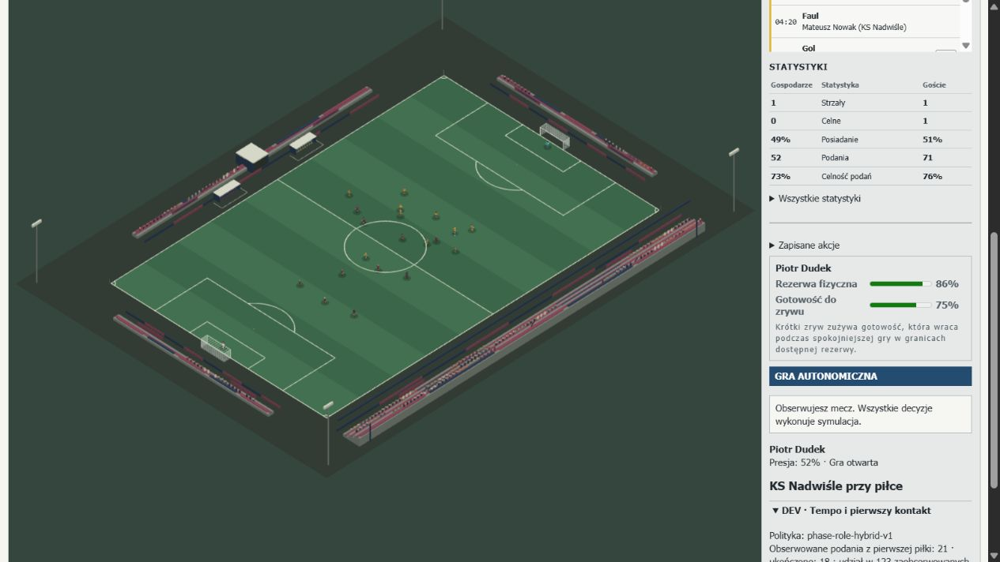

# PR180 — Football Tempo, First-Touch Decisions & Ball Interaction

PR180 changes the common execution layer and incoming-action comparison. It does
not select a tactical-policy winner. Legacy remains the default; canonical football
is **NOT READY for summary calibration**. Match statistics are development evidence,
not league estimates or targets imposed on the engine.

## Baseline and provenance

The base is merged PR179 `5646bb0e757289e1fa6ffde79ff9f94766139f48`.
The five original `mfl-session-benchmark-v5` files were actually available on the
owner's machine. All five byte lengths and SHA-256 digests match the supplied
compact baseline. [Input manifest](performance/PR180-inputs.json) preserves the
digests, original totals, coverage intervals, observer errors and fixture hashes.
The roughly 22–27 MB raw exports are not duplicated in this repository.

| Original manually observed partial match | Legacy | B | R1 | R2 | R3 |
| --- | ---: | ---: | ---: | ---: | ---: |
| Minutes | 47.00 | 46.45 | 45.26 | 47.00 | 46.04 |
| Pass attempts | 1037 | 1283 | 2292 | 1888 | 2189 |
| First-time attempts | 72 | 387 | 1930 | 1558 | 1831 |
| First-time share | 6.9% | 30.2% | 84.2% | 82.5% | 83.6% |
| Shots | 0 | 4 | 3 | 2 | 0 |
| First-time observer invariant errors | 0 | 0 | 49 | 29 | 15 |

These are five dependent exploratory observations, not an independent cohort. B's
early dismissal is a confounder. Detailed observers cover their recorded intervals;
canonical statistics cover the whole exported fragment. No complete original
session/setup/attribute/role snapshot was exported. The closest reproduction uses
the verified club IDs `pro_9` / `pro_1`, current native squads and the same
`lab-mvh694xi` seed. Exact initial-state equality is **not established**.

On untouched PR179, that closest R1 reproduction gives 1895 first-time attempts
among 2267 passes (83.6%) over 2820 elapsed seconds. The corresponding R3 trajectory
finds an inherited hold and has only 225 passes, of which 181 are first-time. That
outlier is retained. Equal seeds do not prevent divergent physical histories.

## Actual execution chain and confirmed causes

`passLaunchPlan` forecasts through `ballPhysics`; `matchActions` samples the pass,
releases the ball, records its identity and snapshots offside. `matchSimulation`
integrates the real flight, compares continuous player/boundary contacts, then tries
`tryIncomingFinish` before ordinary acquisition. `incomingBallContact` supplies a
reachable sample; `firstTimePassing` generates ordinary feet/run/space/loft targets.
`matchActions` ranks incoming alternatives. At actual contact, the same canonical
resolver executes a redirect/shot or `changePossession` resolves the control.
`passReception` determines clean/directional/heavy/failed control. Canonical action
events and `playerMatchStats` reconcile the incoming result and outgoing attempt.

This was a **combination of ranking, feasibility and execution assumptions**:

* R1–R3's fresh-control comparator inherited `forecastWaiting`: 2.5 seconds stationary
  while opponents approach. The quick redirect was compared with prolonged waiting,
  rather than with controlling the incoming ball and making the next useful action.
  Control and directional alternatives were absent from that actual incoming ranking.
* The incoming forecast checked reach, height, broad speed/technique and body
  difficulty. The pass executor already charged orientation, weak foot, pressure,
  skill and an incoming-speed surcharge. First-time passing was not unrestricted.
  However, the shared pass connection lacked the incoming **relative vector**,
  required redirection, contacted foot geometry, spin and actual foot recovery.
* Candidate construction replaced the ball with a point/nominal owner, erasing its
  incoming velocity and height while generating delivery solutions.
* A sampled first-time release could construct an almost independent outgoing ray.
  An imperfect connection did not retain an appropriate part of incoming momentum.
  Release height was reset even when contact occurred above the grass.
* `canExecuteFirstTimePass` accepted a future contact as sufficient execution
  eligibility. Execution now requires arrival time zero and the actual foot envelope.
* Ground-pass body proximity could grant control outside that foot envelope. The
  existing continuous closest-contact samples and landing claims now require a
  reachable foot as well as broad-phase proximity.
* Heavy/failed reception assigned its future escape waypoint as the current ball
  position, sometimes awarding a boundary immediately. It now starts a finite loose-ball
  impulse at the actual contact; only a later physical crossing awards the restart.

This does not isolate the full-match marginal effect of each repair. The
[80 original frozen decision states](performance/pr180-evidence/frozen-decisions.json.gz)
retain old ranks/control values and current action branches, time, effort, reasons,
feasibility and selected action on the same physical inputs. They are historical
counterfactuals, not new independent matches. Prepared passing becomes available
after actual control/preparation; it is not falsely executable while the ball is remote.

## Shared first-touch model

`firstTouch.ts` is a bounded local engineering model, with Zod-validated modes and
evidence. It reuses the existing foot locations/reach, orientation convention,
fitness modifiers, real ball velocity and canonical body state. It reads:

* relative horizontal/vertical arrival velocity and incoming height;
* incoming direction, body orientation and intended continuation direction;
* the angle through which momentum must be redirected;
* nearest eligible foot, reach/edge geometry and weaker-foot proficiency;
* available awareness/preparation, first touch, technique, agility, composure and concentration;
* nearby active opponents, player movement, spin surface speed and temporary reserves;
* the latest executed ground contact and physically contextual recovery requirement.

Its connection quality and uncertainty are engineering proxies, **not empirically
calibrated probabilities**. There is no limb/joint solver. The finite connection
window follows relative speed; recovery follows orientation, movement, contacted
foot and condition. Neither value installs a blanket delay after every team touch.
A teammate's genuine one-touch continuation has its own body/contact state.

| Intention/outcome | Canonical implementation |
| --- | --- |
| Clean/cushioned control | Existing clean-control outcome; `technique: cushion` records a firm-ball cushioning intention. |
| Directional control | Selected carry target enters the existing physical first-touch impulse and locomotion. |
| First-time pass | Actual foot contact, shared uncertainty, original height and residual incoming momentum. |
| First-time shot | Existing shot contact/technique execution also receives low-ball shared contact difficulty. Headers/volleys retain their own height mechanics. |
| Heavy touch / failed control | Existing genuinely loose-ball continuation, ordinary recovery/interception/boundary adjudication. |
| Leave / dummy | Existing `shouldLetPassRun` / run-on continuation remains authoritative; no trick catalogue. |

First-time execution records the actual ground-contact fact. A settled possession
cannot be relabelled first-time by an explicit DEV action. Candidate forecasts retain
their incoming sample's velocity and height; actual release revalidates the body.
An imperfect connection blends some incoming momentum into the outgoing impulse;
launch diagnostics report the realised vector, speed and elevation. Spin can survive
an imperfect redirect. The ordinary launch planner now preserves elevated release
height when forecasting such a contact.

Incoming control and directional touch compete in the same state-value units at the
next controlled touch. They do not inherit the role policy's 2.5-second stationary
hold counterfactual. Deliberate settled holding retains its existing tactical forecast.
The legacy scorer keeps its original units/selection context; it receives the same
physical corrections. R1 role consequences, R2 invitations and R3 phase hierarchy
remain distinct. There is no global first-time quota, random veto or new fixed wait.

## Telemetry: intermediate reconciliation

The defect was an observer identity/visibility mismatch. General attempts were
registered from canonical diagnostics, but first-time attempts and outcome detail
were nested under a requirement that `latestAction` still represented that pass.
A resolved incoming pass can coexist with the receiver's newer action. Completions
were already counted by canonical pass ID, so a completion could be counted without
its first-time attempt. Attaching an observer during such a sequence exposes the
same issue. It is not evidence that a final aggregate necessarily contains more
completions than attempts.

Attempts, first-time classification, intent and outcome detail now derive from the
unique pass diagnostic, before the separate result loop. The invariant remains.
The regression reproduces a completed first-time pass with a later visible hold,
then reobserves the same IDs to check exactly-once behaviour. The five raw manual
exports retain the original errors; new observations must reconcile during every
step. No canonical event is removed and no observer draws football RNG.

## Ground/aerial dynamics, shots and physical clusters

[Ball-dynamics receipt](performance/PR180-ball-dynamics.json) records eleven
controlled trajectories: slow/firm/long ground, driven/lofted diagonal, soft lob,
driven/lofted cross, actual geometric defender deflection, spinning delivery and
grass bounce. It records launch, distance/time, nearest intended arrival, speed,
height, spin, bounces, final point, target miss and receiver contact feasibility.
The nearest-sample target miss is a solver measurement, not sampled player accuracy.
Separate actual launch plans and execution-error experiments retain those distinctions.

Forecast and live integration agree exactly at the same 25 ms steps. Gravity, drag,
rolling deceleration, restitution, Magnus acceleration and spin decay remain the
one existing solver. Long/lofted balls can bounce naturally, be intercepted or remain
second balls; the intended receiver has no ownership guarantee. Player height/jump,
headed contact locks and goalkeeper authority remain in force.

Twelve ordinary shot configurations compare placed/driven/chip, contact orientation
and target side. Ordinary shots intentionally retain the historical zero-spin regime;
this is not a newly discovered missing propagation path. Existing canonical free-kick
curl/power/dip regressions demonstrate nonzero spin and physical curvature. No new
ordinary-shot spin distribution or goalkeeper calibration is inferred from the sparse
manual sample. This remains an explicit modelling limitation.

[Collision regression receipt](performance/PR180-contact-regressions.json) replays
the exact historical PR177 overlap input through five seconds under each policy.
Real movement, acquisition and ball escape replace the old 200-impact stationary
loop. PR178's contact-normal, relative-surface velocity, restitution, continuous-body
support and geometric re-arming are preserved. A pair of contacts within 0.2 s is
never automatically classified as invalid. Original manual exports lack complete
pre-contact engine snapshots, so an exact raw-manual cluster replay is not claimed.

The new cohort exposed **three actual player-body preparation traps at two-player
walls**. The existing detour/exclusion implementation incorrectly required at least
three wall players, conflating a physical obstacle with the separate three-player
IFAB attacking-distance rule. An attacker could also be assigned a target inside
the existing 1.15 m body envelope. The correction reuses ordinary routing around any
wall and leaves a reachable 1.25 m body/stopping corridor. The referee still checks
actual positions and the 9.15 m opponent distance; the three-player legal rule in
[IFAB Law 13](https://www.theifab.com/laws/latest/free-kicks/#procedure) is unchanged.
No timeout releases the kick. All three original frozen states are kept;
their regressions check five policies, actual readiness, stationary placed ball and
physical release after ordinary movement.

## Cohort, tempo and interpretation

Six new predeclared designs contain two SS, two SW and two WW fixtures. Native
strength, formations, styles, seed and complete state/session hashes are frozen in
the input manifest. Every policy receives the same initial state. All zeros,
failures and censored development results are retained; repeated policies are not
independent statistical units. [Policy comparison](performance/PR180-policy-comparison.json).

<!-- PR180_RESULTS_START -->
**30/30 final runs reach full time.** All per-fixture/tier rows, official denominators and observer checks remain in the JSON.

| Complete-match mean, both teams | Legacy | B | R1 | R2 | R3 |
| --- | ---: | ---: | ---: | ---: | ---: |
| Full time | 6/6 | 6/6 | 6/6 | 6/6 | 6/6 |
| Pass attempts | 1753.00 | 1195.67 | 1723.83 | 1513.00 | 1458.67 |
| Completion | 67.7% | 50.2% | 51.0% | 50.5% | 54.8% |
| First-time share | 1.6% | 11.7% | 11.4% | 11.1% | 17.0% |
| Shots released | 1.67 | 9.33 | 8.17 | 15.17 | 10.50 |
| Box entries | 8.83 | 15.50 | 15.83 | 30.17 | 20.50 |
| Crosses | 8.67 | 29.50 | 43.50 | 60.33 | 53.00 |
| Live minutes | 87.63 | 85.00 | 81.66 | 80.67 | 82.21 |

| Tier / policy (two matched designs each) | Pass attempts | First-time share | Shots | Box entries |
| --- | ---: | ---: | ---: | ---: |
| SS / legacy-pr176 | 2178.50 | 3.5% | 1.50 | 4.50 |
| SS / state-value-v1 | 2134.00 | 16.8% | 8.00 | 13.00 |
| SS / role-value-v1 | 2451.00 | 16.7% | 6.50 | 13.00 |
| SS / role-intent-v1 | 2293.00 | 15.5% | 16.00 | 22.00 |
| SS / phase-role-hybrid-v1 | 2200.50 | 22.8% | 9.50 | 18.00 |
| SW / legacy-pr176 | 1839.00 | 1.1% | 1.50 | 8.50 |
| SW / state-value-v1 | 1058.00 | 11.5% | 19.50 | 28.50 |
| SW / role-value-v1 | 1680.50 | 12.5% | 9.50 | 18.00 |
| SW / role-intent-v1 | 1434.50 | 11.3% | 25.00 | 49.00 |
| SW / phase-role-hybrid-v1 | 1205.00 | 18.6% | 14.50 | 25.00 |
| WW / legacy-pr176 | 1241.50 | 0.1% | 2.00 | 13.50 |
| WW / state-value-v1 | 395.00 | 6.9% | 0.50 | 5.00 |
| WW / role-value-v1 | 1040.00 | 4.9% | 8.50 | 16.50 |
| WW / role-intent-v1 | 811.50 | 6.6% | 4.50 | 19.50 |
| WW / phase-role-hybrid-v1 | 970.50 | 9.6% | 7.50 | 18.50 |

| Closest seed fixture, 2820 elapsed seconds | Attempts before → after | First-time before → after | Share before → after |
| --- | ---: | ---: | ---: |
| legacy-pr176 | 1034 → 1038 | 67 → 42 | 6.5% → 4.0% |
| state-value-v1 | 1257 → 1152 | 379 → 196 | 30.2% → 17.0% |
| role-value-v1 | 2267 → 1279 | 1895 → 195 | 83.6% → 15.2% |
| role-intent-v1 | 1979 → 1100 | 1606 → 149 | 81.2% → 13.5% |
| phase-role-hybrid-v1 | 225 → 1055 | 181 → 266 | 80.4% → 25.2% |

| Closest fixture, before → after | Shots | Box entries | Completion | Live minutes | CPU seconds |
| --- | ---: | ---: | ---: | ---: | ---: |
| legacy-pr176 | 1 → 1 | 5 → 6 | 89.5% → 85.4% | 42.46 → 42.99 | 73.50 → 106.70 |
| state-value-v1 | 4 → 5 | 6 → 11 | 76.8% → 63.5% | 42.32 → 40.73 | 87.03 → 139.17 |
| role-value-v1 | 0 → 3 | 0 → 3 | 86.2% → 68.0% | 44.09 → 42.72 | 76.66 → 143.25 |
| role-intent-v1 | 1 → 5 | 3 → 8 | 84.9% → 64.6% | 43.58 → 39.88 | 77.33 → 137.58 |
| phase-role-hybrid-v1 | 0 → 8 | 1 → 12 | 84.4% → 72.3% | 46.08 → 40.42 | 88.64 → 126.56 |

The closest-fixture inputs and sessions match exactly before/after, although their equivalence to the original manual setup remains unproven. CPU is process time under concurrent workload; these before/after runs were not isolated marginal-cost experiments. These comparisons concern the same corrected mechanics, with no winning-policy selection.
<!-- PR180_RESULTS_END -->

In the closest paired R1/R2/R3 fixtures, shots change 0→3 / 1→5 / 0→8 and box
entries 0→3 / 3→8 / 1→12. This is more attacking output than simply a slower pass
loop in these trajectories, but opportunity quality remains limited and the R3
before-run is confounded by its inherited long hold. SS means still exceed 2000
passes per match under all five policies; WW B averages only 0.5 shots.
There is no evidence here that the overall football model is ready for calibration.

| Closest paired fixture | All possession losses / live minute, before → after | Restart awards, before → after |
| --- | ---: | ---: |
| Legacy | 3.49 → 3.86 | 23 → 21 |
| B | 8.46 → 9.48 | 23 → 36 |
| R1 | 7.12 → 9.99 | 19 → 26 |
| R2 | 6.38 → 10.06 | 22 → 40 |
| R3 | 0.80 → 8.61 | 3 → 36 |

These loss rates include every canonical cause, including shots/foul stoppages;
they are not pass-error rates. R1 failed-control losses increase 16→76 and tackles
43→79 as receivers control/chase more often instead of immediately relaying the ball.
The aggregate does not identify a separate causal effect for each correction.
More natural restart awards occur in B/R1/R2/R3, while legacy has two fewer. Even
then, full-cohort live time remains 80.7–87.6 minutes, far above the cited contextual
real-football example. No artificial dead time is used to close that gap.

The pre-wall-repair candidate completed 27/30 runs. Its three 7200-second censored
free-kick preparations are rejected as complete matches and kept separately from
the final candidate. A shorter pass sequence or fewer passes alone is not success.
Read attacking entries, released shots, shot outcomes, crosses, loss purpose/area,
subsequent consequences, hold durations and failed controls together. Weak-team
completion and heavy touches remain material concerns, even if attacking actions
become more varied. None of these development results promotes a policy.

Elapsed match-clock seconds, referee-stopped time, restart preparation and time
after legal readiness are separate in each receipt. `inPlay + stoppage = elapsed`
is checked at the physical-step resolution. The stoppage ledger separately records
incidents, ball/legal readiness, execution, qualifying added time and termination.
Ordinary-restart allowances mean added-time credit is **not** total dead-ball time.
The final report compares the accumulated ledger with the step counters. Halftime
thinking/wall time does not advance the match clock. A long, faulty preparation is
not counted as realistic effective-play improvement. No delay is inserted to obtain
approximately sixty live minutes; excessive live time remains a realism limitation.

## External context and limits

The frozen first twelve 2022 World Cup group games and first twelve 2023/24
Bundesliga games retain StatsBomb Open Data provenance at commit
`4b73468fc5b0f1950f9f66fada70ad3a4f9327cb`, historical event hashes/licensing and
the exact PR171/175 definitions. PR179's unchanged descriptive P10–P90 intervals
are non-cross passes 893.5–1195.9 / 1067.1–1244.7, shots 13–30.6 / 16.4–30.9,
corners 5–12.9 / 6.1–14.8 for complete matches, both teams combined. Crosses and
partially observed MFL fragments are not silently mixed into those denominators.

FIFA's [first-touch coaching session](https://www.fifatrainingcentre.com/en/practice/elite-sessions/in-possession/directing-the-ball-with-the-first-touch.php)
supports the qualitative relevance of body orientation and a purposeful first touch.
Its [one-touch football analysis](https://www.fifatrainingcentre.com/en/game/individual-qualities/speed-of-the-game/speed-of-the-game-5--the-minimalistic-beauty-of-one-touch-football-.php)
supports preserving prepared rapid combinations, not prescribing a universal share.
FIFA's [Qatar added-time explanation](https://vod.fifa.com/refereeing/news/collina-weve-asked-referees-to-calculate-stoppage-time-more-accurately)
reports nearly 59 minutes of actual play in its then-current tournament context;
that sample is not joined to the frozen event cohort to invent a live-minute rate.
No reliable directly comparable population first-time percentage was established.
The 3/7/12/18/24 m/s arrivals are experimental inputs, not asserted empirical norms.

## Performance, browser and correctness

First-touch evaluation is local and bounded. A single incoming flight forecast is
reused across candidate feasibility checks; no new all-player per-tick trajectory
solver or stateful cache is introduced. `first_touch`, ranking, ball/contact and
execution profiler spans are inclusive samples and must not be summed as exclusive
CPU. Cohort CPU/wall figures are concurrent workload measurements. Repeated integrity
windows and the full-match replay also ran concurrently, explicitly flagged in their
receipt. Different football workloads
do not isolate the marginal cost of one scoring function.

The closest after-runs use 106.7–143.3 process CPU seconds, versus 73.5–88.6 before.
This is a material increase in the complete execution/decision workload, not a
performance improvement. It remains a profiling risk even though the original
serial test budgets pass; the small local span does not explain away the total cost.

The identical full R3 trajectory took 343.08 process CPU seconds with the cohort's
observers/profiler and 286.28 without those observers (225601 equal canonical ticks).
That pair exposes instrumentation cost on this workload; concurrent scheduling,
profiler differences and warm-up prevent treating the difference as an isolated
first-touch-model overhead. The serial project tests retain their original budgets.
For the full R1 SS1 match, the new local `first_touch` span sampled 6275 calls and
45.37 ms across 6098 sampled ticks out of 225601 (1.68 s extrapolated inclusive
wall time). This is a sampling estimate, not an exclusive CPU measurement. Candidate
ranking, locomotion, integration and canonical statistics remain the larger workloads.

Match Lab adds a compact collapsed tempo/contact panel, explicitly labelled with
observer coverage. It shows policy, first-time attempts/completions/share, bounded
action intervals, control state and observer errors. Career UI does not display it.
At accelerated visible capture, a task yields between canonical steps after a small
wall-time budget. Only executed ticks consume runtime debt. This corrects the old
up-front consumption of a whole requested batch even when a boundary ended it early.
An integration regression verifies that slow ticks yield and the remaining ticks
catch up. Physics step, match length and football readiness are unchanged.

<!-- PR180_VERIFICATION_START -->
`npm run verify` exits **0**: **2003 tests** across 230 files, lint, TypeScript and
the Vite production build. This includes all 54 match-integration, four canonical
career-contract and five full-career tests. The final run starts after the benchmark
workers finish, with browser games paused; both earlier 90 s / 30 s contention
timeouts pass under their unchanged limits. Build chunk-size/dynamic-import
advisories remain. [Verification receipt and logs](performance/PR180-verification.json).

All **30/30** development matches finish with zero flow/role observer errors and
canonical attempt/result reconciliation. Five closest-fixture comparisons share
identical initial state/session hashes. The controlled receipt contains **5040**
contact cases, **11** trajectories, **12** ordinary shots and **80** original frozen
decision states. Three actual restart traps replay under all five policies.

The [integrity receipt](performance/PR180-integrity.json) confirms complete-state
equality for two observed and one unobserved 120-second runs of each policy, plus
one complete R3 observer-on/off match (225601 equal ticks). Every first-time attempt
and completion stays keyed to the canonical pass ID.
<!-- PR180_VERIFICATION_END -->

[Actual browser receipts](performance/PR180-browser.json) contain matched R1/R2/R3
capture fragments of 240.05/271.08/368.02 seconds, their canonical attempt denominators,
source/fixture IDs, both exported JSONs and zero observer/runtime errors. Browser
console warn/error reads were empty. The separate 150.18-second human game recorded
two selected on-ball passes and one defensive movement, three received passes and
three completed passes among four total attempts (two routine actions were delegated).
The second selected pass followed a real reception; it was not guaranteed to complete.
No incoming-ball menu was selected manually, no ownership/state was injected and no
DEV restart scenario was used. This is a partial gameplay smoke, not a whole browser
match or evidence of policy superiority.



The full existing `npm run verify` remains mandatory: lint, all unit/integration/
career-contract/full-career tests, TypeScript and production build. No CI timeout,
career/performance budget or identity/schema assertion is weakened. Reception tests
now require a finite contact and subsequent boundary crossing. Recovery tests explicitly
isolate a loose-ball chase and the two preparation-clock branches; the PR178 header
regression starts at the archived actual PR179 pre-header state so changed earlier
ground play cannot make the contact test vacuous. The complete telemetry reference
was reproduced twice per seed in pristine PR179 and twice on the final mechanics,
preserving every field and ledger before renewing its two complete-output hashes.
No dependency or live-save migration is added. Legal offside,
restarters, goalkeeper intervention, human decisions, substitutions, seeded RNG,
match completion and exactly-once career result application retain their canonical
paths. Historical receipts are not rewritten as fresh measurements.

## PR181 / PR182 prerequisites and required answers

PR181 owns attacking depth, last-line/offside movement, defensive reactions, wing
pace/direction duels, jockeying, overlaps/underlaps, crossing opportunities, aerial
positioning/duels, second balls and goal-area occupation. It must retain these
physical/contact/accounting regressions and investigate persistent long holds or
weak-team execution rather than promote the lowest-turnover policy.

PR182 owns coach observation, role suitability/adjustments, opponent adaptation and
the final policy comparison/selection. Twelve **new** `pr182-sealed-*` complete initial
states were materialised/hashed without stepping. The twelve old PR179
`pr180-reserved-*` states also remain unopened. Freeze the PR182 source and evaluation
definitions before observing either set. No PR180 tuning uses their outcomes.
Generations/world strength, summary/PlayStyles, career UX and expansion retain their
full scope at PR183/184/185/186 onward; see the authoritative roadmap.

| # | Required answer |
| ---: | --- |
| 1 | R1–R3 compared a quick redirect with 2.5 s stationary waiting and did not make meaningful incoming control compete in that rank. Incomplete contact/redirection execution made the shortcut too reliable. |
| 2 | Combination of ranking horizon, alternative generation and physical connection assumptions; not an isolated height gate or a proven single coefficient. |
| 3 | Lost incoming state in candidate construction; remote-contact eligibility; mismatched control horizon; insufficient momentum/foot/spin/recovery continuity; visibility-dependent telemetry classification. |
| 4 | Relative 3D velocity, height/spin, arrival/target direction, body/foot geometry, preparation/awareness, movement, technique/weak foot, pressure and current physical reserves. |
| 5 | Yes. The canonical rapid A–B–C and elite contact regressions retain real first-time release/reception without a team delay. |
| 6 | Yes in controlled equivalent attribute experiments; cohort differences are not isolated skill effects. |
| 7 | Yes, incoming direction changes orientation and required redirection. |
| 8 | Yes, intended outgoing direction changes turning demand and momentum connection. |
| 9 | Yes, through relative speed, contact window, quality and uncertainty; velocity aligned with movement can make some faster arrivals easier. |
| 10 | Yes, incoming control/directional carry compete directly; ordinary prepared passing follows actual subsequent readiness. |
| 11 | Yes, heavy/failed control leaves a physically recoverable or interceptable ball; counters distinguish the outcomes. |
| 12 | Yes within the existing physical delivery envelope; feasibility and execution difficulty remain separate. |
| 13 | Yes, through the shared gravity/drag/restitution solver; no forced bounce. |
| 14 | Nominal plans share the canonical solver and release height. Actual technique error/connection deliberately changes the executed vector; receipts keep both. |
| 15 | Yes: existing Magnus, bounce/spin decay and free-kick curvature work; ordinary-shot zero spin remains a stated limitation. |
| 16 | Incoming state/height and impulse continuity were corrected; actual two-player-wall body traps were also repaired without a referee bypass. |
| 17 | Existing legal deflections, rebounds, aerial locks and keeper authority remain; full regressions are mandatory. |
| 18 | First-time attempts depended on latestAction visibility, while completions used the immutable pass ID. |
| 19 | The invariant is retained and the exact observation-order regression is fixed; final receipts expose every remaining error rather than suppressing it. |
| 20 | See matched closest-fixture before/after and per-policy complete-match rows; different fixture totals are not an isolated causal policy effect. |
| 21 | See the same explicit attempt denominators and percentages; no percentage is enforced. |
| 22 | Entries, shots/crosses and loss consequences must accompany tempo. The report does not infer better attacks solely from fewer passes. |
| 23 | Yes, role consequences, movement invitations and phase authority are unchanged and remain separately evaluated. |
| 24 | Yes, ordinary run/space/through plans and actual receiver races remain available. |
| 25 | Receipts retain losses by cause/area and attempted action/aftermath. More failures of difficult useful play are not automatically inferior football. |
| 26 | Natural boundaries, errors, fouls and legal restarts are measured, with no forced dead-ball durations. Excessive live time can remain. |
| 27 | Per-run CPU and inclusive sampled spans are recorded. No stable universal marginal overhead is inferred from concurrent policy workloads. |
| 28 | Repeated full-state seeded windows for every policy plus a complete observer-on/off replay are required in the integrity receipt; no old/new-physics whole-match parity is demanded. |
| 29 | Browser receipts distinguish actual policy/fixture, canonical JSON, errors and human action; older/HMR evidence is not labelled final-source smoke. |
| 30 | Last-line depth, wing duels, crossing/aerial positioning and broader attacking conversion remain PR181 work. |
| 31 | Both the new `pr182-sealed-*` twelve and old `pr180-reserved-*` twelve remain untouched until PR182. |
| 32 | Invalidating evidence includes unreachable contacts being executed, empirical skill/speed/orientation relationships inconsistent with the model, injected energy or ownership, forecast/live disagreement, recreated contact loops, observer/RNG divergence, broken laws/career accounting or unacceptable measured CPU cost. |

## Reproduction

Use the locked dependencies and repository Node/TypeScript loader. Input preparation
only materialises states; benchmarking opens development entries only.

```sh
node --experimental-transform-types --import ./scripts/registerTypescriptLoader.mjs scripts/preparePr180Fixtures.mjs
node --experimental-transform-types --import ./scripts/registerTypescriptLoader.mjs scripts/benchmarkPr180Controlled.mjs
node --experimental-transform-types --import ./scripts/registerTypescriptLoader.mjs scripts/benchmarkPr180.mjs --fixtures=docs/performance/pr180-evidence/development.json.gz --policy=role-value-v1 --out=../pr180-final-v4
node --experimental-transform-types --import ./scripts/registerTypescriptLoader.mjs scripts/benchmarkPr180.mjs --manual --seconds=2820 --policy=role-value-v1 --out=../pr180-manual-v4
node --experimental-transform-types --import ./scripts/registerTypescriptLoader.mjs scripts/reportPr180.mjs
node --experimental-transform-types --import ./scripts/registerTypescriptLoader.mjs scripts/benchmarkPr180Integrity.mjs
npm run verify
```

Run both benchmark commands for each of the five policy IDs before reporting. The runner refuses a source
change during measurement and preserves censored failure states; a shortened
`--seconds=` screening run cannot pass as a full-time match. Keep performance runs
serial when comparing CPU budgets. Source fingerprints identify actual working-tree
production modules, independently of the parent Git revision.

The five archived `manual-closest-*-frozen.json.gz` files are the original PR179
counterfactual inputs used by the controlled runner. Restart replay is portable via
`scripts/probePr180Restarts.mjs`. Run the integrity command after the report has
archived the final cohort. Original manual files can optionally be rechecked with
`preparePr180Fixtures.mjs --manual-root=<directory>`; normal reproduction uses their
archived digests and observed totals rather than requiring the owner's Desktop.
