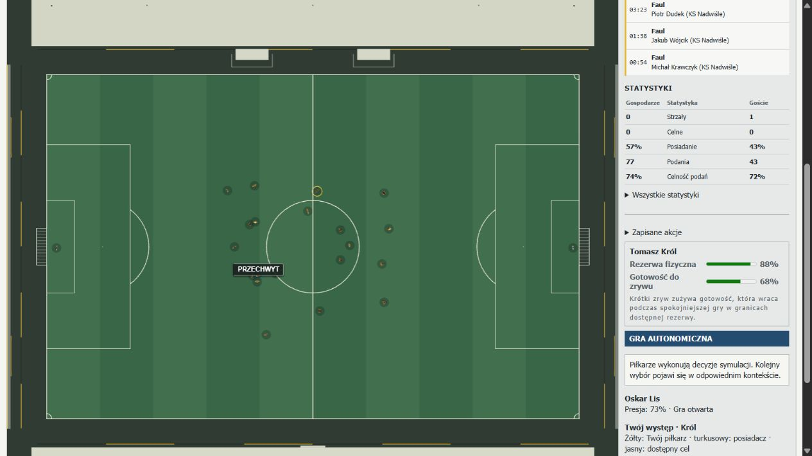

# PR181 — Attacking Depth, Wing Duels & Aerial Football

PR181 changes shared spatial movement, feasible wing carries, defensive restraint,
crossing invitations and aerial competition. **No policy is promoted.**
`legacy-pr176` remains the default. These development experiments do not establish
that canonical football is ready for summary calibration.

## Plan, base and evidence boundaries

Base: merged PR180 `352503946ef6f9ff346b952ad8808fbe8f0dead3`. The implementation
follows gates A–E: frozen positioning counterfactuals; wing races and defensive
response; crossing/occupation; actual aerial contact and second balls; canonical
continuations, matched full matches, browser/human control and complete verification.
The original first-touch, contact, keeper, restart and career contracts remain checks.

The six **new** native senior development designs cover SS/SW/WW, five formations,
different styles, and the actual squads' different pace/heading distributions.
[Frozen inputs](performance/PR181-inputs.json) retain complete state/session hashes
and individual pace/heading values. Five policies share each complete input; the
experimental unit is six designs, not thirty independent matches or millions of ticks.
No `pr182-sealed-*` or historical `pr180-reserved-*` archive is decompressed or stepped.
Existing reference/evidence archives are preserved.

The initial development candidate is retained separately in
[its receipt](performance/PR181-initial-development.json), with a compact production
source overlay under `pr181-evidence/initial-candidate-source.zip`. Its counts exposed
the need to distinguish actual ball-contact eligibility from physical pressure by an
opponent competing for the same space. Interrupted development runs are not final
full-match evidence. The final runner freezes production, harness and observation
hashes; it rejects mixed source or changed observation definitions.

## Confirmed causes and shared repairs

1. Neutral formation depth is deliberately a resting transform (`16 + depth * 39`),
   not a mandate for attackers to remain there. The more important confirmed failure
   was **authority and timing**: a selected depth job was suppressed by a final-third
   occupation, then role movement could replace it. The last unconditional onside
   clamp also restricted defenders and live-flight contestants. A runner's destination
   perpetually before the line encouraged braking rather than acceleration through
   an anticipated release. See [original chain and final arbitration](../src/core/matchSimulation/tacticalPositioning.ts#L851).
2. [Depth assignments](../src/core/matchSimulation/tacticalPositioning.ts#L227) now
   retain their relational job through support/role blending. A false nine connects
   short while a depth-capable partner compensates; a target forward can remain a
   connector. Channel selection considers actual opposition and travel from the
   runner's current lateral position. Existing flank/rest-defence jobs remain bounded.
3. [Timed targets](../src/core/matchSimulation/depthThreat.ts#L38) use current runner
   velocity/acceleration, reading and observable passer preparation. They may extend
   beyond the current line; a late runner returns through ordinary movement, not a
   position correction. No future chosen kick or seeded execution is inspected.
   The ordinary target clamp also respects the own-half exemption: an opponent line
   beyond halfway must not pull legal own-half movement back behind it. The raw
   defender/ball line remains available separately for diagnostics. This follows
   [IFAB Law 11](https://www.theifab.com/laws/latest/offside/).
   Release-time `captureOffsideSnapshot` remains the law. Once the ball is released,
   its pursuers are not constrained by the defenders' _new_ line.
4. [Defensive depth response](../src/core/matchSimulation/depthThreat.ts#L135) requires
   an onside moving runner, a plausible lane and release preparation. One local marker
   tracks an uncovered threat according to momentum/turning disadvantage; covering
   defenders permit handoff, and an aligned marker can hold the line. There is no
   whole-line backward offset. Noncredible runs leave ordinary block/press jobs intact.
   The per-physics-tick nearest-challenger pressure override also respects a live
   `track_depth` job; otherwise that later authority could erase the tactical response.
5. [Wing forecasts](../src/core/matchSimulation/carryOpportunity.ts#L24) add finite
   facing/turning loss to the common acceleration/velocity race and consider outside,
   inward and two bypass corridors. Fatigue still limits attainable capability.
   Sprint value uses the actual sprint envelope rather than the ordinary running
   limit. This generates/evaluates alternatives; it adds no pace-based success grant
   or preferred-action utility bonus. Existing foot impulses, exposed-ball access,
   touch separation, rolling physics and reacquisition execute the selected carry.
6. [Press plans](../src/core/matchSimulation/defensiveChallenges.ts#L437) distinguish
   press, delay, showing outside, cover, commit and recovery. An isolated fullback
   facing a genuine speed disadvantage contains the winger; exposed control can
   justify engagement. Existing protected-receiver/cooperative-press safeguards stay.
   Committed lunges/slides record finite, technique/speed/fitness-dependent balance
   recovery. Locomotion preserves current momentum and gradually restores angular
   response and acceleration; it never resets velocity to a ready pursuit sprint.
7. [Cross opportunities](../src/core/matchSimulation/crossOpportunity.ts#L22) are
   shared by legacy and state-value candidate generation. Receiver arrival must fit
   the actual delivery profile. The assigned zone and a present/velocity-led receiver
   are distinct possibilities; a remote occupation is not evidence of a reachable
   cross. Floated, driven and cutback are the existing physical execution families;
   early/near-post/far-post/late-runner differences follow origin and destination.
   Cross candidates enter the bounded state-value budget **before** pass expansion,
   which previously could truncate them. Empty-box delivery is not invented. Strong
   marking affects the live race/value rather than deleting every contested option.
8. [Aerial positioning](../src/core/matchSimulation/aerialPositioning.ts#L24) uses one
   canonical three-second trajectory per tactical plan and at most three detailed ETA
   probes per outfield player. Each team can pursue attainable interception points,
   including descent/bounce locations outside the nominal target. Ground-rolling
   assignment is not used to predict an airborne ball. An intended run-on receiver
   can retain PR180's prepared low control while opponents attack an earlier header.
9. [Aerial contact pressure](../src/core/matchSimulation/aerialPlay.ts#L125) measures
   actual eligible geometry, relative ball speed, facing, reserves and an opposing
   shoulder challenger. A physically adjacent, prepared/approaching opponent can
   disturb execution without simultaneously touching the ball. **Only actual contact
   candidates can win the ball.** Diagnostics keep `contestantIds`, `challengerIds`
   and contact evidence separate. The resolver rechecks explicitly supplied candidates;
   a high heading score cannot create contact with a distant ball.
10. Clearances/flicks/punches remain physical releases. Existing loose-ball races,
    perception, cover, contact acquisition and transition opportunity handle second
    balls. No possession is assigned by a nearest-player decision. A wrong or heavy
    delivery can bounce, miss the bodies, be intercepted, reach a keeper or cross a
    boundary. First-touch momentum and finite execution remain PR180 mechanisms.

The optional, Zod-validated movement/recovery/contact evidence fields are backward
compatible. No career save version, match clock, physical step, dependency, policy
weight, substitution rule or shooting UI is changed. Spatial intentions feed the
existing tactical cadence and final movement authority; human commands and legal
restart/keeper responsibilities retain priority.

Other preserved authorities are the [release offside snapshot](../src/core/matchSimulation/offside.ts#L34),
[common human/AI action executor](../src/core/matchSimulation/matchActions.ts#L1007),
[movement capability](../src/core/matchSimulation/locomotion.ts#L47),
[flank relationships](../src/core/matchSimulation/tacticalPositioning.ts#L418),
[box occupation](../src/core/matchSimulation/tacticalPositioning.ts#L326), and
[challenge resolution](../src/core/matchSimulation/defensiveChallenges.ts#L1000).

## Controlled mechanisms and causal continuations

[Controlled receipt](performance/PR181-controlled.json) and compressed input/detail
files under `performance/pr181-evidence/` distinguish autonomous decisions from
explicitly prescribed sprint/cross continuations. A prescribed action tests its
physical execution, not whether autonomous ranking preferred it. Different seeds,
roles and policies can legitimately produce a failed attack.
There are 130 labelled continuations from 21 prescribed geometries; policy and
intervention variants reuse those inputs. Every half-second sample retains all 22
body positions/velocities/targets, and the bounded continuation keeps canonical
event identities, including release/result parent links.

The controlled set covers the ten requested wing contexts, target/false-nine/empty/
marked/late-arrival crossing contexts, genuine/no-threat depth and aerial/second-ball
geometry. Each record keeps initial alternatives, actual target arbitration,
defensive response, physical positions/velocities, ball separation, releases and
continuation. The raw peak velocity-change rate includes collisions and reception
impulses; it must not be interpreted as an unopposed motor acceleration measurement.

[Before/after counterfactuals](performance/pr181-evidence/baseline-counterfactuals.json.gz)
compare original PR180 and PR181 on identical complete frozen inputs: depth threat,
false nine, stationary non-threat, isolated winger, crossing and aerial delivery.
Every comparison records actual targets/ranks and a three-second canonical sequence.
The separate twelve-second controlled runs record useful and unsuccessful continuations.

[Context screens](performance/pr181-evidence/contexts.json.gz) add sixteen prescribed
starting situations, paired across all five policies: fifteen eight-second screens
and one eighteen-second wing-to-cross sequence. They cover
fast/target-forward high-line threats, technical low-block attack, wide mid-block play,
two forwards, numerical disadvantage, late lead, late press, and recovery contexts
labelled corner clearance, shot block, interception, failed press, keeper distribution
and aerial recovery, a byline cutback, and a wing run followed by a conditional
delivery request. The recovery label describes the **starting** geometry; the
preceding event is not simulated or counted as a newly observed recovery. Complete
native match events remain separate evidence. Context states are schema-validated and
archived with hashes; they test responses, not frequencies or independent success rates.
The cutback screen produces an actual shot in each of its five dependent policy
variants. In the wing-to-cross screen, legacy reaches a reachable delivery at 2.325 s
(body x=74.84 m), R3 at 5.25 s (x=81.72 m), from x=56 m. The other three do not
reach that delivery condition. R3's actual cross then goes out for a goal kick;
the command does not grant a successful delivery or a finish.

Five reproducible causal examples are directly identifiable by scenario/policy in
the compressed receipt: `depth/prescribed-depth-release` (run, marker response and
separately prescribed through-pass release),
`counter`/`isolated` (natural or prescribed sprint, defender and control consequence),
`cross-target` (explicit delivery, flight and possible keeper/header/outcome),
`aerial-shoulder` (actual header under shoulder pressure, clearance and defending
second-ball recovery), and `covered`/`low-block` (defensive resistance). The separate
`aerial` continuation recovers the second ball for the attacking side. These are
prescribed development geometries, not held-out evidence of league frequencies.
Autonomous rankings are retained alongside prescribed actions. Some depth/isolated
states still rank a backward support pass first; even an action labelled `through`
can travel backward and is not counted as a pass behind the line. The receipt keeps
the actual requested action and relevant runners' physical positions/velocities.
The separate counterattack context can select a sprint naturally. These selection
limitations remain a PR182 concern rather than a reason to add a forced action bonus.
[Compact causal examples](performance/PR181-causal-examples.json) index six mechanism
chains across all five policies, with detailed physical samples in its linked gzip.
The prescribed depth pass targets x=75.361 m but meets its receiver around
x=64.60–64.97 m, before the initial x=66 m line. Those five completed passes are
not five successful receptions behind the line. Whole-match lineage therefore
measures actual contact separately from the target, using matched release snapshots.

## Matched full matches and accounting

<!-- PR181_RESULTS_START -->

**30/30 full-time matches**, zero flow/role observer errors, identical inputs within every five-policy pair.

| Mean per complete match, both teams    |  Legacy |       B |      R1 |      R2 |      R3 |
| -------------------------------------- | ------: | ------: | ------: | ------: | ------: |
| Passes                                 | 1618.33 | 1081.33 | 1488.00 | 1280.17 | 1428.67 |
| First-time share                       |    2.5% |   11.5% |   11.3% |   11.2% |   16.6% |
| Forward gap to line (m, exposure mean) |   12.95 |   15.86 |   16.85 |   17.75 |   16.66 |
| Space behind line (m, exposure mean)   |   31.59 |   31.45 |   30.03 |   31.16 |   30.85 |
| Pre-step event targets behind line     |   13.67 |   12.17 |   12.33 |   17.50 |   11.83 |
| Sprint carry intentions                |   24.00 |  243.67 |  321.83 |  340.00 |  242.83 |
| Wide take-on intentions                |  131.50 |  789.50 |  934.17 | 1680.17 |  769.17 |
| Marker passed with control             |   20.83 |   54.33 |   57.67 |   81.17 |   40.33 |
| Physical shots                         |    2.50 |   12.50 |   17.17 |   20.50 |   20.67 |
| Goals                                  |    1.50 |    4.17 |    3.83 |    5.00 |    6.83 |
| Cross releases                         |   22.50 |   14.67 |   26.00 |   29.50 |   27.50 |
| Aerial opportunities                   |   66.50 |   17.17 |   19.33 |   15.33 |   13.00 |
| Body-contested aerial contacts         |    3.00 |    0.50 |    1.67 |    0.50 |    1.00 |
| Box entries                            |   20.33 |   19.67 |   24.67 |   34.00 |   30.83 |
| Corners                                |    0.67 |    4.00 |    6.00 |    7.17 |    7.00 |
| Offsides                               |    0.17 |    0.00 |    0.67 |    0.17 |    0.17 |
| Live minutes                           |   84.87 |   83.50 |   79.31 |   78.76 |   80.70 |

<!-- PR181_RESULTS_END -->

<!-- PR181_LINEAGE_START -->

**30/30 complete canonical replay states and tick counts equal the original cohort.**
Actual contact and continuous carries are measured separately from target/intent counters.

| Actual outcomes, mean per complete match | Legacy |      B |     R1 |     R2 |     R3 |
| ---------------------------------------- | -----: | -----: | -----: | -----: | -----: |
| Target beyond release line               |  13.67 |  12.17 |  12.50 |  17.33 |  11.50 |
| Completed beyond release line            |   3.50 |   2.17 |   1.83 |   3.00 |   1.67 |
| Completed before/at release line         |   1.50 |   1.33 |   2.67 |   2.17 |   2.33 |
| Failed targeted depth pass               |   8.67 |   8.67 |   8.00 |  12.17 |   7.50 |
| Unresolved targeted depth pass           |   0.00 |   0.00 |   0.00 |   0.00 |   0.00 |
| Completed beyond defence at contact      |   2.00 |   1.50 |   1.33 |   1.83 |   1.00 |
| Continuous wide carry episodes           | 115.33 | 237.17 | 226.17 | 354.50 | 198.50 |
| First marker passed with control         |  26.50 |  49.33 |  53.50 |  73.50 |  38.17 |
| Carry episodes lost to opponent          |  22.00 |  41.50 |  42.00 |  64.33 |  32.67 |

[Lineage definitions and all paired rows](performance/PR181-depth-lineage.json) retain contact points, release snapshot matching and episode endings.

<!-- PR181_LINEAGE_END -->

[All fixture/policy rows and tier splits](performance/PR181-policy-comparison.json)
retain official passing, first-time identities, actual shots/outcomes, crosses by
execution type, depth/wing/shape exposure, overlaps, aerial opportunities and actual
body-contested contacts, second balls, possession losses, restarts, clock and cost.
An exposure sample is not an independent run/duel. A shoulder contest does not mean
two simultaneous ball touches; `multi_player_ball_contact` is a separate stricter
counter. Header recommendations without a winner are opportunities, not headers.
Second-ball links mean the first physical owner acquisition within eight seconds,
before a restart/shot; they are temporal lineage, not proof of a causal tactical gain.
Wide take-on attempts are unique carry intentions starting with a nearby marker;
passing that marker requires actual control and a goalward lead. Their ending control
states distinguish retained possession, opponent control and released/loose balls.
The last category includes deliberate passes and knock-ons and is not labelled a
failed dribble. Block width/length, line gaps and defensive depth are accumulated
throughout in-play exposure; the bounded first shape samples are illustrative traces.

The lineage comparison follows the existing official completion rule: the passer
collecting his own delivery is a self-recovery, not a completed pass. Raw physical
diagnostics retain that contact; final derived totals exclude it and reconcile all
thirty official completion counts. The first fourteen lineage artifacts use the
original harness; its pitch-bounded target validator rejected later out-of-play
physical targets. The resumed harness accepts finite physical coordinates and
validates saved results. Measurement logic and thresholds are unchanged; both actual
harness hashes and the original source are retained in the lineage receipt.
The original event counter uses the preceding physics frame and a visible release
target; the lineage replay uses matched release snapshots and each pass diagnostic's
physical target. Small differences between these target counts are retained rather
than silently equated. Only the lineage table measures actual completed contacts
beyond the release line; one unmatched snapshot uses the explicitly counted prior
0.025-second frame fallback.

Cross releases use canonical event identities. `cutbacks` now means the selected
cutback delivery, rather than every cross travelling fewer than five forward metres.
Crosses/non-shot headers are not silently added to official pass attempts. The report
requires exact cross/event reconciliation, unique pass/first-time identities, clean
observers and `inPlay + stoppage = elapsed` at physical-step tolerance. Natural dead
time is reported from actual referee/restart lifecycle, without inserted delays.

The unchanged frozen StatsBomb Open Data reference remains commit
`4b73468fc5b0f1950f9f66fada70ad3a4f9327cb`: first twelve 2022 World Cup group matches
and first twelve available 2023/24 Bundesliga matches, original hashes/definitions/
licensing as documented in PR171/175. PR179's descriptive non-cross pass P10–P90
intervals are 893.5–1195.9 / 1067.1–1244.7; shots 13–30.6 / 16.4–30.9; corners
5–12.9 / 6.1–14.8. These small professional samples are context, not youth/weak-team
quotas, and are not combined with an incompatible real live-minute denominator.

FIFA's [movement in behind](https://www.fifatrainingcentre.com/en/practice/talent-coach-programme/sessions/movement-to-attack-the-space-in-behind.php),
[collective defending](https://www.fifatrainingcentre.com/en/practice/talent-coach-programme/zonal-defending/zonal-defending-1.php)
and [attacking the cross](https://www.fifatrainingcentre.com/en/practice/talent-coach-programme/sessions/attacking-the-cross.php)
inform timing, complementary occupation and cover principles. They supply neither
implementation constants nor universal rates of successful runs/crosses/duels.

## Correctness, browser and performance

[Human mechanics screens](performance/pr181-evidence/human-mechanics.json.gz)
exercise the eight requested contexts on legacy and R3 with explicit human control:
sprint, pass into a run, lofted pass, cross, contested reception, movement to an aerial
contact, shot from a prescribed end-of-cut-in position, and defender response to a
take-on. Commands use the shared `human_selected` executor, and the aerial case uses
an existing movement intent, without inventing a jump button. These prescribed
eight-second canonical continuations do not establish UI coverage or prove that the
preceding cut-in/clearance succeeded. Actual browser play and existing decision-gate,
incoming-shot parity and explicit-carry agency regressions supply separate evidence.

The [actual browser receipt](performance/PR181-browser.json) covers 266.275 canonical
seconds on final R3, fixture `fixture-3d47e0aa`, seed `pr181-human-wing-final`, native
away right winger Tomasz Król with no forced XI. Three accepted manual commands are
recorded: incoming carry, sprint and a lofted through-labelled pass. The selected
teammate made that last target backward relative to attack; it is not evidence of
a pass behind the line. Both attempted passes failed to complete, and the controlled
player took no shot. Runtime/observer/canonical warnings and console errors are zero;
the fresh build digest matches the inspected source. This is a partial UI smoke;
all eight mechanics are not claimed as manually exercised UI contexts. The original
full career contract separately passes human choices, save/reload, repeat equality
and exactly-once accounting.



<!-- PR181_VERIFICATION_START -->

**Full original `npm run verify` PASS: 2,020 tests** (1,957 unit, 54 integration,
4 career contract, 5 full career), lint, TypeScript and Vite build. The
[verification receipt](performance/PR181-verification.json) preserves the full log,
an earlier concurrent wall-time timeout and its serial repeat; original test limits
and performance budgets are unchanged. Existing build chunk/dynamic-import warnings
are recorded. Final production source is `7af33920dd12d99a4991310f6829472baca0f46b0a0f64cb072f15c518cef6fc`.

[Complete-state integrity](performance/PR181-integrity.json) reproduces each policy's
120-second canonical state twice with observers and once without them: all fifteen
states match within policy. The complete R3 SS1 observer-free performance run equals
its observed cohort state/tick count. All thirty lineage replays also equal their
original complete canonical states, ticks and official passing identities.

| Serial matched workload        | CPU before/after (s) | Wall before/after (s) | Sampled RSS before/after (MiB) | CPU ratio |
| ------------------------------ | -------------------: | --------------------: | -----------------------------: | --------: |
| Full R3 SS1                    |      168.36 / 178.25 |       152.23 / 161.84 |                433.55 / 422.39 |     1.06× |
| 120 s legacy-pr176 SW2         |          3.47 / 3.92 |           2.45 / 2.58 |                164.17 / 166.82 |     1.13× |
| 120 s state-value-v1 SW2       |          4.45 / 5.39 |           2.96 / 3.91 |                163.85 / 163.26 |     1.21× |
| 120 s role-value-v1 SW2        |          4.92 / 4.95 |           3.59 / 3.24 |                163.80 / 170.53 |     1.01× |
| 120 s role-intent-v1 SW2       |          4.67 / 4.78 |           3.33 / 3.19 |                164.41 / 166.77 |     1.02× |
| 120 s phase-role-hybrid-v1 SW2 |          6.22 / 4.78 |           4.71 / 3.39 |                164.06 / 171.88 |     0.77× |

The complete paired R3 workload uses 5.87% more CPU.
The five bounded window ratios range from 0.77×
to 1.21×; they do not establish a universal slowdown or speedup.

[Serial trial inputs, hashes, costs and limitations](performance/PR181-performance.json)
retain all twelve raw receipts. These are single paired workloads, without uncertainty
estimates; changed football histories affect CPU and sampled memory. They cannot
prove the cost of an isolated function. The completed natural stoppage ledger on the
full R3 pair changes from 1115.92 s / 98 intervals
to 1246.62 s / 104 intervals, over elapsed
5708.60 / 5846.27 s. Both use the original lawful clock/restart
lifecycle. This one design does not establish a general stoppage increase.

[Reservation proof](performance/PR181-reservation-proof.json) confirms unchanged stored
bytes for both previous/reserved state archives and unchanged manifest text after
checkout newline normalization, without decoding reserved inputs.
[Evidence index](performance/PR181-evidence-index.json) identifies
the committed receipts and compressed artifacts by SHA-256.

<!-- PR181_VERIFICATION_END -->

The all-field telemetry references retain every schema, identity ledger and assertion.
Original PR180 and final 2400-tick outputs are each reproduced twice in fresh processes:
[reference receipt](performance/PR181-telemetry-reference.json). New tactical targets
can change the complete initial state hash; the requested session factory and physical
initialization are unchanged. Old hashes are not relabelled as current measurements.
The agency cross regression now supplies a physically present box receiver; its original
forty-metres-behind fixture no longer manufactures a crossing candidate. The run-on
reception regression preserves its original physical-contact/continuation assertions.
Depth tests explicitly specify the participating roles and check release-time legality
instead of requiring every future destination to stay before the line.

Whole-match CPU/wall/memory from concurrent development workers are provenance, not
serial cost ratios. Separate matched serial windows and full matches use fresh
processes with observers/profiler disabled. Different football histories change the
workload, so their ratio does not isolate one function's marginal cost. Sampled RSS is
not an allocation peak. Inclusive profiler spans overlap and must not be summed.
No physics accuracy or match duration is reduced to obtain a faster benchmark.

## Remaining limitations and PR182 decision

The new models are bounded engineering approximations. There is no independent limb,
jump or full-body contact solver; an aerial maximum reach is still the existing
height/jumping envelope. Turn-loss forecasts approximate the live angular envelope.
Defensive recognition is local and does not add a new explicit coach offside-trap
instruction. Cross generation exposes three existing execution families; it does not
introduce eight separately calibrated delivery techniques. Native teams can still
recycle excessively, make poor selections, take heavy touches or fail to create chances.
More events, a low turnover count or a small successful development scenario cannot
select the policy winner.
Native strong/strong games still exceed 2,000 passes under several policies; legacy
averages only 2.5 shots across the six designs, while weaker squads often suffer poor
first-touch completion. Broad current-position crossing invitations can still select
an early, low-danger destination outside the penalty area. These are measured
selection/calibration limitations, not evidence that all spatial problems are solved.
Carry-intent refreshes are not treated as conventional dribble attempts: the separate
lineage replay joins them into continuous physical possession episodes.

PR182 must freeze its candidate, evaluation definitions and intended selection rule
before opening either reserved archive. It owns opponent observation, effective live/
halftime role changes, role suitability, matchups, justified role-sensitive substitutions,
coach adaptation, new manual play and independent SS/SW/WW validation. It must inspect
dangerous opportunity-to-release-to-outcome chains, failures and defensive cover,
stagnation, weak-team transitions, natural restarts, human agency, deterministic lawful
completion and serial computational cost. Retain all five policies until that decision.
PR183 generations/world strength, PR184 summary/PlayStyles, PR185 career UX/direct
goal-click shooting and PR186+ world expansion retain their full scope.

Rejected alternatives: permanent striker offsets, compulsory crosses/dribbles/retreat,
bonus scores for action labels, contact for distant aerial winners, automatic loose-ball
ownership, forced substitutions, pass/shot quotas, dead-time padding and policy promotion
based on the most favourable development score. Preserved rough edges remain explicit.

## Required answers

|   # | Answer and evidence                                                                                                                                                                                                                                                            |
| --: | ------------------------------------------------------------------------------------------------------------------------------------------------------------------------------------------------------------------------------------------------------------------------------ |
|   1 | Deep resting anchors were compounded by target replacement and an own-half onside clamp that could follow an opponent line behind halfway. Frozen PR180 targets are compared on identical inputs in the counterfactual receipt.                                                |
|   2 | `deriveTacticalTargets` applied occupation, role blending and the final onside clamp after the depth invitation. The nearest-challenger tick override could also replace defensive tracking. The corrected authority chain is described above.                                 |
|   3 | Yes: the shared depth job survives arbitration, with an explicit sprint intention and finite locomotion; controlled targets and physical sequences are retained for all five policies.                                                                                         |
|   4 | Yes: false-nine/target-forward connecting work can be compensated by a depth-capable teammate; false-nine and inside-forward cases retain different targets and continuations.                                                                                                 |
|   5 | Observable preparation changes staging/launch timing. The actual release snapshot judges offside; movement never teleports back onside.                                                                                                                                        |
|   6 | A physically advancing onside runner and plausible lane can recruit one local tracking defender. Controlled depth targets, velocity and canonical continuation demonstrate danger behind the high line.                                                                        |
|   7 | Stationary/offside/noncredible runs do not order retreat. `observeDepthThreats` and `deriveDepthDefence` require present motion, preparation, lane and a local recovery disadvantage; cover permits handoff.                                                                   |
|   8 | Shared line shape and release-time offside remain. A covered/aligned marker can hold, allowing a coordinated line to catch a mistimed run. No new autonomous coach trap command is claimed.                                                                                    |
|   9 | Yes: relative movement/facing/reserves enter sprint races. The ten controlled wing contexts record velocity, separation, action and continuation; autonomous choice is distinct from prescribed sprint execution.                                                              |
|  10 | An isolated slower wide defender contains/shows outside until control is exposed or immediate goal danger justifies commitment. See `projectPressingPlan` and the isolated/exposed counterfactual.                                                                             |
|  11 | `resolveDefensiveChallenge` records finite lunge/slide balance recovery. The canonical movement integrator reduces turning and acceleration while preserving existing momentum; a regression asserts this consequence.                                                         |
|  12 | Existing protected-receiver and cooperative-cover rules remain. Cover affects the commitment decision and a depth marker can hand off, so support need not blindly abandon a central runner.                                                                                   |
|  13 | Existing covered flank jobs retain overlap/underlap/width targets and ordinary locomotion. Their exposure and physical continuation are measured, without granting a successful pass.                                                                                          |
|  14 | Reachable floated/driven/cutback alternatives use three existing physical families. Early/near/far deliveries differ by geometry and timing rather than new execution labels.                                                                                                  |
|  15 | Near/far/central/late occupation, current motion and actual arrival are compared. Empty, marked, target-forward and false-nine controlled cases retain different targets and candidate deliveries.                                                                             |
|  16 | Both teams can chase an attainable point on a shared canonical predicted flight, independently of the intended receiver. Controlled assignments and sampled positions record actual movement.                                                                                  |
|  17 | Yes: PR180 execution difficulty and current contact quality/relative velocity remain. A loose result grants no owner; overhit, bounce, missed control and keeper outcomes continue through physics.                                                                            |
|  18 | Header/clearance/flick outcomes keep live redirects. The shoulder scenario produces contact under pressure and defending second-ball acquisition; the separate aerial continuation includes attacking recovery. No recovery is assigned from proximity alone.                  |
|  19 | `resolveAerialDuel` filters actual `evaluateAerialContact` geometry, including explicitly supplied contestants. Adjacent shoulder pressure can affect quality but cannot grant remote ball contact. Opportunity and completed contact counters are separate.                   |
|  20 | Keeper claim/punch/miss authority and legal geometry are retained; controlled crosses include keeper outcomes. Complete keeper/restart regressions remain mandatory.                                                                                                           |
|  21 | Actual shots and outcomes are retained per full-match row; crossing/wing continuations retain unsuccessful attacks too. A valuable box target or candidate cross is never counted as a completed chance or shot.                                                               |
|  22 | Existing transition assignments remain available after physical recoveries/clearances. Tier rows and second-ball team identities expose what weaker sides actually achieve; a transition invitation does not guarantee a successful counterattack.                             |
|  23 | No new turnover-aversion coefficient or quota is introduced. Existing value policies still differ in conservative selections, which PR182 must assess with opportunity quality and consequences.                                                                               |
|  24 | Cross/event and pass/first-time identities reconcile. Cutback classification follows actual delivery intent. Aerial opportunities, physical challengers, actual winners and multi-player ball contact have separate denominators.                                              |
|  25 | Actual foul/boundary/offside/restart clocks determine stoppages. Full-match rows report their observed time and causes; PR181 does not require an increase or pad dead time to reach a target.                                                                                 |
|  26 | All five receive common physical/spatial repairs. Legacy keeps heuristic ranking; B keeps common state value; R1 keeps role consequences; R2 keeps role intentions; R3 keeps phase authority.                                                                                  |
|  27 | Policy algorithms/weights remain distinct and final rows expose their different choices and outcomes. No default is promoted; six dependent development designs cannot establish an independent winner.                                                                        |
|  28 | Canonical 0.025-second physics, contact, release offside, referee/restarts, RNG and exactly-once career paths remain. Complete-state replay/observer equality and full verification are required receipts.                                                                     |
|  29 | Actual browser/human receipts identify selected actions, source/fixture, coverage and limitations. Human commands retain the same physical executor; browser fragments are not whole-match validation.                                                                         |
|  30 | Concurrent full-match and separate serial CPU/wall/memory measurements are reported separately. Bounded flight/race work stays on the existing tactical cadence; no speedup from altered physics/clock is claimed.                                                             |
|  31 | PR182 owns coach observation/adaptation, suitable live/halftime changes, role suitability, matchups and justified substitutions. Native circulation, opportunity selection and cover still require tactical improvement and new manual assessment.                             |
|  32 | Freeze source, metrics and selection rule before opening reserved inputs. Compare all five on independent SS/SW/WW designs, complete opportunity/outcome chains, failures, human agency, lawful deterministic completion and serial cost before selecting a default or hybrid. |

## Reproduction

```sh
node --experimental-transform-types --import ./scripts/registerTypescriptLoader.mjs scripts/preparePr181Fixtures.mjs
node --experimental-transform-types --import ./scripts/registerTypescriptLoader.mjs scripts/benchmarkPr181Controlled.mjs
node --experimental-transform-types --import ./scripts/registerTypescriptLoader.mjs scripts/benchmarkPr181Contexts.mjs
node --experimental-transform-types --import ./scripts/registerTypescriptLoader.mjs scripts/benchmarkPr181Human.mjs
node --experimental-transform-types --import ./scripts/registerTypescriptLoader.mjs scripts/benchmarkPr181Baseline.mjs --baseline-root=<pristine-PR180-checkout>
node --experimental-transform-types --import ./scripts/registerTypescriptLoader.mjs scripts/reportPr181Causal.mjs
node --experimental-transform-types --import ./scripts/registerTypescriptLoader.mjs scripts/benchmarkPr181.mjs --policy=role-value-v1 --out=../pr181-final-v4/role-value-v1
node --experimental-transform-types --import ./scripts/registerTypescriptLoader.mjs scripts/reportPr181.mjs --runs=../pr181-final-v4
node --experimental-transform-types --import ./scripts/registerTypescriptLoader.mjs scripts/benchmarkPr181Depth.mjs --policy=role-value-v1 --out=../pr181-lineage/role-value-v1
node --experimental-transform-types --import ./scripts/registerTypescriptLoader.mjs scripts/reportPr181Lineage.mjs --runs=../pr181-lineage
node --experimental-transform-types --import ./scripts/registerTypescriptLoader.mjs scripts/benchmarkPr181Integrity.mjs
node --experimental-transform-types --import ./scripts/registerTypescriptLoader.mjs scripts/benchmarkPr181Performance.mjs --root=<pristine-PR180-checkout> --label=full-before --policy=phase-role-hybrid-v1 --id=pr181-dev-ss-1
node --experimental-transform-types --import ./scripts/registerTypescriptLoader.mjs scripts/benchmarkPr181Performance.mjs --label=full-after --policy=phase-role-hybrid-v1 --id=pr181-dev-ss-1
node --experimental-transform-types --import ./scripts/registerTypescriptLoader.mjs scripts/reportPr181Final.mjs --baseline-root=<pristine-PR180-checkout>
npm run verify
```

Run the full-match command for **each** of the five policy IDs. A `--seconds=` screen
is never a complete match. Performance commands accept a source root and explicit
fixture/policy; keep serial comparisons free of other simulation/test workers.
For each policy, run the paired performance window on `pr181-dev-sw-2` with
`--seconds=120 --label=window-before` and `--seconds=120 --label=window-after`,
using the pristine root only for `before`. The final report requires all twelve
performance receipts. A lineage replay may resume with `--resume`; saved results
retain their original harness hash and must pass input/source/state/tick validation.
