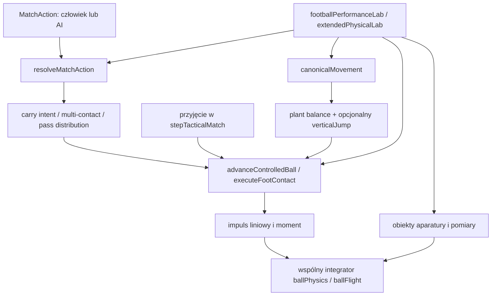

# PR185 — Extended Physical Testing & Ball-Control Mechanics

## Wynik i etapy pracy

PR185 dodaje wykonywane fizycznie powierzchnie kontaktu stopy, wspólną odpowiedź
równowagi, prototyp dwukontaktowych zwodów i wyrzut bramkarza. Laboratorium mierzy
te same kontakty, ruch, fitness, lot piłki, interwencje i odbiory co mecz.
Nie zmienia schematu 28 atrybutów, rozwoju kariery ani domyślnej polityki
**B `state-value-v1`**. Canonical pozostaje **NOT READY** do kalibracji summary.

Pracę podzielono na pięć etapów:

1. Zachowanie PR184 i odtworzenie awarii slalomu na niezmienionym silniku.
2. Wspólne kontakty, spin, podparcie i wykonanie zwodów; integracja przyjęć.
3. Aparatura obręczy, powtarzanego wysiłku, skoków, pojedynków i bramkarzy.
4. Sparowane pomiary, rozdzielenie błędów aparatury od wykonania i pełne mecze.
5. Powtórki, pełne verify, raport ograniczeń oraz plan kalibracji PR186 i PR187.

## 1. Zachowana referencja PR184

Baza to merge `5fb7370a5c5c0440385c223b838108ba3f71763e`, head PR184
`a355df53ac5be9aab8b2a9877a3617bb5b0d538e`. Plik
[`PR185-baseline.json`](performance/PR185-baseline.json) zachowuje wejścia, pełne
wyniki odtworzenia, hashe i ślady kolizji. **106 historycznych plików PR184** ma
zachowane bajty i SHA-256. Harness sprawdza je przed każdym pomiarem.

Historyczne 9 360 prób / 1 960 776 kroków i 2 127 testów należą do PR184.
Nie przemianowano ich na pomiary PR185. Odtworzenie potwierdza: wymuszona stopa
dominująca nie kończy ciasnego slalomu z powodu budżetu kolizji; słabsza kończy
w 13,250 s, wybór swobodny w 12,725 s. To nie dowód przewagi słabszej stopy.

## 2. Rzeczywisty graf wykonania



`footContact.ts` nie jest solverem treningowym. `ballContactGeometry.ts` używa go
przy prowadzeniu, a `matchSimulation.ts` przy rzeczywistych przyjęciach. Intencje
`carry.contactSurface`, `carry.skillMove`, `carry.foot` i `pass.distribution` należą do
zwykłego schematu akcji. Nie trzeba ich automatycznie preferować w każdej polityce.
Strzały i mocne podania zachowują dotychczasowe specjalizowane resolvery; PR185
nie twierdzi, że wszystkie uderzenia są już jednym solverem kontaktu.

Wszystkie nowe stany i wyniki mają schematy Zod. Krok pozostaje 0,025 s.
Brak nowych zależności, animacji, treningowego rozwoju atrybutów i migracji save.
Obiekty laboratorium nie trafiają do zwykłego meczu.

## 3. Stopa, powierzchnia i ograniczony impuls

Żądana stopa jest respektowana, jeżeli kontakt jest osiągalny. Bez wymuszenia
wybierana jest bliższa stopa, z dominującą jako rozstrzygnięciem remisu. To
lokalny wybór wykonania, nie nowa polityka taktyczna. Wspólny wybór powierzchni
uwzględnia kierunek, tempo, przyjęcie i osłonę.

| Powierzchnia         | Fizyczne znaczenie                                                                                                 |
| -------------------- | ------------------------------------------------------------------------------------------------------------------ |
| `inside` / `outside` | Różne efektywne normalne i styczne, zależne od stopy, orientacji i przygotowania; inne wyjściowe prędkości i spin. |
| `instep`             | Wąski łuk przygotowania i silniejszy impuls do przodu, odpowiedni dla wypuszczenia piłki.                          |
| `sole`               | Niska, wolniejsza piłka, wymagane podparcie; ograniczony docisk, tarcie i moment hamujący.                         |
| `cushion`            | Normalna przeciw względnej prędkości; pochłanianie i ograniczone tłumienie stycznego poślizgu.                     |
| `protection`         | Krótkie impulsy i geometria utrzymania piłki po osłoniętej stronie, bez dodatkowego zasięgu.                       |

Uproszczona piłka ma masę 0,43 kg, promień 0,11 m i moment bezwładności
`2/3*m*r²`. Względna prędkość powierzchni zawiera `omega × r`. Impuls normalny
ma limit wykonania, styczny limit tarcia Coulomba; ten sam impuls zmienia
prędkość liniową i moment pędu. Dodatkowy skończony obszar kontaktu podeszwy
i przyjęcia pochłania część obrotu. Obwiednia numeryczna ±160 rad/s ogranicza
sam impuls/moment. Nie jest empiryczną granicą futbolowego spinu.

Jakość zależy od techniki, dryblingu, pierwszego kontaktu, zwinności, fitness,
presji, przygotowania, równowagi i biegłości używanej stopy. Nie ma progu typu
„drybling 85 odblokowuje Elastico”. Zasięg kontaktu to 0,82 m od geometrycznej
stopy, wysokość zwykłej stopy do 0,65 m; podeszwa do 0,24 m i maks. 4 m/s.
Nieosiągalne żądanie daje jawną przyczynę, bez udawania udanego zamiennika.
To ograniczone przybliżenia inżynierskie wymagające kalibracji.

Fakt kontaktu zapisuje środek piłki, punkt na jej powierzchni, normalną, stopę,
technikę żądaną/wykonaną, czas, geometrię względną, prędkości i spin przed/po,
impuls i limity, jakość, równowagę, przygotowanie, odzyskanie gotowości i wynik.
`retained` oznacza lokalny błąd wykonania poniżej 4,8 m/s względem żądanej
prędkości; nie jest gwarancją późniejszego posiadania.

W kontrolowanym kontakcie słabszej lewej stopy jakość rośnie z 0,666 do 0,808
przy biegłości 20→100; zmienia się też rzeczywista prędkość. Nie jest to wyłącznie
atrybut celności podań lub strzałów. 72 próby powierzchni zawierają obie stopy,
trzy orientacje i dwa poziomy biegłości.

## 4. Slalom, nawroty i równowaga

Przyczyna starej awarii była złożona: przełączenie waypointu przy bocznej
prędkości około 3,4 m/s, dalszy cel po drugiej stronie stożka i pogoń za
wymuszoną stopą prowadziły ciało w kolejną przeszkodę. Powtarzane kolizje
blokowały ruch. Sam współczynnik słabszej stopy nie był przyczyną.

Adapter trasy teraz hamuje przed ostrym skrętem, uwzględnia promień ciała i
wybiera lokalny punkt obejścia. Po minięciu punktu stycznego kontynuuje trasę,
zamiast zatrzymywać się na nim. Nie zmienia przyspieszenia ani zasięgu stopy.
Wspólne `canonicalMovement` aktualizuje obciążenie nogi podporowej i ograniczoną
równowagę na podstawie zmiany pędu; odnowa ma skończony czas i zależy od fitness.
Osłona uwzględnia masę, względny pęd, ustawienie, siłę i równowagę.

**24/24** lustrzane warianty kończą próbę w **17,35–17,70 s**. Obejmują lewą
i prawą dominację, dominującą/słabszą/swobodną stopę, kierunki lustrzane oraz
obie strony nawrotu. Pary z jednoczesnym odbiciem anatomii i geometrii zgadzają
się; ta sama anatomia po odbiciu trasy może zachować różnicę około 0,2 s.
Nowego bezpieczniejszego sterowania nie należy oceniać jako pogorszenia samej
sprawności na podstawie starego czasu 12,725 s.

Wyniki zawierają rzeczywistą drogę, nominalną długość polilinii, czas, kontrolowane
m/s, kontakty/m, straty i kolizje. `pathEfficiency` to nominalna polilinia / droga
ciała; może przekroczyć 1, bo checkpointy mają promień i dopuszczają ścinanie
narożników. Nie porównujemy czasu tras o różnej długości jako jednej zdolności.
Czas obecnego slalomu bywa niewrażliwy na drybling: tempo ogranicza kontroler.

## 5. Dwukontaktowy zwód i reakcja obrońcy

Mała maszyna kontaktów obsługuje `inside_outside`, `outside_inside`,
`sole_redirect` i `elastico`. Zmienia kierunek rzeczywistymi impulsami i zachowuje
czas do drugiego kontaktu oraz odnowę. Kolejny kontakt może być nieosiągalny.
Obrońca w aparaturze otrzymuje wcześniejszą obserwację pozycji i prędkości
piłki po skończonym opóźnieniu sensorycznym. Nie czyta planu drugiego kontaktu.
Podchodzi wspólnym ruchem i wykonuje zwykły challenge.

396 prób obejmuje sześć reakcji: brak rywala, commitment, delay, fast,
wrong-facing i cover. Pierwsze 216 prób porównuje zgrupowane profile techniki,
dryblingu i zwinności 25/60/95: 34/72, 50/72 i 56/72 ucieczek. To **nie**
pojedynczy efekt dryblingu. Pozostałe 180 prób izoluje drybling 20→100 przy
innych atrybutach równych 60 i 30 sparowanych seedach:

| Reakcja    | Drybling 20 | Drybling 100 |
| ---------- | ----------- | ------------ |
| Commitment | 14/30       | 18/30        |
| Delay      | 8/30        | 15/30        |
| Cover      | 5/30        | 11/30        |

Jakość drugiego kontaktu rośnie 0,712→0,860. Zawodnik może wykonać dwa kontakty
i przegrać dalszy pojedynek. `escaped` wymaga kontroli i przekroczenia pozycji
pierwotnego obrońcy o 2 m; w wariancie cover nie dowodzi minięcia całej obrony.
Izolowane pace 20→100 skraca ten sam odcinek po zwodzie 1,375→1,275 s, przy
identycznych dwóch kontaktach. Nie jest to pomiar sprintu na 20 m.

## 6. Spin, przyjęcie i późniejszy odzysk

**60 rad/s = 9,549 obr./s = 572,958 rpm.** To duży spin, nie domyślna wartość
zwykłego podania. 578 prób obejmuje 0/5/15/30/45/60 rad/s, prędkości 6/18/26 m/s,
osie top/back/side/combined, powierzchnie i przygotowanie. Dodatkowe wolniejsze
wejścia aktywują legalną podeszwę, a próby ze zmiennym ruchem badają poślizg.

`firstTouch` uwzględnia kierunek poślizgu i normalną zamiast samej długości
wektora spinu. Podeszwa może tłumić obrót i ruch, lecz nie usuwa ich automatycznie.
Piłka 18 lub 26 m/s nie staje się legalnym idealnym zatrzymaniem podeszwą.
Ten sam przygotowany kontakt może być dostępny, a przy 0,01 s przygotowania
odrzucony. Test energii potwierdza rozpraszanie bez wyzerowania spinu.

Naprawiono także sztuczną pionową składową normalnej przy płaskim przyjęciu:
kontakt z piłką bez spinu nie tworzy teraz nieuzasadnionego podskoku. Laboratorium
integruje spin dokładnie raz, od faktycznego stanu po kontakcie; test porównuje
pełną pozycję, prędkość i spin z normalnym prowadzeniem po jednym kroku.
Zachowane są wspólne gravity, drag, Magnus, spin decay, ground resistance,
bounce i spin retention. Nie przestrojono lotu pod trudną próbę 60 rad/s.

Osobne pola zapisują pierwszy osiągalny/usiłowany kontakt, jakość, początkową
kontrolę, późniejszy odzysk i koniec zadania. Kilkusekundowa pogoń nie jest dobrym
pierwszym przyjęciem. Ogólne przejścia fitness i geometria mogą zmieniać eventual
completion niezależnie od jakości pierwszego kontaktu.

## 7. Fizyczna obręcz i uderzenia

408 prób: 324 launchery, 12 startów z nowego solvera stopy i 72 zwykłe uderzenia
`placed`/`driven`/`chip`. Zmieniane są średnica, odległość, wysokość, odchylenie,
pochylenie/normalna, kierunek przecięcia, prędkość, kąt i osie spinu. Uderzenia
obejmują dwa poziomy zdolności, obie stopy i niską/podniesioną obręcz.

Przecięcie jest interpolowane przez rzeczywistą płaszczyznę, z promieniem piłki
i właściwym kierunkiem. Kontakt z rantem unieważnia trafienie; samo zbliżenie
do środka nie wystarcza. Zapisane są lot, spin, wysokość, krzywizna, czas,
punkt przecięcia, błąd geometryczny i prognoza. Prognoza przestaje być porównywalna
po kolizji. Launcher daje **40/324** trafień i 19 kontaktów rantu; zwykłe
uderzenia **31/72** i 5 kontaktów rantu. 12 startów po kontrolnym dotknięciu
nie trafia — te ograniczone impulsy nie zastępują mocnego strzału.

## 8. Powtarzany wysiłek

48 serii × sześć powtórzeń obejmuje nominalne 10 m, 20 m i 20+20 m,
0/2/10/30 s odpoczynku, piłkę/bez piłki i stamina 20/90 przy pace 95.
Fitness przechodzi między powtórzeniami. Po mecie zawodnik naprawdę hamuje;
odpoczynek zaczyna się dopiero po hamowaniu. Przeniesienie na start jest jawnym
ustawieniem kolejnej niezależnej próby z miejsca, nie ciągłym biegiem wahadłowym.

Bez piłki metę mierzy przecięcie linii przez ciało. Z piłką jest to osobny
protokół kontrolowanego prowadzenia, z checkpointem 1,1 m obejmującym naturalny
odstęp stopy/piłki; zapisuje faktyczny dystans. Promień 0,4 m powodował zatrzymanie
ciała przy piłce około 0,8 m przed nim i fałszywy timeout. Naprawa dotyczy
aparatury, bez zwiększania fizycznego zasięgu. Tych dwóch protokołów nie należy
porównywać jako identycznego pomiaru dokładnych 20 m.

Przy stamina 20, bez odpoczynku, sprint 20 m zwalnia **2,843→3,053 s**;
gotowość po końcowym hamowaniu spada do 0,484. Przy stamina 90 i 30 s odpoczynku
czasy wynoszą 2,8421→2,8428 s, końcowa gotowość 0,997. Prowadzenie nominalnych
20 m zwalnia **4,175→4,250 s**. Wszystkie 144 powtórzenia z piłką kończą się.
W 20+20 m z piłką czas nie pogarsza się monotonicznie mimo zużycia fitness:
wolniejszy dojazd może ułatwić nawrót. Nie maskujemy tego sztuczną karą za numer
powtórzenia. Suma dodatnich zmian energii kinetycznej jest przybliżeniem pracy
w J, nie kosztem metabolicznym ani kompletną pracą mięśni.

## 9. Skok, ciało i główka — świadomie etapowana integracja

64 próby obejmują wzrost 165/195 cm, masę 60/95 kg, siłę i jumping 25/90 oraz
skok z miejsca, z abstrakcją pomocy ramion, z podejścia i po skręcie. Siła działa
przez skończony czas wyprostu, masa obciąża impuls; przygotowanie i odzysk zależą
od zwinności, równowagi i fitness. Po wybiciu działa grawitacja 9,81 m/s²,
z czasem wybicia/lądowania wewnątrz kroku. Maksimum jest mierzone na trajektorii.

Wynik oddziela przemieszczenie środka masy od wzrostu i osiągalnej wysokości głowy.
Zakres maksimum środka masy wynosi **0,073–1,032 m**. Skrajne wartości pokazują
potrzebę kalibracji, nie zgodność z pomiarem elity. Masa nie daje darmowej
wysokości skoku. 64/64 odpowiednio dobranych opadających piłek dochodzi do
osiągalnego kontaktu i zwykłego `header_clearance`, z rzeczywistą wyjściową
prędkością, a nie samym booleanem „główka możliwa”. Część kontaktów jest po
lądowaniu; ślady pozwalają oddzielić je od kontaktów w locie.

Nowy stan pionowy jest obsługiwany przez wspólny ruch i eligibility główki,
gdy istnieje. **AI nie planuje jeszcze automatycznie nowych wybić.** Zwykli
zawodnicy bez tego stanu zachowują legacy aerial reach. Nie twierdzimy pełnej
zgodności domyślnego futbolu powietrznego z nowym protokołem. Aparatura rozbiegu
podaje początkową prędkość, a nie odtwarza całego odcinka rozpędzania; to kolejny
obszar PR186 przed włączeniem powszechnych skoków w meczu.

## 10. Osłona, bark i odbiór

468 prób zachowuje kompletny stan i seed. Scenariusze obejmują osłonięcie,
kontakt z przodu/boku/tyłu, różne masy/siłę/pęd i standing/committed/slide/tactical.
Porównania jednego atrybutu używają sparowanych seedów. 24 późne, niebezpieczne
wejścia aktywują rzeczywisty faul, zamiast udawać legalny odbiór.

Wyniki: **62 clean_win, 21 beaten, 72 missed, 1 loose_ball, 24 foul oraz
288 not_offered**. Ostatnia grupa oznacza brak dopuszczalnej propozycji zwykłego
resolvera, nie 288 wykonanych nieudanych wślizgów. Zapisano dostęp do piłki,
zasłonięcie przez ciało, względną prędkość, kontakt ciał, load, równowagę,
pozycje i dalszą kontrolę. Istnieją czyste wygrane lżejszego/słabszego obrońcy;
wynik zależy także od drogi do odsłoniętej piłki, pędu i czasu. To nie ragdoll
ani wyizolowana empiryczna kalibracja siły barku.

## 11. Bramkarze i rzeczywista dystrybucja

252 prób reakcji korzysta z legalnego pełnego fixture i zwykłych ticków meczu:
reaction, low, high, angle, one_on_one, cross oraz parry_recovery. Zachowane są
rola i familiarity bramkarza; profil testowy zmienia jawnie wskazane cechy ciała
i atrybuty. Ocena wynika z rzeczywistej piłki, ruchu, catch/parry i bramki,
bez znajomości przyszłego intencjonalnego zwodu lub wyniku strzału.

Izolowane reflexes 20→100 skraca diagnostyczne opóźnienie 0,278→0,118 s;
nie zmienia wyniku łatwej dostawy: oba są catch. Handling 20→100 zmienia na
tej dostawie parry w catch. Nie każda różnica czasu reakcji musi zmienić save.
Próby kąta i 1v1 zachowują faktyczne pozycje i decyzje wyjścia. Grouped keeper
20/60/100 nie jest dowodem przyczynowym działania każdego z sześciu atrybutów.

Druga piłka jest uruchamiana tylko po prawdziwym parry. Aparatura zachowuje
pozycję i fitness bramkarza, usuwa zakończony stan pierwszej piłki i uruchamia
nowy, jednoznacznie identyfikowany strzał. W ośmiu aktywowanych sekwencjach
druga interwencja kończy się **5 saves / 3 goals**. To dwie następujące po sobie
dostawy, nie dwie piłki jednocześnie w meczu.

72 próby dystrybucji wykorzystują zwykłe `resolveMatchAction(pass)` i fizyczny
lot, a nie automatyczne completion. Nowe `goalkeeperThrowing` wpływa na prędkość,
kąt i deterministyczny rozrzut wyrzutu, z faktycznego miejsca dłoni, na wysokości
0,74 wzrostu. Legalność wymaga roli GK, posiadania, tokenu prawdziwego trzymania
po catch, bliskości piłki i własnego pola karnego. Token znika przy kolejnym
faktycznym kontakcie stopą. Nie wystarczy stać nad dowolną własną piłką.

Izolowany throw 20→100: błąd przecięcia płaszczyzny **0,444→0,060 m**;
kick 20→100: **4,390→0,567 m** w jednym sparowanym przykładzie. Są też chybienia;
nie jest to oszacowanie rozkładu celności w populacji. AI nie dostaje nakazu
wybierania wyrzutu. Dotychczasowe career/overall reads `goalkeeperThrowing`
pozostają, a nowa bezpośrednia ścieżka wykonania jest jawna.

## 12. Atrybuty i autonomiczne cele

[`PR185-attribute-coverage.json`](performance/PR185-attribute-coverage.json)
obejmuje wszystkie 28 atrybutów, odczyty bezpośrednie, dynamiczne i deklaratywne,
role fizyczne/decyzyjne/fitness/kariery, testowane konteksty i zachowane pary
metryk. Weak-foot proficiency pozostaje osobnym parametrem. Oznaczenie efektu
oznacza wykrywalną różnicę danych w danym protokole, nie zawsze poprawę wyniku.

| Wynik izolowanych kontekstów PR185             | Atrybuty                                                                                                                                                                          |
| ---------------------------------------------- | --------------------------------------------------------------------------------------------------------------------------------------------------------------------------------- |
| Zmierzony efekt                                | technique, firstTouch, passing, dribbling, finishing, tackling, gameReading, pace, stamina, strength, agility, jumping, reflexes, handling, goalkeeperKicking, goalkeeperThrowing |
| Brak wykrytej różnicy w użytej próbie          | heading, composure, oneOnOnes, goalkeeperSweeping                                                                                                                                 |
| Brak odpowiedniego nowego fizycznego protokołu | positioning, setPieces, concentration, leadership, determination, aggression, ambition, professionalism                                                                           |

Nie są to deklaracje globalnego nieużywania cech. Heading jest testowane
clearance, które nie różnicuje tu końcowego uderzenia; wymaga celowej główki.
Composure wymaga trudniejszego kontekstu. Sweep/cross kończy się bez odpowiedniej
interwencji, więc nie identyfikuje sweeping. Część pozostałych cech działa przez
decyzje i karierę. Identyczne wagi firstTouch/agility w tym kontakcie i nakładające
się technique/dribbling wskazują konteksty do rozdzielenia, nie uzasadniają teraz
usuwania atrybutów. Strength/jumping i pace/agility mają różne drogi fizyczne.

122 dodatkowe próby izolują passing/finishing (30 sparowanych seedów na pasmo)
i pace. Średni błąd podania na 30 m maleje **3,034→0,461 m**, strzału
**1,671→0,398 m** przy 20→100. Większa celność nie musi skracać czasu dolotu.

Adapter celu ćwiczenia przekazuje cel oraz filtruje/rankuje legalne kandydatury;
po ścianie odświeża etap zadania. Nie daje lepszego impulsu, dodatkowego zasięgu
ani automatycznego posiadania. Zapisano ranking i wykonanie.
**10/10** target passes, **10/10** rebound-turn-pass i **10/10** stationary shots
kończy zadanie, wobec historycznych 0/30, 0/30 i 30/30 w PR184. Nowe 10 seedów
nie oznacza 10 niezależnych geometrii: są trzy różne ustawienia. Kalibracja
trafności prognoz taktycznych pozostaje PR186.

## 13. Liczebność, reprodukcja i koszt

Zarchiwizowano **2 580 wierszy prób** w 14 grupach, plus jawne diagnostyczne
porównania par metryk w macierzy atrybutów. `totalTrials` liczy wiersze, nie wszystkie
wewnętrzne podpróby diagnostyczne. Np. 48 serii RSA to 288 powtórzeń, nie 288
niezależnych wejść. Seed nie wytwarza sztucznej wariancji deterministycznego ruchu.

Każda grupa ma pełne wejścia/profile/seedy, SHA wejścia i wyniku, skrót metryk,
SHA archiwum i pełne ślady `.json.gz` w `performance/pr185-traces/`.
`distinctInputProfiles` pomija seed; `physicallyDifferentStartingStates` dodatkowo
oddziela fizyczną pozycję, ruch i delivery od zdolności/wybranej techniki. Np.
396 zwodów to 78 profili i 24 konfiguracje początkowe, 72 dystrybucje to 24
profile i trzy różne ustawienia. Nie sumujemy tych liczb jako jednostek populacji.

```sh
node --experimental-transform-types --import ./scripts/registerTypescriptLoader.mjs scripts/benchmarkPr185.mjs
node --experimental-transform-types --import ./scripts/registerTypescriptLoader.mjs scripts/replayPr185.mjs
```

Osiem reprezentatywnych protokołów odtworzonych w nowym procesie ma identyczny
**cały wynik**, nie tylko finish time. `PR185-replay.json` zapisuje pary hashy.
Manifest zawiera LF-normalizowane hashe plików, harnessów i lockfile. Historyczny
`sourceSha256` zawiera natywne separatory Windows; przenośny hash to osobne
`portableSourceSha256` z posortowanych par ścieżka/SHA. Żaden nie jest SHA commita.

Pełne mecze zmierzono na freeze
`adf7152207e29cdb0c79132ca4a704ff5d45c61392b2ade91eaee1b18ae1dcea`.
Później zmieniono wyłącznie protokoły w `extendedPhysicalLab.ts`: drugą piłkę
bramkarza i checkpoint RSA. `PR185-match-source-bridge.json` przechowuje oryginalny
manifest i potwierdza brak zmiany w konserwatywnym domknięciu statycznych importów
wejść meczowych (również type imports). Nie przypisujemy dawnym meczom nowego
pełnego hasha. Bieżący hash, koszt ostatniej macierzy, CPU/RSS i wszystkie liczniki
są w `PR185-source-manifest.json`, `PR185-evidence-index.json` i
`PR185-performance.json`. Macierz trwa około 25 s, zużywa około 31 s CPU i
540 MB RSS na tym Windows/Node 24; obejmuje kompresję i rzeczywiste ticki GK.
Nie jest to pomiar narzutu pojedynczej funkcji ani porównanie z PR184 na pustym CPU.

## 14. Pełne mecze, obserwatory i człowiek

Jedno zamrożone wejście development SW 75 vs 55, 4-4-2 vs 4-3-3, używa tego
samego seeda i tych samych profili przed/po. Rozgrywane są prawdziwe połowy,
zakończenie i pełny fixed tick; nie skrócono zegara, nie wymuszono końca meczu.

| Wersja / polityka |   Kroki | Czas kanoniczny s | Wynik | Podania | Strzały |
| ----------------- | ------: | ----------------: | ----- | ------: | ------: |
| PR184 B           | 231 909 |         5 797,725 | 9:0   |   1 866 |      33 |
| PR185 B           | 236 580 |         5 914,500 | 10:2  |   1 974 |      27 |
| PR184 R3          | 243 663 |         6 091,575 | 14:3  |   1 721 |      43 |
| PR185 R3          | 232 132 |         5 803,300 | 9:0   |   1 838 |      20 |

Wyniki nie są jednolicie lepsze: B ma więcej goli przy mniejszej liczbie strzałów;
R3 ma mniej strzałów; wzrasta cyrkulacja. To realny sygnał ryzyka kalibracji,
nie powód do dostrojenia współczynników pod ten seed. Jedno wejście SW nie
identyfikuje przeciętnej zmiany jakości futbolu. Polityki i powtórki są zależne,
nie są nowymi niezależnymi projektami. Nie wykorzystano zamkniętych przyszłych
wejść PR187.

Pełny PR185 B z obserwatorem i bez niego ma identyczne 236 580 kroków i cały
stan końcowy SHA `efbe24439a12484a870e2617577d5ccb304392f36f7480b11e8295cdf5f2ed46`.
Koszt B to 260,0 s CPU (237,2 s wall), bez obserwatora 246,0 s CPU (226,2 s wall);
R3 293,8 s CPU (271,1 s wall). Pristine PR184: B 291,4 s CPU, R3 287,0 s CPU.
Próby miały współdzielone obciążenie hosta i różne liczby zdarzeń/kroków, dlatego
nie interpretujemy ilorazu wall jako izolowanego przyspieszenia solvera.
Legacy/R1/R2 przeszły dodatkowo po 120 s / 4 800 kroków, z wynikami 0:0/0:0/1:0.

Pełna telemetria legacy dwóch seedów × dwie świeże powtórki przed/po ma zachowane
wszystkie pola i inwarianty tożsamości. Oczekiwane hashe referencyjne zmieniono
dopiero po intencjonalnej zmianie kontaktów i potwierdzeniu deterministyczności;
stare hashe pozostają w komentarzu oraz receipts. Nie usunięto asercji.

Human smoke jest **headless**: ta sama akcja carry/skill wykonana ze źródłem
człowieka i AI daje te same dwa impulsy; zwykłe testy kontraktu odgrywają prawdziwy
mecz, ludzkie wybory, zapis, reload, kalendarz i exactly-once. U-17 wykonał osiem
wyborów i zakończył 0:1; mecz seniorski zakończył 1:1 z 24 selected / 21 resolved
oraz pięcioma zmianami i identyczną powtórką. Nie wykonano nowego ręcznego
smoke w przeglądarce ani nie dodano UI treningowego.

## 15. Weryfikacja i bramki

Pełne `npm run verify`: lint, unit, integracje meczu, kontrakty kariery,
full-career, TypeScript i Vite. Końcowy wynik oraz zarchiwizowany log zapisuje
`PR185-verification.json`. Nie usunięto żadnej kontroli, testu lub limitu czasu.
Faza testów zakończyła się 2 163/2 163: 2 098 unit, 56 integration, 4 career
contracts i 5 full-career. Następujący TypeScript wykrył nullable w nowej asercji
testowej. Naprawa samych oznaczeń non-null zachowuje identyczny emitowany
JavaScript (dowód `PR185-type-repair.json`). Ponowne lint, 36 testów laboratorium
i kompletny build przeszły; receipt zachowuje również pierwotny exit 2 i log
naprawy, bez przedstawiania nieudanego polecenia jako exit 0. Końcowy commit
przechodzi dodatkowo wszystkie zwykłe grupy CI przed oznaczeniem PR jako gotowego.
Node 24, `NODE_OPTIONS=--max-semi-space-size=64`; zależności pochodzą z instalacji
identycznego lockfile PR184. Standardowe ostrzeżenia Vite o rozmiarze chunków
i mieszanym imporcie careerStorage pozostają nieblokujące.

| Gate           | Dowód                                                                                |
| -------------- | ------------------------------------------------------------------------------------ |
| 0 baseline     | Merge/head oraz 106 niezmienionych hashy.                                            |
| 1 kontakt      | Sześć powierzchni, rzeczywiste impulsy i ślady, niedostępne kontakty.                |
| 2 symetria     | Odtworzenie przyczyny i 24 ukończone warianty lustrzane.                             |
| 3 zwód         | Dwa rzeczywiste kontakty; reakcja, sukcesy i porażki.                                |
| 4 spin         | Osie, przygotowanie, tarcie i rozpraszanie; bez resetu spinu.                        |
| 5 obręcz       | Trajektorie proste/krzywe/górne, trafienia, pudła i rant.                            |
| 6 wysiłek/skok | Sześć biegów, odnowa, ślady pionowe i rzeczywista główka; live scheduling etapowane. |
| 7 pojedynki    | Legalne odbiory, straty, osłona i faule; jawne not_offered.                          |
| 8 bramkarz     | Reakcje, pozycje, druga piłka i legalny wyrzut/kopnięcie.                            |
| 9 atrybuty     | Wszystkie 28 + słabsza stopa, jawne luki kontekstów.                                 |
| 10 regresje    | Pełne B/R3, inne polityki smoke, determinism/observer i headless human.              |
| 11 verify      | Pełny log i wynik w receipt; końcowy commit podlega również zwykłemu CI.             |

## 16. Źródła rzeczywiste i granice porównania

- [Asai i in. (2004), infront curve kick](https://shura.shu.ac.uk/2206/): średnio
  7,8 obr./s, prędkość stopy 24,2 m/s i piłki 27,1 m/s. Wspiera mechanizm i rząd
  wielkości kręconego kopnięcia, nie twierdzenie, że zwykłe podania mają taki spin.
- [Zago i in. (2016)](https://pubmed.ncbi.nlm.nih.gov/27111261/): dziesięciu
  subelitarnych chłopców U13, prowadzenie 5 m i nawrót 180° podeszwą. Obserwacje
  podparcia, tułowia i ramion nie są normą czasu dorosłego protokołu 505.
- [Przegląd testów siły/mocy w elitarnym męskim futbolu](https://pmc.ncbi.nlm.nih.gov/articles/PMC11467003/):
  protokoły SJ/CMJ/VJ, pomoc ramion i metody pomiaru różnią się. Własny impuls
  MFL nie jest dokładnym CMJ ani walidacją biomechaniczną na podstawie przeglądu.
- [Physics Today: Power and spin](https://physicstoday.aip.org/quick-study/power-and-spin-in-the-beautiful-game)
  służy kontekstowi aerodynamiki, nie kalibracji przyjęć.

Podany w zadaniu artykuł MDPI zwracał ograniczenie dostępu, a PubMed 42764529
nie dostarczył zweryfikowanej treści. Nie użyto wartości 13,89 obr./s ani
twierdzeń z tego drugiego tekstu jako potwierdzonej podstawy kalibracji.
Nie wymyślano pomiarów konkretnych gwiazd ani progów elitarnego dryblingu.

## 17. Odpowiedzi na 33 wymagane pytania

1. **Stopa i powierzchnia:** wymuszenie lub najbliższa geometryczna stopa;
   lokalny wybór powierzchni według intencji, kierunku i przygotowania (§3).
2. **Inside/outside różne:** tak, inne normalne, prędkości, spin i trajektorie.
3. **Podeszwa zmienia ruch/obrót:** tak, przez skończone tarcie i moment (§6).
4. **Impulsy ograniczone:** tak, normalny/tangencjalny i torque mają limity.
5. **Słabsza stopa poza podaniem/strzałem:** tak, jakość i ruch kontrolnego dotknięcia.
6. **Dawny slalom:** przełączenie trasy i wymuszonej stopy przy zbyt dużym pędzie,
   kolizja ciała i powtarzana pogoń za nieosiągalnym lokalnym celem (§4).
7. **Lustrzana symetria:** 24/24 kończy; zachowane niewielkie anatomiczne różnice.
8. **Przewaga dryblingu:** tak w izolowanym zwodzie pod presją, nie w każdym
   speed-limited slalomie (§5).
9. **Dłuższy instep touch:** wspólny burst może wybrać instep i wypuścić piłkę;
   impuls i lot są mierzalne. Nie gwarantuje to utrzymania kontroli.
10. **Odzysk ciężkiego dotknięcia:** pozostaje zwykły wyścig/ball acquisition;
    brak gwarancji. PR185 nie daje niezależnej estymacji skuteczności celowego
    heavy-touch recovery przeciw rywalowi — potrzebna osobna para w PR186.
11. **Prawdziwy zwód:** tak, dwa kontakty w różnych chwilach zmieniają ruch piłki.
12. **Oszukanie obrońcy:** tak, reakcja na opóźnioną pierwszą obserwację bez planu drugiej.
13. **Porażka zwodu:** tak, również po poprawnym wykonaniu obu kontaktów.
14. **Agility/pace/technika:** przygotowanie i podparcie, następnie przyspieszenie,
    następnie dokładność impulsu; szybki dojazd może utrudniać skręt.
15. **Kierunek spinu:** tak, przez styczny poślizg względem normalnej i Magnus.
16. **Silny spin/podeszwa:** może być tłumiony przy niskiej, dostatecznie wolnej
    i osiągalnej piłce; szybka dostawa nie dostaje automatycznego zatrzymania.
17. **Zły timing:** tak, ta sama geometria może zostać odrzucona za przygotowanie.
18. **60 rad/s stabilne:** tak w badanych przypadkach; to engineering stress,
    nie dowód typowości takich przyjęć.
19. **Obręcz rozróżnia loty:** tak, pełna płaszczyzna, kierunek, wysokość i rant (§7).
20. **Kontakty w meczu:** tak, carry i reception używają wspólnego wykonania;
    automatyczna preferencja każdej techniki nie jest wymagana (§2).
21. **Zmęczenie:** tak, sprint i prowadzenie zmieniają się wskutek rzeczywistego
    fitness, bez mnożnika numeru powtórzenia (§8).
22. **Ruch pionowy:** tak, mierzona trajektoria środka masy i finite recovery.
23. **Wzrost/jumping osobno:** tak, zasięg bazowy i pionowe przemieszczenie są oddzielne.
24. **Kontakt/równowaga/kontrola:** tak, przez osłonę, pęd, shared balance i challenge.
25. **Słabszy może wygrać:** tak, dostęp/ustawienie/pęd mogą przeważyć samą siłę.
26. **Reakcje GK:** korzystają z aktualnego ruchu piłki i zwykłego resolvera;
    nie otrzymują przyszłego wyniku ani planu akcji (§11).
27. **Reflexes/handling/sweeping:** pierwsze dwa mają izolowany efekt; wybrany
    cross nie identyfikuje sweeping, więc jego kalibracja pozostaje otwarta.
28. **Wyrzut:** tak, legalny token catch, release point, prędkość/spin i wspólny lot.
29. **Luki pokrycia:** osiem kontekstów nieaktywnych i cztery bez wykrytego efektu
    wymieniono jawnie w §12; nie są globalnie nieużywane.
30. **Niedostateczne rozróżnienie:** firstTouch/agility i technique/dribbling
    nakładają się w kontakcie; heading/composure/1v1/sweeping potrzebują innych zadań.
31. **Pogorszenie meczu:** istnieją sygnały mniej strzałów i większej cyrkulacji;
    pojedynczy sparowany SW nie pozwala ogłosić poprawy lub braku regresji jakości (§14).
32. **PR186:** zadania i kryteria poniżej, bez strojenia pod te development seedy.
33. **PR187:** nowe niezależne projekty, zamknięte przed kalibracją, pełne
    polityki i jakościowy/przekrojowy pomiar futbolu, nie kolejne powtórki SW.

## 18. PR186 i PR187 — następne etapy

**PR186 — Attribute & Execution Calibration:**

1. Dopasować limity/normalne/tarcie i jakość do celowej zmiany wektora, energii,
   weak-foot i presji; sprawdzić celowy heavy touch z późniejszym odzyskiem.
2. Oddzielić prognozę przyjęcia od pościgu i skalibrować preferencje powierzchni
   na nowych geometriach, bez ukrytego ułatwiania kontaktu laboratorium.
3. Zmierzyć współdziałanie pace/agility/fitness na nawrotach oraz slalomach
   ograniczonych umiejętnością, nie narzuconym tempem kontrolera.
4. Urealnić zakresy impulsu skoku na zgodnych protokołach, wykonać pełny rozbieg,
   celową główkę oraz czasowanie wybicia. Dopiero potem włączyć scheduler w AI
   i porównać równoważne próby aerial w normalnym meczu.
5. Rozróżnić shot reflex, wcześniejszy ruch pozycyjny, catch/parry/recovery;
   aktywować sweeping i trudne 1v1, pressure/composure, interferencję przy cross.
6. Rozdzielić sukces/odmowę propozycji odbioru, osłonę i kontakt barkiem;
   skalibrować siłę/pęd bez usuwania legalnych zwycięstw słabszego zawodnika.
7. Dopasować sensory latency/commitment i sprawdzić celowe dotknięcie względem
   pełnej asekuracji, z estymacją skuteczności na nowych sparowanych wejściach.
8. Ocenić rozdzielenie pace/acceleration, technique/firstTouch, dribbling/balance
   oraz strength/jumping dopiero po zidentyfikowaniu efektów, bez pochopnej migracji.
9. Skalibrować decyzje z faktycznym wykonaniem i sprawdzić mniej strzałów,
   cyrkulację, konwersję i reguły na danych development, potem zamrozić kandydata.

**PR187 — Match Transfer Validation:** przed otwarciem wyników zapisać nowe,
nieużywane wejścia SS/SW/WW z różnymi rolami, formacjami, tempem, budową ciała,
zmęczeniem i GK. Porównać wszystkie pięć polityk na każdym pełnym projekcie,
z prawdziwą przerwą i końcem, etapami posiadania, kontrolą strzałów/xG, strat,
powrotów, aerial, podań, fauli i czasu gry. Jednostką niezależną jest projekt
składów/stanu, nie seed powtórki czy polityka. Oddzielić development od zamkniętego
potwierdzenia, dodać human browser smoke i koszt na spokojnym hoście.
Domyślne B i blokada summary pozostają do takiego potwierdzenia.
