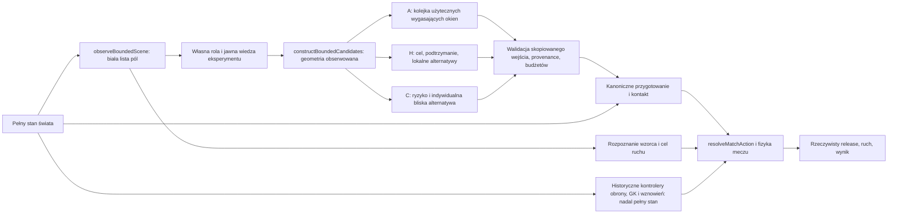
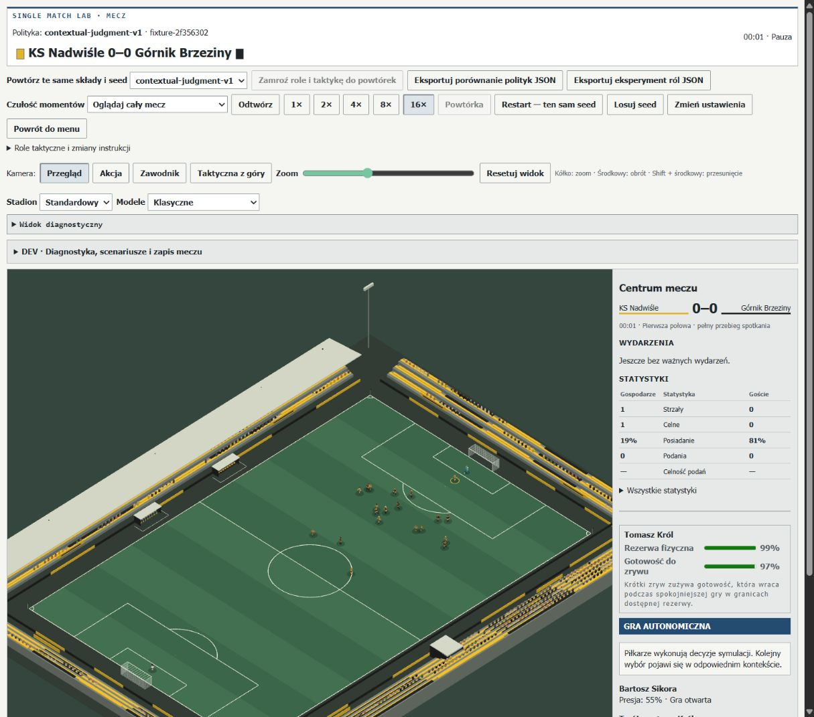

# PR187 — Bounded Football Intelligence & Decision Policy Validation

## 1. Decyzja i zakres

PR187 wdraża trzy wybieralne **eksperymenty autonomicznych decyzji przy piłce**:
Opportunity-Driven, Hierarchical Intent i Contextual Individual Judgment. Każdy
korzysta z nowego, typowanego adaptera obserwacji i własnego mechanizmu wyboru.
Wykonanie, kontakt, ruch, stamina, bramkarze i przepisy należą do istniejącego silnika.
Trzy wzorce PR186 są podłączone do rzeczywistej pętli ruchu, z opóźnieniem
rozpoznania, anulowaniem i osobnym pomiarem dotarcia.

**To PR eksperymentalny, wymagający dalszych prac. Nie jest ukończoną walidacją
ograniczonej inteligencji całego meczu. B `state-value-v1` pozostaje domyślne.
Canonical pozostaje NOT READY dla kalibracji summary.** Kontrolery obrony,
orientacji, bramkarzy, wznowień i część reakcji przy odbiorze nadal mają historyczny
dostęp do pełnego stanu. Nie przedstawiamy ich jako ograniczonej percepcji.
Nie otwarto niezależnej kohorty potwierdzającej przy niespełnionych prerequisite.

## 2. Baza, plan i historyczne dowody

Baza to scalony PR186 `68487f1c0e16f32b840056550708832ac1a68cdf`;
jego head `3db9b99fa86f93dfcb93b965751ceac9728fc650` ma pomyślny CI run
`40039945758`. Odtworzono 19 testów cognition/protocol PR186. Historyczny receipt
`PR186-verification.json` zachowuje swoje 2184 testy, dokładny zakres i zastrzeżenie
dotyczące ostatnich zmian. Nie przypisujemy tego wyniku nowemu kodowi.

Przed implementacją zapisano bazę i rozwojowe hipotezy/blokady w
[`PR187-baseline.json`](performance/PR187-baseline.json) oraz
[`PR187-development-design.json`](performance/PR187-development-design.json).
193 historyczne pliki PR184–186 są chronione hashami LF/binarnymi. Żaden nie jest
nadpisywany. Stare fixtures i okna 699,050/3504,050 s pozostają development.

Kolejność prac: baza i audyt → interfejs obserwacji/kandydatów → rozpoznawanie
wzorców w pętli live → trzy mechanizmy → diagnostyka technik/utraconych okien →
pełne mecze development → ocena blokad → dokumentacja i zgodność. Bramka
niezależnego potwierdzenia nie została uznana za spełnioną przez samo ukończenie meczów.

## 3. Architektura i zależności



| Odpowiedzialność | Moduły i kontrakt                                                                                                                                          |
| ---------------- | ---------------------------------------------------------------------------------------------------------------------------------------------------------- |
| Obserwacja       | `boundedPerception.ts`; własne atrybuty, ciało i rola, widoczna geometria, piłka, wynik/czas; brak referencji do świata                                    |
| Wiedza           | `boundedIntelligenceState.ts`; jawnie zadane system/role/partner familiarity i wymagania coacha; domyślnie zero historii                                   |
| Wzorce           | `boundedIntelligence.ts` + `recognisePattern` PR186; wyłącznie cel/intencja ruchu, bez przydzielania posiadania                                            |
| Kandydaci        | `boundedDecision.ts`; maks. 48, ground passes, trzy carry directions, hold i trzy techniki strzału; wycena przybliżona                                     |
| Polityki         | Trzy osobne funkcje; żadna nie wywołuje `rankStateValueActions` ani `evaluateStateValueAction`                                                             |
| Walidacja        | Nowe schematy i wzmocniony `validateResearchDecision`; odrzucenie obcego aktora, niewidocznego odbiorcy, nieznanych dowodów, duplikatów i wygasłego wyboru |
| Przygotowanie    | Własna ostrożna prognoza; kanoniczny `preparationMarginForAction` przy autonomicznym wykonaniu nowych polityk; bez skracania czasu                         |
| Wykonanie        | `matchActions.ts`, `canonicalMovement.ts`, `ballContactGeometry.ts`, `footContact.ts`, `shotResolver.ts`, `matchSimulation.ts`                             |
| Feedback         | Osobne ślady decision/pattern/attempt; ID rzeczywistego podania/strzału i istniejąca telemetria; obserwator dostaje kopię                                  |

Nie utworzono drugiego silnika meczu. Kandydat jest hipotezą o działaniu;
kanoniczny resolver może ją odrzucić. Nowe mechanizmy nie dopisują udanego
kontaktu, ukończonego podania, gola, dotarcia ani bonusu fizycznego.

## 4. Informacja i pozostałe wycieki

W nowej ścieżce przy piłce **world truth → obserwacja → kandydaci → polityka**
jest wymuszone typami i konstrukcją wejścia. Generator przyjmuje `BoundedScene`,
nie `TacticalMatchState`. Nie odzyskuje świata przez helpery. Nie używa starego
generatora, precomputed expectedCompletion, dokładnego ETA rywala ani jego techniki.
Metamorficzne testy zmieniają ukryte atrybuty, prywatne cele, instrukcje rywala,
decisionIndex i niewidziane pozycje przy identycznej scenie: kandydaci/wybór są identyczne.

Widoczność ma promień 36 m, szeroki kierunkowy sektor i bliski region do 7 m.
Niewielka niepewność pozycji korzysta z osobnego, seedowanego strumienia i
100-ms koszyków. Własny kontakt jest propriocepcją, nie prognozą cudzego wyniku.
Rozpoznaje się publiczną sylwetkę bramkarza i własne role drużyny; techniczne
atrybuty innych graczy nie są dostępne. Niewidoczny keeper oznacza niepewność,
nie pustą bramkę. Prywatne intencje runnerów nie są przekazywane carrierowi.

| Droga informacji                                                                      | Status                                                                                            |
| ------------------------------------------------------------------------------------- | ------------------------------------------------------------------------------------------------- |
| Kandydaci, adresaci podań, lokalne lane/shot estimates nowych polityk                 | Oparte na skopiowanej scenie; bez ukrytych opponent ratings i przyszłego RNG                      |
| Przygotowanie i ostateczny kontakt                                                    | Własne ciało + kanoniczna autorytatywna kontrola, dopiero po wyborze                              |
| Wzorce wsparcia                                                                       | Ograniczona widoczna geometria; osobna znajomość systemu/roli/partnera; brak gwarancji kooperacji |
| Podstawowe cele formacji i pressing                                                   | **Historyczny pełny stan**, przed/obok nadpisania celem wzorca                                    |
| Orientacja, lokalna praca przy piłce, reception/loose-ball/aerial nomination          | **Częściowo pełny stan**, nieprzeniesione do adaptera                                             |
| GK approach/sweep/reaction/claim                                                      | **Historyczny pełny stan**, w tym lot; brak nowego bounded keeper controller                      |
| Wznowienia, część nieposiadających piłki challenge decisions, coach opposition memory | **Historyczne wspólne kontrolery**, nie certyfikowane jako percepcja jednostki                    |

To blokuje deklarację pełnej bounded-intelligence. Nie maskujemy wycieku,
przekazując stare uprzywilejowane wartości w nowym opakowaniu. Porównania pełnych
meczów z B/R3 są historyczne; nie są eksperymentem równych informacji dla całego AI.
Nie ma pełnej okluzji, aktywnego rozglądania ani zanikającej pamięci pozycji.
Pamięć posiadania jest uproszczona i może mylnie interpretować ponowne zobaczenie piłki.

## 5. Trzy mechanizmy i mapowanie identyfikatorów

| Kontrakt PR186        | Wybór w Match Lab/headless | Mechanizm                                                                                                                        |
| --------------------- | -------------------------- | -------------------------------------------------------------------------------------------------------------------------------- |
| `opportunity_driven`  | `opportunity-driven-v1`    | Admit benefit/risk względem przewidywanego trzymania piłki; użyteczne krótkie okna według zamknięcia; brak nakazu strzału        |
| `hierarchical_intent` | `hierarchical-intent-v1`   | Najpierw sprawdzenie poprzedniego celu i zależności; następnie jeden cel retain/progress/escape i do trzech lokalnych alternatyw |
| `contextual_judgment` | `contextual-judgment-v1`   | Subiektywna koperta ryzyka, kontekst wyniku/czasu i ograniczona do 0,02 dyskrecja w bliskich alternatywach                       |

H potrafi podtrzymać ważny cel przy jednej ocenie, zamiast ponownie porównywać
całe menu. Widoczny brak odbiorcy, zmiana instrukcji, upływ czasu, utrata asekuracji,
spalony/niebezpieczna linia lub brak wykonalnego kandydata unieważnia kontynuację.
Utrata posiadania usuwa bieżący cel; jej osobny ślad anulowania wymaga jeszcze rozbudowy.
Zależności nie oznaczają, że partner zgodził się na plan lub dotarł.

C wykorzystuje kombinacje composure/determination/ambition i
professionalism/concentration w interpretacji ryzyka/zgodności. Żaden atrybut
nie wskazuje typu akcji. Bodziec osobisty jest wyłącznie jawnie wstrzyknięty;
nie powstają fikcyjne milestone/scouting facts. Compliance i regret nie są
przepisywane po późniejszym golu. Egzekucja i wynik są osobnymi faktami.

Kontrolowany wspólny zestaw daje trzy różne intencje: krótkie okno carry,
podtrzymaną kombinację i bezpieczniejszy carry. To test mechanizmów na jawnie
zadanych wartościach, **nie dowód trafności tych wartości w meczu**. Zmiany planu,
wygasłe okno, brak runnera, planning/individuality off i końcówka spotkania są
osobnymi development contrasts. Nie losowano akcji dla uzyskania różnorodności.

## 6. Wzorce, znajomość i coach

Counter support wymaga zaobserwowanej zmiany zespołu przy piłce i widocznego
poruszającego się carriera. Playmaker run używa zgrubnego widocznego body-set cue
deep playmakera. Press triangle rozpoznaje bliskiego przeciwnika przy partnerze.
Eligibility korzysta z istniejących instrukcji roli, bliskości, dwóch widocznych
jednostek asekuracji i ryzyka spalonego. Wzorzec ma termin, target i origin;
przeciwnik przy celu, utrata źródła/posiadania, cover, instrukcji lub restart go anuluje.

Przygotowany cue playmakera pozostaje uproszczeniem: aktywne opanowanie piłki
nie dowodzi specyficznego przygotowania długiego podania. Nie stwierdzamy, że
wdrożono pełny widoczny backlift/komunikację zamiaru dystrybucji.

Cel wzorca trafia do istniejącego ruchu; nie zmienia capability, przyspieszenia,
balansu, nogi, stamina ani powierzchni kontaktu. Ludzkie movement intent,
reception i istniejący defensive challenge zachowują pierwszeństwo. Dotarcie do
taktycznego celu, przybliżona dostępność podania, próba, release, dotarcie odbiorcy
i końcowy wynik podania są mierzone oddzielnie. Nie utożsamiamy completed pass
z ukończeniem wzorca. Próby z przeciwnikiem używają zwykłego polecenia ruchu,
bez przenoszenia ciała po początkowym ustawieniu; pierwsza wersja aparatury z
interwencją geometryczną jest zachowana jako wcześniejsza próba development.

Familiarity 0,1/0,9 zmienia recognition, nie fizyczne umiejętności. System,
tactical role i partner są odrębnymi polami; `positionFamiliarity` nie zmienia znaczenia.
Zmiana instrukcji anuluje zależny wzorzec i może obniżyć lokalną przydatność system
familiarity; nie usuwa role/partner knowledge. To mechanizm match-level, bez
trwałej kariery uczenia. `learnPattern`/adaptability PR186 nie zostały pozornie
przedstawione jako zintegrowana ekonomia wieloletnia.

Coach demands są jawnie konfigurowane i oddzielne od istniejącego CoachProfile
adaptability. Creative freedom/discipline uczestniczą w dyskrecji i complexity
w rozpoznaniu. Change frequency i rehearsal to zachowane rozszerzenia konfiguracji,
bez potwierdzonego osobnego efektu live. Nie przeprowadzono pełnego eksperymentu
filozofii trenerów, spontanicznej komunikacji ani lidera rozpoznającego własną radę.

## 7. Timing, przygotowanie i utracone okna

Observation/recognition wzorca, rozpoczęcie ruchu, arrival, wybrana akcja,
przygotowanie, attempted canonical resolution i faktyczny release mają różne pola.
Przy piłce pierwsza interpretacja czeka na istniejącą zdolność percepcyjną gracza;
następne zapytania rozróżniają zmianę obserwowanej geometrii/presji, własny kontakt,
wynik i instrukcje od spokojnej kontynuacji. Recognition zależy od gameReading/
concentration, a spokojny przegląd od własnej poprzedniej akcji, zmęczenia i
przygotowania. Nie ma jednego 0,2-s timera wszystkich zawodników i akcji.
Pełny podział motor/prepared/deliberate pozostaje do rozbudowy. Wcześniejszy
cykl 4 ze sztywną kadencją zachowano w `PR187-evidence-cycle4.json`; cykl 5 ma
osobny preregistered development design, te same zużyte projekty i nowe receipts.

Własna prognoza action preparation kopiuje ostrożnie kanoniczne potrzeby obrotu,
dystansu i techniki, bez przyznawania PlayStyle relief. Resolver autonomicznych
nowych polityk sprawdza rzeczywisty margin; human-selected path zachowuje istniejącą
obsługę. Nie obniżono czasów przygotowania, nie zmieniono reach i nie omijano stóp.

Oba zamrożone okna R3 są ponownie audytowane z ich rzeczywistych stanów PR186.
Nowe polityki widzą tylko adapter, a oddzielny audit widzi fizyczną prawdę.
Nie dorobiono wcześniejszego cue, nie cofnięto zegara przygotowania i nie wymuszono
strzału. Pełne kontrfaktyczne earlier recognition/legitimate earlier preparation,
zmieniony obrońca i alternatywna intencja wymagają dalszego cyklu. Regresja
PR184→185 nie została przyczynowo rozwiązana.

## 8. Techniki strzału i bramkarze

Historyczna wspólna wycena driven/placed/chip pozostaje **jawnie odizolowanym,
nierozwiązanym common-engine mismatch**. Nie zmieniono starych polityk na podstawie
niezwalidowanej heurystyki. Nowy generator uwzględnia odmienną nominalną prędkość,
minimalny pionowy składnik chip, czas lotu, własne wykończenie, presję i widoczne
położenie keepera. Jest to przybliżenie, nie wspólny skalibrowany fizyczny evaluator.

144 próby development obejmują trzy dystanse, dwie pozycje GK, dwa pasma techniki/
finishing, cztery sparowane seedy i trzy techniki. Mierzą prognozę **przed** akcją,
kanoniczny release/launch, przypisany po ID wynik lub null. Forecast error jest
liczony osobno według techniki; null/no-release nie jest obronionym strzałem.
Duży błąd, szczególnie chip, blokuje uznanie nowego estymatora za naprawę.
Nie podnoszono mnożników, aby otrzymać oczekiwane dodatnie sensitivity.

Historyczny keeper steruje fizyczną kontynuacją tych prób. Nie wdrożono nowej
niepewnej percepcji lotu GK, improved sweep/stay choice study ani niezależnego
oneOnOnes calibration. Wyniki PR186 pozostają inconclusive. Weak foot/surfaces,
first touch/recovery, technical carry, jump scheduling, shielding/challenges,
unsaturated feints, catches/parries/recovery i większy repertuar kontaktów pozostają
w roadmapie. Żaden atrybut nie został usunięty ani uznany za zbędny.

## 9. Mecze i jakość futbolu

Development SS/SW/WW ma trzy różne projekty: formacje, siła, styl, zadane ciała,
słabsza noga i wybrane rezerwy fitness różnią się jawnie. Te same wejścia fizyczne
są sparowane między politykami. B/R3 są historycznymi full-state porównaniami.
15 wariantów na trzech projektach to **trzy projekty**, nie 15 niezależnych potwierdzeń.
Pełne powtórki observer on/off są dodatkowym testem tego samego projektu SW.

Telemetria zachowuje progresywne/cofające/zwrotne podania, entries/threat flow,
kontakty, straty, faule, kary, goalkeeper events i wynik. Nowe liczniki oddzielają
decision/candidates/inspections, continuation/cancellation, pattern observation/arrival,
attempt i release. Te dodatkowe liczniki dotyczą nowej ścieżki; historycznych rankingów
B/R3 ten harness nie instrumentuje, dlatego ich komórki mają „—”, nie fikcyjne zero decyzji.
Powtarzane zapytania nie są niezależnymi okazjami. Nie narzucono
kwot podań, strzałów ani goli. Samo ukończenie meczu i różna liczba akcji nie dowodzą
poprawy futbolu; brak dotarć, długa cyrkulacja i błędy estymacji są wynikami negatywnymi.

<!-- PR187_RESULTS_START -->

15/15 wariantów development kończy mecz (trzy nowe polityki × trzy projekty oraz B/R3 × trzy projekty). Trzy dodatkowe pełne SW observer on/off mają identyczne wejścia i końcowe hashe. Historyczne pliki: 193/193 zachowane.

| Projekt | Polityka | Wynik | Podania / celne | Strzały | Decyzje / inspekcje | Wzorce / dotarcia |
| --- | --- | ---: | ---: | ---: | ---: | ---: |
| dev-ss | contextual-judgment-v1 | 0:1 | 990/714 | 1 | 19792/193392 | 15/0 |
| dev-ss | hierarchical-intent-v1 | 0:1 | 1850/1208 | 1 | 13189/72641 | 15/0 |
| dev-ss | opportunity-driven-v1 | 0:0 | 1536/1070 | 1 | 15417/151047 | 11/0 |
| dev-ss | phase-role-hybrid-v1 | 6:2 | 2258/1507 | 22 | — | — |
| dev-ss | state-value-v1 | 1:4 | 2400/1496 | 19 | — | — |
| dev-sw | contextual-judgment-v1 | 3:0 | 629/215 | 5 | 20929/196293 | 8/0 |
| dev-sw | hierarchical-intent-v1 | 5:0 | 1276/417 | 6 | 13226/70776 | 9/0 |
| dev-sw | opportunity-driven-v1 | 8:0 | 923/331 | 19 | 16338/156153 | 12/0 |
| dev-sw | phase-role-hybrid-v1 | 11:0 | 1743/787 | 39 | — | — |
| dev-sw | state-value-v1 | 16:0 | 1768/760 | 33 | — | — |
| dev-ww | contextual-judgment-v1 | 0:0 | 10/0 | 0 | 18130/158451 | 5/0 |
| dev-ww | hierarchical-intent-v1 | 0:0 | 800/26 | 0 | 12122/60428 | 9/1 |
| dev-ww | opportunity-driven-v1 | 0:0 | 11/1 | 0 | 18419/168815 | 5/0 |
| dev-ww | phase-role-hybrid-v1 | 0:0 | 664/96 | 3 | — | — |
| dev-ww | state-value-v1 | 1:1 | 601/88 | 10 | — | — |

| Technika | Próby / release | Rozstrzygnięte / null | Średnia prognoza | Gole w rozstrzygniętych | Brier |
| --- | ---: | ---: | ---: | ---: | ---: |
| driven | 48/48 | 48/0 | 0.140 | 13/48 | 0.177 |
| placed | 48/48 | 48/0 | 0.158 | 12/48 | 0.159 |
| chip | 48/32 | 32/16 | 0.118 | 21/32 | 0.499 |

Wcześniejsze błędy/non-completions zachowano w 3 receipts; krótkie próby i poprzednia aparatura również pozostają w indeksie. Tabele nie ustanawiają zwycięzcy ani gotowości canonical. Surowe traces, wejścia, CPU/RSS i hashe: [PR187-evidence-index.json](performance/PR187-evidence-index.json).

<!-- PR187_RESULTS_END -->

Końcowy cykl 5 nadal ujawnia blocker jakości WW: A wykonuje 11 podań, kończąc jedno, C 10/0, a H 800/26; żadna nowa polityka nie oddaje strzału. W zachowanym cyklu 4 było odpowiednio 11/0, 24/2 i 821/16. Ukończenie spotkań i zmiana harmonogramu rozpoznania nie rozwiązują tej regresji. Dotarcia do celów wzorców są rzadkie. Próby kontrolowane nie wykazują, że szybsze rozpoznanie regularnie prowadzi do ukończenia wzorca. Hipotezy poprawy futbolu pozostają niepotwierdzone.

## 10. Reprodukcja, CPU i pamięć

```sh
npm run benchmark:pr187 -- --design=dev-sw --policy=opportunity-driven-v1 --full --rep=5 --replay
npm run benchmark:pr187 -- --design=dev-ss --policy=hierarchical-intent-v1 --full --rep=5 --replay
npm run benchmark:pr187 -- --design=dev-ww --policy=contextual-judgment-v1 --full --rep=5 --replay
npm run benchmark:pr187 -- --design=dev-sw --policy=state-value-v1 --full --rep=5 --replay
npm run benchmark:pr187 -- --design=dev-sw --policy=phase-role-hybrid-v1 --full --rep=5 --replay
npm run benchmark:pr187 -- --design=dev-sw --policy=opportunity-driven-v1 --full --observed=false --rep=5 --replay
npm run benchmark:pr187:research -- --replay
npm run benchmark:pr187:index -- --replay
npm run benchmark:pr186:replay
npm run verify
```

Te same polecenia przyjmują pozostałe kombinacje trzech development designs/policies.
Dla nowego uruchomienia wybierz nieużyty `--rep`; istniejące match receipts są chronione przed nadpisaniem. Replay sprawdza wejście, źródła i końcowy stan fizyczny, pozostawiając oryginalne czasy CPU/RSS. Receipt zawiera pełne początkowe wejście w archiwum, seed, source/evaluator hashes,
czas symulowany, status/non-completion, CPU/RSS, wynik i hash końcowego stanu.
Manifesty źródeł normalizują CRLF→LF. CPU obejmuje konstrukcję, parsery i wycenę,
a nie tylko pętlę wyboru. Licznik evaluations mierzy faktyczne inspekcje przez
runner-owned meter; sortowanie gotowych cech, budowa i walidacja są dodatkową pracą
objętą pomiarem całego procesu. Nie ukrywamy kosztu przeniesionego do percepcji.

Większość development matches wykonywano równolegle na tym samym hoście; wall time
nie jest kontrolowanym benchmarkiem jednego rdzenia. Mniejsze inspections H nie
oznaczają automatycznie zysku całego procesu. Limit przyszłego potwierdzenia 2×
nie jest zaliczony na podstawie współbieżnych pomiarów.

`benchmark:pr186:replay` archiwizuje **zamrożony commit PR186**, uruchamia jego
oryginalny harness z istniejącymi zależnościami i sprawdza 2086 historycznych prób.
CI pobiera historię potrzebną do tego commita. Nie odświeża historycznych hashy
nowym kodem. Katalog tymczasowy i junction są ograniczone do własnego scratch path.

Końcowe lokalne `npm run verify` przeszło: 2153 + 56 + 4 + 5 = **2218 testów**, lint, TypeScript i build. Bieżący research replay oraz indeks archiwów również przeszły. Dokładne polecenia, środowisko, hashe logów i wcześniejsze nieudane/przerwane uruchomienia: [PR187-verification.json](performance/PR187-verification.json). Wynik CI ostatniego head jest raportowany osobno w opisie PR.

## 11. Human/browser, save i zgodność

Nowe ID są wybieralne w istniejącym Match Lab oraz `configureMatchPolicy`.
Stan wiedzy/planów jest opcjonalny i walidowany; stare zapisy nie muszą go zawierać.
Nie dodano pól do kart ani obowiązkowej migracji kariery. Nowe runtime fields
przechodzą JSON/schema roundtrip i deterministyczną fizyczną kontynuację.
Historyczny schema roundtrip normalizuje część diagnostycznych velocity fields;
test nie utożsamia kolejności kluczy lub signed zero z inną fizyką.

Browser smoke obejmuje widoczny domyślny B, osiem opcji, autonomiczny A (cykl 5) i H (wcześniejszy cykl 4),
renderer/runtime i ludzką decyzję/strzał z C. Dokładny zakres, seed i niewykonane
przypadki zapisano w `PR187-browser-cycle5.json` i wcześniejszym `PR187-browser.json`. Nie zastępuje on pełnego Stage E:
manual substitutions, wszystkie restarty, movement/cancellation i GK interaction
wymagają szerszego smoke. Testy projektu weryfikują istniejące kontrakty.

## 12. Bramy akceptacji i gotowość

| Brama                       | Ocena                                                                                                                  |
| --------------------------- | ---------------------------------------------------------------------------------------------------------------------- |
| 1 — baza/audyt              | Wykonana baza, historyczny replay i jawny audyt pozostałych full-state dróg                                            |
| 2 — wspólna obserwacja      | Wykonywalna przy piłce; **niepełna dla całego meczu**, blocker pełnej bounded deklaracji                               |
| 3 — wzorce                  | Trzy podłączone do canonical loop; jakość, specyficzny cue długiego podania i skuteczna koordynacja **niezwalidowane** |
| 4 — trzy polityki           | Odrębne mechanizmy, kontrolowane kontrasty i rzeczywiste mecze; bez deklaracji przewagi futbolowej                     |
| 5 — mismatch/keepers/timing | Odrębny estymator z negatywną kalibracją; common correction, keeper studies i kontrfaktyczne okna **nieukończone**     |
| 6 — development             | Pełne wyniki i negatywne próby, replay/observer checks; nie jest niezależną walidacją jakości                          |
| 7 — confirmation            | **NOT RUN**, nowe SS/SW/WW niezamrożone i nieotwarte z powodu blockerów                                                |
| 8 — dokumentacja/verify     | Dokładny lokalny wynik i final-head CI w receipt i opisie PR; draft pozostaje draftem badawczym                        |

## 13. Priorytety PR188+ bez usuwania zobowiązań

1. Dokończyć percepcję także w obronie, orientacji, mikroprzygotowaniu, odbiorze,
   keeperach i wznowieniach. Dodać krótką pamięć pozycji i rzeczywiste zdarzenia
   reconsideration. Dopiero wtedy wykonać equal-information benchmark B adapter/new policies.
2. Wspólne, technique-sensitive physical forecasting: profil wykonania, trajectory,
   target/window, pressure bez double counting, GK uncertainty; skalibrować na
   faktycznie wypuszczonych strzałach i zachować null. Zbadać oba R3 windows i PR185 regression.
3. Poprawić planowanie współpracy i widoczny long-pass cue; mierzyć dotarcie,
   dostępność, release i outcome oddzielnie. Rozwinąć evidence-driven komunikację,
   coach changes, learning/adaptability i cancellation traces bez wymyślonej historii.
4. Ukończyć sweep/stay i 1v1 studies, pozostałe physical calibration i bezpieczny
   repertuar kontaktów/akrobatyki. Zachować przepisy, kartki, offside i human agency.
5. Zamrozić kod/evaluator/config i co najmniej dwa nowe niezależne projekty w każdym
   SS/SW/WW, hipotezy/blokady/CPU i brak strojenia po otwarciu. Dopiero potem readiness review.

Generational renewal zachowuje 20–25 sezonów, starzenie, emerytury, młodzież,
transfery i siłę świata. Summary/PlayStyles nadal czeka na przekonujący canonical.
Career UX, player–coach relacje, ekonomia treningowa i world expansion zachowują
swoje miejsca i pełny zakres; ten PR ich nie uznaje za wykonane.


