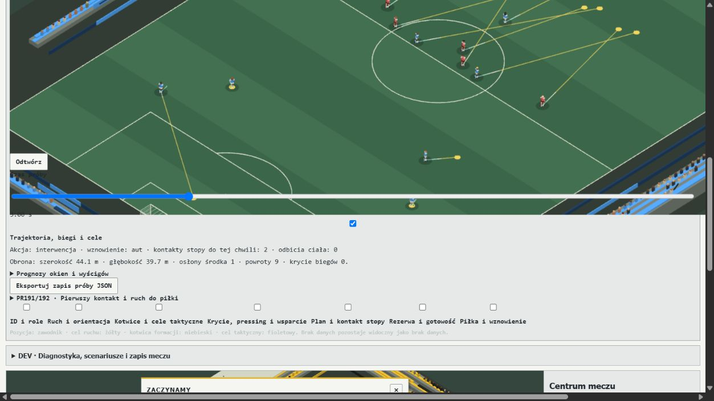

# PR193 — Transition Intelligence, Strategic Clearances & Opportunity Windows

## 1. Executive findings and readiness

**Canonical remains NOT READY. B remains default; independent confirmation is sealed.**
This stage implements opt-in temporal pass evaluation, movement after release,
third-man support, observed runner tracking, finite tactical clearance contacts,
and experimental non-shot loose-ball goal adjudication. It also supplies six
reproducible laboratory families and a Polish Match Lab replay panel.

Temporary advantage can produce a real progressive delivery, meaningful runs and
an ordinary attacking shot. It can also disappear through a goalkeeper claim,
failed contact, offside, a foul or a return to circulation. The paired development
matches still expose severe policy-dependent underproduction. This is not evidence
that the canonical engine or any alternative policy is ready for promotion.

Across the fifteen paired combined matches, passes fall **24,373 → 22,546** but
shots also fall **214 → 183**. Active time spans **77.375–85.355 minutes**. WW/B
improves attacking production while WW/O and WW/H remain severe failures; SW/H
regresses from 38 shots to nine. These findings reject a general quality claim.

`experimentalTransitionIntelligence`, `experimentalStrategicClearances` and
`experimentalIncidentalGoals` are independent optional fields. Full development
matches test the first two; the third is enabled only in the deflection/scoring
apparatus. Existing recovery, restart preparation and body-contact flags retain
their meanings. No experiment is enabled globally, and no new dependency is added.

## 2. Frozen PR192 evidence

Merged base: `8106f28c68e7bed5368d8140cfe97ede79e9d19e`; PR192 head:
`379a87f73ee446e096195caf5e31d2ca8655eca1`.
[Frozen manifest](performance/pr193/frozen-pr192.json) records normalized source,
scripts, configurations, historical report hashes, all fifteen input hashes/seeds
and environment. Source variants are recoverable overlays against this exact base.
Historical PR189–192 reports and performance archives are unchanged.

PR192's 15 matches reached full time, with approximately 79.3–89.0 active minutes.
WW/O had 1,899 passes, five shots and five throws; WW/H had 1,498 passes, three shots
and no throws. SS/B had 2,241 passes, 23 shots, 63 foul challenges and 60 foul
restarts, including 42 behind challenges. These are different event populations.

The exact PR192 laboratory, flow, challenge and captured replay checks run in an
archive of PR192 through `benchmark:pr193:baseline`. Their source-integrity checks
must not be pointed at changed PR193 source. The earlier PR186–191 replay chain
and PR192's frozen PR191 baseline remain in CI. The PR192 integration timeout
correction is historical test budgeting, not a football speed improvement.

## 3. Opportunity-window model

`opportunityWindows.ts` separates location arrival, playable contact and subsequent
action readiness. Its estimate uses observed position, velocity, acceleration,
adverse/transverse momentum, facing, reaction and preparation. Nearest Euclidean
distance is not treated as a contact winner. Unknown opponents share an uncertain
physical envelope; their private attributes, targets and future RNG are unavailable.

Each pass samples nine release times over 1.6 s and four lane points. `opensAt`,
`closesAt`, contact/lane margins and censoring are recorded with the observation
time. The 200 ms grid and linear motion are bounded engineering approximations,
not exact future physics. Final reach, control and release use canonical execution.

Pass/carry valuation compares local successor threat with turnover threat in the
same units. A visible continuation can make a backward release useful. Coefficients
are engineering priors, not calibrated xG. Territory, space, possession and recovery
are conditions on the continuation rather than separately accumulated rewards.
The Opportunity queue also compares a fleeting candidate against better durable
options; short expiry alone no longer preempts a valuable available release.

An incomplete observed defensive line cannot establish offside. A missing keeper
adds uncertainty, not an imaginary second-last defender. The actual release and
interference still use the authoritative offside laws.

## 4. High-risk transition scenario

Benchmark A starts with a pressured carrier, backward support, a moving striker,
wide support, an additional runner, rest cover and recovering opponents. Every
body continues through the canonical 25 ms simulation. Initial placements are
controlled experimental conditions; later passes, contacts and shots are not
scripted. Normal, organised, initially passive/distant, fatigued and late-score
conditions are retained, including both mirrors.

The normal 80/80 case releases through space immediately, starts two support jobs
and gains territory, but loses its clean attack to the keeper and later circulates.
A fatigued condition produces an ordinary attacking shot after an intervening
opponent touch: it is not an uninterrupted ideal combination. A late-score case
also produces a shot, with many intervening actions. Neither is advertised as a
guaranteed spectacular goal. Exact action/owner timelines and failures are in the
[laboratory summary](performance/pr193/summary-final-v1.json).

## 5. Press escape and backward-release findings

The press-escape condition adds a second nearby pressure line while retaining
visible backward support. Candidate logs preserve the backward option, its
continuation estimate, competing progressive options and the executed choice.
Available space after release is not equivalent to a completed progressive chain.
The backward candidate is not always selected or successfully converted; local
visibility, risk and subsequent opponents still matter.

The full-match receipts separately count forward/backward deliveries, progressive
receptions, final-third/box entries and turnovers. A new forward pass count is not
used as a proxy for attack quality. Full traces retain circulation returning after
an initially successful escape. No reward is attached merely to passing backwards.

## 6. Pass-and-run and third-man movement

`observeTransitionRelease` runs after an actual delivery. Each runner uses their
own bounded scene, with reaction delay, visible cover, role/duty and offside
uncertainty. At most two jobs persist, prioritising the passer's own continuation.
Other players infer visible ball direction; they do not read the passer's private
receiver intention. There is no promised return pass or reserved future receiver.

Runs remain active during flight and use ordinary acceleration, sprint/run effort,
fitness and collisions. Possession loss seen locally, ownership, human control,
arrival, expiry and stoppages can cancel them. Defending centre backs and holding
roles are not recruited indiscriminately. Full-match diagnostics distinguish jobs
started, bodies moving at least 1.5 m and an observed tracking response.

## 7. Relative contact-race experiments

Benchmark B crosses 40/40, 80/80, 40/80 and 80/40 with both mirrors and actual
0.2/0.5/1.0 s release delays. All 28 attributes are controlled as a team-quality
condition, not silently substituted into opponent knowledge. Ratings affect real
movement/execution; the local opponent estimate remains uncertain.

A farther runner with useful momentum can beat a nearer defender moving away.
The isolated kinematic regression verifies this. Laboratory receipts additionally
record first approach, playable touch and action separately. Null means not observed
within the retained horizon. These contacts must not be inferred from the estimated
race winner, ball proximity or an ownership forecast.

The delayed apparatus holds the source through the existing human hold mechanism,
then executes the labelled intervention. Counterattack delay conditions similarly
hold the carrier before releasing autonomous choice. Actual release times are
recorded; a requested delay is not asserted to equal the final physical release.
There is no general theorem that higher skill or a faster pass always wins.

## 8. Defender displacement and team shape

Defenders rescan at 100 ms, including during ball flight. They compare visible
runner velocity/goal-side danger with ball danger and nearer cover. A lone central
screen can stay central instead of chasing a wide runner. Decisions do not inspect
attacking run IDs, private targets or exact unseen team organisation.

Passive diagnostics measure width, depth, line gaps, anchor RMS, central screens,
recovering bodies and tracking jobs. Truth-based measurements never feed a bounded
decision. Laboratory samples include actual positions, velocities, facing and
movement targets. Minute samples in full matches include late and fatigued phases.
This is a limited coordinated controller, not a full formation/marking rewrite.

## 9. Central versus wide transition risks

Benchmark D compares central/left/right geometry across all four skill pairs and
mirrors. Central access can produce a quick shot but increases keeper/defender
exposure. Wide access can retain territory, fail a combination, lose possession or
cross the touchline. Both outcomes and contact histories are retained.

The boundary is a physical constraint, not a flank attack bonus. Benchmark E adds
three nearby defenders at the line; safe space to retreat and genuine physical
failure remain possible. No guaranteed trick, escape, corner or throw is awarded.

## 10. Deliberate defensive clearance cases

`strategicClearance.ts` evaluates control, second-ball clearance into play,
touchline clearance, goal-line clearance and delay. It estimates the opponent's
next threat from local support, access, restart location and reachable recovery.
A throw concedes a restart; a corner can be expensive. Neither receives a fixed
out-of-play bonus. Estimated preparation/recovery is distinct from elapsed time.

Autonomous NPC challenges can carry an explicit objective. Existing human choices
remain human choices. A legal ball-first duel then attempts the existing finite
inside-foot impulse, respecting preparation, posture, pressure and reach. A miss
cannot create velocity. The surface's actual outgoing 3D velocity/spin and last
touch survive the duel resolver; they are not replaced by a generic loose ball.

Benchmark C compares identical geometry and paired seeds for control, in-field,
touchline and late attempts. A selected clearance does not guarantee an exit.
Only whole-ball boundary crossing awards the restart, to the team entitled by
the last actual touch. Control/field/line cases can have different subsequent
fouls or recoveries; the last challenge is not always the initial intervention.

## 11. Incidental body deflections

Benchmark F prescribes an outside-foot delivery objective and a reachable defender's
clearance objective, then lets ordinary contact/flight continue. Each intention is
retained separately from the surface that actually executes. Subsequent body
rebounds are not renamed as a deliberate pass, shot or knee technique.

A separate canonical probe exposed a real limit: a non-shot loose ball crossing
the goal mouth historically became a goal-line restart. The opt-in repair checks
the existing whole-ball goal/frame geometry, uses the physical goal end even for
an own goal and resolves posts before the line. It preserves direct-restart and
dropped-ball goal restrictions, ordinary post-goal movement and correct attribution.

[Scoring-law probes](performance/pr193/incidental-scoring-v3.json) distinguish a
non-shot goal, own goal, post, wide ball, forbidden direct throw and flag-off control.
The near-goal trajectories are prescribed law tests, not evidence that F generated
an autonomous multi-contact wonder goal. General non-shot delivery scoring outside
the loose-ball path and full articulated keeper/body surfaces remain staged.

Public player shots/SoT include an incidental non-own goal, following the
[Opta goal-inclusive convention](https://www.statsperform.com/opta-event-definitions/).
Own goals remain separate. Neither case invents an intentional Shot/MatchAction ID,
launch diagnostic or attacking scorer for an own goal. The two ledgers are explicit.

## 12. Unavailable trick/contact geometry

The [geometry audit](performance/pr193/geometry-limits-v1.json) tests the actual
ordinary loose-flight defender collider. It is still a solid legacy body envelope,
not an authoritative gap between separately positioned legs. Optional articulated
lower-body research geometry does not replace that collider in every canonical
branch. A low central trajectory intersecting this envelope cannot prove a nutmeg.

Consequently, nutmegs, precise shin/knee redirections and goalkeeper leg gaps are
**blocked by contact geometry** here. No named trick or cosmetic bypass is added.
An incidental legacy body rebound remains valid only at that envelope's accuracy.

## 13. Defensive fouls and legal contact

The SS/B audit reruns the complete frozen baseline and captures sixteen actual
pre-contact states, including clean/missed/behind/foul outcomes. One-tick replays
match their recorded canonical successors. It preserves 63 foul challenges and
42 behind fouls, with the exact PR192 final-state hash and separate 60-restart ledger.
Positions, facing, relative speed, reach, contact ordering, lateness and estimated
force are retained. A from-behind label alone does not prove a foul or legality.

The [IFAB Law 12](https://www.theifab.com/laws/latest/fouls-and-misconduct/) distinction
between careless, reckless and excessive-force challenges is the applicable frame;
ball first does not excuse subsequent dangerous contact. The legacy force estimate
is a geometric model, not calibrated newtons. Reproducibility does not validate
every threshold. This PR changes no foul threshold to reduce a target total.

## 14. Restart preparation and territorial value

An attacking throw preserves its real location and restart entitlement while
ending the live transition. Both teams move during retrieval, finite preparation
and legal restart readiness. There is no imaginary carry-over of the old counter.
The retained PR192 lift/retrieval lifecycle and quick-free-kick rules remain active.

[IFAB Law 9](https://www.theifab.com/laws/latest/the-ball-in-and-out-of-play/) requires
the whole ball to cross. Current [Law 15](https://www.theifab.com/laws/latest/the-throw-in/)
has a referee's visible five-second countdown after unfair delay and possible
reassignment. It does not prescribe a mandatory five-second pause on every throw.
PR193 adds no statistical delay or fixed throw timing. A full referee countdown
model remains a separately identified law/lifecycle extension.

## 15. Full-match development comparisons

The authoritative set is **31 full matches** on the final canonical kernel:
15 combined WW/SS/SW × B/R3/O/H/C; twelve transition-only or clearance-only
ablations for B/O; one unchanged WW/B control; three full B observer-off twins.
Fixtures retain frozen PR188 inputs, seeds and 25 ms steps, with PR192 recovery
and restart preparation enabled. Confirmation inputs are never read.

[All fifteen baseline → PR193 comparisons](performance/pr193/full-match-table.md),
[ablation CSV](performance/pr193/ablations.csv) and
[complete numerical summary](performance/pr193/summary-final-v1.json) distinguish
score, passes/completion/rate, shot distances/expectations, final-third/box access,
turnovers, windows, preparation, runs, clearances, actual restarts, fatigue and costs.
Raw full receipts retain shot diagnostics, restart durations and sampled organisation.

| Fixture | Passes PR192 → PR193 | Shots PR192 → PR193 | Active minutes PR192 → PR193 |
| --- | ---: | ---: | ---: |
| WW/B | 667 → 408 | 11 → 22 | 83.815 → 81.202 |
| WW/O | 1,899 → 1,512 | 5 → 1 | 88.274 → 82.022 |
| SS/B | 2,241 → 2,065 | 23 → 20 | 79.308 → 83.430 |
| SW/H | 1,172 → 1,620 | 38 → 9 | 85.223 → 85.150 |

WW/B ablations separate the mechanisms: transition-only gives 379 passes,
17 shots and 84.601 active minutes; clearance-only gives 584/18/82.941; combined
gives 408/22/81.202. Thus fewer passes alone neither establish better finishing
nor explain natural-flow improvement. The combined WW/B case awards twelve throws
and eleven corners, while WW/O awards 23 throws but only one shot.

The earlier `final-v1` dispatch is a staged development cohort whose source changed
between jobs; it is preserved, not presented as a uniform final-source experiment.
All authoritative `final-v2` receipts share the current canonical dependency hash.
Complete source manifests/overlays retain apparatus-only changes during dispatch.

## 16. Passing circulation and shot creation

New temporal candidates address stale lanes and disconnected runners; finite
clearances change live-ball risk and create real interruptions. These are causal
interventions upstream of the boundary system, whose geometry already worked.
The full ablations show how movement and clearance differ rather than attributing
every aggregate change to one new function.

[Selected actual trajectories](performance/pr193/figures/selected-trajectories.svg)
compare normal/passive defence, control/line clearance and delayed races. They are
sampled projections with unchanged observed outcomes, not storyboards of a goal.

Nevertheless, Opportunity/Hierarchical can still recycle for long periods with
very few shots. Local continuation estimates are short, finish selection competes
with low-risk retention, runners can lack a useful second contact and the keeper
can end a seemingly open transition. A large number of started windows or runs
does not establish valuable attacks. The receipts expose unused windows and
preparation choices without treating every sampled episode as a ground-truth chance.

There is no pass cap, shooting quota, shot-value inflation, clearance quota, forced
turnover or elapsed-time attack trigger. Sparse natural interruptions and high
active minutes remain football blockers even when technical tests are green.

## 17. Negative tests and unresolved blockers

[Negative ledger](performance/pr193/negative/README.md) preserves failed development
cycles, confounded early variant seeds, the original non-shot scoring failure,
delay-apparatus mistakes and corrected checks. Lab v6 / protocol v2 is authoritative;
earlier archives remain recoverable. Source drift during a laboratory run aborts
the receipt instead of certifying mixed-source results.

Open gates: robust autonomous multi-stage counter combinations; calibrated relative
contact predictions; universal articulated collisions/leg gaps; general non-shot
delivery goal handling; policy-wide shot creation; credible natural-flow/foul rates;
independent confirmation. Initial passive/distant defenders are experimental
placements, not frozen bodies or proof that weak opposition always loses.

Trace caps (192 decision records, 64 contacts, 100 ms lab samples, minute shape
samples) are retention limits. Missing events beyond them are not asserted absent.
Full-match `late` is not a populated action breakdown; late organisation and final
fitness are measured, but no missing late-action counts are fabricated.

`clearanceExits` in the full runner is a last-challenge/last-touch correlation,
not a complete causal episode ledger: a later touch by the same player can confound
it. Actual boundary awards remain authoritative. Recovery-after-clearance counts
are not fully attributed; possession changes, contact races and retained shapes
are the available evidence. These counters must not be promoted as exact causal
conversion rates. A dedicated episode ledger remains an instrumentation extension.

## 18. Determinism and performance

The benchmark uses seeded observations and canonical RNG only. Mirrors transform
y position/velocity, facing and foot; seed jitter is not forced into exact mirror
symmetry. Matched seeds hold across skill and delay/variant contrasts in protocol v2.

Repeated laboratory samples use detached mutating observers. Fifteen actual
full-match captures each continue twice with a mutating bounded observer and once
without it; all three hashes must agree. Three complete B observer-on/off pairs
also compare final states. The unchanged WW/B control must reproduce PR192's full
state hash. Older saves parse with optional new fields absent; human cancellation
and finite-contact failures have focused regression coverage.

Receipts report wall time, CPU user/system time and peak RSS. Parallel development
wall times are workload-dependent; they are not advertised as engine speedups.
The 100 ms defence scan, at most two jobs, nine window samples, four lane points
and 48-candidate bound limit added work. CPU overhead and negative performance
results remain explicit in the numerical summary.

The [shared-checkpoint probe](performance/pr193/cost-prefix-v1.json) runs 160 ticks,
one warm-up and five repetitions per mode. Median CPU is 219 ms baseline, 359 ms
transition, 250 ms clearance and 375 ms combined: about 71% added combined CPU in
this local workload. Each mode repeats the same final hash, but flags alter its
subsequent football. This is one point, not a universal speed estimate; profiling
the experimental perception work remains necessary before promotion.

[Twelve shot-quality replays](performance/pr193/laboratory-shot-quality-v1.json)
retain actual final shot launch, distance, pressure, preparation/error profile and
outcome, reproducing their original final-state hashes. Initial pass risk and final
shot expectation use different models; they do not prove a calibrated claim that
the finish is easier than every preceding action. No such probability is invented.

`npm run verify`, focused physics/PR193 tests, historical replay chain, new
laboratory checks, source/evidence integrity and observer replay are recorded in
[verification receipt](performance/pr193/verification-final-v1.json). Final-head
This immutable local receipt is a pre-CI snapshot. The final consolidated local
verify result and final-head GitHub CI are reported on the PR; no assertion or
timeout is relaxed.
Match Lab browser smoke covers scenario selection, physical clearance, timeline,
Polish labels and optional overlays with no console errors.

## 19. Independent validation readiness

The existing independent cohort remains sealed. These are selected development
fixtures, repeated causal conditions and regression checks. A small paired cohort
cannot establish policy superiority or realistic population rates. Confirmation
should open only after football blockers and protocol acceptance are reviewed,
with a frozen candidate and predeclared metrics. No promotion follows from green CI.

## 20. Future career requirements and roadmap

PR193 specifies, without implementing career selection, that performance depends
on role fit, familiarity, partners, preparation, fitness, morale/confidence,
opponent matchup and temporary form with uncertainty. Repeated role-adjusted
evidence should inform coach style and trust. One spectacular play must not
permanently inflate the player's underlying card; visible form and latent ability
remain distinct. A slump is not automatic permanent decline.

The authoritative sequence in [ROADMAP](ROADMAP.md) and
[PROJECT_STATE](PROJECT_STATE.md) is PR193 transitions/clearances → PR194 full
Generational Renewal & World Strength → PR195 Summary/PlayStyles → PR196 Career UX
→ PR197+ World Expansion. The entire outstanding 20–25-season generational scope,
academies/cohorts, full squad/best XI/position strength, growth/ceilings, ageing,
retirement, transfers, replacement and strong/weak club stability is retained.
Remaining match blockers need an explicit priority decision; renumbering does not
complete generations or justify indefinitely postponing career work.
