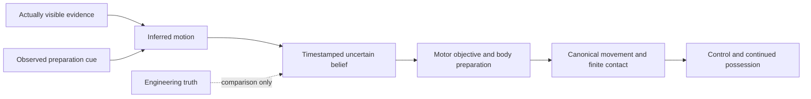

# PR199 — Ball Flight Perception, Receiver Regression Forensics & Validation Progress

## 1. Executive summary

**Diagnostic-only PR. Canonical NOT READY; B default; independent confirmation sealed.** The exact PR198 receiver baseline is reproduced, including every eight lost and three gained direct contacts. Facing/speed and observation freshness causally affect those failures; neither a better point/time representation nor a single earlier-braking rule establishes better physical reception. No new controller is installed in live matches.

The Ball Flight Perception & Occlusion Lab completes **1720 prediction trials on 20 actual launches**, **664 real receiver continuations**, 32 named stressor continuations, 16 retained sensory-reference continuations and versioned goalkeeper experiments. It separates offered visibility, attended exposure, actual acquisition, inferred motion, memory, uncertainty, motor preparation and real contact. Original failed and confounded experiments remain available. A separate generated programme report reproduces the historical explicit-update union and keeps source audit, investigation, diagnosis, scoped repair, development evidence and full closure distinct.

## 2. Frozen PR198 baseline

Merged base: `aa2292b664ab3c0afa43297c2e4d24fc0f6c6d5b`; PR198 head: `ef79798795cde20d802f58e1283ac2b4f9ed11df`. [Frozen manifest](performance/pr199/frozen-pr198.json) binds normalized source fingerprint `bc638ebb8ec3e7715fee7317e3a58c6544fd005c4193fcc82a8297f322e893c9`, all 135 original IDs/statuses, exact optional flags and Git blob identities for all PR195–198 receipts. This includes the original 28 long-pass cases, 180 real releases/40 rejected requests, 448-trial sensitivity matrix, two 280-scenario opportunity cohorts, seven full-match pairs, negative controls and validation receipts. No historical expected value is refreshed.

| Configuration | Released/touch/control/retained |
| --- | --- |
| R | 180/154/123/116 |
| S | 180/149/113/108 |

The original non-anticipating baseline remains 160/128/107. PR198's 2.557→0.278 m and 0.493→0.058 s errors describe thirteen shared contacts, not all attempts. Synchronisation remains opt-in. Canonical arrival remains separate and false in the frozen reception continuations.

## 3. Registry and dependency scope

Primary: PASS-004/006/009, TACT-001/004, GK-001/002, MEAS-001/003/011. TACT-009 already covers bounded perception and memory; its scope now explicitly includes temporal observation, inferred velocity, occlusion and trajectory uncertainty. No duplicate issue is added. All 135 historical identities remain in order. PASS-003/005/007/008, DEF-002/003/005, GK-003/005/010, TACT-002, FIT-002 and measurement/replay/performance dependencies remain separate gates.

The [dependency map](match-engine/MECHANISM_DEPENDENCIES.md) distinguishes actual current consumers from the isolated proposed information path. GK-001's logistic coverage estimate is only partly investigated; actual save trials are not a recalibration of that utility.

## 4. Receiver regression case-by-case forensics

[Full forensic receipt](performance/pr199/forensics-changed-v1.json.gz) retains 40Hz ball/body positions and velocities, actual observation/time/age, local velocity, point/time plan and legacy estimate, initial momentum, facing/turn delta, plant/support/finite feet, motor speed, replanning, tactical/challenge/human/combination intentions, authority expiry, actual opportunities/contacts and original control/retention. The exact observation and versioned predictor also reconstruct the complete local forecast; it is not replaced with canonical future truth.

| Case (family / ability / sample) | Change | R touch/control/retained | S touch/control/retained | Restoring interventions |
| --- | --- | --- | --- | --- |
| long_ground/20/1 | gained | no/no/no | yes/no/no | gain retained as separate outcome |
| long_ground/20/3 | lost | yes/no/no | no/no/no | speed_legacy, accurate_fresh |
| moving_lead/40/3 | lost | yes/no/no | no/no/no | accurate_fresh |
| moving_lead/60/0 | gained | no/no/no | yes/no/no | gain retained as separate outcome |
| cross_field/20/1 | gained | no/no/no | yes/yes/yes | gain retained as separate outcome |
| cross_field/60/0 | lost | yes/yes/no | no/no/no | facing_incoming, speed_legacy, accurate_fresh, observation_gap |
| cross_field/60/3 | lost | yes/yes/yes | no/no/no | facing_incoming, speed_legacy, accurate_fresh, observation_gap |
| cross_field/80/0 | lost | yes/yes/yes | no/no/no | facing_incoming, speed_legacy, accurate_fresh |
| cross_field/80/1 | lost | yes/yes/yes | no/no/no | facing_incoming, speed_legacy, accurate_fresh |
| cross_field/80/2 | lost | yes/yes/yes | no/no/no | facing_incoming, speed_legacy, accurate_fresh, observation_gap |
| cross_field/80/3 | lost | yes/yes/yes | no/no/no | facing_incoming, speed_legacy, accurate_fresh, observation_gap |

- **long_ground/20/1**, ball `935aa4af8847d3a8e120da3adf86ae42c4ac5ad41bfe5f61051e36c9b06a241b`: Synchronization gains a real contact in this geometry; alternatives and actual control/retention remain separate. R touch time: 13.625s; S touch time: 11.700s; S had 0 no-prepared-contact reviews.
- **long_ground/20/3**, ball `b0fe070b4878850995bb081ba47fea2b64284d0d937a32901bc96e522680c5f7`: Live facing and/or approach-speed intervention restores contact on the exact ball. Motor preparation is causally implicated; cadence interactions prevent a unique universal coefficient repair. R touch time: 11.775s; S touch time: unavailable; S had 8 no-prepared-contact reviews.
- **moving_lead/40/3**, ball `23d58f71e522b9543e3177f4475c681cb4d736a918ff6ad6f5fcaf515d73ac68`: Fresh engineering observation restores contact; finite-cadence/model/movement interaction remains precisely narrowed rather than assigned a unique cause. R touch time: 11.450s; S touch time: unavailable; S had 19 no-prepared-contact reviews.
- **moving_lead/60/0**, ball `5aaa14912a2b3e93b8fd0c525f99dcb2bba8ecf9676a16a4c0a34d38c3fda1e7`: Synchronization gains a real contact in this geometry; alternatives and actual control/retention remain separate. R touch time: 14.250s; S touch time: 11.275s; S had 0 no-prepared-contact reviews.
- **cross_field/20/1**, ball `c9dc2e96803d90cc916cecfae4386a5ce63755ff6f7ef75ab40ac0e46e4c8e86`: Synchronization gains a real contact in this geometry; alternatives and actual control/retention remain separate. R touch time: unavailable; S touch time: 12.550s; S had 8 no-prepared-contact reviews.
- **cross_field/60/0**, ball `e47b81ddf5768f6d404c06a4105c06200226498522549698ca1fa083bcc68fbd`: Live facing and/or approach-speed intervention restores contact on the exact ball. Motor preparation is causally implicated; cadence interactions prevent a unique universal coefficient repair. R touch time: 12.000s; S touch time: unavailable; S had 16 no-prepared-contact reviews.
- **cross_field/60/3**, ball `3eef1d888176a8f64a7d0dc705df0b75df16782d79a9d55e4d94be86854f8350`: Live facing and/or approach-speed intervention restores contact on the exact ball. Motor preparation is causally implicated; cadence interactions prevent a unique universal coefficient repair. R touch time: 11.975s; S touch time: unavailable; S had 16 no-prepared-contact reviews.
- **cross_field/80/0**, ball `3bc9b7fe3969605db417fd9515a30a340bc05a489beacaef0edd7adb171f96ae`: Live facing and/or approach-speed intervention restores contact on the exact ball. Motor preparation is causally implicated; cadence interactions prevent a unique universal coefficient repair. R touch time: 12.000s; S touch time: unavailable; S had 20 no-prepared-contact reviews.
- **cross_field/80/1**, ball `b644961fa1faf88de6847cd8744213679ab64496cdffbb7c48c78d2a1f717499`: Live facing and/or approach-speed intervention restores contact on the exact ball. Motor preparation is causally implicated; cadence interactions prevent a unique universal coefficient repair. R touch time: 12.000s; S touch time: unavailable; S had 20 no-prepared-contact reviews.
- **cross_field/80/2**, ball `76080180cce97285f7b6eec748c8c912f7db00788df40f443051af5501c8c3fa`: Live facing and/or approach-speed intervention restores contact on the exact ball. Motor preparation is causally implicated; cadence interactions prevent a unique universal coefficient repair. R touch time: 12.000s; S touch time: unavailable; S had 22 no-prepared-contact reviews.
- **cross_field/80/3**, ball `c4ba716dbc2a16e7b4e574ca2b0b25146644338d81e367ab84455fe3e704b68d`: Live facing and/or approach-speed intervention restores contact on the exact ball. Motor preparation is causally implicated; cadence interactions prevent a unique universal coefficient repair. R touch time: 12.000s; S touch time: unavailable; S had 22 no-prepared-contact reviews.

The paired interventions isolate the live destination and clock separately, incoming-facing versus the travel/presentation rule, old approach effort, earlier braking, removing commitment, a fresh engineering observation, an observation gap, authority expiry and continuation clock. Space-only and time-only hybrids intentionally violate the coherent planner contract as diagnostic counterfactuals; they are not candidate controllers. Accurate-fresh is explicitly a privileged engineering control, never an allowed player observation.

| Intervention | Eligible/touch/control/retained |
| --- | --- |
| R | 11/8/6/5 |
| S | 11/3/1/1 |
| spatial_legacy | 11/3/2/1 |
| time_legacy | 11/2/1/1 |
| facing_incoming | 11/9/6/5 |
| speed_legacy | 11/9/6/4 |
| brake_earlier | 11/1/0/0 |
| no_commitment | 11/2/1/1 |
| accurate_fresh | 11/11/8/7 |
| observation_gap | 11/5/4/4 |
| authority_clock | 11/3/1/1 |
| continuation_clock | 11/3/1/1 |

| Separate incoming-uncertainty ablation | Eligible/touch/control/retained |
| --- | --- |
| S | 11/3/1/1 |
| uncertainty_zero | 11/2/1/1 |
| uncertainty_double | 11/3/1/1 |

Six lost cross-field contacts are restored by the incoming-facing ablation, while the lost weak long-ground case is restored by old approach speed. The moving-lead 40/sample-3 loss is restored only by the fresh-observation control among these factors. Four cross-field losses also improve with a longer observation gap: less frequent replanning can sometimes preserve a better commitment. All eight losses are therefore reproduced and causally narrowed, without asserting one universal cause. The three gains and their actual continuation outcomes remain visible.

Authority/continuation clock ablations do not change the 11 direct-contact outcomes. This rejects them as sufficient causes in this subset, not as global dependencies. Earlier braking reduces this subset to one contact. A later attractive body orientation must not erase a real earlier opportunity, and a desperate touch is not automatically better than later controlled possession: the table retains control and one-second retention separately.

## 5. Observation data-flow and information-leak audit

| Suspected path | Deterministic finding |
| --- | --- |
| A newly visible ball receives exact physical velocity | CONFIRMED |
| General motor adapter reads canonical spin; reception-specific path removes it | CONFIRMED |
| Reception refreshes canonical coordinates during a retained hidden sighting | REJECTED_FOR_RECEPTION_ADAPTER |
| General adapter retimestamps cached ball state and refreshes hidden spin | CONFIRMED |
| Privileged pass forecast or unseen opponent ratings enter synchronized reception inference | REJECTED_FOR_TESTED_PATH |
| Goalkeeper projector responds to hidden instantaneous canonical shot state without a sighting gate | CONFIRMED |
| Read-only observation calls mutate canonical state | REJECTED_FOR_TESTED_CALLS |

`boundedPerception` copies exact canonical velocity when visible; it has no observation-interval justification. General `observeBallMotorState` reads rounded canonical spin and gives cached geometry the query time; with an active retained sighting its spin can refresh from hidden state. `observeReceptionBall` separately preserves memory time and zeroes spin on its fresh-adapter branch. These distinct paths must not be described as one uniformly corrected observer. Its cached-object return is also retained as a dependency on the provenance of the cached observation.

`receiverSynchronisation` uses the observation and its own body, not the changed engineering pass point or unseen opponent ratings in the tested intervention. This narrow negative result does not certify all inherited tactical consumers. The native goalkeeper projection reads canonical position, velocity, spin and shot age without a sighting/occlusion gate; its result drives movement as well as advisory geometry. V2 also exposes full-world tactical target/facing movement outside that projector. Native body occlusion is absent; a current ground-plane FOV test is not 3D visibility.

## 6. Actual available sensory information

The new [schema-validated belief module](../src/core/matchSimulation/ballFlightBelief.ts) receives only timestamped noisy 3D positions and, when available, displacement over a continuously visible optical interval. It cannot receive canonical instantaneous velocity, spin, hidden attributes, a pass target or a future contact point. One instantaneous sighting leaves velocity unknown; one acquisition containing a real short optical interval can attempt motion inference. Separate sightings can also support inference. There is no universal two-discrete-sightings rule.

The sensor uses the existing range/FOV convention and an attribute-dependent cadence, with deterministic isolated observation noise. Concentration affects position precision/cadence; game reading affects cadence and a documented derivative correction from interval-average toward current velocity. These are explicit uncalibrated hypotheses. An interval interrupted by a mask or attention supplies no cross-gap optical derivative. Canonical physics/RNG, all physical launch error and spin remain unchanged.

## 7. Trajectory-memory contract

The final model records separate position and motion-evidence timestamps. A position-only reacquisition cannot refresh an old velocity: its uncertainty grows, and a contradicted or expired velocity becomes unknown until legitimate motion evidence arrives. Two targeted regressions protect this correction. Earlier V1/V2 belief receipts retain the flawed refresh semantics as rejected research evidence.

Belief stores the last actual sighting, evidence time, position, inferred velocity/source, uncertainty terms, acquisition/exposure counts, cue provenance, revisions and contradictions. Extrapolation is calculated from this evidence alone. Position/velocity/acceleration uncertainty grows with age; confidence is a declared heuristic, not a calibrated reception probability. The maximum inference horizon is four seconds, with bounded 100ms local steps and unknown spin.

Hidden ticks never refresh evidence. Unseen bounce/deflection cannot silently correct the forecast; a genuine subsequent sighting can contradict and revise it. The point estimate can settle while uncertainty continues growing. The motor objective remains separate. The M laboratory adapter can retain a still-future commitment during occlusion, using the inferred state at calculation time while restoring the actual evidence timestamp and uncertainty in the returned meeting contract. It does not relabel extrapolation as a fresh sighting. Old R/S stale-observation limits remain visible baselines.

## 8. Visual exposure methodology

Primary perception and receiver tables use V3. V1 cue arms supplied a preparation snapshot without range/FOV admission; V2 corrects that acquisition boundary, and V3 separates motion-age confidence on reacquisition. Every earlier receipt remains exact-source reproducible, but reproducing a rejected apparatus does not validate its cognitive assumptions. Cue availability is now distinct from actual cue acquisition.

Ten families × two fixed development geometries: short/long ground, medium/long loft, diagonal, moving lead, bouncing, significant rotation, inaccurate execution and deflection. Every initial ball comes from the ordinary executor, including genuinely released spinning free kicks. The deflection apparatus uses a fixed finite defender sphere, canonical swept collision and the existing rebound response. The same complete isolated physical trace is shared by every visibility/skill variant for that flight. The bouncing family deliberately follows a real loft through grass contacts; it is not a second modified launch.

FULL, EARLY, APEX, LATE, INTERMITTENT, INITIAL OCCLUSION, cue-only/no post-release view and neither-information controls are retained. Development exposures are 50/100/200/400/800ms, quantized to 25ms. Short intermittent exposures use an integer number of ticks; 200ms has four 50ms windows. Ground balls have no meaningful aerial apex, so their APEX comparison uses a disclosed nominal 0.8s anchor. Aerial apex timing is a privileged environmental mask specification, never actor knowledge.

Offered window time, actually attended time, actual acquisitions and acquired continuous intervals are recorded separately. A 50ms opportunity can yield no usable motion estimate when acquisition/attention misses it. Fixed-body prediction trials are separated from real moving/contact continuations, where later collisions naturally diverge as consequences of movement; those trials freeze the initial actual release, not an impossible collision-independent whole match.

## 9. Early, apex, late and intermittent results

“First useful ball observation” means the first actual acquisition after which the model has a non-null velocity estimate; it is not an empirical accuracy or successful-reception threshold. Cue-only priors remain separately identifiable. The no-trajectory count records attempts that never formed an estimate, rather than confusing a later expired estimate with no earlier evidence.

| Window / duration seconds | Flights | Attended seconds | Mean acquisitions | No useful ball observation | 0.5s mean error m | P90 m | Maximum m |
| --- | --- | --- | --- | --- | --- | --- | --- |
| APEX/0.05/no-cue | 20 | 0.010 | 0.20 | 20 | unavailable | unavailable | unavailable |
| APEX/0.1/no-cue | 20 | 0.021 | 0.25 | 20 | unavailable | unavailable | unavailable |
| APEX/0.2/no-cue | 20 | 0.046 | 0.50 | 16 | 5.592 | 14.638 | 21.221 |
| APEX/0.4/no-cue | 20 | 0.098 | 0.85 | 15 | 4.019 | 10.674 | 17.218 |
| APEX/0.8/no-cue | 20 | 0.208 | 1.60 | 12 | 4.065 | 8.959 | 21.221 |
| EARLY/0.05/no-cue | 20 | 0.010 | 0.20 | 20 | unavailable | unavailable | unavailable |
| EARLY/0.1/no-cue | 20 | 0.020 | 0.20 | 20 | unavailable | unavailable | unavailable |
| EARLY/0.2/no-cue | 20 | 0.040 | 0.40 | 16 | 5.982 | 20.503 | 28.216 |
| EARLY/0.4/no-cue | 20 | 0.080 | 0.60 | 16 | 4.911 | 13.732 | 21.567 |
| EARLY/0.8/no-cue | 20 | 0.160 | 1.20 | 16 | 3.234 | 9.689 | 14.390 |
| INTERMITTENT/0.05/no-cue | 20 | 0.010 | 0.40 | 16 | 7.228 | 22.568 | 33.342 |
| INTERMITTENT/0.1/no-cue | 20 | 0.023 | 0.90 | 16 | 4.338 | 16.665 | 25.365 |
| INTERMITTENT/0.2/no-cue | 20 | 0.045 | 0.90 | 16 | 4.338 | 16.665 | 25.365 |
| INTERMITTENT/0.4/no-cue | 20 | 0.090 | 0.90 | 16 | 4.338 | 16.665 | 25.365 |
| INTERMITTENT/0.8/no-cue | 20 | 0.180 | 1.80 | 12 | 3.428 | 7.595 | 14.390 |
| LATE/0.05/no-cue | 20 | 0.040 | 0.80 | 20 | unavailable | unavailable | unavailable |
| LATE/0.1/no-cue | 20 | 0.080 | 0.80 | 20 | unavailable | unavailable | unavailable |
| LATE/0.2/no-cue | 20 | 0.160 | 1.50 | 6 | 1.698 | 2.742 | 3.075 |
| LATE/0.4/no-cue | 20 | 0.320 | 2.30 | 4 | 1.644 | 2.677 | 6.508 |
| LATE/0.8/no-cue | 20 | 0.620 | 4.30 | 4 | 1.656 | 3.172 | 6.508 |

Errors are evaluated against canonical engineering truth at declared future times, including 0.2/0.5/1s. That establishes engine-estimation error, not real-football calibration. Missing predictions remain missing in every eligible denominator. A seemingly good conditional mean cannot erase the no-observation rows, poor aerial tails or unobserved changes of flight.

## 10. Equal-exposure comparison

| 200ms placement | Offered s | Attended s | Mean acquisitions | No useful observation /20 |
| --- | --- | --- | --- | --- |
| APEX | 0.200 | 0.046 | 0.50 | 16 |
| EARLY | 0.200 | 0.040 | 0.40 | 16 |
| INTERMITTENT | 0.200 | 0.045 | 0.90 | 16 |
| LATE | 0.200 | 0.160 | 1.50 | 6 |

These conditions all offer exactly 200ms per flight. Their attended/acquired information differs. Late visibility often becomes useful because the ball has entered the observer's geometry; this fixed-body catalogue cannot establish that late sight is generally better for an athlete who also needs time to run and turn. Intermittent windows can support later correction but can also fail to yield an optical interval. No exposure duration guarantees reception.

## 11. Kicker cues versus ball-flight tracking

Preparation cues use only represented kicker position, facing, approach velocity and preparing state. No striking-leg anatomy, selected pass action, launch error or intended destination is invented. A broad preparation prior is explicitly distinct from actual flight observations; its speed/elevation/uncertainty are uncalibrated hypotheses. The four information combinations are tested separately, with range and facing checked before a cue enters belief. Cue-only movement may be wrong; the neither-information control has no trajectory estimate. Fixed pre-release cue snapshots are offered as a controlled laboratory condition, not proof that every live receiver saw that kicker.

| Receiver/controller | Condition | Eligible/touch/control/retained | No useful ball observation | No trajectory estimate |
| --- | --- | --- | --- | --- |
| M | CUE_ONLY/cue | 8/4/3/2 | 8 | 8 |
| M | EARLY/cue | 8/4/3/2 | 6 | 6 |
| M | EARLY/no-cue | 8/4/3/2 | 6 | 6 |
| M | NONE/no-cue | 8/4/3/2 | 8 | 8 |
| R | CUE_ONLY/cue | 8/3/3/3 | 8 | 8 |
| R | EARLY/cue | 8/3/3/3 | 6 | 6 |
| R | EARLY/no-cue | 8/3/3/3 | 6 | 6 |
| R | NONE/no-cue | 8/3/3/3 | 8 | 8 |
| S | CUE_ONLY/cue | 8/4/3/2 | 8 | 8 |
| S | EARLY/cue | 8/4/3/2 | 6 | 6 |
| S | EARLY/no-cue | 8/4/3/2 | 6 | 6 |
| S | NONE/no-cue | 8/4/3/2 | 8 | 8 |

| Keeper final cue comparison | Attempts | Cue acquired | Contact / goal |
| --- | --- | --- | --- |
| clear/cue | 2 | 2 | 2/0 |
| clear/no-cue | 2 | 0 | 2/0 |
| wall_initial/cue | 2 | 2 | 0/0 |
| wall_initial/no-cue | 2 | 0 | 0/0 |

The final goalkeeper cohort additionally offers represented kicker cues in clear/wall conditions; it never reveals the physical release error. When the existing preparation representation supplies no useful cue, the model cannot manufacture one. The separate receiver comparison tests cues with the same 200ms early ball exposure. No universal benefit is encoded from the results.

[Ivosevic and Stöckel's 2025 corner-kick experiment](https://pmc.ncbi.nlm.nih.gov/articles/PMC12364925/) compared 23 skilled and 23 less-skilled players across temporal/spatial occlusion; kicker information alone was insufficient, and broader play patterns mattered. This motivates separating cue sources, not a numeric elite reception bonus. [Müller et al. (2024)](https://www.frontiersin.org/journals/psychology/articles/10.3389/fpsyg.2024.1328991/full) retained kicking performance under intermittent vision in eleven skilled Australian-rules athletes; that different task/population is not a calibration target for MFL receptions.

## 12. Attribute sensitivity

The final physical V3 matrix replays identical actually acquired reference observations for agility, firstTouch and composure until the first interaction/reference interaction time; natural sensing resumes when physical collision paths diverge. All 16 reference continuations and their outcomes remain recorded. Tape hashes and applied-prefix hashes are checked. Cognitive sweeps retain variable acquisition. V1 natural-view coupling and V2 tape results remain archived. Pure prediction trials isolate inference; changing an attribute in the full engine can also affect existing readiness/control consumers, so those physical results are not attributed solely to perception.

| Controller / independently varied factor / level | Eligible/touch/control/retained | Mean acquisitions |
| --- | --- | --- |
| M/agility/100 | 8/5/4/3 | 30.13 |
| M/agility/20 | 8/5/4/2 | 30.00 |
| M/agility/40 | 8/5/4/4 | 30.13 |
| M/agility/60 | 8/5/4/4 | 30.13 |
| M/agility/80 | 8/5/5/4 | 30.13 |
| M/composure/100 | 8/5/5/4 | 30.13 |
| M/composure/20 | 8/5/4/4 | 30.13 |
| M/composure/40 | 8/5/4/3 | 30.13 |
| M/composure/60 | 8/5/4/4 | 30.13 |
| M/composure/80 | 8/5/4/4 | 30.13 |
| M/concentration/100 | 8/6/6/4 | 36.75 |
| M/concentration/20 | 8/4/2/2 | 23.00 |
| M/concentration/40 | 8/5/2/2 | 28.75 |
| M/concentration/60 | 8/5/4/4 | 29.88 |
| M/concentration/80 | 8/6/5/2 | 36.38 |
| M/firstTouch/100 | 8/5/5/4 | 30.13 |
| M/firstTouch/20 | 8/5/4/4 | 30.13 |
| M/firstTouch/40 | 8/5/4/4 | 30.13 |
| M/firstTouch/60 | 8/5/4/4 | 30.13 |
| M/firstTouch/80 | 8/5/5/4 | 30.13 |
| M/gameReading/100 | 8/5/3/3 | 34.25 |
| M/gameReading/20 | 8/5/3/2 | 24.88 |
| M/gameReading/40 | 8/6/5/4 | 31.00 |
| M/gameReading/60 | 8/5/4/4 | 29.88 |
| M/gameReading/80 | 8/5/3/3 | 34.25 |
| M/pressure/1.2 | 8/5/4/4 | 28.00 |
| M/pressure/3 | 8/5/4/4 | 28.00 |
| M/pressure/8 | 8/5/4/4 | 28.00 |
| S/agility/100 | 8/3/2/2 | 25.38 |
| S/agility/20 | 8/4/4/2 | 27.13 |
| S/agility/40 | 8/4/4/3 | 27.25 |
| S/agility/60 | 8/4/4/4 | 27.25 |
| S/agility/80 | 8/3/3/3 | 25.38 |
| S/composure/100 | 8/4/4/4 | 27.25 |
| S/composure/20 | 8/4/4/3 | 27.25 |
| S/composure/40 | 8/4/4/3 | 27.25 |
| S/composure/60 | 8/4/4/4 | 27.25 |
| S/composure/80 | 8/4/4/4 | 27.25 |
| S/concentration/100 | 8/6/6/4 | 36.75 |
| S/concentration/20 | 8/3/3/3 | 21.88 |
| S/concentration/40 | 8/5/3/2 | 29.38 |
| S/concentration/60 | 8/4/4/4 | 27.13 |
| S/concentration/80 | 8/5/4/3 | 33.13 |
| S/firstTouch/100 | 8/4/4/3 | 27.25 |
| S/firstTouch/20 | 8/4/4/2 | 27.25 |
| S/firstTouch/40 | 8/4/4/2 | 27.25 |
| S/firstTouch/60 | 8/4/4/4 | 27.25 |
| S/firstTouch/80 | 8/4/4/4 | 27.25 |
| S/gameReading/100 | 8/4/2/2 | 29.88 |
| S/gameReading/20 | 8/5/3/3 | 26.00 |
| S/gameReading/40 | 8/5/4/4 | 30.13 |
| S/gameReading/60 | 8/4/4/4 | 27.13 |
| S/gameReading/80 | 8/4/2/2 | 29.88 |
| S/pressure/1.2 | 8/5/4/3 | 28.00 |
| S/pressure/3 | 8/4/4/3 | 25.25 |
| S/pressure/8 | 8/4/4/4 | 28.00 |

The physical matrix varies gameReading, concentration, agility, firstTouch and composure individually at 20/40/60/80/100, plus separate pressure-distance branches. The original actual launch/seed remains fixed. Cognitive sampling/inference, canonical motor capability and technical control have separate mechanisms. First-touch ability does not receive a vision bonus. Keeper gameReading/concentration/agility/reflexes/handling/positioning sweeps and complementary weak/strong profiles are separate. Higher ratings do not guarantee success, and no monotonic success quota is fitted.

Accurate prediction with inadequate reach, contact without control, and contact despite poor/no forecast are different explanations. Full-match inheritance can still supply other tactical movement; the receiver M experiment is not a claim that the entire NPC controller has become bounded. We have no credible real-world target mapping these rating levels to a universal percentage; E remains open.

## 13. Predicted versus actual contact position and timing

| Family | Eligible 0.5s forecasts | Emitted / missing | Mean horizontal m | P90 m | Max m | Mean height m |
| --- | --- | --- | --- | --- | --- | --- |
| bouncing | 4480 | 304/4176 | 1.341 | 2.697 | 3.975 | 0.111 |
| cross_field | 4480 | 312/4168 | 1.469 | 2.616 | 3.250 | 0.081 |
| deflected | 4480 | 0/4480 | unavailable | unavailable | unavailable | unavailable |
| inaccurate | 4480 | 256/4224 | 2.440 | 5.373 | 6.508 | 0.000 |
| long_ground | 4480 | 324/4156 | 1.652 | 2.780 | 3.246 | 0.000 |
| long_loft | 4480 | 304/4176 | 1.341 | 2.697 | 3.975 | 0.111 |
| medium_loft | 4480 | 700/3780 | 2.699 | 6.173 | 8.959 | 0.043 |
| moving_lead | 4480 | 760/3720 | 1.936 | 3.956 | 5.869 | 0.000 |
| rotation | 4480 | 2158/2322 | 8.859 | 19.836 | 38.585 | 0.089 |
| short_ground | 4480 | 2352/2128 | 0.756 | 1.645 | 1.985 | 0.000 |

| Age since actual sighting s | Eligible | Emitted / missing | Mean horizontal m | P90 m | Max m |
| --- | --- | --- | --- | --- | --- |
| 0-0.2 | 2758 | 1842/916 | 0.802 | 1.528 | 5.521 |
| 0.2-0.5 | 1058 | 690/368 | 1.432 | 2.797 | 8.623 |
| 0.5-1 | 1964 | 1204/760 | 2.250 | 4.880 | 13.792 |
| 1+ | 6254 | 3734/2520 | 5.762 | 15.859 | 38.585 |
| none | 32766 | 0/32766 | unavailable | unavailable | unavailable |

The machine summary also stratifies forecast horizon, exposure, initial speed and individual cognitive attributes; family splits retain rotation/deflection tails. Raw rows preserve height, direction and speed error, age, confidence, first useful observation, revisions and uncertainty growth. Contact-point errors compare the proposed coordinate to canonical position at the proposed time. The additional timing reference is explicitly the first low crossing of the observer's x plane; it is not silently equated with motor arrival. Physical contact-time residuals are separately derived from real receiver witnesses. Tick-level post-contact coordinates are approximate, and missing contact/plan remains null. No successful-contact-only metric is treated as overall reception quality.

## 14. Full physical receiver outcomes

| Controller | Eligible/touch/control/retained | Censored | No useful ball observation |
| --- | --- | --- | --- |
| R | 72/32/29/27 | 0 | 37 |
| S | 72/35/26/20 | 0 | 37 |
| M | 72/38/28/20 | 0 | 37 |

| Controller / visibility / cues | Eligible/touch/control/retained | No acquired ball sighting | Remembered motor ticks |
| --- | --- | --- | --- |
| M/APEX/no-cue | 8/4/2/2 | 1 | 257 |
| M/CUE_ONLY/cue | 8/4/3/2 | 8 | 0 |
| M/EARLY/cue | 8/4/3/2 | 6 | 38 |
| M/EARLY/no-cue | 8/4/3/2 | 6 | 38 |
| M/FULL/no-cue | 8/5/4/4 | 0 | 382 |
| M/INITIAL_OCCLUSION/no-cue | 8/4/3/2 | 3 | 6 |
| M/INTERMITTENT/no-cue | 8/5/4/2 | 0 | 50 |
| M/LATE/no-cue | 8/4/3/2 | 0 | 135 |
| M/NONE/no-cue | 8/4/3/2 | 8 | 0 |
| R/APEX/no-cue | 8/4/3/2 | 1 | 0 |
| R/CUE_ONLY/cue | 8/3/3/3 | 8 | 0 |
| R/EARLY/cue | 8/3/3/3 | 6 | 0 |
| R/EARLY/no-cue | 8/3/3/3 | 6 | 0 |
| R/FULL/no-cue | 8/5/4/4 | 0 | 0 |
| R/INITIAL_OCCLUSION/no-cue | 8/3/3/3 | 5 | 0 |
| R/INTERMITTENT/no-cue | 8/5/4/3 | 0 | 0 |
| R/LATE/no-cue | 8/3/3/3 | 0 | 0 |
| R/NONE/no-cue | 8/3/3/3 | 8 | 0 |
| S/APEX/no-cue | 8/4/2/2 | 1 | 0 |
| S/CUE_ONLY/cue | 8/4/3/2 | 8 | 0 |
| S/EARLY/cue | 8/4/3/2 | 6 | 0 |
| S/EARLY/no-cue | 8/4/3/2 | 6 | 0 |
| S/FULL/no-cue | 8/4/4/4 | 0 | 0 |
| S/INITIAL_OCCLUSION/no-cue | 8/4/3/2 | 3 | 0 |
| S/INTERMITTENT/no-cue | 8/3/2/2 | 0 | 0 |
| S/LATE/no-cue | 8/4/3/2 | 0 | 0 |
| S/NONE/no-cue | 8/4/3/2 | 8 | 0 |

All attempts remain eligible, including no usable ball observation/estimate. Direct touch, original-delivery receiver control, one-second team endpoint and censoring follow unchanged original-delivery-v3 semantics. A teammate/defender, header or first-time redelivery cannot manufacture later original control. M remains a research variant: its different touch count and mixed control/retention outcomes do not validate a live replacement.

## 15. Occlusion and replanning failures

[32 explicit stressor continuations](performance/pr199/failures-v3.json.gz) cover early sight/long occlusion, late reacquisition with adverse facing, incorrect primitive cue prior, limited physical pace, an unseen bounce, a defender-scan attention gap, a competing movement commitment and a teammate initially closer to the ball. Scene names describe stressors, not guaranteed outcomes. The receipt retains actual contacts and original outcomes even when the intended failure does not occur.

Direct contradiction tests retain the unchanged old prediction until new evidence, then allow a reversed estimate. The deflected-flight family shares a real swept-contact/rebound trace across visibility variants: the old forecast remains wrong while hidden, and reacquisition can revise it. A new sighting with insufficient motor time can still fail. An already nearby receiver can contact a ball without a useful forecast; that does not establish good inference. Equivalent target oscillation, stale uncertainty acceptance and broader tactical interference remain follow-up calibration work.

## 16. Goalkeeper wall/defender occlusion

Versioned goalkeeper cohorts retain the original apparatus as well as refinements. V1's real free kicks mostly miss or hit physical bodies, so it cannot calibrate keeper save rates. V2 separates clean ordinary shots from information-only screens while retaining real wall-shot and deflection cases; it exposes inherited full-world movement outside the projector. V3 isolates keeper motor target/speed/facing from those side channels while reusing canonical integration. V4/V5 add and bound preparation cues; V6 repairs separate motion-age confidence. Final V7 uses actual wall-role members, their height/jump, and world-anchored screen paths. Earlier synthetic moving screens were tethered to the observer/ball midpoint and cannot establish realistic moving-defender effects. Final scripted screen speeds are 6–7.5 m/s, with fixed initial world anchors; no live wall construction changes. Earlier receipts are preserved, not rewritten as successful validation.

Screens use a finite upright cylinder and the 3D eye-to-ball segment. A high ball above a wall can become visible before its ground projection clears it. Moving crowds/teammates are prescribed laboratory geometry, not new live wall construction. The between-legs condition is a declared trunk opening (bottom 0.55m), not articulated leg anatomy. Actual wall collision and optical occlusion remain different phenomena. An original shot terminated by a physical block does not automatically remain a live shot forecast for a subsequent deflection; that is an explicit episode/controller dependency.

[Valkanidis et al. (2020)](https://journals.plos.org/plosone/article?id=10.1371/journal.pone.0243287) found delayed movement initiation and reduced virtual free-kick interception performance when a wall obscured early flight. The response delay was smaller than the occlusion interval; skilled goalkeepers were not shown to be immune. This supports measuring visibility and reaction separately, not copying their experimental durations as MFL thresholds or removing walls globally.

## 17. Goalkeeper reaction and save results

| V7 motor-isolated scenario / controller (no-cue arms) | Attempts | Contact | Catch / parry | Goal | No sight | Mean sight s | Mean first movement s |
| --- | --- | --- | --- | --- | --- | --- | --- |
| clear/belief | 2 | 2 | 2/0 | 0 | 0 | 0.000 | 0.250 |
| clear/native | 2 | 2 | 2/0 | 0 | 0 | 0.000 | 0.025 |
| high_early/belief | 2 | 2 | 2/0 | 0 | 0 | 0.000 | 0.250 |
| high_early/native | 2 | 2 | 2/0 | 0 | 0 | 0.000 | 0.025 |
| late_deflection/belief | 2 | 0 | 0/0 | 0 | 0 | 0.000 | unavailable |
| late_deflection/native | 2 | 0 | 0/0 | 0 | 0 | 0.000 | 0.025 |
| leg_gap/belief | 2 | 2 | 2/0 | 0 | 0 | 0.000 | 0.250 |
| leg_gap/native | 2 | 2 | 2/0 | 0 | 0 | 0.000 | 0.025 |
| moving_crowd/belief | 2 | 2 | 2/0 | 0 | 0 | 0.000 | 0.250 |
| moving_crowd/native | 2 | 2 | 2/0 | 0 | 0 | 0.000 | 0.025 |
| teammate_screen/belief | 2 | 2 | 2/0 | 0 | 0 | 0.000 | 0.263 |
| teammate_screen/native | 2 | 2 | 2/0 | 0 | 0 | 0.000 | 0.025 |
| too_late/belief | 2 | 0 | 0/0 | 2 | 2 | unavailable | unavailable |
| too_late/native | 2 | 0 | 0/0 | 2 | 2 | unavailable | 0.375 |
| tracking_failure/belief | 2 | 0 | 0/0 | 2 | 0 | 0.000 | unavailable |
| tracking_failure/native | 2 | 2 | 2/0 | 0 | 0 | 0.000 | 0.025 |
| visible_then_wall/belief | 2 | 2 | 2/0 | 0 | 0 | 0.000 | 0.250 |
| visible_then_wall/native | 2 | 2 | 2/0 | 0 | 0 | 0.000 | 0.025 |
| wall_initial/belief | 2 | 0 | 0/0 | 0 | 1 | 0.075 | unavailable |
| wall_initial/native | 2 | 0 | 0/0 | 0 | 1 | 0.075 | unavailable |

| Version (all skill and control trials) | Attempts | Contact | Catch / parry | Goal | No sight |
| --- | --- | --- | --- | --- | --- |
| v1 | 200 | 2 | 0/2 | 6 | 42 |
| v2 | 200 | 96 | 86/10 | 28 | 42 |
| v3 | 200 | 91 | 86/5 | 33 | 42 |
| v4 | 204 | 93 | 88/5 | 33 | 43 |
| v5 | 204 | 93 | 88/5 | 33 | 43 |
| v6 | 204 | 93 | 88/5 | 33 | 43 |
| v7 | 204 | 99 | 92/7 | 27 | 43 |

The sighting clock and inferred trajectory drive only a normal movement proposal. A projection's reachable flag cannot grant a save: the existing swept body/keeper contact, catch/parry and rebound mechanisms remain authoritative. Passive contact can still occur without a planned intervention. Final V7 prohibits corrective tracking from an unseen physical state in the isolated motor input; native full-world behaviour remains an explicit baseline. Six [bare/passive/hostile-copy native continuations](performance/pr199/neutrality-v2.json.gz) preserve complete physical/sample hashes. Final movement onset uses the full velocity vector; older onset fields measured lateral changes. Correction counts are lateral-velocity sign reversals, with complete movement vectors retained. New inference can still lose saves under restricted or full vision and is not promoted.

## 18. Scoped implementation corrections and gate decision

Incoming-ball uncertainty is separately ablated at zero and twice the original envelope. This changes commitment admission only, never physical reach. Zero tolerance loses a contact; doubling does not restore the eight losses. These are predeclared research controls, not a coefficient search or selected gameplay tuning.

Confirmed cognitive/source defects are documented by deterministic interventions. The isolated inference adapter removes privileged velocity/spin, admits only genuinely acquired cues, preserves separate sighting/motion ages and permits evidence-driven revision; the keeper research motor adapter closes the measured tactical side channel and anchors reaction to actual evidence. These are laboratory corrections, not live gameplay repairs. Every existing live source hash is unchanged, and no live module imports the new belief.

The receiver ablations do not justify a single production replacement: direct contacts improve under some motor changes, while broader control/retention and visibility conditions remain mixed. Therefore no player-facing correction is installed and no new live feature flag is added. This is the evidence gate being respected. Existing experimental flags remain optional; synchronisation stays opt-in. No contact radius, physics, utility, technical success multiplier or named-player privilege changes.

## 19. Autonomous opportunity implications

PR198's observed-lofted-pass experiment and evidence remain byte-preserved: combined sampled/decision candidate presence 55→176, actual autonomous releases 0→5 in matched 280-case cohorts. Those releases do not prove deliberate runner opportunity, passer recognition, correct selection, receiver tracking, control and continued play. PR199 changes no candidate generation/ranking, and no new successful reception is back-attributed as deliberate initial movement. Full-world decision witnesses remain distinct from sparse sampled menu absence.

## 20. Full-match development consequences

No new live consumer, state flag or gameplay controller is installed. Exact existing-source hashes, 180-case final-state reproduction, hostile-observer continuation equality, six native bare/passive/hostile observer triplets and historical saved-prefix/source replays establish diagnostic neutrality. Additional expensive WW/SS/SW full-match combinations would not test a changed player-facing mechanism, so they are not rerun here.

The seven historical pairs and all their pass/reception/retention, selection/release, shot/save/rebound, entry/turnover/loose-ball, restart, in-play and CPU/RSS evidence remain linked by the frozen manifest. Their 81→97 shots include SW/B 22→17, WW/R3 15→14 and WW/Opportunity 0→0; no local result erases these regressions. A future live perception or motor change requires fresh paired policy-specific full matches, including all five pathological configurations, before promotion.

## 21. Computational performance

| Category | Calls | Recorded wall ms | CPU user/system ms |
| --- | --- | --- | --- |
| observation_acquisition | 240 | 0.90 | 16.00/0.00 |
| trajectory_inference | 240 | 0.20 | 15.00/0.00 |
| memory_update | 240 | 0.79 | 0.00/0.00 |
| receiver_motor_planning | 240 | 14.74 | 0.00/15.00 |
| goalkeeper_observation_reaction_projection | 240 | 5.28 | 0.00/0.00 |
| logging | 240 | 0.51 | 0.00/0.00 |

Profile peak RSS: 292.7 MiB.

Each profile contains 240 API calls/category, including ordinary cadence skips in observation acquisition; wall/CPU/RSS are host measurements under concurrent development load, not a reliable whole-match speed ratio. Canonical body probes remain at most three × 96 steps; local belief extrapolation is bounded by four seconds, motor forecast by 2.4s and existing acquisition cadence. Logging is separately measured. The keeper microprofile measures the existing projection routine reused on inferred input; reaction-clock and motor integration costs are also present in cohort totals. This fixed-input profile is not directly comparable with PR198’s twelve-frame microbenchmark. The goalkeeper cohort records episode CPU/RSS; its local forecast is bounded to 2.4s. No every-player physical forecast is introduced into the 40Hz loop: added live consumers and live hot-loop cost are zero.

## 22. Historical replay and save compatibility

No existing match/player persistence schema or optional field changes. The belief has its own Zod schema and is not stored in old saves. Source archives reconstruct each version before read-only comparison. Historical PR195–198 receipts, rejected controllers and failed PR199 apparatus remain intact. Strict PR197 report comparison exposed Windows CRLF/LF checkout drift; `.gitattributes` now fixes generated PR197 report/template line endings. No historical expected content is changed.

Local recorded verification: **PASS**. [Actual commands, exits and compressed logs](performance/pr199/verification.json) retain initial failures and successful retries separately.

Supported commands: `benchmark:pr195:check`, `benchmark:pr196:historical`, `benchmark:pr196:check`, `benchmark:pr196:replay`, `benchmark:pr197:check`, `benchmark:pr197:replay`, `benchmark:pr197:source-replay`, `benchmark:pr198:check`, `benchmark:pr198:replay`, `benchmark:pr198:source-replay`, `benchmark:pr199:check`, `benchmark:pr199:replay`, `benchmark:realism:check` and `verify`. Read-only generated checks reject source/receipt/registry/output drift. CI runs exact PR199 source groups and includes them in required quality. Final-head CI is checked on the actual pull-request head; it is not invented as a self-referential source receipt.

## 23. Assumptions progress accounting

| Dimension | Supported scopes |
| --- | --- |
| SOURCE_AUDITED | 135 |
| EXPERIMENT_INVESTIGATED | 38 |
| ROOT_CAUSE_IDENTIFIED | 12 |
| FIX_IMPLEMENTED | 10 |
| DEVELOPMENT_VALIDATED | 8 |
| INDEPENDENT_VALIDATED | 0 |
| COMPLETE | 0 |

Total registered 135; registry-blocked 12; awaiting first linked item-specific lab 96; distinct scoped source corrections 7.

[REALISM_PROGRESS.md](match-engine/REALISM_PROGRESS.md), [JSON](match-engine/REALISM_PROGRESS.json) and [explicit mapping](match-engine/REALISM_EVIDENCE.json) derive totals from all registered IDs and linked classifications. Historical explicit development updates in PR196–198 form a distinct union of **34**, reproduced from actual paragraphs. Newly introduced items are separately retained. A cited ID alone does not establish diagnosis; each positive classification has a PR, source fingerprint/commit, exact hashed receipt, demonstrated result and limitation.

Scoped corrections can share one source repair; the report deduplicates correction identities. Development-supported scopes still leave original E/T/M/C gates open. Unreviewed dimensions are NOT_ASSESSED, not failed or fixed. The original statuses and COMPLETE checkbox remain authoritative, with no weakened requirements and no completion percentage inferred.

## 24. Updated registry status and blockers

GK-002 and the subset attribute investigations become LAB_ACTIVE; GK-001 coverage remains only partially investigated. Other source-audited issues do not gain a diagnosis from being mentioned here. All original IDs remain; none becomes COMPLETE. Remaining blockers include empirical visual noise/interval inference and memory calibration, better preparation cues, articulated occlusion/keeper/contact geometry, whole-controller boundedness, unique motor-regression isolation, broader original-action event ordering, comparative tactical value, live full-match transfer and sealed independent confirmation.

## 25. Recommended PR200 scope

Start with the six cross-field motor losses and the remaining weak long-ground/moving-lead interaction. Freeze body trajectories and observation histories, distinguish projected versus live facing/effort/plant/pose decisions, and test the earliest physically feasible contact against actual control/continuation. Use fresh development geometries before selecting a replacement; do not choose a coefficient to recover eight contacts.

Then close the proven snapshot/general-cached/GK tactical information side channels in one independently opt-in live mechanism, with genuine cue/optical evidence and no privileged fallback. Preserve poor full-view results and uncertainty tails. A live change must repeat negative controls, isolated attributes, deterministic persistence, autonomous consequences where relevant and policy-specific full-match pairs. External calibration precedes any realism claim; independent confirmation stays sealed until the development mechanism is frozen.

## 26. Canonical readiness decision

**NOT READY. B remains default. Canonical 40Hz and all 28 attributes are unchanged. No live feature is promoted; independent confirmation remains sealed.** PR199 makes partial visibility, memory, motor preparation and real reception/save consequences measurable while preserving failures. The generated progress report measures evidence coverage and scoped work, not the completion of realistic football.
