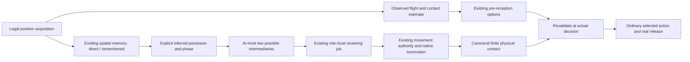

# PR203 — Situational awareness and conditional prospective support

Research change: extend existing spatial memory, receiving-position jobs and preparation consumers. Local result: actual early support movement with mixed physical consequences. Integration effect: two separately identified development profiles; maintained `realism-candidate-v1` remains unchanged. Promotion decision: memory **RETAIN_EXPERIMENTAL**, prospective movement **NEEDS_REPAIR**, whole profile **NOT_READY_FOR_PROMOTION**. Next dependency: preserve C's real controlled reception when withdrawing or completing the support intention.

**Canonical NOT READY; B default; 40Hz; 28 attributes; independent confirmation sealed; 135 stable assumption IDs; zero COMPLETE.** This is one bounded implementation, not a replacement AI or a completed realism programme.

## Audit and architecture

The PR195 audit distinguishes prediction, physical execution and censoring; PR196 fixes original-delivery attribution; PR197–198 retain receiver/long-pass regressions; PR199 exposes velocity/spin/timestamp and keeper side channels; PR200 isolates selected live consumers; PR201 adds local waiting; PR202 preserves and packs the replay surface. Their reports, original thresholds, receipts, failed variants and archives are unchanged. See [prior research](match-engine/PRIOR_RESEARCH.md), [register](match-engine/ASSUMPTIONS_REGISTER.md), [integration architecture](match-engine/INTEGRATION_ARCHITECTURE.md) and [work plan](PR203_WORK_PLAN.md).

| Existing mechanism | Knowledge, clock or authority | PR203 reuse / boundary |
| --- | --- | --- |
| `activePerception` / `activePerceptionState` | 12 spatial sightings per actor; direct IDs, observation times, uncertainty, attention and next acquisition; 100–200ms updates | Add optional `situation` to the same memory; no second tape or uniform scan loop. |
| `boundedPerception` | Whitelisted scene; 36m/FOV actors; remembered geometry; on-ball candidates | Awareness profiles use the existing cache. Direct ball evidence requires the live sensor's actual acquisition time. |
| `ballFlightBelief` / `liveBallFlight` | Two optical positions, separate position/motion clocks, inferred motion, four-second maximum belief | Unchanged detailed 36m/3D occlusion model. No instantaneous physical velocity, spin, hidden target or future RNG supplied. |
| `ballOrientedMovement` | Observed motor ball and local finite-horizon contact plan | Remains the incoming-ball motor route. A sector belief cannot request a precise intercept. |
| `receivingPositions` | Own role/anchor, small local target set, personal/team geometry | Reuse the same local utility and stored jobs for conditional support. No progression bonus. |
| `preReceptionPlanning` | At most three conditional follow-up options; expected contact point/time; expiry and actual reassessment | Awareness profiles enable this existing consumer only with fresh motion evidence and bounded uncertainty. |
| `opportunityWindows` | Common uncertain opponent envelope, bounded pass windows, useful-contact ETA, offside uncertainty | Reuse own-body ETA with native speed/acceleration, momentum and orientation; no exact future replay. |
| `tacticalCognition` | Known system/role/partner familiarity, pattern recognition, preparation/advice and attention | Own existing familiarity affects recognition latency. No synthetic experience, private opponent plan or new attribute. |
| `boundedRuntime` / opponent knowledge | Sightings, on-ball intent, patterns and observed opponent/self evidence | Remain independent existing consumers; not presented as newly bounded or replaced. |
| `movementAuthority` | Shape < press < coordination < reception < keeper < commitment < human < restart | Existing target dispatch remains. Prospective support yields to incoming reception, commitments, human control and restart. |
| `passReception` | Release engineering projection, observed incoming correction, physical preparation/contact | `hold-local-v1` retained. No ellipse/contact-radius expansion or hidden launch fallback. |
| `integrationProfile` | Explicit features, auxiliary settings, saved selection/checksum and dependencies | Historical identities unchanged; new profiles carry explicit awareness/prospective settings. |

The privileged read-only outcome/covariance observer has no return edge to cognition or physics. Broader historical tactical controllers and named-receiver dispatch are not globally certified as bounded by this PR.

## Awareness and the 36m boundary

`Direct` is a newly acquired ball position; `Remembered` retains its original evidence time and last location. Uncertainty grows by an explicit uncalibrated four metres per second, confidence decays and the coarse memory expires after three seconds. It stores a 3×3 pitch sector separately from position precision. It never tracks an unseen true coordinate. Existing important-player memory already carries ages, uncertainty and limited extrapolation.

Possession is **Inferred**, capped at 0.75 confidence, from an unambiguous visible body within 1.5m of a newly observed low ball. This is a fallible cue, not a confirmed control witness. Competing close bodies with less than 0.6m separation remain ambiguous. A remembered possessor expires after 1.2s and cannot support a new prospective job after 0.9s. Phase is separately labelled inferred/remembered/unknown. New observed contradictory possession clears the old belief; direct absence does not magically reveal a turnover.

Tests verify acquisition at 35m and its absence at 37m; previously acquired sector knowledge can survive outside detailed range. **No new distant sector sensor is calibrated or enabled.** Carrier recognition needs both detailed ball acquisition and a nearby legal player sighting. Accurate long-flight motion needs genuine optical intervals. Thus coarse memory, identity inference and flight precision have different validity windows even though this limited PR preserves the historical detailed range. Extending physical acquisition range without field evidence is deferred.

Attention follows the existing situation-sensitive acquisition cadence and remembered-ball attention. PR203 does not activate automatic periodic shoulder scans; the separate historical scanning experiment retains its meaning. Restarts clear planning jobs, inactive actors are removed, and all records stay bounded by the existing 22-player/12-sighting limits.

## One prospective behaviour

C may infer that observed carrier A could pass to one of at most two visible teammates B. It scores their visible lane/space, then reuses existing receiving-position evaluation around C: a maximum of nine unique ±4m local targets, not a field search. It does not add forward progress to utility. Support behind the ball, width and teammate separation use the existing receiving function. Conservative own-body useful-contact ETA must fit a two-second horizon.

A job stores carrier/intermediary IDs, evidence confidence, creation/recognition/expiry, at most two alternatives and conditional/supported/withdrawn status in the existing receiving-position store. Review is no faster than 300ms; target/origin are held within a job to avoid repeatedly chasing a moving optimum. A withdrawn/expired job has a cooldown rather than immediate contrary recruitment. Wingers cannot be recruited inward by this behaviour; defending/hold-position duties and centre-backs retain cover.

`gameReading` lowers evidence ambiguity tolerance and recognition delay. Existing `concentration` still controls acquisition and memory reliability. Own system familiarity adds a small interpretation delay. There is no separate permanent decisions attribute in the 28-attribute schema; actual choice and composure remain in the existing bounded policy/reception preparation. Pace/agility/fitness still determine real movement; firstTouch/technique/composure still govern existing execution. Reading does not multiply running speed, contact reach, launch accuracy or first-touch quality. Recognition constants are engineering hypotheses, not calibrated human skill curves.

When selected, the prospective command uses own native run capability and target-facing rather than borrowing hidden-world pressure or ball-facing for its effort/orientation. Higher authorities still win. A legal incoming flight can retain the hypothesis while heading toward B; contradictory flight, another observed possessor, pressure/marking, lost evidence or expiry withdraws it. No future pass is written into MatchEngine. After a real observed incoming ball, existing `preReceptionPlanning` considers follow-ups and the ordinary decision consumer revalidates them. Fresh motion (≤0.5s) and uncertainty ≤3m are required; a coarse memory cannot create precise reception preparation.

## Development laboratories A–F

- **A / positional awareness:** actual acquisition, aged and expired knowledge, pure direct/indirect contradiction controls plus 40Hz physical continuations with an attention intervention. Correct and wrong proximity cues are explicitly fallible.
- **B / two-pass anticipation:** three seeds × two reading levels × eight consequences × three profiles = 144 native continuations. A's initial alternative is an explicit development intervention through ordinary `resolveMatchAction`; B's later decision is autonomous. Neither pass is granted.
- **C / long reception:** 60 historical long-ground/lofted/cross-field releases per profile, plus 60 exact historical local-configuration controls. Each executes up to eight seconds in MatchEngine. Direct contact, control and retention use original-delivery-v3 witnesses.
- **D / wrong prediction:** alternate A pass, pressure on B, finite-body interception intervention, delayed/rejected pass, unseen C, newly marked C and changed flight direction. The velocity disturbance is labelled an exogenous physical intervention, **not** a credited canonical deflection. Natural interception/contact facts remain separately recorded.
- **E / roles:** striker, winger, supporting midfielder and centre-back, three profiles, native two-second continuation. Protection prevents prospective recruitment; it does not certify the entire historical team's shape controller.
- **F / knowledge boundary:** equal memories/scenes yield equal support decisions despite hidden ball location, velocity/spin/target/ownership; a separate native-step test verifies equal active support target/velocity/facing before hidden motion is observed. New legal observations may then change the plan. These contracts do not claim every inherited full-world controller is isolated.

All contact/control claims require changed canonical witnesses; geometry alone is labelled availability. Hypotheses and movement jobs are not attempted passes. C's geometric option, B's candidate menu, selected action, actual release and original-delivery effect are stored separately. The PR201 profile omits full menus in its existing trace: those values are **unavailable**, not zero. Awareness profiles expose their actual bounded menus. Full 40Hz execution is used for physical trials; pure belief interventions are separately identified contracts, not credited football successes.

## Measured results

<!-- PR203_RESULTS:START -->

Source archive: `5d291d7a63dd16e865e007da7c152f49b912e5ebfdfc4c04a8b9f226cdbe2bf2`, base `5a9e12a2b7e4054bb1f68366ac82569f575b19f6`.

| Profile | Trials | Early movement | A releases | A→B touch/control/retained | B→C releases | B→C touch/control/retained |
| --- | --- | --- | --- | --- | --- | --- |
| realism-candidate-v1 | 48 | 0 | 42 | 28/28/6 | 18 | 18/18/18 |
| situational-awareness-v1 | 48 | 0 | 42 | 28/28/8 | 26 | 17/17/13 |
| prospective-play-v1 | 48 | 42 | 42 | 28/28/17 | 26 | 16/16/15 |

| Profile | C geometrically available | C in B menu | C selected | Withdrawn | Mean 7s path m |
| --- | --- | --- | --- | --- | --- |
| realism-candidate-v1 | 20 | unavailable | 18 | 0 | 22.35 |
| situational-awareness-v1 | 19 | 28 | 26 | 0 | 25.10 |
| prospective-play-v1 | 19 | 27 | 26 | 48 | 20.27 |

| Profile | Reading | Early movement | Mean lead s | A→B retained | B→C control/retained |
| --- | --- | --- | --- | --- | --- |
| realism-candidate-v1 | 20 | 0 | 0.000 | 3 | 9/9 |
| realism-candidate-v1 | 85 | 0 | 0.000 | 3 | 9/9 |
| situational-awareness-v1 | 20 | 0 | 0.000 | 4 | 9/8 |
| situational-awareness-v1 | 85 | 0 | 0.000 | 4 | 8/5 |
| prospective-play-v1 | 20 | 21 | 0.175 | 8 | 9/9 |
| prospective-play-v1 | 85 | 21 | 0.650 | 9 | 7/6 |

| Long reception profile | Trials | Touch/control/retained | Eligible signed residuals |
| --- | --- | --- | --- |
| realism-candidate-v1 | 60 | 30/16/16 | 0 |
| situational-awareness-v1 | 60 | 30/16/16 | 2 |
| prospective-play-v1 | 60 | 30/16/16 | 1 |

| Support profile | Process CPU s | Wall s | Max memory state bytes | Max save bytes |
| --- | --- | --- | --- | --- |
| realism-candidate-v1 | 10.68 | 9.37 | 4 | 192912 |
| situational-awareness-v1 | 14.41 | 12.57 | 108422 | 290094 |
| prospective-play-v1 | 17.17 | 14.31 | 107771 | 292577 |

| Lab | Rows | Wall s | Peak process RSS MiB |
| --- | --- | --- | --- |
| support | 144 | 36.62 | 522.3 |
| awareness | 2 | 0.51 | 289.1 |
| roles | 12 | 1.23 | 299.6 |
| reception | 240 | 51.98 | 529.7 |

<!-- PR203_RESULTS:END -->

Per-scenario/skill rows, every observed decision, release and physical result are retained in [summary.json](performance/pr203/summary.json) and the four compressed final receipts. Availability and phase/control witnesses have distinct denominators. Movement cost is the complete observed window's C path, including ordinary movement after expiry, not a claimed isolated cost of the new mechanism. Candidate availability is privileged geometric lane/space within 25m; it is not a known complete football opportunity set or a guarantee of canonical offside legality. Recognition recall is therefore not estimated against an invented ground-truth denominator.

The A→B one-second ownership count rises6→17, while B→C control falls18→16 and one-second ownership falls18→15. The former uses the existing strict ownership-at-one-second contract and can change when B releases its next ball earlier or later; it is not proof of more continuous team possession or better tempo. The downstream losses, together with the small artificial geometry, prevent a football-quality or whole-team improvement claim. Local support-process CPU rises approximately10.68→17.17s in this observation; that substantial extra cost is another reason to keep the route opt-in.

The observer records B's decision menus, canonical subsequent releases, C's incoming preparation options, actual control and later ownership. It does not quantify the quality of C's complete post-control action menu or a full-team cover/displacement effect. The midfielder role arm likewise does not establish a distinct calibrated dropping-midfielder behaviour. Those quantities remain unmeasured; an existing controller executing a continuation is not evidence that its decision quality improved.

The decisive limitation is downstream: more early movement/options/releases do not establish better B→C contact/control. The receipt retains paired losses and failed or rejected releases. No-pass support may still separate players, but neither free space nor a longer path is credited as improved football without a physical consequence. Strong/weak reading uses paired physical attributes and seeds; it measures earlier recognition, not a guarantee of success or a calibrated talent curve.

Concrete example, sample0/reading85/available: C prepares from (62,38) toward (66,34), begins the selected prospective movement at10.250s, A actually releases at10.900s (0.650s lead), B first controls at11.675s and autonomously releases B→C at13.000s. C physically controls at14.925s, but one-second team retention is false. That is an executed two-pass sequence with a poor continuation, not a successful retained combination. The high-reading marked cases at samples0 and2 preserve C-control losses against PR201. Alternative A deliveries cancel the prospective job at11.200s; changed-flight cases cancel at11.500–11.800s in this apparatus.

In that available example the original support job has already withdrawn at12.100s, before B's13.000s release. The handoff from an expiring conditional support job to the actual delivery is a concrete remaining dependency. Simply extending every prediction horizon would require new evidence and would risk preserving wrong commitments longer.

Two intended stressors also give negative findings about the apparatus/older policy: in the pressure arm B still selects C in all six prospective runs despite zero measured clear-lane availability. The single facing intervention named `unseen_support` does **not** keep C outside B's acquired/remembered menu: all six runs later include C. These arms therefore do not prove adaptive alternate selection under pressure or a persistently unseen available C; their actual menu/release data is retained. They are remaining development limitations, not relabelled successes or reasons to add a guaranteed alternate pass.

## Contact uncertainty: diagnostic only

Historical PR201 diagnostics mostly retain unsigned spatial distance or null point/time residuals; those cannot identify a signed 2D covariance. The new observer captures the first existing legal preparation forecast 0.5–1.5s before predicted contact, then measures actual direct-contact residuals along/across its inferred incoming direction. Failed/censored contacts remain in the corpus and are not fitted as zero error. Time error is stored separately.

`contactUncertainty.ts` provides unbiased sample covariance, positive-definite validation, bias correction, rotation to pitch x/y, eigenvalue semi-axes and Mahalanobis inclusion. Singular/insufficient/mixed-stratum fits are rejected rather than padded with invented variance. The small observed residual set cannot support an empirical covariance or held-out coverage estimate. The final `fits` entries therefore retain null fits/coverage where data is insufficient. Synthetic algebra tests demonstrate the implementation, not football calibration.

The ellipse level `k` has **no assigned predictive probability**. No 95% region is claimed; no Gaussian assumption has been validated. Different flight/bounce/contact/horizon strata must remain separate; no mixture is collapsed into one ellipse. The current bounded contact predictor has limited phase modelling, another reason not to fit a pooled region or activate it for movement. The module is diagnostic and has no live motor/contact consumer; there is no covariance behaviour ablation to invent.

Calibration plan: freeze forecast admission/horizon and phase/surface labels first; collect signed residuals over fresh ground, airborne and post-bounce seeds including failures/censoring; split train/development validation by launch seed, not ticks; inspect bias/multimodality and empirical held-out coverage by stratum. Only then decide whether a Gaussian ellipse is justified or bounded distinct hypotheses are needed. This plan is not counted as an implemented calibration.

## Integration gate and cost

The local downstream-contact gate is not met. Therefore no new-profile full-match WW/SS/SW comparison is credited or run as a promotion exercise. Existing PR200–201 complete matches and all 63 historical CI executions remain required. Their historical outcomes are not relabelled as PR203 improvements. The new long-reception control additionally checks 60 entire final historical local states and outcomes against frozen PR201 on current source.

`situational-awareness-v1` is PR201 plus the explicit memory/preparation route; `prospective-play-v1` additionally selects `two-pass-v1`. Both use `pr203-prospective-play-v1` implementation identity and explicit saved checksums. They remain development experiments. Historical v0/v1 profile IDs, checksums, optional missing-field semantics and replay paths remain. Applying an older profile clears new settings/caches; saved profile mismatches are rejected.

Measured costs above are process CPU, wall time, peak process RSS and actual serialized memory/save sizes. They are observations on this development host, not a portable per-match budget. Per-arm CPU/wall and save sizes are in the support receipt; per-process RSS is not per-arm allocation or simultaneous process-tree memory. No new permanent player attribute or dependency is added. Existing memory cadence, actor cap and local targets bound work; there is no 22-player whole-field search at 40Hz.

The baseline memory-state value4 is the serialization length of `null`, not measured four-byte process memory. Proposal generation follows existing 100–200ms sensory updates; existing prospective jobs are reviewed at300ms. The extra serialized awareness state reaches about108KB and total save size about293KB in this local corpus, compared with about193KB baseline. These are material experimental costs, not evidence of a compact production-ready implementation.

CI adds one bounded replay/evidence step to the existing main group, no new job matrix or timeout. The original PR202 124-command/63-match manifest, archives and scheduling-equivalence evidence are preserved. Its original unchanged-runtime assertion is retained over its historical PR201→PR202 interval; current successor bytes are independently bound to `current-source.json`, exact local replays and unchanged historical evidence. The PR201 checker still runs verbatim in its original private context. A historical assertion is not silently rewritten to claim current runtime is unchanged. Final receipt edition is v2; v1 and exploratory pilots remain available under their original names.

## Failed trials and verification

`support-trial-v1` retains an apparatus error: pre-release samples were included in original-delivery interpretation, prematurely terminating the episode as a different action. It is not football evidence for zero touches. `support-trial-v2` repairs sample admission and records actual B→C episodes. Early pilot receipts retain their fingerprints/raw results; they did not capture reconstructible source archives and are explicitly **not** exact-source validation. The first source-archived v1 measurements also retain the initial lint failure (unused import and missing explicit Node Buffer import). Final v2 receipts have a complete reconstructible archive after this tooling correction and preserve all measured negatives. The initial build attempt also lacked the generated world database; the normal generator restores that required artifact without a source change.

The exploratory range/possession probe exposed carrier-body occlusion in the existing detailed sensor when a fixture put the ball at the body's centre. The fixture now places it at a visible foot-side location; the live sensor is unchanged. Wrong indirect cues remain possible in real execution and are not replaced by privileged ownership.

Commands: `npm run verify`; `npm run ci:manifest`; `npm run ci:contracts`; `node scripts/ci/renderWorkflow.mjs --check`; `node --max-semi-space-size=64 --experimental-transform-types --import ./scripts/registerTypescriptLoader.mjs scripts/checkPr203Evidence.mjs`; `node scripts/replayPr203.mjs`. The checker reconstructs all final local results, asserts the historical full-state controls, role protection, real early movement, real B→C contact and negative/rejected cases. The exact-source runner independently exports the recorded base and restores archived bytes before replay. Final execution status and command logs are recorded under `performance/pr203/verification/` and in the PR.

Final local validation: **PASS** — `npm run verify` completed lint,2,468 tests (2,403 unit +56 integration +4 career contracts +5 full-career), TypeScript and production build on Windows/Node24.22.1. Local verify used128MiB semi-space, as in PR202's recorded Windows verification; original CI settings and all test timers are unchanged. Current-source A–F contracts/receipts, independent exact-source reconstruction,60 complete-state PR201 controls, the original PR201 evidence checker, original PR200 current-source information and900 frozen continuations, CI failure contracts, the unchanged124-command/63-match inventory and deterministic28-job workflow checks all passed. [Verification manifest and raw-log hashes](performance/pr203/verification/verification.json) distinguish initial failed setup/lint logs from final passing commands. Historical evidence directories remain unchanged; the current-source PR200 harness's generated archive is retained separately in PR203 verification rather than appended to historical evidence.

## Decision and next dependency

Memory: retain experimentally with fallible possession/phase and conservative detailed range. Prospective support: retain the limited implementation for investigation, **NEEDS_REPAIR**, because downstream contacts do not support promotion. Covariance: retain reproducible diagnostic infrastructure, calibration incomplete. Whole profile **NOT_READY_FOR_PROMOTION**; maintained candidate remains PR201; no global policy/default promotion or independent confirmation.

One next football dependency: **phase-safe completion/withdrawal of C's support job at the real B→C delivery window, demonstrated by recovering the retained paired C-contact losses without privileged information or geometry changes**. Freeze that local repair before spending on a new whole-match integration candidate.
