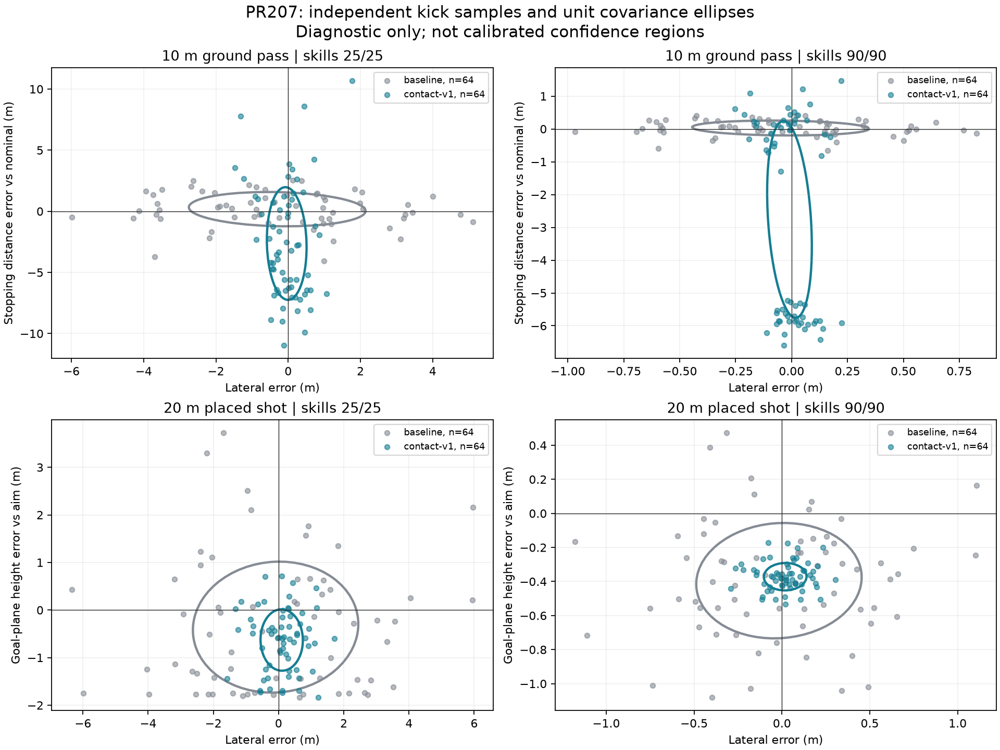

# PR207 — Physical kick execution and error propagation

Research change: add separately selected `experimentalKickExecution: contact-v1` at the actual canonical release boundary. Local result: finite nominal pass/shot launches and coupled contact errors work; ground/air transition and distribution calibration fail broader integration readiness. Integration effect: **PR201 remains the maintained candidate, unchanged**. Promotion decision: **RETAIN_EXPERIMENTAL / NOT_READY_FOR_PROMOTION**. Next dependency: resolve the measured near-ground contact discontinuity, then validate realistic execution distributions and technique/preparation handoff before any wider release integration.

One 40 Hz executor, all 28 permanent attributes, B/default, historical profiles/checksums, human/tactical authority and sealed independent confirmation remain. No ball-flight equation, contact reach, default setting, save edition, historical receipt or timeout changes. PR205's already-active continuous-body, keeper and high-free-ball constraints and PR206's missing lawful preparation handoff remain open.

## Source and protocol

Base: merged PR206 `f61395cdf05194092f2ac5818e37404ee7d8fac3`. Final measured runtime/harness fingerprint: `e03d33a7e699e1ccb996d47606df4b79efa826042a3873c77747dd46fead7d0c`. [Current manifest](performance/pr207/current-source.json), reconstructible `source-<fingerprint>.json.gz` archives, [summary](performance/pr207/summary.json), [physical checks](performance/pr207/physical-checks.json), and [contact-example method](performance/pr207/unexpected-example-method.mjs) distinguish the exact method from a commit label. Pilot, pre-guard and pre-CI-isolation archives remain separate with explicit path/hash indexes. The final corpus uses the same seeds and coefficients; this is not resampling for favourable outcomes. [CI-isolation parity](performance/pr207/ci-isolation-runtime-parity.json) proves the final CI-only source revision changes no engine/experiment-harness byte or recorded physical result. The contact-example method has its own recorded content hash because it lives beside its data rather than inside the runtime/harness inventory.

Read with [PR185](PR185_EXTENDED_PHYSICAL_TESTING.md), PR195–206, particularly [PR197](PR197_PASSING_REALITY_FLIGHT_INTERCEPTION_AND_RECEIVER_ANTICIPATION.md), [PR200](PR200_MATCH_ENGINE_INTEGRATION_CANDIDATE_RECEIVER_MOTOR_AND_BOUNDED_PERCEPTION.md), [PR204](PR204_INTENT_CONTINUITY_COGNITIVE_TECHNICAL_RECEPTION.md), [PR205](PR205_OBSERVED_BALL_INTENT_CONTACT_PARITY.md), [PR206](PR206_PRE_RELEASE_RECOGNITION_AND_FIRST_TOUCH.md), and the architecture, assumptions, dependencies and calibration documents. Primary scope: PASS-005/008, SHOT-003, PHYS-002 and MEAS-008/009; reception, keeper and preparation IDs remain dependencies. No I/F/E/T/M/C gate or COMPLETE count is promoted.

## Gate 1: source-backed execution map

The acting root is [`resolveMatchAction`](../src/core/matchSimulation/matchActions.ts#L1027), reached by normal AI and human choices. Selection forecasts are not contact execution. The unchanged destination-based baseline is **not fully impulse-derived**.

| Actual route | Intention, delivery, foot/surface | Nominal launch and spin | Error sampling and attributes | Finite contact at intentional release? Final flight input |
| --- | --- | --- | --- | --- |
| Short ordinary ground pass | Projected teammate/space target; support/progressive/direct/lead/through. Requested foot affects difficulty; no executed surface in baseline. | `derivePassLaunchPlan`, zero elevation, rolling arrival estimate, speed ceiling 30 m/s; missing spin means zero. | `interpretPassExecution`: independent Gaussian lateral/depth destination errors. Passing/technique plus direct reading/composure aggregation; facing, pressure, weak foot, fitness. Depth error also scales launch speed by square root of range ratio. | Baseline bypasses foot impulse; `deriveLaunchVelocity` writes velocity directly. New eligible path replaces this noise and writes only finite contact velocity/spin. |
| Long ground pass | Same route at longer range; no distinct long-ground contact controller. | Same rolling planner, 30 m/s ceiling. | Same uncertainty grows with distance and geometry. | Same bypass/new eligible consumer as short passes. |
| Lofted pass | Projected target, loft/chip/driven/cross-field interpretation. | `derivePassLaunchPlan` → `deriveAerialLaunchPlan`, geometry/ability-dependent apex/time and capped speed; zero authored spin. | Pass destination error changes heading and speed after planning; normal pass elevation remains the planned one. | Baseline bypass; new selection deliberately leaves actual loft release unchanged. |
| Cross-field pass | `interpretPassExecution` label for a sufficiently lateral long loft, not another executor. | Same aerial/pass planner. | Same pass error distribution. | Same direct prescribed-velocity release; audited dependency. |
| Floated/driven cross | `action.target`, floated/driven/cutback. No chosen foot/surface in release contract. | `deriveAerialLaunchPlan(cross/driven_cross)`; arrival height 1.9/0.65 m and fixed profile `executionError` 0.2/−0.7. Cutback uses direct launch, 27 m/s fallback and 0.1 rad elevation. | Cross `executionError` is a deterministic profile input, **not a sampled random contact error**. Passing/technique alter the aerial profile. | Direct planner velocity; no `interpretPassExecution` and no finite foot impulse. New model only explores isolated cross solutions. |
| Settled shot | Goal-relative aim and placed/driven/chip profile. Baseline weak-foot difficulty is inferred from geometry; no executed foot witness. | `deriveShotExecutionProfile` nominal speed: intent plus technique; gravity-based elevation, chip alternative. Ordinary spin zero. | `deriveShootingDifficulty` supplies goal-plane horizontal/vertical uncertainty; finishing, technique, composure, agility, weak foot, incoming ball, obstruction/window and fitness. `resolveCanonicalShot` samples these plus independent ≈1.8 m/s speed noise. | Baseline directly prescribes velocity. New eligible low settled foot shots skip these three noise terms, execute finite contact, then classify its actual trajectory. |
| First-time shot / volley | `canExecuteCanonicalShot`/incoming-ball contact supplies legal reachable contact and technique; first-touch assessment adds difficulty. | Same shot resolver, incoming-height/contact profile and chip/shot launcher. | Same goal-plane error plus incoming/contact difficulty. | Legal/physical eligibility is not a full finite striking impulse. No new contact-v1 release here; exact launch parity is checked. Existing separate reception/redirection contacts remain. |
| Spinning free kick | Selected goal/wall ray and free-kick strike profile. | Authored top/sidespin from setPieces/technique and foot sign; bounded four-iteration `solveSpinningLaunch` uses shared physics. | Goal-plane/speed noise plus spin noise; setPieces blended into finishing. | Planner/launch inversion directly writes velocity/spin; finite foot contact does not generate the strike. New path leaves restarts/free kicks unchanged. |
| Keeper long distribution | Goal-kick or explicit keeper kick to receiver/space; distribution ability replaces pass primary. | `deriveAerialLaunchPlan(long_pass)` with goalkeeperKicking and noisy pass target; separate keeper throws use a held-ball release, throwing/fitness and authored spin. | Kick route uses pass destination uncertainty and distribution ability. Throw route has its own angular draw, range/ability speed and elevation. | Kick/throw launches bypass the foot solver; excluded from new kick eligibility. |

Relevant sources: [`passExecution`](../src/core/matchSimulation/passExecution.ts#L126), [`passLaunchPlan`](../src/core/matchSimulation/passLaunchPlan.ts#L34), [`passDecision`](../src/core/matchSimulation/passDecision.ts), [`shotResolver`](../src/core/matchSimulation/shotResolver.ts#L166), [`shotIntent`](../src/core/matchSimulation/shotIntent.ts), [`shootingDifficulty`](../src/core/matchSimulation/shootingDifficulty.ts#L29), [`shootingOptions`](../src/core/matchSimulation/shootingOptions.ts#L419), [`crossOpportunity`](../src/core/matchSimulation/crossOpportunity.ts), [`goalkeeperDistribution`](../src/core/matchSimulation/goalkeeperDistribution.ts), [`firstTouch`](../src/core/matchSimulation/firstTouch.ts), [`footContact`](../src/core/matchSimulation/footContact.ts#L176), [`ballContactResolution`](../src/core/matchSimulation/ballContactResolution.ts), [`ballFlight`](../src/core/matchSimulation/ballFlight.ts), and [`ballPhysics`](../src/core/matchSimulation/ballPhysics.ts#L161).

PR185's finite foot solver is genuinely used by carrying/control/reception through `ballContactGeometry` and `passReception`. That does not make the intentional kick releases above finite impulses. `firstTouch` assesses reach/quality, not articulated leg dynamics. `ballContactResolution` owns swept body contact, separation and re-arming; it is not an intentional-kick launcher. `crossOpportunity` forecasts/admission and `passDecision` probability estimates remain historical: their baseline error priors are **not recalibrated** for contact-v1. This mismatch is another integration limitation.

## Gate 2: smallest nominal extension

[`activeStrikeCapability`](../src/core/matchSimulation/footContact.ts#L148) and the optional `activeStrike` request extend the existing solver. Legacy requests retain their original branch. New requests supply a presented 3D unit normal and effective foot velocity; the solver caps relative foot speed using preparation, balance, weak foot, fitness, strength, technique and agility. Effective mass is 1.5–2.7 kg; restitution is 0.55. These are explicit **uncalibrated engineering assumptions**, not measured physiology. Strength does not linearly prescribe ball speed and technique is not a power gate.

For incoming ball velocity `v`, foot velocity `u`, radius vector `r = −R n`, mass `m=0.43 kg`, inertia `I=(2/3)mR²`, and effective foot mass `M`:

```text
closing = (u − v − omega×r) · n
Jn = clamp((1+e) closing / (1/m + 1/M), 0, capability limit)
Jt = −unit(tangent slip) min(mu normalLoad, |slip_t|/(1/m + R²/I + 1/M))
v_after = v + (Jn n + Jt)/m
omega_after = omega + (r×Jt)/I
```

The existing Coulomb coefficients, reach/height/preparation rejection and ±160 rad/s numerical spin envelope remain. Tangential impulse is scaled before application when the spin envelope binds, preserving torque/linear impulse consistency. No enlarged envelope, foot teleport, ball velocity multiplier or second integrator exists. Foot-speed clipping occurs before impulse resolution. The solver's quality field remains a legacy diagnostic aggregation; active strike force is governed by capability/contact mechanics rather than a second quality multiplier.

The measured zero-error request `(30,0,6)` m/s gives old `(8.5951,0,2.0424)` with a flat normal, versus new `(30,0,6)` with a finite 3D impulse and zero spin. A lower spherical contact patch can now supply upward normal impulse. An impossible 1000 m/s request is capability-limited in contracts. The active model still prescribes an effective moving foot; it **does not derive a leg swing from articulated joints or prove physiological calibration**. Nominal feasibility is conditional on preparation, orientation and capability. Reproducing the planner's vector does not correct its goal-plane bias; the intended aim, nominal forecast and realised forecast remain separate. Independent spin authoring/erasure for a spinning incoming ball remains outside the demonstrated settled-zero-spin solution.

## Gate 3: contact perturbation and error attribution

[`executePhysicalKick`](../src/core/matchSimulation/kickExecution.ts#L39) translates the existing nominal trajectory into foot closing speed and a preparation-limited presented normal. It samples three episode-local Gaussian latent variables: lateral patch error, timing and effort. Timing contributes to both vertical/lateral patch displacement and effort. Thus angular, linear and power errors are coupled where they share a cause, while an independent effort component allows correct direction with wrong speed.

For `s=(0.65 primary+0.35 technique)/100`, with passing or finishing as primary:

```text
patchSigma = (0.0007 + 0.006(1−s)²) contextDemand      [metres]
timingSigma = (0.001 + 0.005(1−technique/100))
              × (1 + proximityPressure(1−composure/100)) contextDemand [seconds]
lateralOffset = lateralDraw patchSigma + 0.12 timingError
verticalOffset = 0.20 timingError
effortError = effortDraw(0.012+0.14(1−s)²) + 1.5 timingError
n_actual = unit(n_presented − lateralBasis offset_lateral/R − upBasis offset_vertical/R)
```

The foot retains its swing direction as the contact normal changes. This obliquity creates the same tangential impulse that changes direction and spin. A 2 cm patch displacement has no assigned miss/height: the spherical geometry, incident velocity, finite mass, friction and normal/torque determine the result. Effort is bounded to nonnegative twice nominal before the independent physical foot-speed cap. Large tails can lose normal alignment or saturate capability; no spectacular-error quota exists.

Ground passes use `nominalContact` to skip the old destination draw, so the usual range-noise speed multiplier becomes one. Backheel/outside-foot/turning-pass interpretations keep the full original release, as do chip shots. Eligible placed/driven shots skip old horizontal, vertical and 1.8 m/s noise before planning, then run finite contact **before** classification/release. Other actions keep old uncertainty. There is no old/new random error stack for eligible kicks. An exactly zero realised launch is recorded as an unreleased contact attempt; it cannot write a zero-speed shot or infinite action cooldown into saved state. A deterministic zero-effort tail intervention tests this at both actual consumers.

The key is seed + `kick-contact-v1` + release decision index + actor, with no irrelevant event label. Six draws form three Gaussian latents; paired skill/context arms keep them paired. No shared match RNG advances, reroll during movement, post-release retargeting or Monte Carlo tactical decision is added. Shot release retains the historical incremented decision-index convention. Equal explicit zero-error geometry yields equal impulses across pass/shot calls; label/reading counterfactuals and mirrored offsets have zero measured residual.

## Gate 4: attributes, pressure and preparation

Passing/finishing and technique change repeatability. Agility changes the time required to prepare; body orientation constrains normal presentation; plant balance, preparation and fitness constrain foot speed. Weak foot affects capability and error context. FirstTouch retains its existing incoming/reception role; the new settled release adds no direct firstTouch accuracy bonus. GameReading is absent from the new contact sampler/capability. Any inherited influence on action choice, target or earlier actual body preparation remains outside this isolated execution contrast.

Pressure has two disclosed paths. Actual opponent closing velocity and distance to the existing 0.8 m contact vicinity bound available preparation time. This constant-current-velocity approximation is not a swept-body contact forecast. It changes physical capability and adjustment; a 1.1 m separation at 5 m/s gives 0.06 s. Separately, authoritative proximity over 14 m and composure scale timing variance as an explicit heuristic. This is **not claimed to be perceived pressure or wholly physical mediation**. The model does not add a pressure oracle to cognition. With no on-ball clock, 0.24 s (or the existing shot technique window) is an assumed motor preparation budget, not a witnessed wind-up. An actual `onBallPreparation.gainedAt` can shorten it; support/recognition age is not forwarded as a bonus. Incorrect surface substitution is not implemented.

The full 2×2 primary/technique corpus keeps other attributes fixed. Low skill remains physically able to kick hard; an isolated low-technique/high-strength contract exceeds 25 m/s without an unlocking threshold. These experiments do not estimate all interactions or a real-football skill curve.

## Laboratories A–D and distribution results

The final laboratory has **2752 paired configurations / 5504 requested releases**, 64 independent seeds per stratum. Ground passes cover 10/35/45 m and the full 2×2 low/high passing/technique. The 20 m context study covers open/moderate/immediate/hurried/first-time. Shots cover 20 m upper-corner aim, 2×2 finishing/technique, placement/driven and open/immediate/first-time. Two 30/45 m actual loft strata are unchanged-route controls. All 5504 requests release; the separate reach/preparation contracts retain rejected kicks. Of the laboratory attempts, 2048 use the new finite solver; the remaining baseline/excluded releases are explicitly labelled.

Arms/skill strata sharing a seed are paired, **not independent kicks for uncertainty estimation**. Frames are never treated as trials. Constructed scenes, six live seeds per family and selected examples do not constitute independent confirmation or adequate football calibration.

| Scene, skills primary/technique | Direction SD, baseline → contact (rad) | Speed SD (m/s) | Reception/goal-plane lateral SD (m) | Contact elevation SD (rad) | Missing plane, baseline → contact |
| --- | ---: | ---: | ---: | ---: | ---: |
| 10 m ground, 25/25 | 0.1342 → 0.0332 | 0.413 → 1.070 | 1.362 → 0.328 | 0.00757 | 0 → 4 / 64 |
| 10 m ground, 90/90 | 0.0218 → 0.00635 | 0.067 → 0.162 | 0.218 → 0.064 | 0.00239 | 0 → 0 / 64 |
| 35 m ground, 25/25 | 0.1735 → 0.0332 | 0.964 → 1.930 | 6.232 → 1.133 | 0.00757 | 0 → 7 / 64 |
| 35 m ground, 90/90 | 0.0156 → 0.00635 | 0.087 → 0.292 | 0.544 → 0.223 | 0.00239 | 0 → 0 / 64 |
| 20 m placed shot, 25/25 | 0.1226 → 0.0294 | 1.489 → 2.438 | 2.536 → 0.649 | 0.00600 | 0 → 0 / 64 |
| 20 m placed shot, 90/90 | 0.0230 → 0.00550 | 1.489 → 0.410 | 0.471 → 0.121 | 0.00189 | 0 → 0 / 64 |

Missing reception planes remain in denominators, not silently discarded. Plane SD is conditional on a crossing; stopping-position summaries retain short balls. The intended pass target is an arrival point, **not a stopping point**. Baseline nominal run-out beyond a 10 m recipient is about 8.15 m, so absolute stopping error against that recipient is not a pass-accuracy score.

The [machine-readable diagnostics](performance/pr207/summary.json) include bias, population SD, covariance/correlation, speed/elevation error, spin axes, apex, landing/arrival time and speed, stopping position, 95th absolute order statistic, maximum and excess kurtosis, plus missing-plane and stopping-horizon counts. Two-dimensional unit-covariance ellipses report empirical unit and squared-radius-5.991 coverage. They **are not calibrated confidence regions**; clustering, bounded capability, bounce mixtures and tail shape preclude an automatic Gaussian coverage claim.



These results expose under-calibration: the high/high placed-shot contact arm has 64/64 unobstructed on-target paths in this one scene, although every release has nonzero error. This is not 100% goals or guaranteed perfection. The experiment is generally far narrower laterally than the historical baseline and does not justify replacement on realism grounds.

## Laboratory B and exploratory loft/cross extension

Longer flight amplifies spatial/arrival differences; low/low 35 m reception dispersion is 1.133 m versus 0.328 m at 10 m, with seven under-reaching planes rather than four. At 30/45 m, 512 isolated solver explorations cover pass/long_pass/cross/driven_cross. Zero-error and perturbed contact receipts, intended/realised flight, apex, landing and plane state are retained in `explore-development-v1.json.gz`.

Actual canonical lofted passes remain byte-identical between selection arms. No live cross or loft consumer is enabled. An overhit cross example exists in the isolated solver data, but it is **not evidence that a canonical cross was executed through contact-v1**. Aerial normal presentation, deliberate tangential spin and actual crossing/reception constraints need their own nominal and live gates. Headers, keeper distributions, throw-ins, high contests and free kicks stay audited dependencies. Backheel/outside-foot/turning-pass and chip releases are explicitly excluded and preserve baseline launch parity; the simplified inside/instep presentation is not claimed to implement those techniques.

## Laboratory E: unexpected trajectories

Sampled corpus examples retain long-underhit (`pr207-pass-19`), unwanted sidespin (`pr207-pass-12`), near-nominal clean execution (`pr207-pass-56`) and isolated overhit cross receipts. Selection is descriptive after inspection, not an estimate of event frequency. Ten-metre sampled ground passes do not produce a meaningful raised apex at this resolution; small positive launch components often settle immediately. Across all sampled ground lengths the maximum apex is 0.115208 m.

The separate [controlled-contact examples](performance/pr207/unexpected-examples.json) hold nominal intent fixed and intervene **before impulse** on patch geometry:

| Controlled error | Actual physical consequence |
| --- | --- |
| Ground launch, patch 15 mm below nominal | Apex 0.14514 m; upward impulse and backspin, then normal bounce/rolling. |
| Driven `(30,0,6)` nominal, patch 20 mm below nominal | Apex 4.57365 m; goal-plane height 4.36204 m and spin y −21.2373 rad/s. |
| Lateral patch 20 mm with timing/effort deviation | Goal-plane y 31.1322 instead of 34; sidespin −16.8335 rad/s. Same launch without spin has a different one-second path through existing Magnus. |

These are bounded causal interventions, **not sampled frequencies or manually assigned ball heights**. The same geometry/finite solver generates velocity and spin; actual flight follows the unchanged integrator. The final method and separately identified interim method/data receipts are retained. No claim that a 2 cm displacement universally produces the same angle/miss is made.

## Gate 5: real canonical contacts, boundaries and continuation

`live-development-v1.json.gz` has **60 paired configurations / 120 real releases**, ten family/context strata and six seeds each. Every arm continues seven seconds through the normal 40 Hz executor with all 22 players, moving opponents, actual keeper, collisions, boundaries and subsequent decisions active. Full launch receipts, sampled ball/keeper states, actual contact witnesses, actions, original-delivery-v3 outcomes and complete final-state hashes are retained. There are 48 new finite releases in this live cohort; first-time arms remain original releases. No receiver ownership is assigned after initial scene setup.

| 20 m pass context, six per arm | Touch/control, baseline → contact | One-second team possession | Later receiver pass/shot/cross proxy |
| --- | ---: | ---: | ---: |
| Open | 6/6 → 6/6 | 2 → 3 | 6 → 6 |
| Moderate | 6/6 → 6/6 | 4 → 1 | 6 → 6 |
| Immediate | 6/6 → 5/5 | 0 → 2 | 5 → 5 |
| Hurried/alignment | 6/6 → 6/6 | 3 → 0 | 6 → 6 |
| First-time, excluded release | 6/6 → 6/6 | 3 → 3 | 6 → 6 |

Contact, technical control and team possession are separate. The raw helper's `usefulNextAction` field means only that the receiver later released a pass/shot/cross within the horizon, potentially after intervening play. It **does not establish uninterrupted retention, tactical usefulness or successful next delivery**. Exact actions/ownership/times permit further attribution; no calibrated usefulness metric is claimed.

Settled open/moderate/immediate/hurried shot arms produce baseline 12 goals, 4 saves, 5 posts and 3 misses out of 24; contact-v1 produces 21 goals, 1 save, 1 post and 1 miss. First-time controls each retain 5 goals/1 miss. These are narrow constructed scene outcomes, **not scoring percentages to fit or evidence of realistic improvement**. Actual keeper interventions and frame rebounds are retained, not suppressed by the unobstructed arm. No block/crossbar occurred in this small live cohort; unobstructed laboratories separately record first geometric post/crossbar witnesses. The isolated free-flight/scatter arm continues mathematically through that witness; only canonical continuation applies the actual frame rebound and rules. There are no outcome-horizon censors in this live catalogue; a missing goal/reception plane is separately retained as spatial non-arrival. The foot solver's legacy `retained` flag measures closeness to its requested velocity and is not receiver/team possession.

## Gate 6: failed integration gate and numerical limitation

The current integrator has a near-ground sign discontinuity. From the same radius-height ball with horizontal speed 10 m/s:

| Initial vertical speed | First-tick horizontal speed | Stopping x, from x=30 |
| ---: | ---: | ---: |
| −0.001 or 0 m/s | 9.9200 | 45.6250 |
| +0.001 m/s | 8.1877 | 40.7243 |
| +0.200 m/s | 8.1877 | 40.7243 |

A minute upward contact enters airborne integration, crosses the floor during the tick and incurs horizontal bounce restitution, whereas the zero case rolls. This creates a finite distance loss as the upward component tends to zero. The new model exposes it; it does not repair it or add artificial lift to jump over it. It plausibly explains much of the bimodal run-out bias, but the broader contact/ground calibration remains unproven. Symmetric kick geometry is not sufficient to establish a continuous floor-contact model.

Local retention losses (moderate 4→1; hurried 3→0), short balls, narrower-than-justified shot dispersion, uncalibrated capability and the explicit floor discontinuity block promotion. **No new full-match comparison is run:** Gate 6's prerequisite of satisfactory local behaviour is not met. This is a bounded negative integration decision, not missing evidence relabelled as success. Historical full-match CI executions remain mandatory and unchanged.

## Cost, saves and replay

Measured on Windows / Node 24.22.1: final lab wall/CPU 11.702/13.734 s, peak RSS 493544 KiB; live 15.600/20.593 s, 425632 KiB; exploration 1.489/2.187 s, 381836 KiB. These include fixtures, schemas, forecasts and evidence collection. A warmed 3000-call microbenchmark measures active translator+contact at 12.597 µs wall/call versus 2.192 µs for the old standalone touch solver. That old touch was **not the prior ordinary release path**, so this is not a measured full-match overhead comparison. Per-process CPU timings include runtime threads and short samples have coarse resolution. Earlier concurrent-load costs remain archived. These are not physiological or portable budgets.

The translator itself runs no trajectory forecast and no tactical Monte Carlo. Existing pass/shot planning and the existing shot classification forecast remain; exploratory contact investigations are offline. Optional selection/receipt fields have Zod schemas; old saves omit them. Historical profile application clears the new selection/receipt and rejects saved undeclared mixing. No new integration profile/checksum is introduced. The last receipt is bounded to one kick, although its diagnostic copy in raw shot state/evidence adds size. The [save-size method and receipts](performance/pr207/save-size.json) measure schema-serialized tactical state at release: pass 90990→93166 bytes and shot 90151→92556 bytes, with 2055/2238-byte last receipts. These are not complete career-save or production match-memory measurements. Long platform parity remains the existing open limitation; exact receipts use their recorded environment.

Disabled selection is compared against merged PR206 in an isolated export using identical new scene setup, complete released-state hashes and two-second continuations for ground/shot and first-time controls. The original PR206 evidence checker runs unchanged in that original source. Original PR203/204/205 checks, historical source archives, commands, negative findings and required time budgets are retained. Current source binding in CI advances to PR207; it does not weaken an old assertion to accept new runtime.

## Verification and reproduction

The 15 new contracts pass, covering nominal/legacy limitation, mirrored direction/spin, independent effort, lower contact lift, linear/angular impulse, friction/spin caps, reach rejection, labels/reading, actual pressure preparation, both canonical consumers, excluded techniques/routes, zero-impulse rejection, optional saves/profile conflicts, skill variance, weak foot/power and Magnus. TypeScript passes. Full verify and final hosted CI status are recorded below after execution; a running or failed verify is never described as ready.

```sh
npm run verify
npm run ci:manifest
npm run ci:contracts
node scripts/ci/renderWorkflow.mjs --check
node scripts/checkPr207Evidence.mjs
node scripts/summarizePr207.mjs --check
node scripts/ci/replayPr206Check.mjs
# Recorded Windows / Node24.22.1 environment for exact physical replay:
node --max-semi-space-size=64 --experimental-transform-types --import ./scripts/registerTypescriptLoader.mjs scripts/benchmarkPr207.mjs --mode=lab --check
node --max-semi-space-size=64 --experimental-transform-types --import ./scripts/registerTypescriptLoader.mjs scripts/benchmarkPr207.mjs --mode=live --check
node --max-semi-space-size=64 --experimental-transform-types --import ./scripts/registerTypescriptLoader.mjs scripts/benchmarkPr207.mjs --mode=explore --check
node --experimental-transform-types --import ./scripts/registerTypescriptLoader.mjs scripts/pr207PhysicalChecks.mjs --check
node --experimental-transform-types --import ./scripts/registerTypescriptLoader.mjs docs/performance/pr207/unexpected-example-method.mjs --check
```

The existing consolidated **28-job / 124 historical-command / 63-full-match** layout is preserved. New evidence and summary checks run in the existing main group, alongside unit contracts and unchanged historical assertions. `replayPr206Check` isolates the original source rather than rebinding its receipts. The [new release inventory](performance/pr207/integration-inventory.json) records consumers, exclusions, policy scope, provenance, cost and save implications without rewriting historical PR200 inventories. Independent confirmation remains sealed.

The [verification receipt and complete logs](performance/pr207/verification.json) distinguish preliminary verification from the **source-stable complete `npm run verify` PASS (exit 0)**: **2454 unit + 56 integration + 4 career contract + 5 full-career = 2519 passing tests**, lint, TypeScript and production build. Start/end runtime/harness fingerprints both equal `5f52b531caffb29d69845c854b0b7bd753d841c2dce897c3c165902a48b2b7f6`, the code at `5da428b305911e78baa4973e9fb2d3fe520533de`. Vite retains the existing mixed-import/large-chunk warnings. Fifteen new contact contracts, exact recorded-platform laboratory/live/exploratory replays, physical examples/save-size replay, original PR206 checker/disabled-state parity, the unchanged CI manifest and five CI contracts pass.

The first hosted run [41184155502](https://github.com/adamfron/my_football_legend/actions/runs/41184155502) exposed an additional historical-harness boundary: PR198 asserted the original `footContact.ts` source bytes against the intentional PR207 extension. Its failure log is retained. `runGroup` now runs the **unchanged original `npm run benchmark:pr198:check`**, including all four original commands/assertions, inside an isolated merged-PR206 export, matching the existing historical-context pattern. The complete original command passes locally with original receipts and report. No historical command, expectation, timeout or task definition is changed.

Only `scripts/ci/runGroup.mjs` and the new `scripts/ci/replayPr198Check.mjs` change after the source-stable football verify. The final full inventory is `e03d33a7…`; engine/experiment harness bytes and **every physical row in all three repeated catalogues are exactly unchanged**. New CI scheduling is checked separately with the original command, CI contracts, lint and manifest. Full verify is not falsely rebound to the later CI-only source hash. A fresh hosted run belongs to the final head; prior green main/integration jobs are not substituted for its status.
