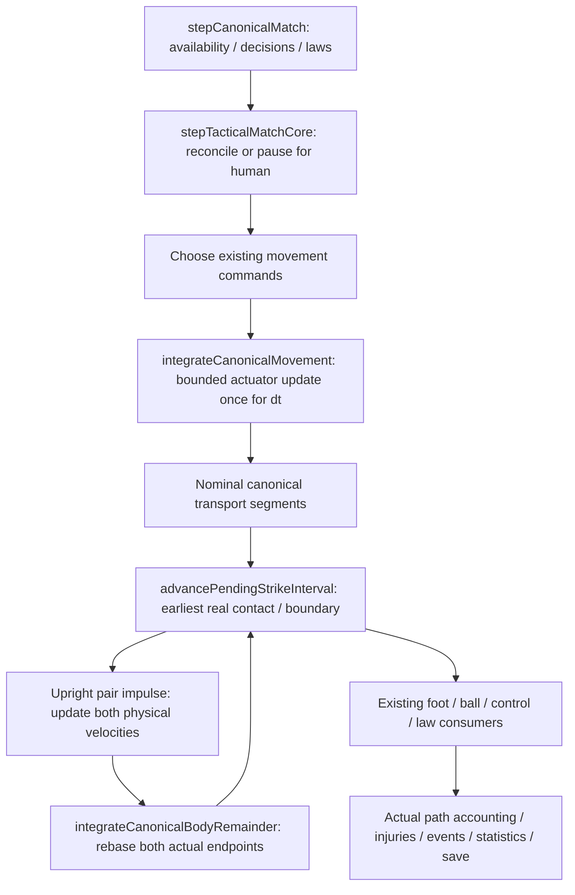

# PR213 — Persistent contact and upright body impulse

Base: merged PR212, `44b2f1df70af49c4b0135849eeb67855440efa35`.
Research change: a separately selected upright standing-pair collision changes both
canonical bodies and their remaining foot trajectories. Local result: finite
momentum-conserving, dissipative impulses, three distinct three-event orderings in
one 25ms step, real misses and geometric continuity. Integration effect: the named
pair boundary improves; crowded and universal contact arbitration remains partial.
Promotion decision: **RETAIN_EXPERIMENTAL / general arbitration NEEDS_REPAIR**.
PR201 remains the maintained realism candidate, B the default, 40Hz and all 28
permanent attributes remain. Independent confirmation stays sealed.

## 1. Gate A: source ownership and actual execution

Audited PR205/209/210/211/212, PROJECT_STATE, product roadmap and the integration,
dependency and assumption registers. Runtime authority is the current source,
including `sharedContactTimeline`, `pendingStrikeInterval`, `pendingStrike`,
`defensiveChallenges`, `ballContactResolution`, `ballContactGeometry`, `footContact`,
`canonicalMovement`, `locomotion`, `lowerBodyGeometry`, `ballAcquisition`,
`matchSimulation`, `matchState`, `matchRules` and `matchInjuries`.

| State / operation | Owner and source |
| --- | --- |
| Position, physical planar velocity, facing, plant balance, pose | `MatchPlayerState`; persisted by `tacticalMatchStateSchema` |
| Desired target/speed/facing | Tactical, human and locomotion intentions; never collision momentum |
| Mass | Existing `profile.weightKg`; full body mass in this isolated translational approximation |
| Attainable acceleration/braking/turning | `deriveMovementCapability`, fitness, plant balance, `integrateCanonicalMovement` |
| Wider personal-space/compliance constraint | `constrainCompliantBodyStep` / `compliantBodySeparation`; position-only constraint |
| Standing impact core | Existing PR212 0.34m torso radius on each upright body |
| Prepared foot and ball | Existing finite temporal foot path, shared foot impulse and `integrateBallFlight` |
| Fouls, discipline, restarts and injury availability | Existing challenge, `matchRules`, `matchInjuries` and outer canonical consumers |



The integrator is semi-implicit: the bounded motor velocity update precedes
`position += velocity * dt`. `constrainCompliantBodyStep` can stop a proposed segment
or separate an existing overlap at a finite rate, but does not change the other
body's momentum. PR212 then interpolates already integrated body segments and
`restoreClock` restores nominal endpoints. This was the execution boundary that had
to change before an impulse was meaningful.

PR213 extracts the **same transport expression**, without changing ordinary
arithmetic, as `integrateCanonicalBodyRemainder`. The selected standing pair bypasses
its competing personal-space projection while the shared interval owns its torso
core. Other pairs and historical selections keep their constraints. Transport uses
the motor velocity already earned for this tick; the remainder does not spend the
acceleration budget again. The next canonical tick uses the normal finite actuator,
starting from the post-impact velocity. There is no second locomotion executor.

## 2. Selection, impulse model and assumptions

Select `experimentalPlayerBodyImpulse: upright-pair-dev-v1`, together with existing
`standing-contact-dev-v1`, `low-pass-dev-v1` and `event-v1`. Omission preserves the
historical edition. Saved incompatible selections fail schema validation;
historical profile application clears the selection and persistent pair/evidence
state. No historical profile or checksum changes.

Scope is two physically eligible upright outfield players participating in a
selected standing attempt. Keeper, airborne, sliding and committed body impulses
are not supported. Input planar speeds above 12m/s are outside this bounded
development solver. The existing standing torso core is deliberately simpler than
articulated shoulder geometry. Wider personal-space dimensions are not added as a
second impact surface.

For unit normal n from B to A and approaching normal relative velocity vn < 0:

`Jn = -(1 + e) * vn / (1/mA + 1/mB)`

`vA' = vA + Jn*n/mA`; `vB' = vB - Jn*n/mB`.

Experimental restitution is **0.05**, with sensitivity at **0, 0.05, 0.15, 0.3**.
Tangential friction is explicitly **zero**: tangent velocities remain unchanged.
These are engineering assumptions, not measured human restitution or skin/clothing
friction. The approximation has no angular momentum, compliant muscle model or
ground impulse. Its conservation claim applies only to the isolated passive pair
impulse, not to later locomotion, referee intervention or other constraints.

The symmetric 75kg / 75kg, +3 / -3m/s case gives **236.25N·s**, outgoing
**-0.15 / +0.15m/s**, unchanged zero total momentum and energy **675 → 1.6875J**.
The 55kg / 110kg case has inverse-mass velocity changes, without possession.
Similarly moving players produce much smaller normal impulse. Separating/resting
bodies get no impact impulse. Sensitivity checks retain momentum and nonpositive
passive energy change. No velocity clamp manufactures momentum or hidden energy.

## 3. Real substep and remainder evidence

`findPlayerBodyContact` solves entry on the actual constant-velocity canonical
transport segment. On impact the interval moves both authoritative bodies to the
event, applies the common-normal impulse and rebases both body/foot segment origins.
All later candidates are searched again on the new trajectories. `restoreClock`
uses the replacement endpoints and velocities. It cannot restore nominal motion or
resurrect a player removed by a law consumer.

In `opponent-body`, contact is at **10.035349510875s**. Defender velocity
`(-5.700278,-0.058716)` becomes `(-3.396774,1.216728)`m/s; passer `(0,0)` becomes
`(-2.303503,-1.275445)`m/s. Normal impulse is **197.477811N·s** and energy change
**-470.445859J**. The remaining **14.650489ms** moves the defender to
`(29.945131,34.517218)` and passer to `(29.366253,34.151314)`m. The prepared pass
subsequently expires as a genuine miss; collision identity does not force that
outcome.

Receipts separate passive energy from the already applied locomotion update
(`locomotionWorkBefore`, `locomotionWorkAfter=0` inside the drift remainder).
Actual path length replaces nominal movement distance/mean position and fitness
distance. `actuatorSpeed` keeps passive collision delta-v out of motor acceleration
and braking work. Existing physiological recovery, sprint and contextual injury
formulas remain; no new collision injury hazard is enabled.

## 4. Pending pass and standing challenge chronology

All times below are actual canonical event times, not selection order:

| Scene | First | Second | Third |
| --- | --- | --- | --- |
| body-pass-challenge | body 10.075843161 | pass 10.081600166 | challenge 10.094964810 |
| pass-challenge-body | pass 10.078915781 | challenge 10.084577255 | body 10.088421100 |
| pass-body-challenge | pass 10.078915781 | body 10.080999323 | challenge 10.081341162 |

Each row fits in one 25ms interval and contains two real foot impulses plus a body
impulse. The first row's changed passer foot velocity is approximately
`(2.843082,-0.519511,0)`m/s and pass impulse `(1.461498,-0.061694,~0)`N·s.
Pass-first rows retain the already completed pass impulse
`(3.641231,0,~0)`N·s; later body contact cannot rewrite it. A lawful body contact does
not cancel an otherwise valid prepared stroke. Existing bounded foot-search
uncertainty remains explicit.

## 5. Persistent surfaces and geometric rearming

The following remain different contracts:

1. `continuousFootContacts`: active foot–ball surface episode.
2. `ball.continuousBodyContacts`: passive ball–body support.
3. `continuousPlayerContacts`: upright player-pair surface episode.
4. `defensiveChallenge` / `defensiveEpisodes` / `recentDuel`: discrete attempted engagement and its inherited recovery locks.
5. `lastGroundContact` plus retained finite reception: actual secure control evidence.
6. Existing continuous-body constraints: support without another restituting impact.

Player-pair identity is geometric and survives tick, owner and ball-episode changes.
Rearming needs clearance **greater than 1cm** beyond the 0.68m combined core;
recontact still needs approach. The 1cm margin is numerical hysteresis. A continuous
approach uses zero restitution support, not another impact. No fixed immunity time
is added. Existing motor recovery remains separate.

For a completed prepared foot, the latch retains the existing path and original
facing/selection clock. Pure path evaluation was extracted to
`temporalFootTrajectory.ts`; there is still one stroke definition. Removing a
pending intention, starting another one or changing ownership cannot snap that
latched surface to a nominal foot and falsely prove separation. Generic selected
finite foot execution and acquisition respect these latches. Real clearance removes
them, permitting a later genuine touch. Independent feet/players retain independent
geometric episodes, subject to inherited motor recovery. Same-actor within-tick
service is still bounded by the inherited exclusion/recovery; this is not universal
articulated two-foot arbitration.

Selected new outfield ownership needs an available finite reception/control event.
An identity change on an already owned ball is rejected; a standing poke first
creates a physically loose ball. Keeper handling and law consumers retain their
existing scope. No post-collision automatic owner or tackle-win quota is added.

## 6. Stationary duels and acquisition routes

The original PR212 corpus and seeds remain. The two stationary starting states are
identical apart from selecting the new edition; bodies then move autonomously.

| Two-second scene | PR212 feet/passive/owner changes | PR213 feet/passive/owner changes |
| --- | --- | --- |
| stationary duel | 3 / 2 / 0 | 3 / 2 / 0 |
| stationary close | 4 / 1 / 1 | 4 / 1 / 1 |

The extended corpus also includes stationary loose, moving convergence, shielding,
owned-to-loose, returning ball, third opponent, teammate replacement and consecutive
tick routes. It records foot and passive contacts, pair impacts/support, latch
release, ball path/velocity/spin, acquisition, uncontrolled time and defensive state.
Every newly acquired owner is checked against an executed retained finite control
witness in that interval. **Zero unexplained acquisitions** occur across the 31
scenes. This preserves the negative finding: no pathological stationary oscillation
was reproduced. It is not proof that every historical/keeper/high-ball/acquisition
route is repaired. The shielding scene loses the ball through the ordinary attempt;
it does not certify sustained repeated shielding over many engagements.

## 7. Clinch and conflicting constraints

The existing `supportContinuousBodyContacts` is reused, without a new ball solver.
The PR212 two-surface clinch remains at zero velocity for 80 calls, with no new
restitution, owner, ejection or stoppage. The unresolved clearance is
**-0.002760279m**; the other is about **+0.000010m**. Each call retains its eight-pass
bound. A separately applied available finite foot impulse frees the ball, with
clearances **+0.482296m / +0.476720m** after 150ms. This is an explicitly constructed
surface/foot apparatus, not proof of a live multi-limb entrapment technique.

A third player encountered by a corrected body lies outside the isolated pair
approximation. The interval stops at that witness with `third_body_remainder`;
it does not drift the player through the third body or invent a simultaneous
multi-body impulse. A corrected body reaching the canonical player movement edge
similarly reports `player_pitch_edge`. These are explicit unresolved remainder
boundaries. No infinite event loop is possible: the inherited four-event budget,
per-pair servicing and bounded searches remain.

## 8. Balance and future falls

Measured specific impulse `J/m` supplies a bounded disturbance relative to existing
acceleration over an assumed **200ms** support-recovery interval. Load is capped at
1; balance loss is at most **0.30** with both feet or **0.45** with one support foot,
and the existing **0.35** floor remains. It affects subsequent real movement through
the existing plant balance. These assumptions are not a support-polygon model.

Gentle contact leaves balance about **0.962**; stronger double support **0.70** and
one-leg support **0.55**. In the constructed recovery commands, 0.99 balance returns
at approximately 25ms / 200ms / 325ms respectively; turning/severe controls take
375ms. Receipts retain every command and frame. Even severe collision remains
upright: the model lacks authoritative downed posture, angular support failure,
ground impact and compatible action/recovery geometry. No knockdown probability,
anatomical injury diagnosis or artificial fall is introduced.

## 9. Laws and injury compatibility

Each fresh actual body event is assessed independently through the existing
`resolveDefensiveChallenge` diagnostic and referee handler, using pre-impact
circumstances. Its temporary discrete-resolution state is not installed: the live
foot attempt is not prematurely completed or counted twice. A separate later ball
touch cannot legalize an earlier prohibited body event. A body impulse itself does
not imply a foul. Unit controls retain lawful contact, an independently assessed
reckless diagnostic, human pending authority and whole-ball boundaries.

This work does not add holding detection, an articulated shoulder/arm classification
or a new charging-law model. It preserves the existing referee's approximation.
Measured impulse is diagnostic exposure evidence only. Existing deterministic
contextual injuries, substitutions, medical stoppage and career availability remain
authoritative; no live injury probability is derived from J.

## 10. Negative and unsupported results

Initial overlap is `initial_body_overlap`, exact/near tangent is
`near_tangent_body`; neither receives a clean impact. The old finite geometric
separation remains available for initial overlaps. Foot search exhaustion is retained,
including the selected paired-later and escaping-ball cases. Third-body and player
pitch-edge remainders stop explicitly. Conflicting ball supports stay unresolved.
Keeper/airborne/slide/committed body response, limb retraction dynamics, repeated
whole-match crowded contacts and universal continuous-contact parity remain open.

Historical PR195–212 receipts are unchanged. Pilot source archives and negative
command logs are retained; final measurement is a separate receipt. A native information-boundary gate exposed a module initialization cycle in the extracted path schema. Removing its dependency on contact execution fixed the native import-order failure; that original failure is retained. Source-drift failures during the final passive-contact preservation edit also remain, followed by fresh source-bound replay. A native information-boundary gate exposed a module initialization cycle in the extracted path schema. Removing its dependency on contact execution fixed the native import-order failure; that original failure is retained. Source-drift failures during the final passive-contact preservation edit also remain, followed by fresh source-bound replay. Initial tests
also checked the pre-existing PR211/212 paths before enabling the new edition.

## 11. Save/replay, source binding and laboratories

The [canonical receipt](performance/pr213/canonical-final-v5.json.gz),
[summary](performance/pr213/summary-final-v5.json), [source](performance/pr213/source.json)
and reconstructible source archives bind 31 scenes, **93 schema reload comparisons**,
24 restitution/mass/geometry controls, six balance continuations and bounded clinch.
A saved checkpoint contains both a persistent player contact and an unfinished
pending strike; original/restored event order, impulses, physical state, ownership
and normalized terminal hashes agree. Prepared foot latches also survive save.
Focused contracts cover the three within-tick orderings, true rearming, unchanged
pass-first impulse, third-body stop, human pending authority, touchline/goal-line/
post boundaries and historical profile isolation. This is deterministic development
evidence on the recorded environment, not new cross-platform long-match calibration.

## 12. Performance and CI

Final recording: **9.025s wall**, **11.672s process CPU**, peak RSS **547828KiB**,
Windows / Node **24.22.1**. This includes full-frame retention and 93 replay pairs;
it is not a full-match overhead estimate. Pair search is bounded and selected;
new contact state is bounded to 22 pair latches and eight current-step witnesses.

Full **npm run verify PASS**: 2636 tests in that invocation (2571 unit, 56 integration, four career contracts, five full-career tests), lint, TypeScript and production build. The final continuity/import-order/human-freeze follow-up additionally passes **2572 unit tests**, **89 focused contracts**, lint, TypeScript, native information, current-source replay and final build. All **20 history/CI gates** and **seven source-archive reconstructions** pass. Existing Vite mixed-import/chunk-size warnings remain. [Verification and retained failures](performance/pr213/verification.json) identify the actual command phases; hosted CI is separate.
The existing consolidated CI keeps its job layout. The original PR212 replay now
uses a real-file private-index export of merged PR212; its original assertions run
unchanged. Earlier wrappers retain their historical source contexts and use the new
current-source guard. The small PR213 replay joins the existing main CI group.

Reproduce with locked dependencies:

```text
node --experimental-transform-types --import ./scripts/registerTypescriptLoader.mjs scripts/benchmarkPr213.mjs --check
node scripts/ci/replayPr212Check.mjs
node scripts/ci/buildManifest.mjs --check
node --test scripts/ci/contracts.mjs
node scripts/ci/renderWorkflow.mjs --check
npm run verify
```

## 13. Integration and promotion decision

Architecture, isolated impulse and the named canonical remainder pass local checks.
Continuity, duel/control and clinch have scoped positive and negative evidence.
General crowded/edge continuation and full articulated geometry remain partial;
therefore the conditional new full-match smoke and WW/SS/SW policy matrix are not
run. A match with no relevant contact would add no collision validation. Default
career compatibility is assessed independently by required verify tests.

No default/profile promotion, tactical realism claim, universal possession repair
or confirmation is made. The executable PR201 candidate is unchanged.

## 14. Product direction

The [product roadmap](MFL_PRODUCT_ROADMAP.md) now explicitly orders credible,
integrated canonical MatchEngine work, then a versioned distilled statistical
simulator validated on conditional distributions/tails/correlations, then expanded
career/world/finance/news/graphics/UI. Current career remains playable. This does not
require all 135 realism issues to be COMPLETE first and creates no fixed PR schedule.
No distilled simulator or product expansion is implemented here.

## 15. Highest-priority next dependency

**Resolve bounded simultaneous multi-body support on the same canonical interval**,
including crowded contact and movement-edge continuation, before widening the
standing family or attempting true falls. Preserve the successful pair remainder,
geometric foot/body episodes, explicit uncertainty, law authority and exact source
replays. Then progress to integration evidence that actually exercises the mechanism.
