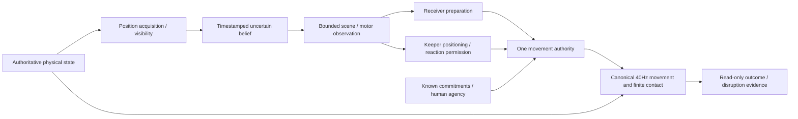

# MatchEngine integration architecture

PR211 adds explicitly selected `experimentalPendingStrike: low-pass-dev-v1` for owned low inside-foot ground passes. `actionLifecycle` owns one schema-backed pending intention; the existing canonical ball interval advances actual body/foot/ball segments and orders competing feet/body proposals/boundaries. Selection changes no ball momentum or executed-pass event. Save/replay, real misses and unresolved continuation are explicit. Active defensive challenges lack a shared precise substep event and conservatively cancel the pending intention; general arbitration/promotion stays blocked. Historical profiles clear/reject this independent selection. PR201/default B/checksums remain unchanged; no new opt-in full-match matrix, no sealed confirmation. [PR211 evidence and limitations](../PR211_CANONICAL_PENDING_STRIKE_LIFECYCLE.md).

PR210 corrects the shared live human decision lifecycle: ordinary menus use the existing finite release-contact readiness, an unfinished carry remains an intention, incoming first-time enumeration explicitly requests forecast preparation, and pursuit threats offer prospective movement. No second possession/movement/physics executor or new persistent ball flag is added. Maintained PR201 mechanism selections and profile checksums stay unchanged; current human boundaries intentionally improve while frozen historical source replays retain their original edition. Temporal-contact-dev-v1 stays laboratory-only; PR211 must provide the persisted strike/arbitration lifecycle. [PR210 evidence](../PR210_HUMAN_AGENCY_PHYSICAL_BALL_READINESS.md).

PR209 adds a **laboratory-only** `temporal-contact-dev-v1` low inside-foot primitive: a bounded path starts at the current effective foot, actual canonical ball motion determines the first contact, and the existing impulse supplies velocity/spin. It is not installed in `resolveMatchAction` or a profile. Live use still requires persisted preparation, canonical body segments and common arbitration with carry/body/opponent/rule events; synchronous release must not advance an offline mini-match. All pre-existing production source bytes, profiles and saves remain unchanged. PR208's ten retention discordances are diagnosed separately from first-touch success and onward deliveries. Maintained PR201 unchanged; no promotion or new full-match matrix. [PR209 scope and evidence](../PR209_MOVING_BALL_STRIKE_AND_BOUNCE_RECEPTION.md).

PR208 physical edition: optional schema-validated `TacticalMatchState.ballEnvironment.groundContact: event-v1` is passed to the shared canonical predictor and executor, independently of contact-v1. Omission preserves legacy-v1 exactly. Frozen profile application clears the environment and saved undeclared mixing is rejected; no historical fingerprint or maintained candidate changes. Cognitive observed-ball approximations retain their existing scope. [PR208](../PR208_GROUND_CONTACT_CONTINUITY.md).

PR207 adds separately selected `experimentalKickExecution: contact-v1` to the same canonical pass/shot release consumers. Optional active-strike normal/foot velocity generates finite impulse and spin; eligible releases replace old destination/speed noise. Historical profile application clears the new selection/receipt, and saved undeclared mixing is rejected. No profile/checksum is added or promoted: maintained candidate PR201 is unchanged. Local retention losses, uncalibrated dispersion and a measured near-ground integration discontinuity block new full-match trials. Aerial/cross/keeper/first-time releases retain their existing path; PR205/206 dependencies stay open. [Execution map, equations, receipts and decision](../PR207_PHYSICAL_KICK_EXECUTION_AND_ERROR_PROPAGATION.md).

PR206 evidence-only continuation: three actual pre-release support commands alter canonical bodies before A releases. The 96-arm common-release experiment and 17 matched contact checkpoints do not establish physical compensation for low first touch; elapsed prospective/observed preparation does not reach local reception's contact preparation argument. The pressure reading benefit lacks pre-release recognition. No runtime, profile, default or saved selection changes; candidate PR201 unchanged, whole profile NOT_READY_FOR_PROMOTION, confirmation sealed. [PR206 report](../PR206_PRE_RELEASE_RECOGNITION_AND_FIRST_TOUCH.md).

PR205 scoped correction: `observed-ball-contact-dev-v1` is a separate development revision of existing movement/reception pathways. It repairs the demonstrated observed recovery/low-foot contact routes while retaining PR204 selection. Fixed-release control/retention is unchanged; selected support still loses controls against PR203. Keeper/high-free-ball equivalence and already-active continuous-body contact parity remain unresolved. Maintained candidate PR201 unchanged; whole profile NOT_READY_FOR_PROMOTION, confirmation sealed. [PR205 evidence](../PR205_OBSERVED_BALL_INTENT_CONTACT_PARITY.md).

PR204 development: the opt-in continuity and local-observation intervention remains experimental. Tested hidden-preparation counterfactuals pass, but other information boundaries and downstream control regressions remain. The pre-release factorial did not demonstrate prospective recognition. The maintained candidate remains PR201; independent confirmation is sealed. [PR204 evidence](../PR204_INTENT_CONTINUITY_COGNITIVE_TECHNICAL_RECEPTION.md).


PR200 establishes a maintained integration product. Canonical **NOT READY**, B/default **state-value-v1**, independent confirmation **sealed**. Implementation lifecycle and the original I/F/E/T/M/C evidence gates are separate.

## One physical engine

`matchSimulation.stepTacticalMatchAfterDecisionProbe` advances the existing fixed 0.025s simulation. `canonicalMovement`, `ballPhysics`, swept ball/body contact, `footContact`, first-touch response, keeper contact, rules, restarts, fitness and human agency remain authoritative. Every policy and integration profile uses this executor. Research observers sample outcomes; their forecasts cannot grant contact, possession or goals. All 28 permanent attributes remain.

Default matches do not select a profile and do not enable the new perception flag. Optional historical fields retain their old path. `canonical-pr199` is an explicit development baseline, with experimental switches false. It is not a new production default or proof that the baseline is calibrated.

## Profiles and policies

PR203 adds two separately selected development experiments, `situational-awareness-v1` and `prospective-play-v1`. Both inherit PR201 recovery; the former enables optional `situationalAwareness: bounded-v1` in existing spatial memory/preparation, the latter also selects `prospectiveMovement: two-pass-v1` in existing receiving-position jobs. Their implementation/checksums are separate; historical v0/v1 selections are unchanged. The maintained candidate remains `realism-candidate-v1`: local downstream-contact losses fail the new experiment's integration gate. See the [PR203 report](../PR203_SITUATIONAL_AWARENESS_PROSPECTIVE_PLAY.md) for actual consumers, information boundaries, preserved negative results and diagnostic-only covariance. No new full-match benefit or canonical promotion is asserted.

The permanent API is `resolveIntegrationProfile(id, policy)` and `withIntegrationProfile(state, id, policy)` in `src/core/matchSimulation/integrationProfile.ts`. The application writes every mechanism switch, validates body-v1 exclusion, clears incompatible caches and persists the selection. It never creates a second simulator.

The profile has a stable ID, version 0, implementation reference, explicit features and auxiliary switches, policy dimension, dependencies, mutually exclusive choices, reasons/evidence/limits per mechanism, policy-specific inactive consumers and a deterministic resolved checksum. Source SHA256 and the exact input/seed/hash are separate evidence identities. A checksum is not a source revision or a security hash.

Policy is independent: legacy/risk, B/role variants and O/H/J keep their interfaces. The candidate does not quietly replace B with another policy. Height-aware engineering ranking is an acting path for full-world policies. O/H/J's observed loft shortlist has its own bounded height forecast. Their shared release diagnostics do not establish a shared acting controller. An enabled switch can therefore be inactive for the policy's choices; manifests state this.

Auxiliary bounded switches (patterns/planning/individuality/relative opportunities/opponent learning/psychology), active scanning/memory/preparation and decision ablation are explicit. Briefing, knowledge, coach and roster data are fixture inputs; they are retained and bound by the initial-state hash rather than invented as a profile benefit.

## Information contract



The physical-state-to-execution edge is legitimate physics. It is not an actor-facing trajectory oracle. Read-only evidence has no return edge into player cognition.

Authoritative physical velocity/spin remains available to physical integration and privileged engineering comparison. The live experiment reads only current ball position through its sensory boundary, applying range, attention and finite 3D body occlusion. Previous actual visual samples can support an optical derivative. One position cannot supply instantaneous velocity. No hidden spin, release target, shot destination or future rebound enters belief.

Subjective belief keeps actual sighting and motion-evidence timestamps separately. Prediction does not refresh them. The implementation caps memory at 22 actors, expires old beliefs after four seconds, samples optical positions at the canonical frame rate and performs inference at 100–200ms cadence. Position/velocity uncertainty grows during occlusion. Bodies/optics/noise and derivative correction remain uncalibrated development assumptions.

Bounded scenes and general/reception motor adapters consume this belief. Direct active-perception gathering admits only a newly acquired sighting; a remembered prediction cannot become fresh `ballSeenAt`. Without usable motion evidence, the receiver retains ordinary formation positioning rather than a privileged trajectory fallback. This reduced-information motor route currently loses many real receptions and remains experimental.

Keeper isolation covers the ordinary projector and airborne intervention, tactical/role/aerial/base proposals, authority, effort and facing. The final experimental motor command consumes remembered geometry, own body and goal geometry. It can anticipate position before a reactive save; it is not a freeze-until-visible rule. Active save permission requires timely motion evidence. A standing body still collides passively. Contact/catch/parry/rebound formulas remain shared. Explicit human movement and restart authority retain their legitimate scope.

This is not a claim that every B/R3 choice or every outfield tactical controller is bounded. The named live route is isolated; broader controllers remain separate registered work.

## Dependencies and validation

PR201 adds the separately identified `realism-candidate-v1` and `realism-candidate-no-recovery-v1`. The optional, schema-validated `boundedReceiverRecovery: hold-local-v1` is a versioned motor behaviour, not another sensing/physics system. It changes only the no-intercept fallback from formation anchor to current body position, with native finite braking and higher authorities preserved. It adds no motion inference from a single position. Profile application clears the field for historical selections and rejects saved mismatches. V0 checksums/behaviour remain unchanged; both successors retain configuration schema edition0. The new mechanism and its scoped evidence are explicit in the resolved manifest and [PR201 integration mapping](INTEGRATION_EVIDENCE_PR201.json); inherited PR200 scopes remain in their original mapping. [Physical gains, losses, full matches and cost](../PR201_BOUNDED_PERCEPTION_RECEIVER_RECOVERY.md) determine its continued experimental status.

Zod validates profile IDs/settings and optional saved selections. Missing receiver anticipation, unvalidated S plus bounded belief, stateful body-v1, unknown profile settings, changed policy/checksum/settings and undeclared auxiliary switches are rejected. Conflicting controllers cannot be introduced by a broad enable-all flag. Static imports plus build validation provide module-existence checks.

The source inventory checks all current experimental state fields and retains exact source occurrences, consumers, effects, policy applicability, provenance, positive/negative findings, performance and save implications. `INTEGRATION_EVIDENCE.json` and generated `REALISM_PROGRESS` record selection separately from live presence, compatibility, match transfer and canonical promotion. Sixteen flags do not become sixteen independent fixes.

## Running and reproducing

Inspect `package.json` before running scripts. Typical development commands:

```sh
npm run benchmark:pr200:freeze
npm run benchmark:pr200:inventory
npm run benchmark:pr200:matches -- --version=new-version --workers=2
npm run benchmark:pr200:source-replay -- --case=frozen,changed,fresh,keepers-v2,diagnosis
npm run benchmark:pr200:source-replay -- --case=matches-sw-state-value-v1
npm run benchmark:pr200:check
npm run benchmark:realism:check
npm run verify
```

The runner compares fixed development inputs and seeds across canonical, historical S, candidate and informative ablations. It runs complete normal matches, stores every effective configuration, policy, source, active/inactive consumer, input identity, outcome metrics, CPU/wall/RSS and final state hash. It uses compact outcome and disruption ledgers rather than massive full-tick archives.

Receipts refuse overwrite. Each source archive records the normalized manifest and reconstructible changes against merged PR199. Read-only replay exports the exact base, restores archived bytes, verifies them, then runs the original measured harness. Historical PR195–199 archives, failures, expectations and protected cohorts remain intact. PR199's historical diagnostic-only assertions run against its exact merged source; they are not weakened to accept a new live consumer.

Final PR200 local cases, the live information proof and v3 candidate matches replay against current source by default, comparing every recorded physical result and final-state hash. This additionally verifies the deferred schema initialization correction. Add `--historical-source` to reconstruct their archived implementation instead. Earlier variants always retain exact archived replay. `benchmark:pr200:check` binds the final runtime to the information-proof manifest; regenerating an inventory cannot silently waive runtime drift.

Exact long-match receipts are currently bound to their measured Windows / Node24.22.1 environment. The first Linux CI attempt differed even for canonical SW/B; these failures are retained and no historical expectation or physical result is changed. Full-match receipt checks therefore use the recorded environment. Existing Linux verify/replay groups remain, and a Windows/Linux checkpoint probe asserts repetition within each environment and explicitly reports differences between them. Portable bit-identical long continuations remain unresolved; do not claim cross-platform determinism from a green platform-specific replay.

For investigation only, `--preflight` compares initial identities/configuration without running the full match, and `--diagnose` adds field-level failure output after archive verification. Diagnostic mode preserves the result comparison and still fails on drift; it is not an unmodified exact-source replay or a replacement for the normal verification command.

## Promotion, rollback and retirement

Per-mechanism decisions are ACCEPT_FOR_CANDIDATE, RETAIN_EXPERIMENTAL, REJECT_CURRENT_VARIANT, NEEDS_REPAIR or BLOCKED_BY_DEPENDENCY. Whole-profile decisions separately distinguish INTEGRATION_CANDIDATE, DEVELOPMENT_VALIDATED_CANDIDATE, NOT_READY_FOR_PROMOTION and READY_FOR_INDEPENDENT_CONFIRMATION. A local repair does not promote the whole profile. A failing profile does not invalidate every component.

Promotion requires source-correct contracts, bounded acting information, actual physical execution, positive and negative local cases, representative policy-specific full-match results, manageable measured cost, save/replay validation and no severe unexplained harm. Independent confirmation stays sealed until development gates are genuinely frozen. Default changes require an explicit later promotion decision.

Rollback is a new baseline/profile selection before a development match, with incompatible state cleared through the API. Do not flip arbitrary fields in a mid-match saved profile and silently accept a mismatched fingerprint. Retain unsuccessful profiles and their archived source. Retirement requires an audited absence of acting consumers, a save/replay edition plan, a validated successor and explicit retained historical reconstruction. Do not delete necessary compatibility branches merely to reduce the inventory.

Every future significant MatchEngine PR states: research change, local result, integration effect (improved/regressed/unchanged), promotion decision and next dependency. It updates this maintained candidate or explicitly leaves it unchanged.
