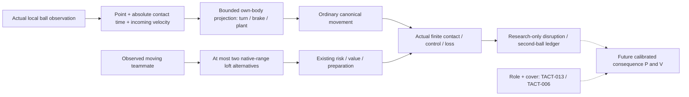
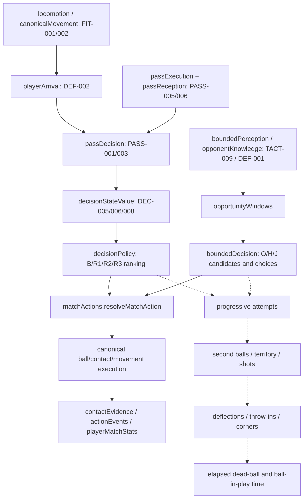
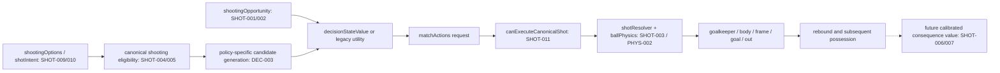
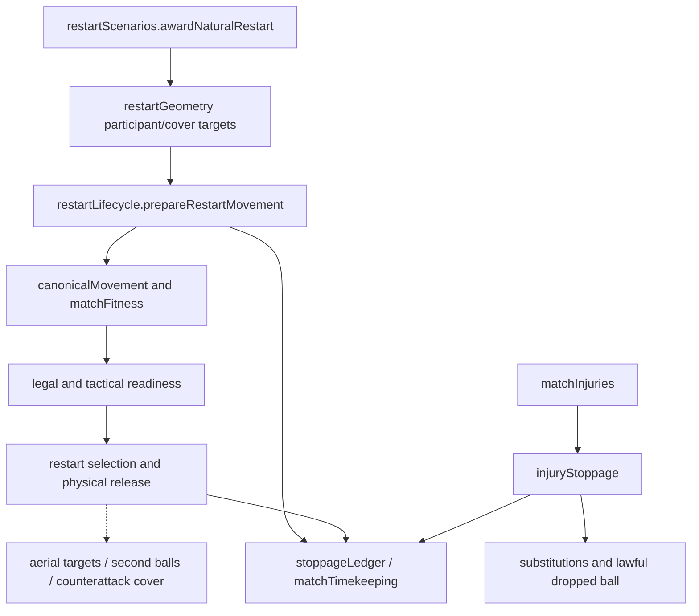

# Mechanism dependencies

PR213: existing bounded locomotion actuator → actual upright pair entry → isolated equal-and-opposite normal impulse → shared canonical transport remainder for both bodies → re-evaluated prepared feet/ball → existing laws and finite control. Persistent surface geometry is independent of defensive attempts/owner/ball episodes; completed prepared paths remain latched until real clearance. Third-body and movement-edge encounters stop with explicit unresolved remainder. Next single dependency: bounded simultaneous multi-body support on this same canonical interval, before broader techniques/falls/full-match promotion. PR201 unchanged. [PR213](../PR213_PERSISTENT_CONTACT_AND_BODY_IMPULSE.md).

PR212: existing challenge selection → persisted finite standing-foot attempt → actual canonical body segment + shared earliest-event comparator → common foot impulse → loose physical ball → independent acquisition/control. An earlier pass can be followed by a real challenge within the same tick. Numerical uncertainty and the unsupported body impulse remainder remain explicit; torso evidence does not establish lower-limb collision, balance loss or downed geometry. Next: refine persistent foot/body arbitration and physically continue opponent-body contacts before committed/sliding/fall extension. Maintained PR201 unchanged. [PR212](../PR212_SHARED_CONTACT_TIMELINE_AND_BALANCE.md).

PR211: lawful selected low pass → existing lifecycle's schema-backed pending plan/error → canonical locomotion and current-interval foot anchors → bounded intersection versus competing feet/body proposals/whole-ball boundary → existing finite contact/law consumers → real release or no-contact continuation. Local feet/boundary cases and replay work; active challenge timing and near-coincident passive-body refinement remain the next blocking dependency. Conservative challenge cancellation is not earliest-tackle proof. PR201 remains maintained; no promotion or confirmation. [PR211](../PR211_CANONICAL_PENDING_STRIKE_LIFECYCLE.md).

PR210: committed human carry → existing pursuit/body/ball execution → actual contact and finite motor readiness → ordinary on-ball opportunity. Immediate route/body threats can instead yield movement-only choices; incoming preparation uses its explicit forecast context and existing pending-reception lifecycle. Another touch, failed pursuit, boundary or explicit replacement closes the old intention without granting control. DEC-002/012 and DRIB-001/009/010 gain scoped local correctness evidence, not full empirical validation. Next: PR211 intentional strike preparation + real canonical segments + earliest competing contact/boundary/cancellation/miss. Maintained PR201 unchanged; confirmation sealed. [PR210](../PR210_HUMAN_AGENCY_PHYSICAL_BALL_READINESS.md).

PR209: authoritative ball/body snapshot + explicit planned meeting intention → anchored finite effective-foot path → timing-shifted onset → first physical swept intersection → existing finite impulse → shared ball integration. This contact foundation is laboratory-only. Its missing live dependency is a persisted intentional-strike lifecycle with canonical body/ball segments and shared earliest-event arbitration, including misses and competing contacts. Reception diagnosis keeps isolated fixed-body physics, autonomous decisions, first control, onward release and one-second ownership distinct. PR206 lawful preparation mediation remains unestablished; PR201 and event-v1 remain unchanged. [PR209](../PR209_MOVING_BALL_STRIKE_AND_BOUNCE_RECEPTION.md).

PR208: nominal plan → unchanged contact-v1 impulse/errors → explicitly selected event-v1 impact/remaining-time integration → actual receiver/opponent movement/contact → one-second continuation. The numerical shallow-flight discontinuity is repaired locally; retention and shot-dispersion dependencies remain. Historical physics, PR201 and PR205/206 dependencies remain unchanged. [Evidence](../PR208_GROUND_CONTACT_CONTINUITY.md).

## PR207 release execution boundary

Football intention → existing nominal pass/shot plan → contact-v1 preparation-limited normal/effective foot velocity → finite normal/Coulomb impulse and torque → shared 40 Hz flight → unchanged body/keeper/boundary/reception. The new release path replaces eligible destination and independent speed noise; it does not add noise to those same old errors. PASS-005/008 and SHOT-003 depend on PHYS-002's near-ground transition: a +0.001 m/s vertical release currently incurs a finite horizontal bounce loss compared with zero. MEAS-008/009 preserve cost and source identities. Calibration of contact distributions and historical selection priors remains open; live loft/cross integration is withheld. PR201, PR205 already-active body/keeper/high free-ball parity and PR206 lawful preparation handoff are unchanged. [PR207 evidence](../PR207_PHYSICAL_KICK_EXECUTION_AND_ERROR_PROPAGATION.md).

## PR200 live integration boundary

Current executable graph and source-backed inventory: [integration architecture](INTEGRATION_ARCHITECTURE.md), [candidate decisions](INTEGRATION_CANDIDATES.md), [PR200 report](../PR200_MATCH_ENGINE_INTEGRATION_CANDIDATE_RECEIVER_MOTOR_AND_BOUNDED_PERCEPTION.md) and [exact current consumers](../performance/pr200/inventory.json).

TACT-009 sensory acquisition → timestamped uncertain motion inference → PASS-004/009 observed receiver preparation and GK-002 final movement/action boundary → shared canonical movement/contact → PASS-006/007 original delivery control/retention. Physical truth remains with execution and privileged comparison. Active memory cannot relabel a prediction as a sighting. Keeper tactical/role/aerial targets, facing/effort and active save reach cannot bypass the experiment's gate. B/R3 full-world ranking and broader outfield tactics remain separate information scopes.

PASS-003/DEF-003/004 symmetric reception is a scoped integration test candidate; height-aware engineering ranking and bounded loft repertoire have different acting policy interfaces. S requires receiver anticipation and is rejected with the unvalidated live belief route. The whole combination executes but fails development promotion: bounded receiver performance falls and policy-specific match harms remain. Primary next dependency is acquisition/cadence versus preparation, not a universal speed or facing multiplier. MEAS-001/003/011/012 keep information, motor intent, actual contact and attribution separate. The sections below retain historical PR196–199 claims in their original scope.

## PR199 temporal information boundary

[PR199](../PR199_BALL_FLIGHT_PERCEPTION_RECEIVER_FORENSICS_AND_VALIDATION_PROGRESS.md) audits the currently present paths: canonical ball → bounded snapshot with exact velocity → motor observation → receiver estimate; canonical shot → engineering keeper projection → native movement/contact; and general cached ball → fresh adapter timestamp/hidden spin. Reception-specific timestamps and zero-spin handling are verified separately. Native broad tactical positioning/facing is not certified bounded.

The new laboratory-only path is actual offered 3D visibility + attention → noisy positions/finite optical interval → inferred velocity and preparation prior → aged uncertain trajectory belief → bounded existing body projection/committed objective → ordinary 40Hz movement → finite contact/control/continuation. No live application imports the new belief. Prediction, motor intention and physical outcome retain separate contracts.

TACT-009 covers temporal perception/occlusion/inferred velocity/memory without a duplicate issue. PASS-004/009 connect it to body preparation and competing clocks; PASS-006/MEAS-011/012 preserve actual original outcomes; GK-002 exposes hidden release/reaction and inherited tactical consumers; GK-001 coverage remains only partly investigated; MEAS-001/003 separate cognitive, physical and technical sensitivity. I/F/E/T/M/C requirements are unchanged.

Next dependency: isolate the first demonstrable motor/sensory defect across fresh development geometries, then bound every acting consumer before paired live-match trials. Neither early desperate contact nor later attractive facing is awarded artificial value. Historical failed controllers and goalkeeper apparatus remain evidence.

## PR198 scoped paths and unresolved value

[PR198](../PR198_RECEIVER_SYNCHRONISATION_AUTONOMOUS_OPPORTUNITIES_AND_EMERGENT_DISRUPTION.md) separates observed contact point/time from release-time engineering diagnostics and from the motor body's offset destination. PASS-004/009 → local observed flight/absolute meeting → own canonical turning/braking/plant projection → finite contact → PASS-006/007 → original-delivery-v3 MEAS-011/012. The separate synchronisation experiment has worse aggregate reception and remains opt-in; representation consistency does not close calibration.

Bounded observation TACT-009 → observed moving receiver TACT-002/004 → native-range PASS-010/DEC-003 repertoire → height-aware local window → existing value/admission → motor preparation → actual launch. The small loft extension repairs absent alternatives, not all opportunity recognition. B/R3 full-world menus and bounded O/H/J remain distinct, and the full deliberate causal chain is unproven.

Solid arrows are present consumers; dashed arrows remain modelling objectives. The ledger does not feed the acting policy. SHOT-006/007 and GK-003 cover original-shot keeper rebounds; DEC-008/DRIB-009 cover actual second balls; DEF-010/PASS-012/TACT-006 cover clearance territory and restart value; TACT-003 covers measured displacement/organisation. TACT-013 adds the previously implicit role/initiative comparison. Existing on-ball defender carries are physically available; off-ball role protection is not a universal carry prohibition. A separate emergency lofted-clearance repertoire and calibrated role/cover value remain future work.

## PR197 scoped paths

The [PR197 report](../PR197_PASSING_REALITY_FLIGHT_INTERCEPTION_AND_RECEIVER_ANTICIPATION.md) and [summary](../performance/pr197/summary.json) add three independent experiments. The privileged flight→height/access→B/R3 lane-evaluation path never enters O/H/J's bounded observation. The observed ball→local motor target→ordinary movement→finite reception path preserves information age. Symmetric incoming control validates physical access before ownership. A separate v3 measurement observer ends delivery lineage at genuine incoming header/first-time release; it grants no physical contact.

PASS-005/PHYS-002 → actual launch/flight → PASS-003/DEF-003/004 → actual intervention → PASS-004/009 receiver body preparation → PASS-006/007 control/retention → MEAS-011/012 attribution → PASS-001 calibration. PASS-010/TACT-009 constrain candidate/information admission separately. T/M consequences are hypotheses tested by seven full development pairs; mixed policy regressions prevent promotion. Experimental canonical arrival is independent. Free-kick run variants depend on REST-004/009/012 and TACT-002/004; they remain deferred.

Solid arrows below trace calls or data consumption in current source. Dashed arrows are plausible football consequences requiring experiments; they are not established effect sizes. This distinction matters because PR192's improved recovery increased active time, and PR193/194 aggregate attacking changes concealed policy regressions.

`passDecision.evaluatePassDecision` directly consumes `estimatePlayerArrivalTime`, launch plans, pass uncertainty and a projected reception. Its probability claims enter `decisionStateValue.evaluateStateValueAction` and legacy utility adjustments. The bounded path instead consumes a whitelisted scene and `estimateUsefulContact`'s common opponent envelope. They must be calibrated separately. Canonical locomotion additionally models turning, plant balance and braking; sharing an acceleration function does not prove ETA equivalence.

Bounded candidates have a 36 m shot range and height feasibility check; the canonical menu permits settled attempts to 60 m and incoming attempts to 29 m. Incoming bounded selection has a different control-first path. `decisionStateValue` currently uses the same `effectiveScoringExpectation` for driven/placed/chip while `shotResolver` executes distinct profiles: **DEC-013**. Correct probability normalisation does not establish calibrated shot consequences. A missing overhead-kick motor chain cannot be repaired by assigning it a goal probability.

Prepared versus quick release depends on actual travel and opportunity cost. Legal readiness is not ideal tactical organisation. The liveness observer reports stalled progress; it must not become a universal restart deadline. Future attacking goalkeeper decisions depend on **TACT-010** competition context, **GK-005/006** physical aerial participation, **FIT-008** travel cost, **GK-009** empty-goal consequences and **REST-007/008** cover/containment.

The contact→pain/fall→functional recovery chain is incomplete (**CONTACT-001–005**). Existing injuries and medical assessment are not that missing motor model. **CONTACT-006/012/015** require referee/medical priority and current-law review before broader fair-play behaviours. Courtesy kicks and optional returns belong to player decisions, with normal legal restarts and no automatic possession swaps.

## Shared upstream priorities

1. **MEAS-011/PASS-006/007/DEF-003/004:** define the observed event before fitting its probability.
2. **FIT-002/DEF-001/002/DRIB-005/006/PHYS-002:** defensible movement, reach and contact response affect all attacking forecasts.
3. **DEC-002/003/005/006/013:** distinguish missing options, uncalibrated predictions and incomparable consequence values.
4. **GK-001/002/010 and SHOT-001/004/006:** establish physical shot/keeper outcomes before tuning shot frequency.
5. **REST-001–014 and CONTACT-006/012/015:** natural interruption and rule correctness precede full-match time distributions.

Actual import consumers, symbols and line references for every source file are in the [source inventory](../performance/pr195/source-inventory.json). Import reachability proves code linkage, not that an optional feature was enabled or that a downstream football effect was causal. Registry dependencies intentionally include feedback cycles: research should isolate one edge at a time rather than treating this diagram as an acyclic implementation plan.
