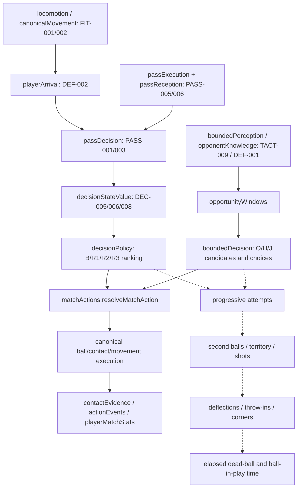
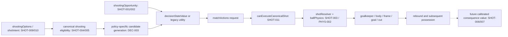
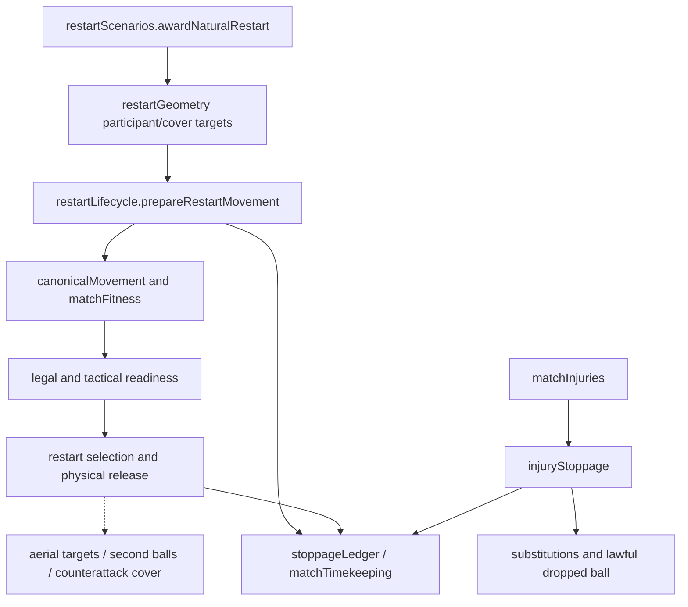

# Mechanism dependencies

## PR197 scoped paths

The [PR197 report](../PR197_PASSING_REALITY_FLIGHT_INTERCEPTION_AND_RECEIVER_ANTICIPATION.md) and [summary](../performance/pr197/summary.json) add three independent experiments. The privileged flight→height/access→B/R3 lane-evaluation path never enters O/H/J's bounded observation. The observed ball→local motor target→ordinary movement→finite reception path preserves information age. Symmetric incoming control validates physical access before ownership. A separate v3 measurement observer ends delivery lineage at genuine incoming header/first-time release; it grants no physical contact.

PASS-005/PHYS-002 → actual launch/flight → PASS-003/DEF-003/004 → actual intervention → PASS-004/009 receiver body preparation → PASS-006/007 control/retention → MEAS-011/012 attribution → PASS-001 calibration. PASS-010/TACT-009 constrain candidate/information admission separately. T/M consequences are hypotheses tested by seven full development pairs; mixed policy regressions prevent promotion. Experimental canonical arrival is independent. Free-kick run variants depend on REST-004/009/012 and TACT-002/004; they remain deferred.

Solid arrows below trace calls or data consumption in current source. Dashed arrows are plausible football consequences requiring experiments; they are not established effect sizes. This distinction matters because PR192's improved recovery increased active time, and PR193/194 aggregate attacking changes concealed policy regressions.

`passDecision.evaluatePassDecision` directly consumes `estimatePlayerArrivalTime`, launch plans, pass uncertainty and a projected reception. Its probability claims enter `decisionStateValue.evaluateStateValueAction` and legacy utility adjustments. The bounded path instead consumes a whitelisted scene and `estimateUsefulContact`'s common opponent envelope. They must be calibrated separately. Canonical locomotion additionally models turning, plant balance and braking; sharing an acceleration function does not prove ETA equivalence.

Bounded candidates have a 36 m shot range and height feasibility check; the canonical menu permits settled attempts to 60 m and incoming attempts to 29 m. Incoming bounded selection has a different control-first path. `decisionStateValue` currently uses the same `effectiveScoringExpectation` for driven/placed/chip while `shotResolver` executes distinct profiles: **DEC-013**. Correct probability normalisation does not establish calibrated shot consequences. A missing overhead-kick motor chain cannot be repaired by assigning it a goal probability.

Prepared versus quick release depends on actual travel and opportunity cost. Legal readiness is not ideal tactical organisation. The liveness observer reports stalled progress; it must not become a universal restart deadline. Future attacking goalkeeper decisions depend on **TACT-010** competition context, **GK-005/006** physical aerial participation, **FIT-008** travel cost, **GK-009** empty-goal consequences and **REST-007/008** cover/containment.

The contact→pain/fall→functional recovery chain is incomplete (**CONTACT-001–005**). Existing injuries and medical assessment are not that missing motor model. **CONTACT-006/012/015** require referee/medical priority and current-law review before broader fair-play behaviours. Courtesy kicks and optional returns belong to player decisions, with normal legal restarts and no automatic possession swaps.

## Shared upstream priorities

1. **MEAS-011/PASS-006/007/DEF-003/004:** define the observed event before fitting its probability.
2. **FIT-002/DEF-001/002/DRIB-005/006/PHYS-002:** defensible movement, reach and contact response affect all attacking forecasts.
3. **DEC-002/003/005/006/013:** distinguish missing options, uncalibrated predictions and incomparable consequence values.
4. **GK-001/002/010 and SHOT-001/004/006:** establish physical shot/keeper outcomes before tuning shot frequency.
5. **REST-001–014 and CONTACT-006/012/015:** natural interruption and rule correctness precede full-match time distributions.

Actual import consumers, symbols and line references for every source file are in the [source inventory](../performance/pr195/source-inventory.json). Import reachability proves code linkage, not that an optional feature was enabled or that a downstream football effect was causal. Registry dependencies intentionally include feedback cycles: research should isolate one edge at a time rather than treating this diagram as an acyclic implementation plan.
